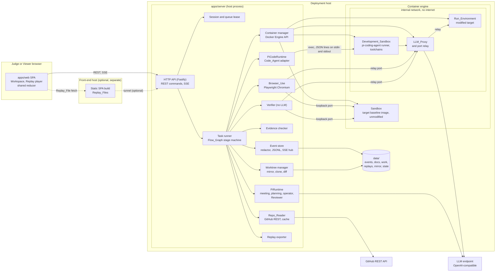
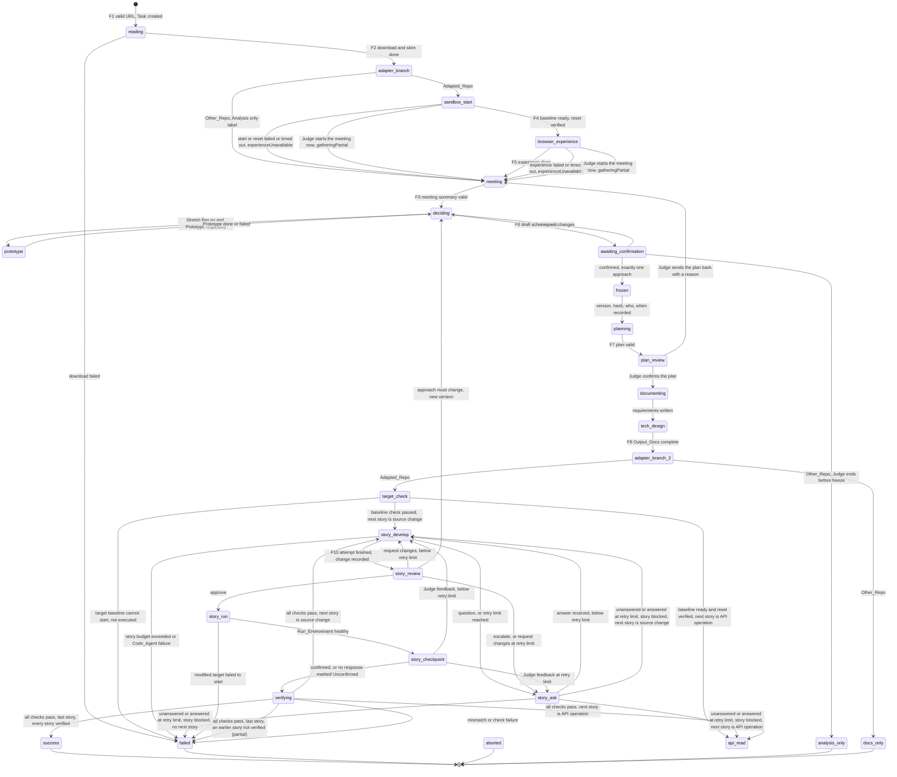
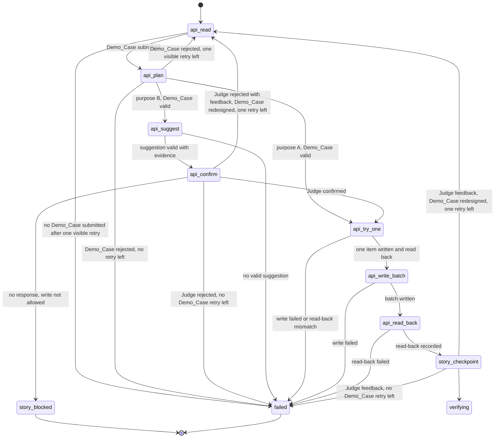

# Design Document: GraftLab AI

> Product name: GraftLab AI. In this document the product is called "the Studio", as in `requirements.md`.
> Every component and decision cites the requirement ids it serves (for example R36.3 is Requirement 36, criterion 3).
> "TO VERIFY" marks a fact that is not verified yet. All TO VERIFY items are collected in the final section together with the first task that verifies each one.
> Initial values are adjustable by environment variable; they are starting points to be measured, not promises.
> Target: buildable in 14 days by one developer. Where a simpler option works, the simpler option is chosen, and what is left out is listed in "Deliberately left out".
> This design is generic: it names the target software, the target baseline environment and the Adapter, never one concrete target. Two references hold the concrete details: [reference-target-linkding.md](reference-target-linkding.md) (how the first target is installed, run, provisioned, tested and verified) and [reference-deployment.md](reference-deployment.md) (where the Studio runs and the environment facts found by the spikes). Both are references, not decision records; this document is authoritative.

## Overview

The Studio analyzes any public GitHub repository and executes only target software that has an Adapter. An Adapter tells the Studio what it needs about one target: its identity, its source reference, its unmodified baseline environment, its test data, its API allow-list and its read-back comparator (see "Adapter contract"). The first version has one Adapter, linkding (reference-target-linkding.md).

The Studio is one TypeScript monorepo with three parts that matter at run time:

1. A Node backend (`apps/server`) that owns everything with authority: the Flow_Graph stage machine, the Event_Stream, the queue lease, the LLM key, the container engine access, the Verifier and the secret redactor.
2. A React single-page app (`apps/web`) whose Workspace is a pure function of the ordered events, computed by a reducer shared with the server tests (`packages/shared`). Live view and Replay use the same reducer (R26.7, R27.14). The front end can be served by the backend or separately as static files (see "Deployment model").
3. Per-Task containers started by the backend through a container engine API: the Sandbox (the target baseline image, unmodified), the Development_Sandbox (Code_Agent plus toolchains, one per Task), the Run_Environment (the modified target, one per story attempt) and the LLM_Proxy (R13, R38, R39, R30.16).

Evidence is gathered before the meeting: the Studio reads the repository and, for an Adapted_Repo, starts the Sandbox and lets the Browser_Use operator experience the target, with live narration and screenshots. The meeting then discusses everything gathered, so it is not interrupted by long waits. A failed Sandbox start or experience is recorded as "experience unavailable" and the meeting proceeds on the reading evidence (R11, R13, R14).

A Task moves through an explicit Flow_Graph stored as data (R36). Agent loops run inside nodes: the Reader, the Explorer (the Browser_Use operator), the Facilitator, the Meeting_Perspectives, the Planner and the Reviewer are pi-agent-core agents inside the backend process; the Code_Agent is `@earendil-works/pi-coding-agent` embedded by a small runner script (our code) that runs inside the Development_Sandbox. All agent roles therefore use one agent family (the pi packages). Leaving a node is decided only by guards over validated, schema-checked outputs, never by free model text (R36.2, R35.6).

Every Studio event passes the secret redactor, is appended to `events.jsonl`, and is then broadcast over Server-Sent Events (SSE). Streamed text is shown live from ephemeral SSE frames and is never persisted; the complete message, including the model-provided reasoning text, is persisted when the stream ends (R3.8, R3.11, R27.7).

Success is decided only by the Verifier, plain TypeScript with no LLM, that runs executable Acceptance_Checks: API read-back, the target's own test suite, and scripted browser checks (R22).

### User story: one linkding Task end to end

**As a** Kiroween judge who has never seen the Studio, **I want to** paste the linkding repository, watch an AI team read and try it, decide with them what AI feature to add, and see that feature built and independently checked, **so that** I can judge in one sitting whether AI agents can safely improve existing software, and see where they failed.

The walk below is the reference journey for the UI, the Flow_Graph and the demo (`/demo` plays it on mock data). The feature in it, tag suggestions on the add form, is only an example: the real feature is decided in the meeting with the Judge (R15.9) and is never pre-decided. Each step names what the Judge sees, what the Judge may do, and which part of the Studio acts.

| Step (flow) | The Judge sees | The Judge may | Who acts | Requirements |
|---|---|---|---|---|
| 1 Start (F1) | One input. Pasting `github.com/sissbruecker/linkding` shows "linkding is fully supported: read, try, build and check". | Start the Task; a wrong or private URL is refused with the reason | Studio code: URL check, GitHub existence check, Adapter match, `task_created` | R9 |
| 2 Read the code (F2) | The Reader's card appears; "Read 6 files" grows; findings appear with the file they come from and a check mark when code found the quoted text | Watch; send a message, which is queued for the meeting | Repo_Reader (code) downloads read-only; the Reader agent skims and records findings | R10, R24, R34, R12.5 |
| 3 Try the app (F4-F5) | "Starting a private copy of the app with test data"; then the Explorer's card appears and its steps in the app show live, including a failed click shown in red | Start the meeting early ("Start the meeting now") | Studio code starts the pinned linkding image, provisions and resets test data; the Explorer operates the browser | R13, R14, R29 |
| 4 Meeting (F3) | The Facilitator opens with the evidence summary and delivers the queued message; User_Value, Feasibility and Risk join and disagree (confirm each tag vs. apply automatically); a question card asks the Judge to choose | Answer the question; interject to any agent at any time | Facilitator and the three Meeting_Perspectives (pi agents), streaming with collapsible reasoning | R11, R12, R5.3 |
| 5 Decide (F6) | A decision draft as items: what is made AI-powered, scope, the approach (exactly one of the assessed options; an option without an executable check cannot be chosen), what the user will see, how success is checked, risks, open questions; an Unverified claim is marked | Accept items; reject an item with a reason and send the draft back; freeze when all items are accepted | Facilitator drafts; Studio code checks the schema, the complete-option rule and the freeze conditions, then freezes with version, hash, Judge and time | R5.7, R15, R16, R37 |
| 6 Plan (F7-F8) | The Planner splits the work into stories (S1 add form, S2 edit form), each with a Feature_Contract; documents appear in Details | Watch; ask for changes through a message | Planner (pi agent); Studio code validates the backlog and the documents | R19, R20, R40 |
| 7 Build and check (F10) | The Code_Agent's card appears and works in a private copy; it stops to ask a feature question in plain words; the Reviewer asks for a change that went outside the contract, then approves (labeled as an LLM judgment); a checkpoint card shows the changed app | Answer the question; confirm the checkpoint or say "not right" with feedback | Code_Agent in the per-Task container; Reviewer (pi agent); Studio code starts the Run_Environment | R21, R38, R39, R40 |
| 8 Result | The Verifier's card appears and lists each check: the form shows the button, clicking it shows only the user's own tags, linkding's tests pass; a green result banner | Watch the Replay later | Verifier (code, no LLM) runs the Acceptance_Checks and decides success | R22, R26 |

What can go wrong in the same story, and what the Judge sees instead:

- The Sandbox does not start: step 3 shows the failure and the meeting starts labeled "experience unavailable" (R13.4).
- An agent's output does not match its schema: the failure is shown with its class and one visible retry follows (R23).
- An unexpected failure (download, start of the changed app, a Code_Agent error): the Task stops for the Judge, who can retry the step, skip the story or end the Task (R36.6).
- A Verifier check fails: the Task ends in `failed` with the per-item results; an approving review does not change this (R22.3).
- The Judge does not answer a checkpoint in time: the story is marked Unconfirmed and the Judge is reminded at the next input (R21.4, R21.8).

### Design decisions at a glance

| Decision | Choice | Requirements |
|---|---|---|
| Language and layout | One npm-workspaces monorepo, TypeScript in all our code, Node >=22.19 | R32, R35.1 |
| Backend | Fastify, REST for commands, SSE for live events, zod for every schema | R2, R27, R35.6 |
| Front end | React + Vite SPA, UI state = reducer over ordered events | R1-R8, R26.7, R27.14 |
| Reader, Explorer (Browser_Use operator), Facilitator, Meeting_Perspectives, Planner, Reviewer | `@earendil-works/pi-agent-core` with `@earendil-works/pi-ai` DeepSeek provider, in the backend process | R11, R14, R19, R40, R30 |
| Code_Agent | `@earendil-works/pi-coding-agent` 1.5.2 (MIT), embedded by our runner script (`docker/dev-sandbox/runner/`, about 100 lines) inside the Development_Sandbox: allow-listed tools, in-memory session manager, thinking level low, custom `ask_question` tool, JSON-line commands on stdin and normalized JSON-line events on stdout, one long-lived runner process per story attempt | R38, R40 |
| Runtime swap | Thin `AgentRuntime` interface; fallbacks for the Code_Agent only: DeepSeek Harness runtime, OpenCode, OpenHands SDK (not built in the first version) | Open item 44 |
| Browser automation | Playwright (Apache-2.0) with headless Chromium in the backend process | R14, R22.2 |
| Persistence | Files under one `data/` directory: JSONL event logs, JSON state file, Output_Docs, caches | R27.1, R32.3 |
| Target software | One Adapter per target in `adapters/<adapterId>/`, implementing the Adapter contract; the first version has one Adapter (see Overview) | R13.3, R25, R39.10, Open item 41 |
| Order of the analysis stage | Evidence gathering first (reading; for an Adapted_Repo also Sandbox start and Browser_Use experience), then the meeting; gathering failures continue to the meeting | R10, R11, R13, R14 |
| Containers | Container engine API (Docker Engine API) from the backend; no container gets the engine socket; no Docker-in-Docker | R38.2, R39 |
| Property tests | fast-check (MIT) with vitest | Testing Strategy |
| Runtime_Rules (layer B) | `runtime-rules/` with a `VERSION` file | R35, Open item 13 |
| Output_Docs (layer C) | `data/tasks/<taskId>/docs/` | R20, Open item 13 |
| Reasoning text | Persisted with `message_completed` | R3.12, Open item 42 |
| API-operation stories | Reviewer designs a Demo_Case with read-only tools; Studio code executes its writes against the Sandbox; the Verifier checks the Demo_Case expected outcome | R18.7-R18.13, R40.18, Open item 50 |

### Initial values (adjustable by environment variable)

| Value | Initial | Environment variable | Requirements and open items |
|---|---|---|---|
| Recency_Window | 15 s | `GL_RECENCY_WINDOW_S` | R2.5, Open item 14 |
| Message progress event interval while streaming | 5 s | `GL_PROGRESS_INTERVAL_S` | R2.4, R2.8 (see Gaps found) |
| Acknowledgement shown after a Judge input | within 1 s | `GL_ACK_BOUND_MS` | R6.2, Open item 15 |
| Confirmation wait at a confirmation point | 120 s (demo setting 30 s) | `GL_CONFIRM_WAIT_S` | R21.7, Open item 10 |
| Unanswered Code_Agent question wait | 300 s, then the story is marked Unconfirmed-blocked and the flow continues to the next story or a terminal | `GL_QUESTION_WAIT_S` | R40.11, R40.17, Open item 39 |
| Code_Agent time budget per story | 10 minutes of Code_Agent run time, summed over attempts | `GL_STORY_BUDGET_MIN` | R38.3, R40.1, Open items 25, 33 |
| Retry limit per story | 3 attempts | `GL_STORY_ATTEMPTS` | R40.11, R40.12, Open item 35 |
| Item_Count_Cap per Demo_Case | 10 items | `GL_DEMO_CASE_MAX_ITEMS` | R18.11, Open item 50 |
| Task timeout | 90 minutes | `GL_TASK_TIMEOUT_MIN` | R36.6, Open item 28 |
| Read-volume limit | 500 files or 4 MB of text, whichever comes first (raised from 300 files and 2 MB on 2026-11-23: linkding has 421 readable files, 2.1 MB) | `GL_READ_MAX_FILES`, `GL_READ_MAX_BYTES` | R34.3, Open item 16 |
| Repo_Memo batching and concurrency | 48 KB of source per file-memo call, 4 calls at a time in the foreground, 2 in the background index | `GL_MEMO_BATCH_KB`, `GL_MEMO_CONCURRENCY`, `GL_INDEX_CONCURRENCY` | R10.7, R10.12 |
| Reading plan caps | 30 files, 160 KB of source | `GL_BRIEF_FILES`, `GL_BRIEF_KB` | R10.10 |
| `read_file` result size | 400 lines or 16 KB per call | `GL_READ_FILE_MAX_LINES`, `GL_READ_FILE_MAX_KB` | R10.7 |
| Tool-result token budget per agent turn | 60 % of the model context window | `GL_TURN_TOOL_BUDGET_PCT` | R10.7, R30.12 |
| max_tokens for role turns | 32768, finish reason checked (raised from 16384 on 2026-11-23: reasoning and the answer share it, and one assessment used 11,528) | `GL_MAX_TOKENS` | R30.12, R30.13 |
| Queue heartbeat and idle release | 30 s heartbeat, 120 s idle release | `GL_LEASE_HEARTBEAT_S`, `GL_LEASE_IDLE_S` | R28 |
| Container memory limits | Explicit limit per container; values per deployment, see reference-deployment.md | `GL_MEM_*_MB` | R38.3, Open item 25 |
| Run_Environment start and health wait | 240 s | `GL_RUN_START_TIMEOUT_S` | R39.11 |
| Per-node timeouts | see the node table in Flow_Graph | `GL_NODE_TIMEOUT_<NODE>_S` | R36.6, Open item 28 |

## Architecture

### Deployment model

- The backend runs as a host process with access to a container engine API. It is the only component that can start containers; no container gets the engine socket, so no internet-facing component can start containers (R38.2, R39.1). No Docker-in-Docker anywhere.
- The web app is a static build. The backend can serve it, or a separate front-end host can serve it on the same public origin while the backend is reached through a tunnel; the Judge-facing link then does not change when the backend moves (R32.5-R32.7).
- Replay_Files are static files that the front-end host can serve while the backend is offline (R27.13).
- Live execution needs a backend with container engine access. A backend without it runs with `GL_EXECUTION_ENABLED=false`: analysis and documents still work, and an Adapted_Repo Task ends in `failed` "not executed" at the pre-execution target check (R25.8).
- Where the Studio runs first, where it runs later, the container memory values and the measured host facts (networks, mounts, package sources, image transfer) are in reference-deployment.md.

### Component diagram



### Four environments (R39.1)

| Environment | What it is here | Requirements |
|---|---|---|
| Dev_Environment | The developer's machines, Kiro, this repository | R39.1 |
| Studio_Runtime | `apps/server` host Node process plus the `apps/web` build | R39.1, R32 |
| Development_Sandbox | One container per Task from the `dev-sandbox` image, Worktree mounted read-write at `/work` | R38.2, R39.2 |
| Run_Environment | One container per story attempt from the `dev-sandbox` image, running the modified target from a read-only snapshot of the Worktree | R39.3, R39.5 |

The Sandbox (the target baseline image, unmodified) is the baseline environment for F4 and F5 and is separate from all four (R13.6).

### Containers

| Container | Image | Lifetime | Network | Mounts | Memory |
|---|---|---|---|---|---|
| Sandbox | The Adapter's target baseline image, unmodified, pinned by digest | Created at `sandbox_start` during evidence gathering (or at `target_check` if it is not running), recreated on reset and restore, stopped while source-change stories develop, removed at Task end | Own bridge network; the Adapter's port published on the loopback interface only | Fresh named volume at the Adapter's data volume path per start | Explicit limit, value per deployment |
| Development_Sandbox | `graftlab/dev-sandbox-<adapterId>` (built locally, see "Images") | Created when the flow first needs it (first development story or Prototype), stopped while the Run_Environment and the Verifier run, removed at Task end | Internal network only | `data/tasks/<id>/work` read-write at `/work`; `data/tasks/<id>/context/<storyId>` read-only at `/context`; read-only root filesystem with tmpfs for `/tmp` and the session and home directory | Explicit limit, value per deployment |
| Run_Environment | `graftlab/dev-sandbox-<adapterId>` | One per story attempt; discarded and recreated for every attempt (R39.5) | Internal network only; app port reached through the relay | Read-only snapshot of the Worktree at `/src`; the start commands copy it to an in-container directory before building | Explicit limit, value per deployment |
| Verifier test container | `graftlab/dev-sandbox-<adapterId>` | Fresh per `test_suite` check, removed after | Internal network only | Read-only snapshot at `/src` | Explicit limit, value per deployment |
| LLM_Proxy | `graftlab/dev-sandbox-<adapterId>` running the bundled proxy script; also hosts the port relay | Per Task, started with the Development_Sandbox | Internal network and the default bridge (to reach the LLM); publishes the relay port on the loopback interface | none | Explicit limit, value per deployment |

Every container gets an explicit memory limit (`GL_MEM_*_MB`); the values and the measured fit are per deployment (reference-deployment.md, "Docker Desktop and memory"). Only one Task runs at a time (R28.1), and containers that are not needed are stopped, so peak usage is the Run_Environment or the test container plus the LLM_Proxy and, for API-operation stories, the Sandbox.

### Network policy (R38.4, Open item 26)

- The Development_Sandbox, the Run_Environment and the Verifier test container have no internet access. They sit on a network created as internal-only, and the only reachable peer on it is the LLM_Proxy.
- The backend reaches app ports on the internal network through a relay on the network boundary: a container attached to both the internal and the default network that publishes one fixed port on the loopback interface and forwards it to the app port. The LLM_Proxy container hosts the relay by default; a dedicated relay container is the alternative. The relay is the default because some container engines cannot publish a port from an internal-only network (measured on the first deployment, reference-deployment.md, "Docker Desktop facts").
- The Sandbox runs the unmodified baseline on its own bridge network with its port published on the loopback interface; the Adapter's baseline settings disable outbound features where the target offers that (for the first target: reference-target-linkding.md, "Baseline run").
- The target's dependencies are preinstalled in the Development_Sandbox image at build time. Consequence: a story that needs a new third-party dependency cannot install it; the Code_Agent must stop and ask (R40.11), and the Judge sees that limit honestly.

### Images (Open item 48)

- Every image is pinned by digest and checked against that digest before use.
- The Development_Sandbox image `graftlab/dev-sandbox-<adapterId>` is built from the Adapter's base image plus a generic layer from `docker/dev-sandbox/Dockerfile`: git, Node (a Node 24 LTS tarball, checksum verified at build time), the pi packages (`@earendil-works/pi-coding-agent`, `@earendil-works/pi-agent-core`, `@earendil-works/pi-ai`, pinned versions, about 153 MB with their siblings) and the Code_Agent runner (`docker/dev-sandbox/runner/`). The Adapter's base image brings the target's toolchain and preinstalled dependencies, never a start recipe for the modified target (R39.10). The image does not contain the DeepSeek Harness executable.
- Build context (task 10.1, decided 2026-11-23): `scripts/dev-sandbox-context.mjs` assembles `adapter/setup.sh` (the Adapter's `dependencySetup`), `target-src/` (`git archive` of the pinned commit from the Adapter's mirror, so the image and the Worktree come from the same commit), and `runner/` (a package.json and lock file with only the pi packages, plus the bundled `runner.mjs` and `llm-proxy.mjs`). The base image is the local image whose ID equals the Adapter's `configDigest`; the build refuses any other.
- The Worktree at `/work` is a fresh clone without dependencies or build output. When the Development_Sandbox starts, the backend copies the Adapter's `prebuilt` paths from `/opt/target-src` into `/work` inside the container. Every `prebuilt` path must be ignored by the target's own `.gitignore` (checked by code with `git check-ignore` when the Worktree is created), so the copies never appear in a diff, a snapshot or a Patch_Artifact. Rejected alternatives: a symlink into the image (a symlink is not a directory for git, so it shows as an untracked file, and symlinks on host bind mounts are unreliable on some hosts); `NODE_PATH` (not honored by bundlers).
- Package sources (apt, Python index, npm registry, Node download) are build arguments. Integrity comes from signatures and lock-file hashes (apt signatures, lock-file hashes with hash checking, `package-lock.json` integrity, the Node checksum, image digests), not from the transport, so a mirror cannot change what is installed.
- How images and packages reach the deployment host is in reference-deployment.md ("Network facts", "Integrity rules", "Image transfer"); the first target's base image and its added layer are in reference-target-linkding.md ("Version pin", "Development_Sandbox for linkding").

### Repository layout

```text
apps/server/            Node + TypeScript backend (Fastify, SSE, task runner, Verifier)
apps/server/src/proxy/  LLM_Proxy entry point (bundled to one file, run in its own container)
apps/web/               React + Vite SPA (Workspace, Replay player)
packages/shared/        Event types, zod schemas, UI reducer, Flow_Graph data, guards
runtime-rules/          Layer B: VERSION, roles/, rules/, schemas/ (JSON exported from zod), adapters/<adapterId>-checklist.md, cases/rules.md
adapters/<adapterId>/   One Adapter per target: adapter.json, hooks (provisioning, seed, reset, equality, comparator), test-data.json, the Adapter's own tests
docker/dev-sandbox/     Generic layer on the Adapter's base image, for Development_Sandbox, Run_Environment, Verifier test container and LLM_Proxy
docker/dev-sandbox/runner/  Code_Agent runner script (pi-coding-agent embedded; protocol and event normalization)
docker/llm-proxy/       Entry script and README for the LLM_Proxy container (runs on the dev-sandbox image)
data/                   gitignored state (see Data Models)
.kiro/specs/graftlab-ai requirements.md, design.md, tasks.md (layer A)
.kiro/steering/         product.md, tech.md, structure.md (layer A, created in the first tasks)
.kiro/hooks/            for example run tests and the secret scan on save (layer A, created in the first tasks)
```

Layer locations decide Open item 13 and R35.1: layer A in `.kiro/` and `AGENTS.md`, layer B in `runtime-rules/`, layer C in `data/tasks/<taskId>/docs/`. The repository holds each target only as references (image digest, upstream URL, release tag and commit), never modified target code (R25.6, R38.6).
Third-party components named in the README (R33.6): the pi packages `@earendil-works/pi-agent-core`, `@earendil-works/pi-ai` and `@earendil-works/pi-coding-agent` (MIT), Playwright (Apache-2.0), and each Adapter's target as an unmodified external dependency with its license (first version: see reference-target-linkding.md). The DeepSeek Harness runtime is not part of the first version; if it is activated as the fallback, its license note is TO VERIFY and it is added to the README then.

### Flow_Graph

The Flow_Graph is data in `packages/shared/src/flow/graph.ts` (R36.1). Each node has a `kind` (`auto`, `agent_loop`, `wait_user`, `terminal`), an allowed tool list, and a timeout. Each edge has an id, a source, a target and a guard: a pure function `(task: TaskState) => boolean`. The function `transition(task, edgeId)` is the only way to change `task.node` (R36.3). It checks that the edge exists from the current node and that its guard holds; otherwise it appends `transition_rejected` with the reason (R36.4). Every accepted transition appends `node_entered` (R36.9). The Workspace shows the current node from the reducer (R36.8).

Global edges apply to every non-terminal node: `timeout` and `unrecoverable_error` lead to `failed`; `judge_abort` leads to `aborted` (R36.6, chart "Any node"). Exception: for the gathering nodes `sandbox_start` and `browser_experience` the node timeout is handled by the node's own edge to `meeting` (see the rules below); the Task timeout and the other global edges still apply.

Evidence gathering comes first: `reading`, then `adapter_branch`; for an Adapted_Repo `sandbox_start` and `browser_experience`; then `meeting`. During gathering the Workspace narrates the reading and the experience with live screenshots, and no question card is opened. The main graph, consistent with the requirements flow chart (F-step ids in the labels):



API-operation sub-path, used for stories whose confirmed approach executes the workflow by operating the target through its API (R18.2-R18.4, R18.7-R18.13, R15.7, R22.1, R40.18; decided by the user, Open item 50). It is part of the same Flow_Graph data. The read and plan stages of R18.2 are the Reviewer designing the Demo_Case: in `api_read` the Reviewer reads the relevant target code and the Sandbox test data with read-only tools and submits a Demo_Case with `submit_demo_case`; in `api_plan` Studio code validates it (schema, Item_Count_Cap, Adapter endpoint allow-list, Sandbox target) and derives the Verifier's `api_readback` Acceptance_Check from its expected outcome. Writes in `api_try_one` and `api_write_batch` are executed by Studio code from the validated Demo_Case; no LLM-facing write tool exists, so write capability exists only in the two write stages. Purpose B still needs a schema-valid suggestion with evidence (`api_suggest`) and Judge confirmation (`api_confirm`) before any write. No agent designs a second case; the non-LLM Verifier runs the derived checks:



`story_blocked` in this sub-diagram is not a node; it stands for the same outcome as the unanswered-question edges of `story_ask` (the story is marked Unconfirmed-blocked and the flow continues to the next story, or to `failed` if none is left).

Node table:

| Node | Kind | Allowed tools (enforced by `beforeToolCall` or by not exposing a tool) | Timeout | Requirements |
|---|---|---|---|---|
| reading | agent_loop (evidence gathering) | Studio download and Repo_Map (code); Reader submits a reading plan, file memos and the Repo_Brief, then the Repo_Index continues in the background; tools `read_file` (line ranges), `search_repo`, `read_memo`, `search_memo`, `submit_reading_plan`, `submit_file_memos`, `submit_repo_brief`, `record_finding`; no `ask_judge`; leaving needs a valid Repo_Brief | 15 min (raised from 10 for the Repo_Memo) | R10, R34 |
| adapter_branch | auto | none | 5 s | R25 |
| sandbox_start | auto (gathering) | none (Studio code: baseline start, provisioning, reset, equality check) | 3 min; timeout or failure takes the edge to `meeting` with `experienceUnavailable` | R13, R29 |
| browser_experience | agent_loop (gathering) | `browser_open`, `browser_click`, `browser_fill`, `browser_press`, `browser_snapshot`, `browser_screenshot`, `record_note`; no `ask_judge` | 10 min, 40 actions; timeout or failure takes the edge to `meeting` with `experienceUnavailable` | R14 |
| meeting | agent_loop | `read_file`, `search_repo`, `record_finding`, `submit_statement`; Facilitator also `ask_judge`, `submit_meeting_summary` | 25 min | R11, R12, R24 |
| prototype | agent_loop (Stretch) | Code_Agent in a separate prototype clone | 15 min | R41 |
| deciding | agent_loop | `read_file`, `search_repo`, `ask_judge`, `submit_decision_draft` | 20 min | R15, R37 |
| awaiting_confirmation | wait_user | none (Judge card only) | Task timeout only; no automatic confirmation | R15.3, R15.4 |
| frozen | auto | none | 5 s | R15.3, R16 |
| planning | agent_loop | Planner `read_file`, `search_repo`, `submit_plan`; Feasibility and Risk `submit_plan_assessment`; Facilitator `submit_final_plan` | 15 min | R19, R20, R40.1 |
| plan_review | wait_user | none (Judge card: confirm, or send back with a reason) | Task timeout only; no automatic confirmation | R19.11, R19.12 |
| documenting | agent_loop | Planner `submit_requirements` | 10 min | R19.2, R20 |
| tech_design | agent_loop | Planner `read_file`, `search_repo`, `submit_tech_design`; Feasibility `submit_tech_review`; Reviewer `read_file`, `search_repo`, `submit_final_tech_design`; the Task_Board is built by code | 20 min | R19.13-R19.15 |
| adapter_branch_2 | auto | none | 5 s | R25 |
| target_check | auto | none (Studio code: engine ping, baseline image present by digest; if an API-operation story remains, the Sandbox is started or reused, provisioned, reset and verified) | 3 min | R13.4, R25.8, R29.5 |
| story_develop | agent_loop | Code_Agent's own tools inside the Development_Sandbox only | story budget | R38, R40 |
| story_review | agent_loop | Reviewer: `read_changed_file`, `read_diff`, `submit_review_verdict` | 5 min | R40.6-R40.10 |
| story_ask | wait_user | Reviewer `answer_question` for technical questions; Judge question card for feature questions | 300 s for the Judge | R40.11-R40.14 |
| story_run | auto | none (Studio starts the Run_Environment) | 240 s | R39.9-R39.11 |
| story_checkpoint | wait_user | none | 120 s (demo 30 s) | R21 |
| verifying | auto | none (Verifier) | 10 min | R22 |
| api_read | agent_loop | Reviewer designs the Demo_Case: `target_api_read` (read-only calls within the Adapter allow-list), `read_file`, `search_repo` (read-only), `submit_demo_case` | 8 min | R18.2, R18.7, R40.18 |
| api_plan | auto | none (Studio validates the Demo_Case and derives its `api_readback` check) | 5 s | R18.2, R18.8, R18.10-R18.12 |
| api_suggest | agent_loop | Reviewer: `target_api_read`, `read_file`, `submit_suggestion` (values only for Demo_Case items marked as suggested) | 5 min | R18.3 |
| api_confirm | wait_user | none (Judge card shows the Demo_Case and the suggestion in feature words) | 120 s | R18.4, R15.7 |
| api_try_one | auto | none (Studio code writes Demo_Case item 1 and reads it back) | 2 min | R18.2, R18.9, R18.10 |
| api_write_batch | auto | none (Studio code writes the remaining Demo_Case items) | 5 min | R18.2, R18.9, R18.10 |
| api_read_back | auto | none (Studio code reads back all Demo_Case items) | 3 min | R18.2 |
| failure_review | wait_user | none (Judge failure card: retry, skip story, end Task) | Task timeout only | R36.6 |
| success, failed, aborted, analysis_only, docs_only | terminal | none | none | R36.5 |

Rules that keep the graph honest:

- Agent loops run inside a node. A node's loop ends by producing a validated output (for example a `submit_decision_draft` call whose arguments pass zod), and the task runner then picks the edge whose guard holds. Free model text never selects an edge (R36.2).
- Back edges: request changes (`awaiting_confirmation` to `deciding`, `story_review` to `story_develop`, `story_checkpoint` to `story_develop`), a new Decision_Doc version (`story_review` to `deciding`, R37.9, R40.15), stop-and-ask (`story_develop` to `story_ask`), and the retry limit (counted in `TaskState.stories[i].attempts`, R40.12).
- Terms: evidence gathering is `reading`, `sandbox_start` and `browser_experience`; the gathering nodes are `sandbox_start` and `browser_experience`.
- Gathering nodes never end the Task by themselves: a failure or timeout in `sandbox_start` or `browser_experience` is recorded as `failure` and takes the node's own edge to `meeting` with `task.gathering.experienceUnavailable` set to the reason. A Judge "start the meeting now" command (`POST /api/tasks/:id/gathering/end`) is accepted only in a gathering node; it aborts the running gathering work and takes the edge to `meeting` with `task.gathering.partial = true`. `reading` itself keeps its failure edge (without the downloaded files there is nothing to discuss).
- No question card is opened during evidence gathering: `ask_judge` is not exposed in `reading`, `sandbox_start` or `browser_experience`. Judge messages received during evidence gathering are accepted, acknowledged, recorded and queued in `task.gathering.queuedJudgeMessages` and delivered at the start of `meeting` (see "Meeting").
- The pre-execution check `target_check` runs once, after `adapter_branch_2` and before the first execution story of an Adapted_Repo. It is the only place where an unavailable target baseline ends the Task: its failure edge leads to `failure_review`, and ending there gives `failed` with the label "not executed" (R13.4, R25.8, R29.5, R36.6).
- A build-time test computes reachability over the graph data and fails the build if any node cannot reach a terminal through non-global edges (R36.7). The gathering nodes reach a terminal through `meeting`, so the test also covers the path where every gathering step failed.
- Guards on `frozen` and later nodes require `task.frozenVersion != null` (R15.4, R15.5); `adapter_branch_2` to `target_check` also requires all Output_Docs present and valid (R19.4); `target_check` to a story node requires the check to have passed.

Implementation notes (task 2.8, 2026-11-22; `packages/shared/src/flow/`):

- Node outcome: the runner records the validated result of the current node's work in `task.outcome` (for example `done`, `failed`, `node_timeout`, `judge_end`, `confirmed`, `send_back`, `approve`, `request_changes`, `answered`, `unanswered`, `passed`) and then asks for an edge. Guards read the outcome and the other TaskState fields; `transition()` clears the outcome on every accepted transition. The outcome is set by code from validated output, never from free model text (R36.2).
- Entry invariants: besides the edge guard, `transition()` checks invariants of the target node for every edge into it: nodes from `frozen` onward need a frozen version; `documenting` needs a valid Product_Backlog; `adapter_branch_2`, `target_check`, `docs_only` and all story nodes need complete Output_Docs; story nodes and `verifying` need an Adapted_Repo and a passed `target_check`; `api_try_one` for purpose B needs a confirmed suggestion. The invariants keep the honest-flow rules true whichever edge is used.
- Edges found missing in the first chart and added above: an answer at the retry limit blocks the story and continues like an unanswered question; Judge feedback at a checkpoint at the retry limit goes to `story_ask`; for an API-operation story, checkpoint feedback and an `api_confirm` rejection redesign the Demo_Case only while a Demo_Case retry is left (one retry, the same budget as R23.5), otherwise `failed`; `api_suggest` and `api_read_back` have failure edges; an unanswered question or confirmation continues to `api_read` when the next story is an API-operation story; `verifying` reaches `success` only when every story is verified, otherwise the last pass ends in `failed` with the summary label "partial" (Property 3).
- Edge ids are unique across the graph; the global edges exist on every non-terminal node. `npm run flow:print` prints the node list with each node's edges.

Failure review, the user loop for unexpected failures (R36.6, decided by the user 2026-11-22):

- Node `failure_review` (kind `wait_user`, no tools, no node timeout; only the Task timeout applies). Before it takes a failure edge, the runner records the `failure` event and sets `task.failure = { node, storyId?, failureClass, detail }` for the node that failed. The entry invariant requires `task.failure.node` to equal the node being left.
- Edges into it: the work-failure edges `reading_failed`, `meeting_failed`, `deciding_failed` (added 2026-11-23: a meeting whose model calls were all refused had no edge for "failed" and fell back to `unrecoverable_error` with an extra "no way forward" failure), `target_unavailable`, `develop_failed`, `run_failed`, `no_demo_case`, `demo_case_rejected_final`, `suggestion_failed`, `try_one_failed`, `batch_failed`, `read_back_failed`; the global `timeout` for a node timeout outside the gathering nodes; and the global `unrecoverable_error`. The gathering nodes keep their own edges to `meeting`.
- Results are not unexpected failures and still go to `failed` directly: `verify_failed`, `verified_last_partial`, the unanswered and answered-at-limit edges with no story left, and the Judge rejections without a Demo_Case retry.
- Edges out of it, chosen by the Judge on a failure card (`card_opened` kind `confirm` with the options below; outcome set from `card_answered`):
  - `retry_<node>`: back to the failed node, for every non-terminal node; guard `outcome = retry` and `task.failure.node = <node>`. The target's entry invariants still apply. The retry is a visible event (`node_entered` with that edge id); for story nodes it counts against the story's attempts and budget as before.
  - `skip_story_source` / `skip_story_api`: the current story is marked blocked and the next pending story starts (`story_develop` or `api_read`); only when a current story exists and another story is pending.
  - `end_task`: to `failed`. After `target_check` the summary label is "not executed".
- Global edges on `failure_review`: `task_timeout` and `unrecoverable_error` go to `failed`, `judge_abort` goes to `aborted`. So the loop can never hang: the Task timeout still ends it.
- The global edges are now `timeout` (node timeout, to `failure_review`), `task_timeout` (to `failed`), `unrecoverable_error` (to `failure_review`, or to `failed` from `failure_review`) and `judge_abort` (to `aborted`).
- The Workspace shows the failure card inline with the Failure_Class, the failed step in plain words and the three choices; the current node line shows "waiting for your decision after a failure".

## Components and Interfaces

### packages/shared

- `events.ts`: the event envelope and every payload as a zod discriminated union; `parseEvent`, `serializeEvent` (R27.4, R27.9).
- `flow/graph.ts`, `flow/guards.ts`, `flow/transition.ts`: the Flow_Graph data, guards and `transition` (R36).
- `reducer.ts`: `reduce(state, event)`, `foldEvents(events)`, and `roleStatus(state, roleId, now)` (R2, R26.7, R27.14).
- `schemas/`: stage output schemas (statements, findings, evidence references, Decision_Doc, Product_Backlog with Feature_Contracts, Sprint_Plan, Task_Board, Definition_of_Done, Review_Verdict, Demo_Case, suggestion, Acceptance_Check specs). A script exports them as JSON into `runtime-rules/schemas/` (R35.6).
- `adapter.ts`: the Adapter contract types (see "Adapter contract") and the Adapter registry interface used for matching (R9.5).
- `url.ts`: GitHub URL parsing and normalization (R9.2, R9.3).
- `redact.ts`: the secret redactor (R30.15).

### apps/server modules

| Module | Responsibility | Requirements |
|---|---|---|
| `http/` | Fastify routes, cookie session, Origin check on every command, lease check on every command endpoint | R28.6 |
| `sse/` | SSE hub: event frames with `id: seq`, ephemeral `delta` frames, `queue` frames, 15 s comment heartbeats, resume with `Last-Event-ID` | R2, R3.6, R28.3 |
| `queue/` | Single operator lease, queue positions, admin switch | R28 |
| `tasks/runner.ts` | Hosts one Task: holds `TaskState`, runs node handlers, applies `transition`, enforces node and Task timeouts | R36 |
| `events/store.ts` | Single writer per Task: assigns `seq`, redacts, appends to `events.jsonl`, fsyncs on decisions and terminals, then broadcasts | R27.1, R27.6, R30.15 |
| `llm/` | LLM_Config resolution, SSRF validation for Judge-supplied base addresses, pi-ai model setup | R30 |
| `runtime/` | `AgentRuntime` interface, `PiRuntime`, `PiCodeRuntime` (the shared pi event mapping lives in one module used by both and by the runner) | R11, R40, Open item 44 |
| `roles/` | Loads role prompts and rules from `runtime-rules/`, records the Runtime_Rules version at Task start | R35.3, R35.4 |
| `reader/` | Repo_Reader over the GitHub REST API with cache by commit SHA | R10, R34 |
| `evidence/` | Evidence checker against the downloaded files | R24 |
| `adapters/` | Loads the Adapters from `adapters/<adapterId>/`, validates them against the Adapter contract at server start, and hands the matching Adapter to the other modules | R9.5, R13.3, R39.10 |
| `meeting/` | Gathered-evidence summary, delivery of queued Judge messages, Facilitator-driven meeting rounds | R11, R12 |
| `docs/` | Planning and document-first generation, Output_Docs rendering | R19, R20, R40.1 |
| `browser/` | Playwright operator tools and scripted browser checks | R14, R22.2 |
| `containers/` | Docker Engine API wrapper for Sandbox, Development_Sandbox, Run_Environment, test container, LLM_Proxy, networks | R13, R38, R39 |
| `worktree/` | Mirror, per-Task clone, snapshots, diff, Patch_Artifact | R38 |
| `dev/` | Development stage per story: context building, Code_Agent run, review, ask, run, checkpoint | R21, R38, R39, R40 |
| `apiops/` | API-operation stories: Demo_Case validation, check derivation, the read-only `target_api_read` tool, and the Demo_Case writer (the only code path that writes to the target) | R18.7-R18.13, R40.18 |
| `verifier/` | Acceptance_Check execution, no LLM | R22, R29.4 |
| `replay/` | Replay_File export with secret scan, static upload hook | R26, R27.11-R27.13 |
| `proxy/` | LLM_Proxy entry point (separate container) | R30.16 |

### HTTP API

All command endpoints require the operator lease and a same-origin request (R28.6). Responses are JSON validated by zod.

| Method and path | Purpose | Requirements |
|---|---|---|
| `POST /api/session` | Create or refresh the anonymous session cookie (`HttpOnly`, `SameSite=Lax`, `Secure` behind https) | R28 |
| `POST /api/queue/join`, `POST /api/queue/heartbeat`, `POST /api/queue/leave` | Queue and lease | R28.1-R28.5 |
| `POST /api/tasks` `{ url }` | Validate the URL, check GitHub, create the Task | R9 |
| `GET /api/tasks/current/stream` | SSE: event frames, delta frames, queue frames, in-progress buffers on connect | R2, R3, R28.3 |
| `GET /api/tasks/:id/events` | All persisted events as JSON | R26, R27 |
| `POST /api/tasks/:id/messages` `{ to, text }` | Interjection; returns `{ accepted: true, clientMsgId }` at once | R5.1, R5.2, R6.1, R12 |
| `POST /api/tasks/:id/cards/:cardId/answer` `{ optionId?, text? }` | Answer a question or confirm/reject card | R5.6, R6.5, R15.3, R21.3 |
| `POST /api/tasks/:id/gathering/end` | Judge "start the meeting now": ends evidence gathering early; accepted only in a gathering node | R12, R14 |
| `POST /api/tasks/:id/abort` | Judge abort, leads to `aborted` | R36.6 |
| `POST /api/sandbox/restore` | Restore the target baseline to the fixed test data set (operator or admin only) | R29.2 |
| `GET /api/tasks/:id/artifacts/:ref` | Diff, screenshot, file content portion | R4, R38.5 |
| `POST /api/admin/queue` `{ open }` | Admin switch to close or open the queue (admin token from environment) | R28 |
| `GET /replays/:taskId.json` | Static Replay_File | R27.13 |

Acknowledgement (R6.1, R6.2): the POST returns within the 1 s bound with `accepted`; the Workspace shows "received" at once. "Delivered" is shown when the `judge_message` event with `deliveredTo` arrives over SSE. During evidence gathering the message is recorded with status `queued` and the Workspace shows "received, delivered when the meeting starts"; "delivered" follows with `judge_message_delivered` at the meeting start (R12.5). If delivery fails, a `failure` event referencing the `clientMsgId` is shown next to the input (R6.4).

### Adapter contract

An Adapter is everything the Studio needs from one target software (R13.3, R39.10, Open item 41). The types live in `packages/shared/src/adapter.ts`; each target implements them in `adapters/<adapterId>/` (declarative values in `adapter.json`, hooks as code). Studio modules use only this contract. The values of the first version's only Adapter are in reference-target-linkding.md ("Adapter JSON example").

```ts
// packages/shared/src/adapter.ts (types only)
export interface Adapter {
  id: string;                                   // adapterId, also the directory name
  match: { owner: string; repo: string };       // case-insensitive after URL normalization (R9.5)
  source: { upstreamUrl: string; releaseTag: string; commit: string };  // mirrored to data/mirror/<id>.git
  baseline: {                                   // the unmodified target the Sandbox runs (R13)
    image: string;                              // reference pinned by digest
    port: number;
    healthPath: string;
    env: Record<string, string>;                // non-secret settings
    secretEnv: string[];                        // filled per Task with generated values, registered with the redactor
    dataVolumePath: string;                     // a fresh volume is mounted here at every start
    readinessTimeoutS: number;                  // wait for healthPath before any provisioning
  };
  provision(b: BaselineHandle): Promise<TargetCredential[]>;  // after readiness; every credential is registered with the redactor
  testData: {                                   // the fixed test data set (R29)
    seed(c: TargetClient): Promise<void>;       // load the fixed set through the target's API
    reset(b: BaselineHandle): Promise<void>;    // fresh container and volume, then provision and seed; restore uses the same
    equals(c: TargetClient): Promise<ItemResult[]>;  // per-item equality with the fixed set (R29.4)
  };
  api: {                                        // the only calls a Demo_Case or target_api_read may make (R18.10)
    read: Endpoint[];
    write: (Endpoint & { op: string })[];       // op ids that Demo_Case items may use
    itemCap: number;                            // may lower GL_DEMO_CASE_MAX_ITEMS, never raise it (R18.11)
    auth: { header: string; prefix: string; credential: string };  // how Studio code adds a provisioned credential (linkding: "Authorization", "Token ", linkding_api_token)
    itemFields: ZodType;                        // schema of the fields of a Demo_Case item and of an expectation
  };
  comparator: {                                 // the target's normalization and comparison rules (R22)
    key(item: TargetItem): string;              // identity used to match planned and read-back items
    compare(expect: Expectation, readBack: TargetItem[], preState: TargetItem[]): ItemResult;
  };
  devSandbox: {                                 // toolchain and dependencies only, no start recipe
    baseImage: string; preinstalled: string[];
    dependencySetup: string;                    // shell file next to adapter.json, run at image build in the pinned UNMODIFIED source
    path: string[];                             // directories put in front of PATH in the image (for linkding the venv)
    prebuilt: string[];                         // gitignored dependency and build output copied into the Worktree at sandbox start
  };
  testSelectionHint: string;                    // guidance for test_suite checks (which tests to name)
  runtimeRulesChecklist: string;                // runtime-rules/adapters/<id>-checklist.md (layer B)
}
// Deliberately absent: any build or start procedure for the MODIFIED target (R39.10).
```

- The repository check of the Testing Strategy fails if an Adapter carries a start-procedure field for the modified target.
- The comparator encodes the target's documented write semantics; the Adapter's own tests check it against an in-memory model of those semantics (Property 11). For the first target the rules are in reference-target-linkding.md ("Write semantics for the comparator").
- The allow-list is checked twice by code: when a Demo_Case is validated (`apiops/validate.ts`) and again by the writer before each request (`apiops/writer.ts`).

### AgentRuntime interface

```ts
// packages/shared/src/runtime.ts (types only; implementations in apps/server/src/runtime)
export interface AgentRuntime {
  start(opts: RuntimeStartOptions): Promise<RuntimeSession>;
}

export interface RuntimeStartOptions {
  taskId: string;
  roleId: RoleId;                 // "reader" | "explorer" | "facilitator" | ... | "reviewer" | "code_agent"
  systemPrompt: string;           // from runtime-rules
  tools: ToolDefinition[];        // already filtered to the node's whitelist
  context: ContextBundle;         // story plus referenced documents only (R19.7)
  budget: { maxTokens: number; deadlineMs: number };
}

export interface RuntimeSession {
  prompt(input: PromptInput): Promise<void>;
  events(): AsyncIterable<RuntimeEvent>;   // normalized events, see the mapping tables
  answerQuestion(questionId: string, answer: string): Promise<void>;
  abort(reason: string): Promise<void>;
}

export type RuntimeEvent =
  | { t: "message_start"; messageId: string }
  | { t: "text_delta" | "reasoning_delta" | "toolcall_delta"; messageId: string; text: string }
  | { t: "message_end"; messageId: string; text: string; reasoning: string; finishReason: string; usage?: Usage }
  | { t: "message_broken"; messageId: string; partialText: string; reason: string }
  | { t: "tool_start"; callId: string; tool: string; input: unknown }
  | { t: "tool_end"; callId: string; ok: boolean; output: unknown }
  | { t: "question"; questionId: string; text: string; kind: "technical" | "feature"; options?: string[] }
  | { t: "final"; reason: "completed" | "error" | "aborted"; text: string };
```

### PiRuntime (Reader, Explorer, Facilitator, Meeting_Perspectives, Planner, Reviewer)

- Uses `@earendil-works/pi-agent-core` 1.5.2 with the `@earendil-works/pi-ai` DeepSeek provider (`deepseek-flash`, OpenAI-compatible, text and image input). Runs inside the backend process, so the real LLM key never leaves the backend (R30.5).
- Event mapping from pi to `RuntimeEvent`:

| pi event | RuntimeEvent | Studio event |
|---|---|---|
| `agent_start`, `turn_start` | none | none |
| `message_start` | `message_start` | `message_started` |
| `message_update` with `text_delta` / `thinking_delta` / `toolcall_delta` | deltas | SSE `delta` frame only; `message_progress` every 5 s and at the first delta |
| `message_end` | `message_end` | `message_completed` (full text, reasoning text, finish reason, usage) |
| `tool_execution_start` / `tool_execution_end` | `tool_start` / `tool_end` | `tool_started` / `tool_finished` |
| `turn_end`, `agent_end` | none | none |
| stream error or abort mid-message | `message_broken` | `message_incomplete` plus `failure` (R3.9) |

- `abort()` maps to pi `abort()`. Interjections use `steer()` on the current speaker; if no role is speaking, the message is appended to the shared transcript before the next turn (R12.2). During evidence gathering messages are not steered into the Browser_Use operator; they are queued and delivered at the meeting start (R12.5). `followUp()` is used for the Facilitator's follow-up turn after a Judge answer. `steer()` and `followUp()` behavior was not part of the 2026-11-20 smoke test: TO VERIFY.
- `beforeToolCall` enforces the node's tool whitelist; a blocked call is recorded as `failure` with class "rejected by a safety rule" and the agent receives an error result (R18, R19.8, R23.7). The 2026-11-20 smoke test verified a blocked tool through `beforeToolCall`.
- Structured outputs are produced through a `submit_<stage>` tool whose arguments are validated by zod. Invalid arguments, a missing submit call at the end of the turn, or a finish reason that shows truncation count as "LLM output format invalid" and the output is discarded (R23.6, R30.4, R30.13). One visible retry is allowed per turn and is shown as a separate attempt (R23.5); after that the turn fails (R11.2).
- `max_tokens` 32768 per role turn leaves room for thinking (R30.12, R30.14). Both test endpoints accepted values up to 131072 (measured 2026-11-23).

### PiCodeRuntime (Code_Agent)
- Artifact: `@earendil-works/pi-coding-agent` 1.5.2 (MIT, engines node >=22.19.0; built-in tools `read`, `bash`, `edit`, `write`), installed in the dev-sandbox image at build time together with `@earendil-works/pi-agent-core` and `@earendil-works/pi-ai`. Its shipped docs say it does not ask for approval before tool calls and recommend a container; the per-Task Development_Sandbox is that container. These facts come from reading the installed package on 2026-11-21; behavior in our container is TO VERIFY.
- The runner: a script of about 100 lines in `docker/dev-sandbox/runner/` (our code) that embeds the SDK with `createAgentSession()`. It sets an allow-listed tool set (`tools` option; `noTools` and `excludeTools` are the alternatives), `SessionManager.inMemory()` so no session files are written, thinking level low, no context files, and our custom `ask_question` tool through `customTools`. Whether the SDK-embedded runner or pi's RPC mode (`--mode rpc`, commands `prompt`, `steer`, `follow_up`, `abort`, `get_state`) is used is TO VERIFY in the first spike; the default is the embedded runner.
- Process model: the backend starts one long-lived runner process per story attempt with a Docker exec into the running Development_Sandbox (`cwd=/work`). The process stays alive while a question is open, so an answer continues the same session (R40.13). It ends after the final event, on abort, or when the budget timer kills the exec.
- Command protocol (stdin, one JSON object per line, validated by zod in the runner): `{"cmd":"prompt","text":"..."}`, `{"cmd":"answer","questionId":"...","text":"..."}`, `{"cmd":"steer","text":"..."}`, `{"cmd":"abort"}`. A prompt sent while the session streams must choose steer or follow-up; the runner uses `steer()` for `steer` and `followUp()` for `answer` when the turn has not yet ended.
- Event protocol (stdout, one JSON object per line): the normalized `RuntimeEvent` values (see above) plus `ready` and `runner_error`. The runner calls the same shared mapping module as `PiRuntime`, so a pi event is mapped in one place. The backend parses each line with zod; a line that does not match the protocol is counted and shown in Engineering_Details, never dropped silently.
- The story prompt is short: it tells the Code_Agent to read `/context/story.md` (Feature_Contract plus referenced documents, mounted read-only) and states the stop-and-ask rule (R19.7, R40.2, R40.11).
- Mapping from pi-coding-agent events to Studio events: the same table as `PiRuntime` (`message_start`, `message_update` deltas, `message_end`, `tool_execution_start` and `tool_execution_end`, stream error or abort mid-message), with these differences:
| pi-coding-agent event or result | RuntimeEvent | Studio event |
|---|---|---|
| `message_end` of an assistant message | `message_end` | `message_completed` (actor `code_agent`; text, reasoning text, usage) |
| `tool_execution_start` / `tool_execution_end` | `tool_start` / `tool_end` | `tool_started` / `tool_finished` (Engineering_Details only) |
| queue and retry events | none | counted, shown in Engineering_Details |
| `ask_question` tool call with valid arguments | `question` | `question_opened` (R40.11, R40.13) |
| `agent_end` followed by `agent_settled` (the session will not continue automatically) | `final` completed | attempt finished; the backend computes `code_change` from the Worktree diff |
| error result, abort, non-zero exit, or killed by budget | `final` error or aborted | `failure` (interface call failure, or budget exceeded) |
- Tool activation (verified in task 1.8): a custom tool passed in `customTools` is active only if its name is also in the `tools` allow-list; otherwise it is silently missing. The runner lists `ask_question` in both, and its `ready` event reports the active tool names so that the backend can check the loadout before the first prompt.
- The rule text tells the Code_Agent to ask only through `ask_question` and never in plain text. A plain-text question is not delivered; asking on an ambiguous story stays best effort (in task 1.8 the agent once inferred the intent from the tests instead of asking), so the code-side trigger at the retry limit (R40.12) stays.
- The ask-question flow replaces the earlier `graftlab_question` JSON fallback. The custom tool `ask_question` takes `{ kind: "technical" | "feature", text: string, options?: string[] }`, validated by zod. A valid call emits the `question` event and ends the turn (the same terminate pattern as the earlier design: the tool result tells the session to stop). The runner then waits for an `answer` command and resumes the same session. Invalid arguments return an error result to the model. Spike evidence shows that none of the tested runtimes stopped to ask on an ambiguous request in unattended mode, so the Studio also opens a question by code when the retry limit is reached (R40.12).
- Write confinement: the container has a read-only root filesystem, tmpfs for `/tmp` and the session and home directory, and only `/work` writable from the host (R38.2). A tool result that reports a read-only file system error outside `/work` and `/tmp` is recorded as `failure` with class "rejected by a safety rule", shown only in Engineering_Details (R38.8). The embedded runner running with a read-only root filesystem and a tmpfs home is TO VERIFY.
- LLM access: the runner holds only the per-Task credential for the LLM_Proxy (R30.16). A custom provider and model entry in the runner's model registry sets the base address to the LLM_Proxy (pi-ai supports custom OpenAI-compatible providers). Whether this works through the proxy is TO VERIFY. The earlier 404 was seen with the harness runtime and stays as history.
- Code_Agent rules (in the Runtime_Rules, R35.9, R40): never special-case code to satisfy tests; report a contradiction between tests, story or documents by asking through `ask_question`; do not edit tests unless the story says so. This is best effort, not a guarantee: in the 2026-11-20 spike pi-coding-agent special-cased the code on the contradictory-tests fixture and did not point out the contradiction. The backstops are the Reviewer review and the Verifier.
- Steer and abort: `steer` and `abort` arrive over stdin; the runner calls `session.steer()` and `session.abort()` and waits for idle (`waitForIdle()`), and the backend expects the exec to finish within a few seconds of `abort`, otherwise it kills the exec. `dispose()` runs on exit.
### Runtime selection (Open item 44)
Decided with the user on 2026-11-21: one agent family for everything, the pi packages. All agents except the Code_Agent (Reader, Explorer, Facilitator, Meeting_Perspectives, Planner, Reviewer) use `@earendil-works/pi-agent-core` with `@earendil-works/pi-ai` in the backend process; the Code_Agent uses `@earendil-works/pi-coding-agent` embedded by the runner inside the Development_Sandbox. Rationale: one event model, one provider configuration, one steer and abort interface, one learning cost, and TypeScript only. The DeepSeek Harness headless mode emits step-level (not token-level) thinking and text events and has no mid-turn steer or abort, so it cannot serve the streaming meeting UI and is only a Code_Agent alternative.
Fallbacks for the Code_Agent, behind the `AgentRuntime` interface and not built in the first version: the DeepSeek Harness runtime (official bundled executable, headless JSON events), OpenCode (`opencode run --format json`, MIT) and the OpenHands Software Agent SDK (agent server with REST and WebSocket, MIT TypeScript client `@openhands/typescript-client`, about 587 MB Python 3.12 environment). Fallback trigger: pi-coding-agent fails the real-document comparison at the first development story, or fails its TO VERIFY items (read-only root with tmpfs home, custom base address through the LLM_Proxy, custom `ask_question` tool, steer and abort over stdin). The first fallback is pi RPC mode, the second is the harness runtime. If the harness is ever activated, its license note (MIT per its wheel metadata, third-party notices) is TO VERIFY and must be listed in the README.
Spike evidence (2026-11-20, macOS, a single run per scenario on a toy Python repository; this is evidence, not a guarantee):
| Scenario | pi-coding-agent | Harness runtime | OpenCode | OpenHands |
|---|---|---|---|---|
| Fix failing tests | passed, 20 s | passed, 15 s | passed, 34 s | passed, 18.5 s |
| Ambiguous request, unattended | did not ask | did not ask | did not ask | did not ask |
| Contradictory tests with "do not modify tests" | special-cased code to pass all tests | reported the contradiction, left two failing tests (`test_slug`, `test_slug_trim`) | reported the contradiction, left one failing test | special-cased code to pass all tests, disclosed it |
| Event output size | larger (`--mode json`, 171-882 KB) | 9-76 KB | larger | larger |
None of them edited tests in the first scenario. The comparison is repeated at the first development story with real documents, using the same criteria: works out of the box, cheaper and faster, follows instructions better (tool whitelists and stopping to ask). The fixtures of the spike live in `spike/bench`.
### LLM_Proxy (R30.16)

- A small Node HTTP server bundled from `apps/server/src/proxy/` into one file, run in its own container on the `dev-sandbox` image, started per Task with the real key and a freshly generated per-Task credential in its environment.
- Accepts requests only with `Authorization: Bearer <per-Task credential>`, forwards only allow-listed OpenAI-compatible paths (initially chat completions and models) to the configured LLM base address, replaces the credential with the real key, and streams the response back unchanged.
- Logs method, path and status (never headers or bodies) so the 404 seen on 2026-11-20 can be diagnosed.
- Also hosts the port relay to app ports on the internal network (see "Network policy"): one fixed TCP port, published on the loopback interface, forwarded to the Run_Environment's or the test container's app port.
- Stopped and removed at Task end; the credential is then useless.
- The real key is visible to the LLM_Proxy container environment on the deployment host; it never enters the Development_Sandbox or the Run_Environment.

### LLM configuration and SSRF validation (R30)

- Server default from environment: base `https://api.deepseek.com`, model `deepseek-flash`, key from the server environment (R30.3, R30.5).
- LLM profiles (decided by the user 2026-11-23): `LLM_PROFILE` selects the set of values the server uses. Without it, or with `LLM_PROFILE=default`, the server uses `LLM_BASE_URL`, `LLM_MODEL`, `LLM_API_KEY`. With `LLM_PROFILE=<name>` it uses `LLM_<NAME>_BASE_URL`, `LLM_<NAME>_MODEL`, `LLM_<NAME>_API_KEY` (name upper-cased). A missing value of the selected profile stops the server at start with a message that names the missing variable (never a value). Every profile key is registered with the redactor. The active profile name and model (never the key or the base address's credentials) are shown in `/api/status` and recorded in `task_created`, so a Replay states which model produced it.
- A Judge-supplied configuration (base, model, key) is behind the feature flag `GL_ALLOW_JUDGE_LLM`, off by default (see Gaps found). Judge keys live in memory for that Task only and are registered with the redactor (R30.8). Whether Judges bring their own key or use a hosted capped key remains Open item 20.
- SSRF validation (R30.17): the base address must parse as `https:`; the host is resolved with DNS and every resolved address must be public. Rejected: loopback, unspecified, RFC 1918 private ranges, RFC 6598 shared address space, link-local (IPv4 and IPv6), IPv6 unique local, multicast, IPv4-mapped forms of these, and the cluster pod and service ranges of the deployment (configuration; see reference-deployment.md). The connection then uses the resolved address (pinned lookup) so a DNS change between check and use cannot redirect it.

### Secret redactor (R30.15, R28.4, R27.12)

First guard, by design (decided by the user 2026-11-22: secrets in events, logs or outgoing data are never allowed):

- Credentials live in one server module (`secrets/`) and are read only at the point of use: the LLM_Proxy adds the real key to the upstream request; the Repo_Reader adds the GitHub token to its request headers; the Adapter client adds the target token; Studio code performs the target login. No credential is passed to an Agent_Role, put into a prompt, a tool result, an event payload or an error message. Error messages from HTTP clients are rebuilt from status code and URL path only, never from request headers or bodies.
- Server logging (Fastify/pino) logs no request headers, no request or response bodies, and no environment; a logger serializer allow-lists the fields that may be logged.
- The per-Task proxy credential is the only credential that exists inside a container (the Code_Agent needs it to call the LLM_Proxy). It is short-lived (valid for one Task), accepted only by the LLM_Proxy, and revoked at Task end, so a leak through Code_Agent output cannot be used outside the Task.

Second guard, the redactor (a safety net, not the mechanism):

- A registry of known secret values: LLM key, GitHub token, the target credentials (generated baseline values from `secretEnv` and every credential returned by the Adapter's `provision` hook), per-Task proxy credential, Judge-supplied key, admin token. Values shorter than 8 characters are refused at registration (configuration error).
- `redact(value)` walks every string and replaces each occurrence of a registered value with `[REDACTED:<name>]`. It runs inside the event store before persisting and before broadcasting, on SSE `delta` frames, and in the logger serializer.
- A hit is a defect, not normal operation: the event store appends a `failure` with Failure_Class `rejected_by_safety_rule`, source `persistence`, and a detail that names the secret by its registered name and the event type (never the value), and the Workspace shows it like any other failure (R23). A hit in a log line is counted and reported the same way.
- The Replay exporter runs a second scan (registered values plus common key patterns, the same patterns as `scripts/secret-scan.mjs`) and refuses to export if anything is found, recording a `failure`.

### Repo_Reader (R10, R34)

- GitHub REST API with the read-only token held server-side (R34.1): repository metadata (existence, visibility, default branch; R9.4), the commit SHA of the default branch (for an Adapted_Repo the Adapter's pinned commit instead, R10.1), the recursive git tree, then raw file contents. For an Adapted_Repo the tree and the files come from the Adapter's local mirror at the pinned commit (the same mirror the Worktree is cloned from), and GitHub is asked only for the metadata; found 2026-11-24 on the first deployment host, where GitHub's raw file host is unreachable.
- Prioritized download order: README, docs, OpenAPI or schema files, route and URL definitions, models, then the rest by path depth. Reading stops at the read-volume limit (500 files or 4 MB of text); skipped parts are listed in a `finding_recorded` event of kind `skipped` and shown in the Artifact_Area (R10.6).
- Binary files and files above 200 KB are skipped and listed.
- Cache: `data/cache/github/<owner>/<repo>/<sha>/` holds the tree and file contents; a repeated request for the same SHA reads only from the cache (R34.2).
- Rate limit responses (`403` or `429` with rate limit headers) produce a `failure` with the limit state and stop the Task honestly (R34.4). The anonymous rate limit value is not assumed (R34.5).
- Files are treated as text only and never executed (R10.3). Each file read appends `file_read` with path, size and an artifact reference to the cached content (R10.4, R4.4).
- After the download, the Reader builds the Repo_Brief and starts the background Repo_Index (next section) and records findings with `record_finding` (best effort, R10.2).

### Repo_Memo: brief first, index in the background (R10.7-R10.12; decided by the user 2026-11-23, revised the same day)

A repository does not fit into a context window (linkding: 421 readable files, 2.1 MB, about 550k tokens), and the meeting does not need the content of every class. The first live run of a full bottom-up memo on linkding (300 files) took 388 s before the meeting could start. Public practice reads strategically instead: README and manifests first, a code-built ranked map, then targeted reads (agentic search in coding agents, PageRank repo maps, outline-then-seed-files wiki generators, codebase onboarding skills; ideas only, the implementation is our own). The Reader therefore works in two parts.

Foreground, the meeting waits for it (target about 2 minutes, measured):

1. Repo_Map (Studio code, no LLM): for every downloaded file the path, size, line count, language, top-level symbols (per-language regular expressions) and resolved imports. Tests, vendored and generated files are map only. Code ranks the files: README and manifests first, then entry points and routes, then by how many files import them (in-degree), then the rest. Code also builds a docs outline: for every Markdown or reStructuredText page under a docs directory its title and first paragraph.
2. Reading plan (LLM, one call): the Reader gets the ranked map, the README in full, the manifests and the docs outline, and submits `submit_reading_plan { files: [{ path, why }] }`, at most 30 files and 160 KB (`GL_BRIEF_FILES`, `GL_BRIEF_KB`). Code checks that every path is in the map and not map only, and enforces the caps. User docs that explain features and setup are read before source files (reader rule). The plan and each reason are an event `reading_planned { files: [{ path, why }], byCode, dropped }` shown in the Workspace, so the Judge sees why a file is read. Every Reader call stops after 3 rejected tool calls (argument validation included), so a model cannot loop. Lists in a file memo that are longer than allowed (key symbols, related paths, features) are cut by code instead of rejected, because a rejection costs a whole model call. The reading plan has no thinking (a selection from a ranked list; measured 59 s with thinking, 10 s without, same kind of plan). If the call fails, the failure is shown and the top of the code ranking is used instead, labeled "plan by code".
3. Reading (LLM): the planned files get file memos in batches (48 KB per call, 4 calls at a time; one file memo is `{ path, purpose (one sentence), keySymbols[], relatesTo[], features[], notes? }`). Files the model leaves out are retried once, together in one smaller batch of only those files, after a visible `failure` that names them; if it is still missing it gets a visible "no memo" mark, never an invented one. A call that ends without a valid submission is a visible `failure`.
4. Repo_Brief (LLM, one call): from the README, the read docs, the file memos and the map. The format is the same for every repository (next subsection). Leaving the reading node needs a valid Repo_Brief (guard).

Background, the meeting does not wait (Repo_Index):

- After the brief, the remaining non-map-only files get file memos, then directory memos are written from their children only, deepest first, with up to 2 calls at a time (`GL_INDEX_CONCURRENCY`) so the meeting keeps priority. Files already memoized in the foreground are reused.
- The Workspace shows "Background index N/M files" backed by `memo_written` events; a stop at Task end or abort is recorded. Agents never wait for the index: `read_memo` and `search_memo` return what exists, and `read_file` and `search_repo` always work on the download.

Repo_Brief format (one generic format, zod-validated; every claim carries `sources` paths that must exist in the map):

| Field | Content | Written by |
|---|---|---|
| `what` | One or two plain sentences and a `kind`: web_app, service, library, cli, desktop_app, mobile_app, framework, other | LLM |
| `users` | Who uses it and the jobs they do, as user actions (for a library: what developers do with it) | LLM |
| `howItRuns` | Stack, parts (for example web, API, worker, database) with their role and paths, entry points | LLM |
| `concepts` | Core concepts or data, with a meaning and paths | LLM |
| `features` | Feature name, the user action, paths (used by agents to locate code) | LLM |
| `extensionPoints` | Where new behavior could attach, with paths; labeled "LLM assessment, not a guarantee" | LLM |
| `unknowns` | Open questions with why they matter; input of the repository introduction (Open item 54) | LLM |
| `coverage` | Files read in full, with a memo, map only, not downloaded; counts and paths | Code, never the LLM |

Rules for the text: plain language in the user-facing fields, no file lists there; a field that does not apply says so; what is not known is listed under `unknowns`, not guessed. A source path that is not in the map is dropped and the drop is counted.

Storage and display:

- Each LLM memo is an event `memo_written` `{ path, level: file | directory, fromCache, mapOnly }`, folded in the timeline ("Summarized 4 files"); map-only files of the background index are counted in the coverage, not announced one by one. The brief is one event `repo_brief { content, fromCache }` carrying the validated record, so Replay needs no other file; `index_progress { started | finished | stopped, done, total }` frames the background index. Leaving `reading` needs `briefReady` (guard on `reading_done`). The Details panel shows the brief first (sources folded behind "N sources"), then the reading plan with a dot per summarized file; the now bar names the phase (downloading, choosing what to read, summarizing N of M, writing the brief).
- Cache: `data/cache/memo/<owner>/<repo>/<sha>/`, keyed by the commit and a hash of the rules the Reader sees (shared rules and `reader.md`), so edits to other roles keep it valid; a second Task on the same commit loads the brief and the index instantly (R10.9).
- The downloaded repository tree (`data/cache/github/.../files/`) is never written to after the download: the Repo_Map, the Repo_Memo and every Output_Doc live in the Studio's own directories, so the analyzed code stays exactly as GitHub returned it (decided by the user 2026-11-23).
- Formats: JSON is the stored form, Markdown is the read form. Records are zod-validated (`memo.json` keyed by path, `brief.json`, `map.json`); one deterministic function renders compact Markdown for agents (byte-identical prefixes for caching), for the Workspace and for the Output_Doc `REPO_MEMO.md` in `data/tasks/<id>/docs/` (brief first, then each directory).

How agents use it (tools over the download only, no execution, R10.3):

| Tool | Returns | Limit |
|---|---|---|
| `read_memo(path)` | The memo of a directory or file, with its children's one-liners | one memo |
| `search_memo(query)` | Memos whose purpose, symbols or features match | 20 results |
| `search_repo(query)` | Matching lines with two lines of context, by file | 30 matches |
| `read_file(path, fromLine?, toLine?)` | The requested lines of a file | 400 lines or 16 KB per call; the result says how many lines remain |
| `record_finding` | Records a finding; evidence must quote the file (R24) | |

- Every agent context starts with the Repo_Brief, not with files. Agents open files only when a decision needs exact code, which is also when they cite evidence.
- A memo is an LLM description and never evidence: findings, assessments and decision items still need a quoted snippet that the evidence checker finds in the file (R24).
- Token budget per agent turn: the runner counts the tokens of tool results in the turn; near the budget (initial value 60% of the model context window) further `read_file` calls return "budget reached, record what you have", so the agent submits instead of failing late.

### Prompt caching (DeepSeek context caching; decided with the user 2026-11-23)

DeepSeek caches prompt prefixes on disk by default (api-docs.deepseek.com/guides/kv_cache, read 2026-11-23). A request hits the cache only where it fully matches a persisted prefix unit: the end of an earlier request's input or output, a common prefix seen in several requests, or fixed token intervals in long inputs. Hit tokens are reported as `prompt_cache_hit_tokens` and `prompt_cache_miss_tokens`. The cache is best effort and cleared after hours to days. So the Studio builds every prompt to share long, byte-identical prefixes:

- Order of every request: shared behavior rules, then the stable Task context (Repo_Map summary, root memo, evidence summary), then the role or batch instructions, then the variable part. Nothing that changes per call (timestamps, Task ids, counters, random ids) appears before the variable part.
- Tool definitions are listed in one fixed order per node, so the tool block is identical across calls of the same node.
- Conversations are append-only: earlier messages are never edited, reordered or trimmed in place, so each turn extends the previous request (the "A + B, then A + B + C" case). Interjections and Judge answers are appended, never inserted earlier.
- Repo_Memo batches: all Reader calls share the same rules, instructions and output schema, with only the batch of files at the end; the shared part is detected as a common prefix after the first two calls and hit afterwards. Directory rollups share their own fixed prefix the same way.
- Meeting: every Meeting_Perspective and the Facilitator get the same shared prefix (rules, Task context, transcript so far) and their own role text after it; a role's next turn extends its previous request.
- Measured, not assumed: `message_completed.usage` records the cache-hit input tokens when the provider reports them (DeepSeek: `prompt_cache_hit_tokens`; OpenAI-style providers: `prompt_tokens_details.cached_tokens`), and Engineering_Details shows the hit rate per node. A live test on 2026-11-23 with an OpenAI-style endpoint showed a hit on 5184 of 5196 prompt tokens from the second identical-prefix request on. Verified 2026-11-23 in the pi-ai 1.6.0 source: its OpenAI-completions adapter maps both formats (and a top-level `cached_tokens`) to `usage.cacheRead`, so the Studio reads `usage.cacheRead`. The backend uses pi-ai and pi-agent-core 1.6.0 (MIT); the Code_Agent runner moves from 1.5.2 to the same version when the dev-sandbox image is built (milestone 10), so the shared pi event mapping serves one version.
- Reasoning parameter (live tests 2026-11-23, one OpenAI-compatible endpoint): cache hits were inconsistent. In one series a request with an explicit "thinking enabled" parameter never hit while the same request without it hit 2368 of 2430 tokens; in a second series of six identical prompts, both of those variants missed and a "thinking disabled" request hit 2816 of 2822 on its second call. The cache appears to be kept per thinking mode and is best effort; the cause is not known and is not assumed. The model reasoned about as much without the parameter (187-343 reasoning tokens) as with it (107-279), and almost not at all with "disabled" (11-28). Each LLM profile has an optional `LLM_<NAME>_REASONING_PARAM` = `send` (default) or `omit` (no reasoning parameter; pi-ai sees the model as not reasoning-configurable; returned reasoning text is still shown). The default stays `send`; the measured hit rate per node decides whether a paid profile should use `omit`. A controlled test (byte-identical requests built by hand, without pi, 15 s apart) ruled out a Studio or pi bug: four requests with the thinking parameter hit 0 tokens each; three without it hit 2752, 0 and 0. The endpoint reports hits only in `prompt_tokens_details.cached_tokens`, which is read correctly. Caching is therefore provider behavior that the Studio cannot control; the Studio keeps prefixes byte-identical and measures.
- Thinking levels (measured 2026-11-23 by capturing the request body): pi-ai picks the reasoning format from the provider; for the current test endpoint `off` sends `thinking.type = disabled`, and `low`, `medium` and `high` all send the same `thinking.type = enabled` with no effort or budget field. On this endpoint the only real choice is on or off, and the model decides how long it thinks (10,000 reasoning tokens in one assessment). A raw test on the same endpoint (each variant twice, a prompt that invites long reasoning, correct answers checked) showed: `thinking.budget_tokens` and `thinking_budget` are ignored (2,667 to 3,851 reasoning tokens for a budget of 300); `reasoning_effort` is honored (low 233 and 301, high 3,441 and 5,236); a small `max_tokens` cuts the answer off (finish length, no answer). Each profile therefore has an optional `LLM_<NAME>_REASONING_EFFORT` = `omit` (default) or `send`; with `send`, pi-ai sends `thinking.type` plus `reasoning_effort`, so the levels differ. A hard cap is possible only on the client: stream the reasoning, stop at N tokens, then ask for the answer with thinking off and the reasoning so far (measured: cut at 300 tokens, 13 to 14 s in total, both answers correct). DeepSeek (deepseek-flash, measured 2026-11-23 the same way): pi-ai detects it and sends `thinking.type` plus `reasoning_effort` without the option; the budget fields are ignored (800 and 1,026 reasoning tokens for a budget of 300); a small `max_tokens` cuts the answer off; the client cutoff works (cut at 100 tokens, about 2 s in total, one of two answers wrong, so a cut must not be too tight). On the real decision step `low` reduces reasoning but is no cap: the same assessment took 0, 3,824 and 1,838 reasoning tokens in three runs at `low` and 5,491 at `high`; the whole step took 18 s with thinking off, 33 to 41 s at `low` and 72 s at `high`. On both endpoints a level is a soft request and only the client cutoff is a hard cap. Decided with the user 2026-11-23: no cutoff. A step that needs thinking keeps it, with a large `max_tokens` so the answer is never cut, and the Judge waits (the working indicators show the thinking); a simple step runs with thinking off (the table below). A cutoff stays possible later if measured worst-case times are not acceptable.
- Thinking per step (decided with the user 2026-11-23 for the demo: only `low` or `off`, with the default configuration; dynamic choice is deferred, see "Deferred for later"). One table in `apps/server/src/llm/thinking.ts`; `off` sends thinking disabled, the levels reach the endpoint only with `LLM_<NAME>_REASONING_EFFORT=send` (otherwise every level is "on"):

  | Step | Thinking | Why |
  |---|---|---|
  | Reader reading plan | off | a choice from a ranked list (measured 59 s to 10 s, same kind of plan) |
  | Reader file memos, background index | low | describing what a file does |
  | Reader Repo_Brief | low | a synthesis of memos that are already written |
  | Meeting preparation | low | reads code, proposes, judges |
  | Facilitator opening and closing | low | merges, gives verdicts and an order |
  | Discussion statements | low | short responses to what is on the board |
  | Speaking signals | off | only "do I want to speak" (measured 0.7 s) |
  | Decision draft | low | the structure of the options needs thought (measured: without thinking the options lost their variety) |
  | Decision assessments | off | the evidence is given; a judgment per option (measured 99 to 186 s to 12 to 20 s, similar content) |
  | Planner plan draft | low | splits the chosen approach into stories with contracts (measured 2026-11-23 on the linkding Decision_Doc: low 280 s, 2 stories on the chosen approach; off 41 s, but 4 stories over the whole scope, one of them large) |
  | Plan assessments (Feasibility, Risk) | off | a judgment per story, as for the decision assessments |
  | Facilitator final plan | low | weighs the assessments and decides |
  | Planner documents | off | reads the target's files for the run environment (measured 2026-11-23: low 307 s, off 86 s with the same files read and a correct start command) |

- Our own cache is separate and deterministic: the Repo_Map and the Repo_Memo are cached per commit (R10.9), so a repeated Task makes no memo calls at all.

### Evidence checker (R24)

- Input: an evidence reference `{ path, line?, snippet }` and the downloaded file set.
- `passed` when the path exists among downloaded files and the whitespace-normalized snippet (runs of whitespace collapsed to one space, trimmed) is a substring of the whitespace-normalized file content, with at least 8 non-whitespace characters. Otherwise `Unverified` with a reason: `file_missing`, `not_downloaded` (skipped by the limit), `snippet_absent`, or `snippet_too_short` (R24.2, R24.3).
- A conclusion is Unverified unless at least one of its references passed (R24.5). The line number is shown when present and is not part of the check.
- The UI states that a passed check proves only that the file and snippet exist (R24.6).
- Module `apps/server/src/evidence/check.ts`: `checkRef(ref, files)` and `checkConclusion(refs, files)`; `files` knows the downloaded texts and the paths skipped by the read limit. Every statement finding and every meeting summary finding passes through it before its event is written; the model never sets `status` or `reason`.

### Meeting (R11, R12, R5, R24, R37)

- The meeting starts when evidence gathering ends: after `reading` for an Other_Repo; after `browser_experience`, or after `sandbox_start` when it failed, for an Adapted_Repo; or when the Judge ends gathering early (R11.1).
- Gathered-evidence summary: the first meeting event is `evidence_summary`, built by Studio code (no LLM) from recorded events: the reading findings and the skipped parts, the experience notes and screenshot references, or the "experience unavailable" reason; it is labeled "partial" when the Judge ended gathering early. The summary is shown in the Activity_Feed and the Artifact_Area and is put at the top of the shared transcript (R11.9).
- Queued Judge messages: right after the summary, every Judge message received during gathering is appended to the shared transcript in arrival order, with its addressee, and a `judge_message_delivered` event records the delivery; a message addressed to one role is also prepended to that role's first turn (R11.10, R12.5).
- No question card is opened during gathering; the Facilitator's `ask_judge` exists only from the meeting on (R12.6).
- Structure (R11.1, R11.11, R11.12; revised with the user 2026-11-23 after a fixed-order meeting took 18 minutes and the perspectives rarely responded to each other):
  1. Preparation: User_Value, Feasibility and Risk work at the same time, each in its own agent loop (read tools, budget 6 reads, thinking low), and submit a position: quotes from the code and proposals with their own stance. Code checks every quote; checked quotes enter the Evidence_Pool and get an internal id (`E1`, `E2`, …); proposals enter the Proposal_Board.
  2. Opening: the Facilitator merges duplicate proposals, says in plain words what is on the board and where the perspectives differ, and usually asks the Judge one question (non-blocking).
  3. Discussion: after every statement and every Judge message, the perspectives that did not just speak signal at the same time whether they want to speak (`submit_signal { speak, kind: disagree | answer | add | agree, about, intent }`, thinking off, no read tools). Code picks the next speaker: the role a Judge message addresses; else disagree before answer before add before agree; else the role with the most missing stances; never the previous speaker. When nobody wants to speak but stances are missing, code names the role and the proposal that lack a stance. After every 4 statements the Facilitator speaks once to sum up and steer.
  4. Close: when every proposal has a stance from every perspective and nobody wants to speak, or at 10 statements or 8 minutes (`GL_MEETING_MAX_STATEMENTS`, `GL_MEETING_MAX_MIN`), or when the Judge ends it, or when the Facilitator ends it in a steering turn (`endDiscussion`, allowed after at least one discussion statement), the Facilitator closes with `submit_close { merges, decisions, openQuestions }`: it merges the remaining duplicates and gives every proposal a verdict `recommend` (rank 1, 2, … and the binding conditions, taken from the stances or its own), `drop` or `park` (needs the Judge), each with a reason. Code refuses the close while a proposal lacks a verdict, and refuses `recommend` for a proposal without a passed quote in its evidence or stances (R11.14, R24.5). Open questions are only those the Facilitator cannot decide (goals, users, data policy, budget); code builds the meeting summary from the board.
  - Authority (decided by the user 2026-11-23): the Facilitator is the highest authority below the Judge. Its verdicts end the discussion and order the proposals; they are labeled "Facilitator's recommendation (LLM judgment)" and become the pre-selection of the decision draft, where the Judge accepts or rejects each item (R15).
- A discussion statement is short (at most about 80 words), responds to one statement, and changes the board through `submit_turn { respondsTo?, changes: [...] }` with changes `stance { proposal, stance: support | against | conditional, reason, conditions?, evidence }`, `add { title, userChange, purpose, evidence, stance, reason }` and, for the Facilitator, `merge { keep, drop }`. Evidence entries name a pool id or give a new quote `{ path, line?, snippet }`, which code checks and adds to the pool; at most 2 reads per discussion statement.
- Two kinds of proposals (R11.15; decided by the user 2026-11-23 after four linkding meetings produced only improvements of tagging, descriptions and search): `kind: improve` (an existing feature gets stronger, or AI takes over a step people do now) and `kind: new` (something the software cannot do today). In preparation each perspective submits at most 2 proposals and at least one `new`; code refuses a position without one. Evidence for `new` quotes the gap ("Rule matching only works based on the URL, not on the content") and the attach point (the data or hook that exists, for example stored snapshots or the background task queue). The board view shows the two kinds in separate groups. The cause of the bias, recorded so it is not reintroduced: the prompts started from existing features and attach points, every stance needed a quote of existing code, Feasibility judged fit to the current code, and User_Value preferred frequent small changes.
- A proposal is an AI change for users; safeguards (off by default, consent, switches, limits) are conditions on proposals, never proposals (role rule; measured 2026-11-23: "outside AI must be off by default" was recommended as number 1).
- Readability limits (measured 2026-11-23: 7 proposals and stance reasons near 100 words made the board unreadable): at most 2 proposals per perspective in preparation and 6 on the board; the Facilitator merges to at most 5; stance reasons are cut by code at 180 characters and conditions at 120 (marked "…"). Once every proposal has a view from all three perspectives, only a disagreement or an answer continues the discussion.
- Proposal_Board entry: `{ id, kind: improve | new, title, userChange (one plain sentence), purpose: A | B | unclear, evidenceIds[], stances: { user_value?, feasibility?, risk? : { stance, reason, conditions?, evidenceIds[] } }, verdict?: { verdict: recommend | drop | park, reason, rank?, conditions[] }, addedBy }`. Every text field on the board passes the same id removal as the statements before it is stored (measured 2026-11-23: a stance reason contained "(E21)"). A proposal or stance whose evidence has no passed quote is Unverified (R24.5).
- The Reader and the Explorer do not speak in the meeting; their findings and observations reach it through the Repo_Brief and the evidence summary. The background Repo_Index pauses during the meeting and continues after it, so it does not compete for model calls.
- Each role is a separate pi agent with its own system prompt from `runtime-rules/roles/<role>.md` plus the shared behavior rules. The shared meeting transcript (previous statements and Judge messages, with role names) is in each role's context.
- A statement is the streamed narration text plus a `submit_statement` call: `{ summary, findings: [{ claim, evidence: EvidenceRef[] }], workflows?: [{ name, purpose: "A" | "B" | "unclear", description, evidence }] }` (R11.5, R11.7, R18.6). The streamed text is narration for the Judge; the validated tool arguments are the machine-readable result.
- The Facilitator asks question cards through `ask_judge` (`{ question, options[], allowFreeText }`, at most 2 per meeting). The card does not block (`card_opened.blocking = false`): the tool returns at once, the discussion continues, and the answer enters the transcript as a Judge input when it arrives, which triggers a speaking round. A card still open when the meeting ends gets `card_expired` and is listed as an open question (R5.3, R11.4). Measured before this change: two cards waited 240 s with nothing happening. Interjections addressed to a role are delivered with `steer()` to the current speaker if it is that role, otherwise they are prepended to that role's next turn (R5.2, R12.2).
- The Facilitator ends the meeting with `submit_meeting_summary` (findings, workflows with A/B tags, open questions); its guard leads to `deciding` (R15.1).
- Prompt order for caching: the system prompt is the shared rules plus the Task context (Repo_Brief, evidence summary), identical for every meeting role; the user message is the transcript so far, then the current board and pool, then the role text and the request. All roles therefore share the system prompt and the transcript as one prefix. Each turn is a fresh pi agent (no hidden state between turns).
- Reads return "read budget reached, submit now" after the budget. A turn that ends without a valid submission gets one visible retry (a `failure` naming it, then a short follow-up turn "submit now, do not read more", R23.5); if that also fails, the turn failed (R11.2) and the meeting continues. The meeting node fails only when the board has no proposal at the end.
- Events: `evidence_added { items }` (checked quotes with pool ids), `board_updated { proposals }` (the whole board after each accepted change), `statement_submitted { roleId, phase: prepare | open | discuss | steer | close, respondsTo?, changes: string[] (plain words, written by code) }`, `signals_collected { signals, next, reason }` (one per speaking round), `meeting_summary { proposals, openQuestions }`, `card_expired`. At most 2 Judge questions per meeting (enforced by the tool; measured 2026-11-23: without a limit the Facilitator asked 3 times and re-asked an unanswered question).
- What the Judge sees and what stays hidden (R11.13):

  | Shown in plain language | Hidden behind a fold | Only in Engineering_Details |
  |---|---|---|
  | The statement text, as a chat bubble with the role's name | "Why we think so": the quoted lines, file name and Studio check mark (or Unverified with the reason in words, for example "this text is not in the file") | Evidence ids, tool calls and arguments |
  | Under the bubble, what changed on the board, written by code ("Against “Tag suggestions”: sends page text to an outside service") | The model-provided reasoning (already folded) | Raw speaking signals |
  | Presence cards: "wants to disagree with Risk", "listening", "preparing" | | Read tool calls |
  | One line per speaking round: "Risk wants to disagree, User_Value wants to add. Risk speaks next." | | |
  | The Proposal_Board in the Details panel: each proposal with what changes for the user, the purpose in words ("AI takes over a step people do now", "AI makes a feature stronger or new"), and one row per perspective: supports / against / only if …, with the reason | | |

  Statements never contain evidence ids or file paths (rule for every role; code removes bracketed ids such as "[E3]" before display and counts it as a rule violation in the measurements). A proposal is named the way a user would name it.
- Until milestone 11 builds the app trial, `sandbox_start` records "experience unavailable: the app trial is not built yet in this version" and continues to the meeting (edge `sandbox_unavailable`), so the label stays honest.
- If a Judge message conflicts with the Frozen Decision_Doc, the Facilitator can call `propose_new_version`, which opens a card stating that a new Decision_Doc version is required (R12.4). Detecting the conflict is an LLM judgment (see Gaps found).

### Sandbox and test data (R13, R29)

- The Adapter's `baseline` identifies the unmodified target the Sandbox runs: an image pinned by digest plus its documented configuration (R13.3, R13.6). For the first target see reference-target-linkding.md ("Version pin", "Baseline run").
- `sandbox_start` (evidence gathering, after `adapter_branch`): create a fresh data volume, start the baseline with per-Task generated `secretEnv` values (registered with the redactor), wait for the health path within the Adapter's readiness timeout, run the `provision` hook (for the first target: reference-target-linkding.md, "Provisioning"), run `testData.seed`, then the Verifier runs `testData.equals` and records the per-item result (R13.2, R29.1, R29.4).
- A failure or timeout of any of these steps records `failure`, shows it in the Workspace, labels the experience "experience unavailable" with the reason, and takes the edge to `meeting`. No Agent action runs against the target baseline in that state (R13.4, R29.5).
- `target_check` (before the first execution story): checks the engine and the baseline image by digest; if an API-operation story remains, it reuses the running Sandbox after a fresh reset, or starts it as in `sandbox_start`. If the baseline still cannot start or the reset cannot be verified, the Task ends in `failed` with the label "not executed" (R13.4, R25.8, R29.5).
- Reset and restore (R29.2): `testData.reset` recreates the container and the volume, then provisioning, seed and the equality check run again. `POST /api/sandbox/restore` triggers the same procedure for the operator or the admin.
- The target credentials stay in the backend and are never shown (R13.5). Outbound features of the target are disabled where the Adapter's baseline settings allow it.

### Browser_Use (R14, R4.2)

- The experience runs in `browser_experience` during evidence gathering, before the meeting (R14.12). The Workspace shows the live screenshots and the operator's notes; the Meeting_Perspectives are not active and the Judge is not asked questions. A failure or timeout (10 min or 40 actions, or 5 consecutive failed actions) ends the experience: it is recorded, the observations made so far are kept, and the flow continues to the meeting with the label "experience unavailable" and the reason. The Judge may end the experience early with "start the meeting now"; the meeting then starts with what was gathered, labeled partial (R14.14).
- Playwright drives headless Chromium in the backend process against the loopback port of the Sandbox, or the relay port of the Run_Environment (R14.5). A route filter aborts every request to another origin (R14.5, R14.10).
- Login is performed by Studio code with the generated baseline credentials; the operator role never sees the password.
- Operator tools: `browser_open(path)` (relative paths only), `browser_click(target)`, `browser_fill(target, text)`, `browser_press(key)`, `browser_snapshot()`, `browser_screenshot()`, `record_note(text)`. Targets are ARIA role and name pairs or text from the last snapshot.
- Observation: the primary observation is Playwright's ARIA snapshot (`locator.ariaSnapshot()`, present in the Playwright 1.65 type definitions), truncated to 8 KB for the model (R14.7). Its quality on the first target is pending (task 1.10; reference-target-linkding.md, "Browser_Use notes"). Screenshots are a supplement sent to the model only when the operator calls `browser_screenshot` and the model is configured as image-capable (R14.8, R14.9). Screenshot reading quality on real pages is TO VERIFY (Open item 45).
- After each action the backend saves a JPEG screenshot to `data/tasks/<id>/artifacts/shots/` and appends `browser_action` and `browser_observation` (snapshot summary, screenshot reference). The live view in the Artifact_Area is this stream of screenshots (R4.2, R14.2, R14.4). A failed action appends `failure` before the next action may run (R14.6).
- Scripted browser checks for the Verifier reuse the same Playwright setup without any LLM (R14.11, R22.9).

### Decision step (R15, R16, R37)

- In `deciding` (milestone 7 implementation): (1) the Facilitator drafts from the meeting summary with `submit_decision_draft`: purpose, the workflows (one per recommended proposal), scope, 2 to 3 Approach_Options of the kinds independent_agent, source_change, ui_change or mix (a mix is one option that names the combination, so the Judge always selects exactly one option), UI impact, the executable Acceptance_Checks per option, risks and open questions; (2) Feasibility and Risk, at the same time, submit their Assessment parts per option (`submit_assessment`: Feasibility gives feasibility, effort small | medium | large with a first version for large, needed environments and claims with quotes; Risk gives risk and claims with quotes); (3) code merges the parts, checks every quote (R24), computes `complete`, adds "Large change (engineering risk)" to the risks for every large option (R37.9), validates the whole draft by zod and appends `decision_draft { draftId, number, content, items }`. A part that a role does not deliver leaves the field "not assessed" and is visible. Thinking: low for the draft, off for the assessments (measured 2026-11-23 on linkding: with thinking the step took 197 to 316 s, over 90 % of the assessment output being reasoning tokens; without it on the assessments 12 to 20 s each with similar content; without it on the draft the options lost their variety). The check formats are given for every repository; the Adapter adds its endpoints and test hints. After a send back, step (1) gets the previous draft and the rejected items with their reasons, and step (2) runs again. Best effort (R37.1, R37.2).
- Effort in the meeting (R37.9): a Feasibility stance carries `effort: small | medium | large`; the board shows it, and a large proposal carries the badge "Large change: engineering risk". The Facilitator weighs effort in its ranking (rule).
- Judge actions (operator only, R28.6): `POST /api/tasks/:id/decision/review { draftId, itemId, itemHash, verdict, reason? }`, `POST .../decision/select { draftId, optionId }` (appends `decision_approach_selected`; only a complete option), `POST .../decision/send-back`, `POST .../decision/freeze`, `POST .../decision/end` (Other_Repo only, to `analysis_only`). The server checks every condition again; a stale `draftId` or `itemHash` is refused with 409.
- The Studio computes, by code, `assessment.complete = acceptanceChecks.length > 0` per option; an incomplete option cannot be selected in the confirm card (R37.5). Every Assessment is labeled "LLM assessment, not a guarantee" (R37.3).
- The confirm card shows the draft in feature terms with exactly one selectable approach or one combination (R15.11, R37.4). Confirm freezes: the server computes the content hash, records version, hash, Judge session id and time, and appends `decision_doc_frozen` (R15.3). Frozen versions are immutable; any later change creates version n+1 (R15.6, R16.1-R16.4).
- Item review (R5.7, decided 2026-11-22; screenshot `ui/screen-4-decide.png`): `decision/items.ts` splits a draft into review items by code, one per section of R15.2 (purpose and workflows, scope, approach, UI impact, executable acceptance checks, risks, open questions); evidence sources are shown inside the items they support. Each item has an `itemHash` (sha256 of the canonical JSON of its section). The Judge accepts or rejects each item; a rejection needs a non-empty reason. Each verdict appends `decision_item_reviewed`. "Send back" is enabled only when every item has a verdict and at least one is rejected; it takes the `awaiting_confirmation` to `deciding` edge and gives the Facilitator the rejected items and reasons. In the next draft, an item whose `itemHash` is unchanged keeps its verdict; a changed item becomes pending. The chosen approach also carries over while that option is still in the draft and complete; choosing a different option makes the approach item pending again. "Freeze" is enabled only when every item is accepted and the approach item has exactly one complete approach or combination selected; the server checks the same conditions again before it appends `decision_doc_frozen` (R15.3, R15.11).
- A rejected draft history (drafts, verdicts, reasons) stays visible next to the review list; drafts are not Decision_Doc versions, only a freeze creates a version (R16).

### Planning and document-first (R19, R20, R40)

- `planning` (multi-role, decided by the user 2026-11-23; R19.1): (1) the Planner drafts the plan with `submit_plan` (thinking low): sprint goal, 1 to 4 stories (priority, user story, acceptance criteria, exactly one demo point, the Decision_Doc sections it uses, and a Feature_Contract), and the Definition_of_Done; (2) Feasibility (effort small, medium or large, concerns) and Risk (risks and conditions) assess every story at the same time with `submit_plan_assessment` (thinking off, as in the decision step); (3) the Facilitator decides the final plan with `submit_final_plan` (thinking low): it may change, split, merge, drop or reorder stories and states in at most 80 words what it changed and why. Code validates every submission with zod; a plan with an incomplete story is rejected with the story named (R20.9), and the role gets one visible retry. Code derives the Sprint_Plan (goal, story ids, Feature_Contract references), fills `derivedFromDecisionVersion` and the default budgets (3 attempts, 10 minutes), and records the assessments with the label "LLM assessment, not a guarantee". A story assessed `large` carries the badge "Large change: engineering risk".
- `plan_review` (R19.11, R19.12): a blocking card in feature terms: the sprint goal and per story its title, what it does, its demo point and its effort. Choices: "Start development" (Other_Repo: "Write the documents") or "Send back to the meeting" with a required reason. Confirming records `plan_confirmed` and leads to `documenting`. Sending back records `plan_sent_back` with the reason, clears `backlogValid`, and leads to `meeting`; the meeting opens with an agenda built by code (the Judge's reason and the current Frozen Decision_Doc), runs as usual, and leads to `deciding`; a new version must be frozen before `planning` runs again, and the old plan's documents are marked "based on an older version" (R20.10).
- `documenting`: the Requirements document, written by the Planner with `submit_requirements` (one item per acceptance criterion, linked to its story).
- `tech_design` (Sprint Planning part two, decided by the user 2026-11-23; R19.13-R19.15): (1) the Planner reads the code and drafts with `submit_tech_design` the Technical Architecture (affected parts with quotes, new components and modules and how they relate to existing ones, data and configuration changes, decision records "decision, why, rejected alternatives", the run environment from the target's own files) and the Feature breakdown, following `runtime-rules/skills/story-splitting.md` and `runtime-rules/skills/feature-breakdown.md`; (2) Feasibility reviews it with `submit_tech_review` (thinking off): per Feature whether it fits the code, whether the size is right, and missing dependencies; (3) the Reviewer decides the final version with `submit_final_tech_design` and grades every Feature on the rubric (vertical slice, independent, testable, small, in scope: pass or concern with one sentence), labeled "LLM assessment, not a guarantee". Code checks every submission (R19.14) and names the failing Feature; one visible retry per role. The Task_Board is built by code with one item per Feature in dependency order. The Judge is not asked; the documents appear in "Plan and documents".
- A Feature: `{ id: "F1", storyId, title, summary, scope: { modules[], files[], notTouch[] }, interfaces[], tests: { files[], command[] }, size: "XS"|"S"|"M", dependsOn[], servesChecks[] }`. `scope.files` guides the Code_Agent and the review; it is not a write restriction (R38.2). After each attempt, code compares the changed files with `scope.files` and `tests.files` and gives the Reviewer the list of unplanned changes; the Reviewer must justify each or request changes.
- Skill validation (R19.15): the two skill files are evaluated on recorded real plans (fixtures from live runs) with a script that runs the technical design step and reports the code-check pass rate, retries, Feature count and sizes, and the rubric results; the report is stored under `runtime-rules/skills/eval/` with the Runtime_Rules version. The design document includes a `runEnvironment` section proposed by the Planner from the target's own files: build and start commands, app port, health path (R39.9). The Studio does not supply a fallback recipe (R39.10).
- Every document records the Frozen Decision_Doc version (R19.2, R20.4, R20.11). Documents are stored as JSON plus rendered Markdown in `data/tasks/<id>/docs/` and shown in the Artifact_Area.
- When a new version is frozen, documents referencing an older version are marked "based on an older version" (R20.10).

### Development stage (R21, R38, R39, R40)

Per source-change story, Feature by Feature in dependency order (R38.10; decided by the user 2026-11-23). Steps 1 to 5 run for every Feature on its branch. After the Reviewer approves a Feature that is not the last of its story, the flow goes straight to `verifying`, which runs the Feature's test command in a fresh test container and, when it passes, merges the Feature into `main`. The last Feature of a story continues with steps 7 and 8 (the running app and the Judge's checkpoint for the story's demo point), then `verifying` runs the Feature's tests and the story's acceptance checks and merges. A Verifier failure ends the Task in `failed` (Open item 53).
1. Context: `dev/context.ts` writes `data/tasks/<id>/context/<storyId>/story.md` containing only the story, its Feature_Contract and the documents the story references (R19.7, R40.2). A unit test checks that nothing else is included (R35.8).
2. Develop: start or resume the Development_Sandbox (stopping the Sandbox if no API-operation story remains, to save memory), run the Code_Agent, map its events. Attempt time counts against the story budget.
3. Record change: the backend computes changed files and the diff with git on the host using a temporary index (`GIT_INDEX_FILE`), so untracked files are included and the Code_Agent's own index is untouched. It appends `code_change` (changed files list, diff reference) (R38.5, R40.5).
4. Review: the Reviewer (pi agent) gets the Feature_Contract, the Decision_Doc summary and the diff, and must call `submit_review_verdict` with `{ verdict: "approve" | "request_changes" | "escalate", reasons[], questionForJudge? }`. The verdict is labeled "reviewed by Reviewer (LLM judgment)" and shown only in Engineering_Details unless an escalation needs the Judge (R40.6-R40.10).
5. Request changes go back to the Code_Agent with the reasons as the resumed prompt and count as an attempt (R40.7, R40.12).
6. Questions and escalations: technical questions go to the Reviewer's `answer_question`; feature or requirement questions go through the Facilitator, which rephrases them in feature words as a question card (R40.8, R40.13, R5.5). The Workspace shows "waiting for answer" with the asked party and elapsed seconds (R2.10, R40.14).
7. Run: the Development_Sandbox is stopped, a read-only snapshot of the Worktree is copied to `data/tasks/<id>/snapshots/<storyId>-<attempt>/`, `worktree_handoff` is recorded as an `artifact_updated` event with the snapshot commit (R39.6, R39.7), and a fresh Run_Environment executes the proposed start commands only inside that container. The backend waits for the health path. Failure leads to `failed` (R39.11).
8. Checkpoint: a confirm card in feature words with the demo (screenshots of the Run_Environment produced by the story's browser check steps, or the API read-back table) (R21.1-R21.3). No response within the wait marks the story Unconfirmed (R21.4); the next Judge input triggers a `reminder` card listing pending Unconfirmed items in feature terms (R21.8, R21.9, R5.8).
9. Verify: the Verifier runs the story's Acceptance_Checks (R22.2).

The Patch_Artifact is `git diff <pinned commit>` saved to `data/tasks/<id>/docs/patches/<storyId>.patch` after each approved attempt and at Task end (R38.6).

Per API-operation story (Feature_Contract `executionKind: "api_operation"`; decided by the user, Open item 50):

1. Context: the same context builder writes the story bundle (R19.7). The story goes to the Reviewer, not to the Code_Agent; no Development_Sandbox is started (R40.18).
2. Design (`api_read`): the Reviewer (pi agent) reads the relevant target code from the downloaded repository with `read_file` and `search_repo` and the current Sandbox data with `target_api_read` (read endpoints of the Adapter allow-list only, through the Studio; the target credential stays in the backend). It submits a Demo_Case with `submit_demo_case`: endpoints, test-data items, expected outcome, harmlessness reason, reversal statement and evidence. Choosing a meaningful, understandable case and the harmlessness reasoning are best effort (R18.7); the Demo_Case is labeled "designed by Reviewer (LLM judgment)" wherever it is shown.
3. Validate (`api_plan`, Studio code): zod validates the Demo_Case (required fields non-empty, R18.8); `apiops/validate.ts` then checks by code that the item count is at most the Item_Count_Cap (R18.11), that every endpoint is in the Adapter's `api.write` or `api.read` allow-list, that every item's fields pass the Adapter's `api.itemFields` schema, and that the target is the Sandbox (R18.10). A rejected Demo_Case records `failure` (schema problems as `llm_output_format_invalid`, cap, endpoint or target problems as `rejected_by_safety_rule`), executes no write, and allows one visible retry (R23.5). An accepted Demo_Case is stored as an artifact with its hash, and `deriveChecks(demoCase)` turns its expected outcome into one `api_readback` Acceptance_Check with target `sandbox` (R18.12). No agent designs a second case.
4. Purpose B (`api_suggest`, `api_confirm`): the Reviewer fills the fields that the Demo_Case marks as suggested with `submit_suggestion`, each value with evidence (R18.3). The Studio accepts a suggestion only for items of the validated Demo_Case and only for the marked fields, then shows the Demo_Case and the suggestion in feature words on a confirm card. Without a Judge confirmation no write happens (R18.4, R15.7). The derived check is recomputed with the confirmed suggested values.
5. Write (`api_try_one`, `api_write_batch`): `apiops/writer.ts` is the only module that sends writes to the target. It accepts only a validated Demo_Case id, builds requests only from its items, uses the Sandbox origin from the container manager (never a URL from model output), checks each method and path against the Adapter allow-list again, and stops after the Item_Count_Cap. Each write appends `api_write` with the Demo_Case id and item id (R18.9, R18.10). The Verifier takes its pre-state snapshot before item 1.
6. Read back and checkpoint: `api_read_back` reads every item back; the checkpoint card shows the read-back table in feature words (R21.2).
7. Verify: the Verifier runs the derived `api_readback` check (R22.2, R22.4, R22.5).
8. Reversal: the Sandbox reset to the fixed test data set at Task start and the restore operation reverse every executed Demo_Case (R18.13, R29.1, R29.2). The reversal statement is shown to the Judge as an explanation only.

### Worktree manager (R38.1, R38.9, R25.6)

- A linked `git worktree` stores host-absolute metadata paths that do not resolve inside a container, so the Worktree is a local clone instead. No linked git worktrees are used.
- One mirror per Adapter: `data/mirror/<adapterId>.git` is a bare mirror of the Adapter's upstream repository, created once and fetched when the pinned commit is missing. How the mirror reaches a host with unreliable large clones is in reference-deployment.md ("Network facts").
- One clone per Task, for an Adapted_Repo when the flow first needs it: `git clone --no-hardlinks` from the mirror into `data/tasks/<id>/work`, check out the pinned commit on a new branch `graftlab/<taskId>`. Every Worktree clone sets `core.fileMode=false` (bind mounts on some hosts show every file as mode 755, spike 1.4) and `core.autocrlf=false`, so LF line endings are kept. No `--shared` alternates (they would also store host paths).
- Nothing is pushed anywhere; the Studio repository never receives modified target code (R25.6, R38.6).
- Branches (R38.10, decided by the user 2026-11-23): the clone checks out the pinned commit as `main`. Each Feature gets `feature/<featureId>` from the current `main`; the Code_Agent commits there. After the Reviewer approved and the Verifier passed the Feature's checks, code merges it into `main` with `git merge --no-ff` ("Merge Feature F1: <title>"). A failed Feature's branch stays unmerged and is listed in the Retrospective; the next Feature starts from `main`. A merge conflict, or a failing check after the merge, records a failure and stops in `failure_review`. Diffs per Feature are taken against the Feature's base commit on `main`; the Patch_Artifact of the Task is `main` against the pinned commit.

### Verifier (R22, R29.4)

Plain TypeScript, no LLM (R22.9). Each Acceptance_Check produces a per-item result `{ checkId, item, pass, expected, actual, detail }` (R22.7).

| Check kind | How it runs | Requirements |
|---|---|---|
| `api_readback` | Reads all pages of the target's read endpoints (Adapter allow-list) with the provisioned credential, then applies the Adapter's comparator: items matched by the comparator key, fields compared by the comparator's rules (for example inclusion where the target adds values itself), and a planned create whose key existed in the pre-state snapshot compared as an update of that item. The first target's rules: reference-target-linkding.md, "Write semantics for the comparator" | R22.2, R22.4, R22.5 |
| `test_suite` | Runs the test selection named in the check (from the Frozen Decision_Doc or the Feature_Contract; targeted test files by default, guided by the Adapter's test-selection hint, because a full suite can take minutes; the first target's full suite took about 300 s, see reference-target-linkding.md, "Tests") inside a fresh test container from the dev-sandbox image with the Worktree snapshot read-only; the exit code decides; a parsed summary (passed, failed, errors) is shown when the output format is recognized | R22.2 |
| `browser_check` | Scripted Playwright steps from a schema: `goto(path)`, `expectRole(role, name)`, `expectText(text)`, `click(role, name)`, `fill(role, name, value)`; each step is an item | R22.2, R14.11 |

- The pre-state snapshot for `api_readback` is taken by the Verifier before the first write of the story.
- For API-operation stories the `api_readback` expectations are derived by code from the expected outcome of the validated Demo_Case (`deriveChecks`), one expectation per expected-outcome entry; no LLM and no second designed case is involved (R18.12).
- Success of the Task is computed only from Verifier results (R22.3). If a role statement claims success and the Verifier disagrees, both are shown with the Verifier result as the outcome (R22.6).
- Source and UI changes are verified against the Run_Environment (R22.8); API-operation stories against the Sandbox (R22.1).
- The test command and browser check steps come from LLM-produced, schema-validated documents, but they are executed only inside containers without internet access and their pass or fail is decided by code.

### Queue (R28)

- One operator lease `{ sessionId, acquiredAt, lastHeartbeatAt }` held server-side; queued sessions in order; positions sent as `queue` SSE frames (R28.2).
- During an active Task the lease stays with that Task's Judge until the Task reaches a terminal; idle release after 120 s without a heartbeat applies only while no Task is active. On Task end the next queued session is promoted (R28.5).
- Viewers receive the same SSE stream read-only; command endpoints reject any session that is not the lease holder with HTTP 403, regardless of the UI (R28.3, R28.6).
- An admin switch closes the queue to new operators.

### Web app (R1-R8, R26)

- Screens: Home (one URL input, R9.1), Workspace (Presence_Cards, Activity_Feed, Artifact_Area with tabs and the collapsed Engineering_Details view, Interaction_Card area, Interjection_Input with addressee selector, current Flow_Graph node, progress line), Replay (the same Workspace with a Replay bar: play, pause, speed, seek, and the permanent "Replay" label, R7.4, R26.2-R26.4).
- State: `foldEvents(events)` from `packages/shared` plus presentation-only state (selected tab, typing animation, in-progress delta buffers). The reducer ignores events with `seq` at or below the last applied `seq`, so reconnects and duplicates are harmless.
- Live streaming text comes from `delta` frames and is shown with a "live" marker; the persisted `message_completed` replaces it (R3.6-R3.8). In Replay, typing is animated from the stored Complete_Message with the note "typing speed in Replay is simulated" (R26.9).
- Reasoning text is shown in a collapsible section labeled "model-provided reasoning" (R3.12); when none was returned, only "thinking, N s" is shown (R3.13).
- Progress: a numeric value only when computed from data (for example files read out of the planned count, stories done out of total); otherwise an indeterminate bar with the waiting reason (R7.1-R7.3).
- Accessibility: `prefers-reduced-motion` disables non-essential animation; all cards are operable by keyboard with visible focus; status always has text, never color alone (R8).
- Halloween styling is optional and every avatar effect is bound to the derived Role_Status (R1.7, R2.9).

### UI design (R1-R8, R26; redesigned with the user 2026-11-22)

Timeline pacing and failure wording (decided with the user 2026-11-23 after watching the M8 recordings):

- One speaker at a time: work runs in parallel in the backend, but the timeline shows statements one after another. A completed statement is typed out over about 3 seconds; the rows after it (its board changes, the next statements) appear when it is done. While one statement is shown, the other roles that are still working have one line each ("Risk is preparing · thinking 12 s"), backed by their events. Presence cards, the now bar and the timers are never delayed; only the order of the timeline text is paced. A page that loads an existing Task (reload, Replay) shows what is already complete at once.
- A refused submission or a retry is shown in plain words ("Risk's answer was not in the right form; it is putting it together again"), with the Failure_Class badge. Tool names, field names, validation messages and JSON appear only in Engineering_Details.

The first dark mocks were replaced after the user tried the clickable demo: too dark, too dense, dated components. The reference is now the running demo at `/demo` (mock data) and its screenshots in `ui/` next to this document. They fix layout, components and wording rules; pixel details and copy may change. Example texts (file names, tags, times) are illustrative only.

| Screenshot | Screen and state | Main requirements |
|---|---|---|
| `ui/screen-1-home.png` | Home: one URL input, validation feedback, three plain-language steps | R9.1, R6 |
| `ui/screen-2-trying.png` | Evidence gathering: grouped reading steps, the Explorer using the app, "Start the meeting now" | R2, R3, R11.9, R14 |
| `ui/screen-3-meeting.png` | Meeting: Facilitator and the three Meeting_Perspectives, streaming text, collapsed reasoning, question card | R2, R3, R5.1-R5.3, R11, R12 |
| `ui/screen-4-decide.png` | Decision: draft as review items, accept or reject with a reason, one selectable approach, Unverified mark, send back, freeze | R5.7, R15, R16, R37 |
| `ui/screen-5-checkpoint.png` | Build: question from development, Reviewer verdict, checkpoint card with the changed app | R5.4, R5.5, R21, R40 |
| `ui/screen-6-result.png` | Result: Verifier checks item by item, success decided by the Verifier only | R22 |

Principles:

- Show things only when they are useful (R1.9, decided by the user 2026-11-22). An agent card appears with the agent's first event; the Meeting_Perspectives appear when the meeting starts; the Verifier card appears when the Verifier starts; a Details tab appears with its first item; the Details panel appears with its first tab (until then the timeline takes the space); Engineering_Details appears with the first tool call. Nothing is shown in advance as an empty placeholder or as "joins later". Shown in advance only: the stepper (orientation, R7) and the composer (R5.1).
- Plain language first. Steps are named for people ("Read the code", "Try the app", "Meeting", "Decide", "Plan", "Build and check", "Result"); flow node ids appear only in small muted text and in Engineering_Details.
- One place says what is happening now and whether the Judge must act ("Now" bar; it turns into "Your turn" with a "Go there" button when a card or the decision review waits).
- Low density. Consecutive steps of the same kind by the same agent fold into one expandable line ("Read 6 files"). A step change is a section divider, not a feed line. Timestamps show on hover. Descriptions of agents show on hover; status text is always visible.
- Conversation looks like a modern chat: avatar circle, name, message bubble; streaming text with a caret; reasoning collapsed as "Model-provided reasoning · N s" (R3.12, R3.13).
- Interaction_Cards are the most visible element on the screen while they wait (soft amber card, large buttons, free text).

Layout of the Workspace (1440 px reference width): header (product, repository chip, LIVE / REPLAY / DEMO label, controls), stepper, "Now" bar, then three columns: Team (about 260 px), Timeline (flexible), Details with segmented tabs (about 380 px). The composer (addressee chip, message field, round send button) sits at the bottom of the Timeline column.

Team panel:

| Group | Agents (avatar) | Shown |
|---|---|---|
| Working on this Task | Reader 🦇, Explorer 🕷, Facilitator 🧙, Planner 📜, Code_Agent 🧪, Reviewer 🐈 | Each from its first event on |
| Meeting | User_Value 🎃, Feasibility 🧟, Risk 💀 | From the start of the meeting on (the group heading appears with them) |
| Checker | Verifier ⚖ | From its first event on; different style: slate outline, label "code, no AI", no reasoning, a list of checks with per-item state |

Theme tokens (light; text always accompanies color, R8):

| Token | Value | Use |
|---|---|---|
| `bg` / `surface` / `surface-2` / `border` | #f5f8f7 / #ffffff / #f0f4f3 / #e2e8e6 | Page, cards, inner areas, borders |
| `text` / `muted` | #1c2421 / #66736e | Main and secondary text |
| `accent` / `accent-soft` | #0d9488 / #ccfbf1 | Primary action, current step, Judge messages |
| `working` / soft | #16a34a / #dcfce7 | speaking, reading, using the browser, passed checks, LIVE |
| `thinking` / soft | #6366f1 / #e0e7ff | thinking, reasoning |
| `waiting` / soft | #d97706 / #fef3c7 | waiting for you, waiting for an answer or the model, cards, REPLAY, DEMO |
| `failure` / soft | #dc2626 / #fee2e2 | blocked, failures, rejected items, Unverified marks |
| `verifier` | #334155 | Verifier card |
| radius / shadow | 14 px cards, pill buttons; 0 1px 2px and 0 6px 20px at 4 to 6 % black | All cards |
| type | 15 px base, line height 1.6, system UI font with PingFang SC | All text |

Activity effect rules (R1.7, R2.9): only a Role_Status with "Working indicator: yes" in the Role_Status derivation table (speaking, thinking, using the browser, reading) gets the activity effect: a soft background in the status color and a pulsing dot. Waiting, blocked and idle get no effect. The effect is computed from `roleStatus(state, roleId, now)` only, so Live and Replay render the same effect at the same event (Property 4), and `prefers-reduced-motion` turns the pulse into a static dot. Halloween avatars stay as costume styling only.

Wording rules: Interaction_Cards for the Judge use feature words without file names, paths or diffs (R5.4, R5.5, R21.2); those details live in the collapsed Engineering_Details section. Every LLM assessment, verdict or Demo_Case carries its label. Results come only from the Verifier card and the result banner.

## Data Models

All models are zod schemas in `packages/shared`. Field lists below are the first version; schema versions start at 1.

### Event envelope (R27.9, R2.1)

```ts
type Actor =
  | { kind: "role"; roleId: RoleId }      // function agents: reader, explorer (the Browser_Use operator),
                                          // facilitator, planner, reviewer; Meeting_Perspectives:
                                          // user_value, feasibility, risk
  | { kind: "judge" } | { kind: "system" } | { kind: "verifier" } | { kind: "code_agent" };

interface StudioEvent<T extends EventType = EventType> {
  v: 1;              // schema version
  seq: number;       // monotonic per Task, starts at 1, no gaps
  ts: string;        // ISO 8601 UTC, server clock
  taskId: string;
  node: NodeId;      // node current when the event was written
  actor: Actor;
  type: T;
  payload: PayloadOf<T>;
}
```

Event types and payloads:

| Type | Payload (main fields) | Requirements |
|---|---|---|
| `task_created` | url, owner, repo, repoKind (Adapted_Repo or Other_Repo), runtimeRulesVersion, commitSha | R9.5, R35.3 |
| `node_entered` | from, to, edgeId | R36.9 |
| `transition_rejected` | from, requestedEdgeId, reason | R36.4 |
| `file_read` | path, bytes, artifactRef | R10.4 |
| `finding_recorded` | kind (finding, endpoint, skipped, note), text, evidence[], evidenceStatus | R3.2, R10.2, R24 |
| `memo_written` | path, level (file, directory, root), fromCache, mapOnly; the memo text is an artifact | R10.7, R10.8 |
| `message_started` | messageId, roleId, purpose (statement, review, operator, code_agent_step) | R27.10 |
| `message_progress` | messageId, phase (waiting, thinking, speaking, tool_call), textChars, reasoningChars | R2.4, R2.8 (see Gaps found) |
| `message_completed` | messageId, text, reasoning, finishReason, usage (input, output, reasoning, cache-hit and cache-miss input tokens) | R3.8, R27.7 |
| `message_incomplete` | messageId, partialText, reason | R3.9 |
| `tool_started` / `tool_finished` | callId, tool, input summary, ok, output summary | R4.7 |
| `judge_message` | clientMsgId, to (all or roleId), text, status (delivered or queued during gathering), deliveredTo | R5.2, R12.3, R12.5 |
| `judge_message_delivered` | clientMsgIds[], deliveredTo, at meeting start | R11.10, R12.5 |
| `evidence_summary` | reading findings and skipped parts, experience notes and screenshot references, experienceUnavailable reason, partial flag; built by code | R11.9 |
| `card_opened` / `card_answered` | cardId, kind (question, confirm, checkpoint, reminder, new_version), feature-level content, options; answer | R5, R21 |
| `artifact_updated` | artifactKind (file, diagram, decision_doc, doc, task_board, worktree_handoff, patch, screenshot, demo_case), ref, title | R4.3, R39.7 |
| `decision_doc_version` | version, content, hash | R15.2, R16.1 |
| `decision_doc_frozen` | version, hash, confirmedBy (session id), confirmedAt | R15.3 |
| `decision_item_reviewed` | draftId, itemId, itemHash, verdict (accept, reject), reason (required for reject) | R5.7 |
| `browser_action` | action, target, ok | R14.2 |
| `browser_observation` | snapshotSummary, screenshotRef | R14.2, R14.7 |
| `code_change` | storyId, attempt, changedFiles[], diffRef | R38.5, R40.5 |
| `review_verdict` | storyId, attempt, verdict, reasons[], label | R40.6, R40.9 |
| `question_opened` / `question_answered` | questionId, from (code_agent or role), askedParty (reviewer or judge), kind, text in feature words; answer | R2.10, R40.13 |
| `demo_case_validated` | storyId, demoCaseId, hash, itemCount, derivedCheckId, label | R18.8, R18.12 |
| `api_write` | storyId, demoCaseId, itemId, method, endpoint (path template), status | R18.9, R18.10 |
| `verifier_result` | storyId, checkId, items[{ item, pass, expected, actual }], pass | R22.7 |
| `failure` | failureClass, detail, relatedRef | R23.1, R23.2 |
| `reminder` | pending items (feature name, plain status) | R21.8, R21.9 |
| `terminal_reached` | terminal, summary (Verifier totals, Failure_Class counts, Unconfirmed marks, label) | R26.5, R36.5 |

`message_progress` is the one type added to the list decided with the user; it carries no text (see Gaps found). `demo_case_validated` and `api_write` were added with the Demo_Case decision (Open item 50). `evidence_summary` and `judge_message_delivered` were added with the evidence-gathering order (R11.9, R11.10, R12.5). No stream chunk is persisted (R3.11, R27.7).

Failure_Class values: `interface_call_failure`, `readback_mismatch`, `llm_output_format_invalid`, `rejected_by_safety_rule`, plus `budget_exceeded` and `blocked_unanswered_question` (allowed by "at least four" in R23.2; see Gaps found). A failed Verifier check of any kind uses `readback_mismatch`, because the Verifier compares the read-back result with the plan. Each failure also carries a `source` (llm, docker, github, verifier, browser, code_agent, persistence, tunnel) for the Error Handling table.

### Persistence and live delivery (R27)

- Append: the store serializes the redacted event to one JSON line and appends it to `data/tasks/<taskId>/events.jsonl` through one open file handle; `fsync` runs after `decision_doc_frozen`, `card_answered`, `terminal_reached` and every `failure`. Broadcast to SSE happens only after the append succeeded.
- If an append fails, the Workspace receives a non-event SSE `error` frame, the Task meta file is marked `incomplete: true`, and the Task goes to `failed` through the `unrecoverable_error` global edge (R27.6).
- In-progress buffers: for each open message the server keeps the streamed text and reasoning in memory, sends it on SSE connect so a reload mid-stream shows it, and drops it when `message_completed` or `message_incomplete` is written.
- SSE frame kinds: `event` (a StudioEvent, `id` = seq), `delta` ({ messageId, channel: text, reasoning or toolcall, text }), `buffer` (on connect), `queue`, `error`, and comment heartbeats.

### Role_Status derivation (R2)

`roleStatus(state, roleId, now)` is pure. Rules are evaluated top to bottom; the first match wins. "Recent" means the event's `ts` is within the Recency_Window before `now`.

| Condition | Role_Status shown | Working indicator |
|---|---|---|
| Latest `failure` for the role is newer than its latest other event | blocked, with the reason | no |
| An open `question_opened` from the role | waiting for answer, asked party, elapsed seconds | no |
| An open card opened by the role | waiting for user | no |
| Open message, no `message_progress` yet | waiting for LLM, seconds since `message_started` | no |
| Open message, recent `message_progress` with phase thinking | thinking (reasoning only has arrived) | yes |
| Open message, recent `message_progress` with phase speaking or tool_call | speaking | yes |
| Open message, no recent event for it | waiting for LLM, no output for N s | no |
| Open `tool_started` without `tool_finished` | waiting for tool `<name>`, elapsed seconds | no |
| Recent `browser_action` or `browser_observation` by the role (the Explorer), it is the role's latest event, and the current node is `browser_experience` | using the browser | yes |
| Recent `file_read` by the role, it is the role's latest event, and the flow has not moved on to the gathering or meeting nodes | reading | yes |
| Otherwise | idle | no |

"Open message" means a `message_started` without a later `message_completed` or `message_incomplete` for the same `messageId`. In Replay, `now` is the timestamp at the playhead, so the same function gives the same result (R26.7).

### TaskState (server, derived by the same reducer plus runner-only fields)

```ts
interface TaskState {
  taskId: string;
  url: string; owner: string; repo: string;
  repoKind: "adapted" | "other";
  node: NodeId;
  terminal?: TerminalId;
  outcome?: NodeOutcome;                   // validated result of the current node's work; cleared on every transition
  runtimeRulesVersion: string;
  decisionDocs: DecisionDocVersion[];      // all versions, immutable once frozen
  frozenVersion: number | null;
  review?: { total: number; accepted: number; rejected: number; approachComplete: boolean };  // current draft (R5.7)
  backlog?: ProductBacklog;
  backlogValid: boolean;
  docsComplete: boolean;
  stories: StoryProgress[];                // { storyId, kind, purpose, attempts, codeAgentMs, status, unconfirmed,
                                           //   demoCaseRejections, suggestionConfirmed }
  limits: { storyAttempts: number; demoCaseRetries: number };  // GL_STORY_ATTEMPTS, one Demo_Case retry
  currentStoryId?: string;
  openCards: CardRef[];
  pendingUnconfirmed: string[];            // storyIds
  failuresByClass: Record<FailureClass, number>;
  adapterId?: string;                      // set for Adapted_Repo
  gathering: {
    partial: boolean;                      // Judge ended gathering early
    experienceUnavailable?: string;        // reason, when Sandbox start or experience failed
    queuedJudgeMessages: string[];         // clientMsgIds, delivered at meeting start
  };
  targetCheckPassed: boolean;
  flags: { prototypeEnabled: boolean; judgeLlm: boolean };
  startedAt: string; deadlineAt: string;
}
```

### Decision_Doc (R15.2, R16, R37)

```ts
interface DecisionDocContent {
  purpose: "A" | "B";
  workflows: { id: string; name: string; purpose: "A" | "B"; description: string; evidence: EvidenceRef[] }[];
  inScope: string[]; outOfScope: string[];
  acceptanceCriteria: string[];
  approachOptions: {
    id: string;
    kind: "independent_agent" | "source_change" | "ui_change" | "mix";
    summary: string;
    assessment: {
      feasibility: string; effort: string; risk: string;
      neededEnvironments: ("sandbox" | "development_sandbox" | "run_environment")[];
      acceptanceChecks: AcceptanceCheckSpec[];
      label: "LLM assessment, not a guarantee";
      claims: { text: string; evidence: EvidenceRef[] }[];
    };
  }[];
  chosenApproachIds: string[];            // exactly one option, or the options of one combination
  uiImpact: string;
  executableAcceptanceChecks: AcceptanceCheckSpec[];
  risks: string[];
  evidenceSources: EvidenceRef[];
  openQuestions: string[];
}

interface DecisionDocVersion {
  version: number;                         // 1, 2, ...
  content: DecisionDocContent;
  hash: string;                            // sha256 hex of canonical JSON of content
  confirmation?: { confirmedBy: string; confirmedAt: string };
  frozen: boolean;
}
```

Canonical JSON: keys sorted, no insignificant whitespace, UTF-8. The hash covers only `content`; confirmation data is outside the hash (R16.5).

### Evidence reference (R24)

`EvidenceRef = { path: string; line?: number; snippet: string; status?: "passed" | "unverified"; reason?: string }`. `status` and `reason` are set by the evidence checker, never by the model.

### Product_Backlog and Feature_Contract (R20, R40)

```ts
interface Story {
  id: string;                              // "S1", "S2", ...
  title: string;
  priority: number;                        // 1 = highest
  acceptanceCriteria: string[];            // at least one
  demoPoint: { description: string };      // exactly one
  references: string[];                    // ids of Output_Docs sections this story uses
  featureContract: FeatureContract;
}

interface FeatureContract {                // zod .strict(): no other fields allowed, no path lists
  feature: string;                         // plain language
  shouldDo: string[];
  shouldNotDo: string[];                   // in feature terms
  executionKind: "source_change" | "api_operation";
  acceptanceChecks: AcceptanceCheckSpec[]; // where possible
  budgets: { maxAttempts: number; maxCodeAgentMinutes: number };  // initial 3 and 10
  derivedFromDecisionVersion: number;
}
```

`ProductBacklog = { decisionVersion, stories: Story[] }`, `SprintPlan = { decisionVersion, goal, storyIds[], featureContractRefs[] }`, `TaskBoard = { decisionVersion, items: { id, storyId, title, status: "to_do" | "in_progress" | "done" | "blocked" }[] }`, `DefinitionOfDone = { decisionVersion, checklist[] }`, `DemoReviewNote = { storyId, demo, judgeFeedback?, unconfirmed }`, `Retrospective = { worked[], failed[], change[] }` (R20).

### Acceptance_Check specs (R15.10, R22.2)

```ts
type AcceptanceCheckSpec =
  | { id: string; kind: "api_readback"; target: "sandbox" | "run_environment";
      expect: Expectation[] }               // Expectation = { key: string; mustExist: boolean; fields: Record<string, unknown> }
                                            // key and fields as defined by the Adapter (comparator key, api.itemFields)
  | { id: string; kind: "test_suite"; command: string[]; workdir?: string; timeoutS: number }
  | { id: string; kind: "browser_check"; target: "run_environment" | "sandbox";
      steps: ({ op: "goto"; path: string } | { op: "expectRole"; role: string; name: string }
             | { op: "expectText"; text: string } | { op: "click"; role: string; name: string }
             | { op: "fill"; role: string; name: string; value: string })[] };
```

### Review_Verdict (R40.6)

`{ storyId, attempt, verdict: "approve" | "request_changes" | "escalate", reasons: string[] (at least one), questionForJudge?: string, label: "reviewed by Reviewer (LLM judgment)" }`.

### Demo_Case and suggestion (R18.7-R18.13, Open item 50)

The Demo_Case replaces the earlier "API plan". It is the only input from which Studio code writes to the target, and its expected outcome is the source of the story's `api_readback` check. Item keys, fields and op ids come from the Adapter (for the first target: reference-target-linkding.md, "Write semantics for the comparator").

```ts
interface DemoCase {                       // zod .strict()
  id: string;                              // assigned by the Studio on acceptance
  storyId: string;
  label: "designed by Reviewer (LLM judgment)";
  summary: string;                         // feature words, shown on the cards
  endpoints: { method: "GET" | "POST" | "PATCH"; path: string }[];   // at least one; each in the Adapter allow-list
  items: {                                 // 1..Item_Count_Cap (initial 10); item 1 is the "try one item"
    id: string;
    testDataRef: string | null;            // id in the Adapter's test data, or null for a new test item
    op: string;                            // an op id of the Adapter's api.write allow-list
    key: string;                           // the item's identity as the Adapter's comparator defines it
    fields: Record<string, unknown>;       // validated by the Adapter's api.itemFields schema
    suggestedFields?: string[];            // purpose B only: filled by the confirmed suggestion
  }[];
  expectedOutcome: {                       // at least one entry; becomes the api_readback expectations
    itemId: string; key: string; mustExist: boolean;
    fields: Record<string, unknown>;       // compared by the Adapter's comparator
  }[];
  harmlessReason: string;                  // non-empty, best effort reasoning
  reversal: string;                        // non-empty; the mechanism is the Sandbox reset and restore (R18.13)
  evidence: EvidenceRef[];                 // code read by the Reviewer, checked as in R24
}
```

- Schema rules (zod): `endpoints`, `items`, `expectedOutcome` non-empty; `harmlessReason` and `reversal` non-empty after trimming; every `expectedOutcome.itemId` names an item; item ids unique (R18.8).
- Code rules (`apiops/validate.ts`, outside the schema because they depend on configuration): `items.length <= min(GL_DEMO_CASE_MAX_ITEMS, adapter.api.itemCap)`; every write endpoint matches `adapter.api.write`; every read endpoint matches `adapter.api.read`; every item `op` maps to an allowed write endpoint; every item's and expectation's `fields` pass `adapter.api.itemFields` (R18.10, R18.11).
- `ApiSuggestion = { storyId, demoCaseId, values: { itemId: string; field: string; value: unknown; evidence: EvidenceRef[] | { itemRef: string; field: string; value: string }[] }[] }`; `value` is validated against the Adapter's `api.itemFields` schema for that field. Accepted only for items and fields that the Demo_Case marks as suggested (R18.3).
- `deriveChecks(demoCase, confirmedSuggestion?) -> AcceptanceCheckSpec` returns one `api_readback` check with target `sandbox` and one expectation per expected-outcome entry, with suggested fields filled from the confirmed suggestion (R18.12).

### Adapter (R13.3, R39.10, Open item 41)

The Adapter's data model is the contract in "Adapter contract"; the declarative part is stored as `adapters/<adapterId>/adapter.json` and validated by zod at server start. No start procedure for the modified target is part of the Adapter (R39.10). The `api` allow-list is the only set of endpoints a Demo_Case may use (R18.10). The first target's `adapter.json`, with its real pins and its allow-list confirmed on the pinned image (TO VERIFY 6, done), is in reference-target-linkding.md ("Adapter JSON example").

### Replay_File (R27.11-R27.13)

`{ header: { schemaVersion: 1, taskId, repo, runtimeRulesVersion, createdAt, label: "Replay" }, events: StudioEvent[] }`, optionally gzip-compressed. Exported at `terminal_reached` after the secret scan.

Milestone 9 implementation (2026-11-23): `apps/server/src/replay/export.ts` writes `data/replays/<taskId>.json` and a copy into the web app's static folder `apps/web/public/replays/` (gitignored) together with `index.json` (taskId, repo, terminal, createdAt), so the Vite host plays a Replay while the backend is stopped (R27.13). The second scan uses the registered values and `SECRET_PATTERNS` from `packages/shared` (the same patterns as `scripts/secret-scan.mjs`); a hit refuses the export, writes no file and records a `failure` naming the pattern, never the value. The backend also serves `GET /replays/:taskId.json`. The player is `/replay/<taskId>`: the same Workspace components, a Replay bar (play, pause, speed 1x to 16x, seek), a permanent "Replay" label, `now` at the playhead, no command; statements whose time is within 15 s of the playhead are typed out with the note "typing speed is simulated". The home page lists the Replays from `index.json`. Idle time is compressed (decided with the user 2026-11-23, after a Replay of 24 minutes held 20 minutes of a Task waiting for the Judge): a gap of more than 30 s without any event plays as 3 s, and while the playhead is inside such a gap the Replay bar says "Skipping N min with no activity". The order of events is unchanged; timers jump through the gap; the bar shows the recorded time and the length of the compressed Replay.

### Data directory (R32.3)

```text
data/
  state.json                     queue, lease, current task id (atomic write: temp file then rename)
  tasks/<taskId>/meta.json       url, repoKind, timestamps, incomplete flag
  tasks/<taskId>/events.jsonl    the Event_Stream
  tasks/<taskId>/docs/           layer C Output_Docs (JSON + Markdown), patches/
  tasks/<taskId>/work/           the Worktree (local clone)
  tasks/<taskId>/context/        per-story context bundles (mounted read-only)
  tasks/<taskId>/snapshots/      read-only Worktree snapshots for Run_Environment and test runs
  tasks/<taskId>/artifacts/      screenshots, diffs, file excerpts
  replays/<taskId>.json          Replay_Files
  mirror/<adapterId>.git         local bare mirror, one per Adapter
  cache/github/                  Repo_Reader cache by commit SHA
```

A JSON state file replaces SQLite: one Task at a time keeps it small, and it needs no native module.

## Correctness Properties

*A property is a characteristic or behavior that should hold true across all valid executions of a system-essentially, a formal statement about what the system should do. Properties serve as the bridge between human-readable specifications and machine-verifiable correctness guarantees.*

Each property below is implemented by exactly one fast-check property test. Properties cover the code the Studio guarantees (Process Principle 5); Agent quality is a Best_Effort_Goal and is not a property.

### Property 1: A terminal is reachable from every node, and terminals are absorbing

*For any* node of the Flow_Graph data, at least one Terminal_State is reachable from it using non-global edges only; and *for any* terminal node, no edge leaves it. Because the graph is finite, the test enumerates every node exhaustively; fast-check additionally generates random walks with guard-satisfying Task states and checks that every walk that stops ends in exactly one terminal.

**Validates: Requirements 36.5, 36.7**

### Property 2: Transitions happen only along edges whose guard holds

*For any* generated TaskState and *any* requested edge id, `transition(task, edgeId)` changes the node if and only if the edge leaves the current node and its guard holds; an accepted transition appends exactly one `node_entered`, and a rejected one appends exactly one `transition_rejected` and leaves the node unchanged. As consequences checked in the same test: no node from `planning` onward is entered while `frozenVersion` is null; no story node is entered while Output_Docs are incomplete, the Task is Other_Repo, or `target_check` has not passed; `meeting` is entered only from `adapter_branch` (Other_Repo) or a gathering node, and no gathering node leads to a terminal through its own edges; `api_try_one` is entered for purpose B only after a confirmed `api_confirm`; and a story's attempts never exceed the retry limit, reaching it leads to `story_ask`.

**Validates: Requirements 36.2, 36.3, 36.4, 36.9, 15.4, 15.5, 15.7, 18.2, 18.3, 18.4, 19.4, 21.1, 25.3, 40.12, 13.4, 11.1**

### Property 3: Success comes only from the Verifier

*For any* generated sequence of story outcomes (Review_Verdicts, checkpoint answers, Prototype results and Verifier results), the Task reaches `success` if and only if every story has a Verifier result in which every item passed; an approving Review_Verdict or a Prototype never changes this outcome.

**Validates: Requirements 22.3, 40.10, 41.3**

### Property 4: Live and Replay produce the same UI state

*For any* valid ordered event sequence, folding it in one batch, folding it as delivered live (split into random chunks, with random duplicates and a reconnect that resends from a random earlier seq), and folding the events parsed from its Replay_File all produce deep-equal UI state.

**Validates: Requirements 26.7, 27.14, 7.5**

### Property 5: Every Activity_Feed entry maps to an event

*For any* valid event sequence, every Activity_Feed entry in the folded state references the seq of an existing event, every narrated event type yields exactly one entry, and every entry derived from a `file_read` or an evidence-carrying event includes the source file path.

**Validates: Requirements 3.1, 3.3, 3.5**

### Property 6: Role_Status never shows work without a recent event

*For any* event sequence, *any* role and *any* time `now`, if `roleStatus(state, role, now)` is reading, speaking or thinking, then an event for that role exists with a timestamp inside the Recency_Window before `now`; and speaking or thinking additionally requires an open message (a `message_started` without a matching end).

**Validates: Requirements 2.1, 2.2, 2.4, 2.8**

### Property 7: Event serialization round trip

*For any* valid Event_Stream, serializing it to JSONL (and to a Replay_File) and parsing it back produces an equal Event_Stream; and *for any* sequence of appends through the event store, seq values start at 1, increase by exactly 1 and every event has a timestamp.

**Validates: Requirements 27.4, 27.9**

### Property 8: Decision_Doc hash recomputation

*For any* Decision_Doc content, recomputing the hash over the canonical JSON of the stored content equals the recorded hash, and the hash is independent of key order in the input object; *for any* single-field change of the content, the hash differs.

**Validates: Requirements 16.5**

### Property 9: Evidence check marks

*For any* generated file set and *any* conclusion with evidence references, the conclusion is marked passed if and only if at least one reference names a downloaded file whose whitespace-normalized content contains the whitespace-normalized snippet (of at least 8 non-whitespace characters); otherwise it is marked Unverified. After checking, every conclusion in a Decision_Doc has either a passed reference or the Unverified mark.

**Validates: Requirements 24.2, 24.3, 24.4, 24.5, 11.5, 11.6, 37.6**

### Property 10: Only complete approach options can be confirmed

*For any* generated Decision_Doc draft, the set of options offered as confirmable equals the set of options with at least one executable Acceptance_Check, and a confirmation is accepted only if it selects exactly one option or one combination from that set.

**Validates: Requirements 15.11, 37.4, 37.5**

### Property 11: The Adapter comparator agrees with a model of the target's write semantics

*For any* pre-state of target items and *any* validated Demo_Case (the plan), applying its items to an in-memory model of the target's documented write semantics and running the `api_readback` check with the Adapter's comparator passes; the check fails if and only if the model's read-back differs from the plan in a way the comparator's rules do not allow (a missing planned item, or a planned field value that the rules require and the read-back lacks); and a planned create whose key existed in the pre-state is compared as an update (the item count for that key stays 1). The property test is part of each Adapter's own tests; the first target's model and rules are stated in reference-target-linkding.md ("Write semantics for the comparator").

**Validates: Requirements 22.4, 22.5**

### Property 12: Secret redaction

*For any* set of registered secret values and *any* event whose payload strings contain those values at any position and nesting depth, the persisted JSONL line, the broadcast SSE frame, the server log line and the exported Replay_File contain none of the secret values; and every event in which a value was redacted is followed by exactly one `failure` event with Failure_Class `rejected_by_safety_rule` whose detail names the secret by its registered name and contains no secret value.

**Validates: Requirements 30.15, 27.12, 28.4, 30.5, 13.5**

### Property 13: Judge base-address validation

*For any* address in the rejected ranges (loopback, unspecified, private, shared, link-local, unique local, multicast, mapped forms, cluster ranges), the validator rejects a base address resolving to it; *for any* public address it accepts an https base address resolving to it; and *for any* non-https scheme it rejects.

**Validates: Requirements 30.17**

### Property 14: Home URL validation round trip

*For any* valid GitHub owner and repository name, every accepted input form (with or without scheme, `www.`, trailing slash or `.git`) parses to the same normalized owner and repository, and formatting then parsing returns the same value; *for any* string outside the grammar, parsing fails and no Task is created; and the Adapted_Repo label is assigned if and only if the normalized pair matches the Adapter case-insensitively.

**Validates: Requirements 9.2, 9.3, 9.5**

### Property 15: Backlog validity

*For any* generated Product_Backlog, validation accepts it if and only if every story has a priority, at least one acceptance criterion, exactly one demo point and a Feature_Contract with all required parts and no extra fields; when it rejects, the error names an incomplete story.

**Validates: Requirements 20.5, 20.6, 20.9, 40.1, 40.3**

### Property 16: Small scope per Agent

*For any* generated backlog, document set and assigned story, the context bundle built for an Agent_Role or the Code_Agent contains exactly that story, its Feature_Contract and the documents the story references, and nothing else.

**Validates: Requirements 19.5, 19.7, 35.8, 40.2**

### Property 17: Structured output validation

*For any* stage output schema and *any* value generated from it, local validation accepts it; *for any* mutation that breaks the schema (missing required field, wrong type, extra field in a strict schema) and *for any* response whose finish reason shows truncation, the output is rejected, discarded, and counted once as "LLM output format invalid".

**Validates: Requirements 30.4, 30.13, 23.6, 35.6, 15.2, 40.6, 11.2**

### Property 18: Every Code_Agent change is recorded and reviewed

*For any* sequence of story attempts with generated sets of added, modified and deleted files in a temporary git repository, each finished attempt yields exactly one `code_change` event whose changed-file list equals the files git reports as changed against the pinned commit, and the next node is `story_review`.

**Validates: Requirements 40.5, 38.5**

### Property 19: Demo_Case write constraints

*For any* generated Demo_Case (valid or mutated: missing harmlessness reason, reversal or expected outcome, too many items, a disallowed endpoint, a URL pointing at another origin), *any* Adapter allow-list and *any* Item_Count_Cap, running `api_plan`, `api_try_one` and `api_write_batch` against a recording fake HTTP client gives: the Demo_Case is accepted if and only if it is schema-valid, has at most Item_Count_Cap items (the lower of the Studio value and the Adapter's `itemCap`) and uses only allowed endpoints; for a rejected Demo_Case zero writes are sent; for an accepted Demo_Case every sent write goes to the Sandbox origin with an allowed method and path, belongs to exactly one item of that validated Demo_Case (by item id), no item is written twice, and the number of writes is at most Item_Count_Cap; and the derived `api_readback` check has exactly one expectation per expected-outcome entry.

**Validates: Requirements 18.8, 18.9, 18.10, 18.11, 18.12**

## Error Handling

Every failure appends a `failure` event with a Failure_Class and a source before anything else happens, stays visible in later retries, and is counted per class (R23.1-R23.3). No failure is hidden by an automatic retry; the one allowed visible retry for invalid LLM output is shown as its own attempt (R23.5).

| Failure source | Detection | Failure_Class | Where the Task goes | Requirements |
|---|---|---|---|---|
| LLM HTTP error, network error, 5xx | pi error, HTTP status | interface_call_failure | Role turn recorded as failed; the node continues if it can still produce its required output, otherwise `failed` | R30.7, R11.2 |
| LLM authentication error (bad key) | HTTP 401 or 403 | interface_call_failure | `failed` at once | R30.7 |
| LLM truncation | finish reason shows length | llm_output_format_invalid | Output discarded; one visible retry; then the turn fails | R30.13 |
| Schema-invalid structured output or missing submit call | zod | llm_output_format_invalid | As truncation | R23.6, R30.4 |
| Stream break mid-message | stream error | interface_call_failure | `message_incomplete` with partial text, then as an LLM error | R3.9 |
| Streaming unavailable | provider response | none (not a failure) | Non-streaming fallback with a visible note | R30.10 |
| Tool outside the node whitelist | `beforeToolCall` | rejected_by_safety_rule | Tool skipped, error returned to the agent, rule shown | R23.7, R18 |
| Demo_Case schema-invalid (missing endpoints, items, expected outcome, harmlessness reason or reversal) | zod | llm_output_format_invalid | No write; one visible retry in `api_read`; then `failed` | R18.8, R23.6 |
| Demo_Case over the Item_Count_Cap, with a disallowed endpoint or a non-Sandbox target | `apiops/validate.ts` | rejected_by_safety_rule | No write; rule shown; one visible retry in `api_read`; then `failed` | R18.10, R18.11, R23.7 |
| Write request not built from the validated Demo_Case (defensive check in the writer) | `apiops/writer.ts` | rejected_by_safety_rule | Write not sent; `failed` | R18.9 |
| Target write or read-back error in `api_try_one` or `api_write_batch` | HTTP status, read-back comparison | interface_call_failure or readback_mismatch | `failed`; reversal by restore | R18.2, R18.13 |
| Repository missing or private | GitHub 404 at creation | none (no Task) | Error on the home page, no Task | R9.4 |
| GitHub rate limit | 403 or 429 with rate limit headers | interface_call_failure | Limit state shown, `failed` | R34.4, R10.5 |
| Container engine unavailable | engine ping at server start, at `sandbox_start` and at `target_check` | interface_call_failure | At `sandbox_start`: experience labeled "experience unavailable", flow continues to `meeting`. At `target_check`: `failed`, marked not executed. The home page shows that live execution is unavailable | R13.4, R25.8 |
| Sandbox start, provisioning, reset or reset verification failure during evidence gathering | engine error, readiness timeout, provisioning hook error, Verifier equality check | interface_call_failure or readback_mismatch | Recorded and shown; experience labeled "experience unavailable"; flow continues to `meeting`; no Agent action against the target baseline | R13.4, R29.5 |
| Target baseline cannot start or reset at the pre-execution check | as above, in `target_check` | interface_call_failure or readback_mismatch | `failed`, marked not executed | R13.4, R25.8, R29.5 |
| Browser_Use experience failure or timeout | node timeout, action limit, 5 consecutive failed actions | interface_call_failure | Recorded; observations so far kept; experience labeled "experience unavailable"; flow continues to `meeting` | R14.6, R14.13 |
| Restore failure on an operator request | as for reset | interface_call_failure or readback_mismatch | Shown; no Agent action against the target baseline until a reset succeeds; the next execution story runs only after `target_check` or a successful reset | R29.5 |
| Development_Sandbox start failure | Docker error | interface_call_failure | `failed` | R38.7 |
| Code_Agent error | `final` error, runner exit non-zero, or `runner_error` | interface_call_failure | `failed` (chart edge from F10) | R38.7 |
| Runner protocol line invalid (not matching the zod event schema) | zod parse of a stdout line | none (counted) | Counted and shown in Engineering_Details, never dropped; a runner that ends without a `final` event is a Code_Agent error | R38.7, R40.2 |
| Story budget exceeded | backend timer; exec killed | budget_exceeded | `failed` | R38.3, R38.7 |
| Retry limit reached | attempt counter | none | `story_ask` | R40.12 |
| Unanswered Code_Agent question | 300 s timer | blocked_unanswered_question | Story marked Unconfirmed-blocked; next story or `failed` | R40.11, Open item 39 |
| Write outside the Worktree | read-only file system error in a tool result | rejected_by_safety_rule | Recorded in Engineering_Details; the attempt continues | R38.8 |
| Run_Environment start or health failure | Docker error or health wait timeout | interface_call_failure | `failed` | R39.11 |
| Verifier check failure | per-item comparison | readback_mismatch | `failed`, per-item results shown | R22.7, R23 |
| Verifier cannot reach its target | HTTP or Docker error | interface_call_failure | `failed` | R22 |
| Browser action failure | Playwright error | interface_call_failure | Recorded before the next action; after 5 consecutive failures the experience ends as in the experience-failure row | R14.6 |
| Event append failure | file system error | interface_call_failure | SSE error frame, Task marked incomplete, `failed` | R27.6 |
| Backend unreachable from a separately served front end (for example the tunnel is down; reference-deployment.md) | SSE disconnect, fetch error | none on the server | Banner "backend unreachable"; SSE reconnects with `Last-Event-ID`; commands fail visibly next to the input; server-side timers continue | R6.4, R32 |
| Backend restart during a Task | Task without `terminal_reached` at start-up | interface_call_failure | `failure` "backend restarted" and `terminal_reached` failed; the Task's containers are removed | R36.5 |
| Task timeout | 90 min timer | interface_call_failure | `failed` | R36.6 |
| Judge abort | abort command | none | `aborted` | R36.6 |
| Secret found during Replay export | export scan | rejected_by_safety_rule | Export refused and recorded; terminal unchanged | R27.12 |

The final view shows the Verifier results, the counts per Failure_Class, the Unconfirmed marks, and the Analysis only or Docs only label where applicable (R26.5).

## Security of analyzed repositories

Not every GitHub project may be run on the developer's machine. The first version avoids the problem: it executes only the adapted target (from the Adapter's pinned image and source reference) and reads every other repository as text (R10.3, R13.3, R25.3, R25.4).

### Now (first version)

- Submitted repositories are only downloaded as text through the GitHub REST API, size-capped by the read-volume limit and the per-file limit, and cached by commit SHA. They are never built, installed or executed (R10.3, R34).
- Analysis tools are read-only (`read_file`, `search_repo`, `record_finding`); no analysis node exposes a tool that writes, runs code or reaches the network.
- Repository text reaches the model only as tool results, never as system instructions; role prompts come only from `runtime-rules/` (R35.4).
- Leaving a node depends only on validated, schema-checked outputs and guards, never on free model text, so instructions planted in a repository (prompt injection) cannot move the flow or reach a write tool; writes to the target come only from a validated Demo_Case through Studio code (R36.2, R18.9).
- Evidence is checked against the downloaded files, so a planted claim without a matching snippet is marked Unverified (R24).
- Residual risk: planted text can still bias the content of the analysis, the meeting and the documents. Mitigation is best effort (role rules, evidence marks, the Judge's confirmation); it is not a Studio guarantee.

### Future (not built)

Before any non-adapted repository is executed, the Studio would need:

- An allow-list or a vetting step: license, reputation, maintainer and age signals, malware and secret scanning, and a dependency audit.
- Stronger isolation than a container: for example gVisor, Kata Containers or a microVM; no network; a seccomp profile; tight CPU, memory, disk and time limits; an ephemeral host separate from the developer's machine.
- Explicit operator approval for each execution.

This is recorded as requirements Open item 51 and listed in "Deliberately left out".

## Testing Strategy

### Tools

- vitest for unit, property and integration tests in all workspaces.
- fast-check (MIT) for property-based tests. No hand-written property framework.
- React Testing Library with jsdom for Workspace components.
- Playwright Test for one end-to-end smoke test of the web app against a recorded Replay_File, and for the Verifier's scripted browser checks against the target.

### Property tests

- One fast-check test per Correctness Property, at least 100 runs each (`numRuns: 100` minimum; Property 1 is exhaustive over the graph plus 100 random walks).
- Each test carries a tag comment in the format `// Feature: graftlab-ai, Property <n>: <property text>`.
- The properties live next to the code they test, mostly in `packages/shared` (graph, reducer, schemas, URL, redactor, hash, evidence), `apps/server` (change recording, SSRF validator, Demo_Case validator and writer) and `adapters/<adapterId>/` (Property 11, the comparator model test).

### Unit tests (examples, edge cases, errors)

- The UI examples listed in the traceability table: areas present, Replay label, Engineering_Details collapsed, cards without paths, reminders, reduced motion, keyboard operation, status text (R1-R8).
- Evidence gathering examples with a fake container manager and a fake operator: a Sandbox failure and an experience timeout each continue to `meeting` with "experience unavailable"; "start the meeting now" gives a partial `evidence_summary`; a Judge message during gathering is acknowledged, queued and delivered at the meeting start; no card is opened during gathering (R11.9, R11.10, R12.5, R12.6, R13.4, R14.12, R14.13, R14.14).
- Runner examples with a scripted fake `AgentRuntime`: role turn failure, stream break, truncation, interjection delivery, stop-and-ask after the retry limit, technical versus feature routing, approach change returning to `deciding`, checkpoint timeout giving Unconfirmed, reminder at the next input (R11, R21, R35.9, R40).
- Timers use a fake clock so timeouts are tested without waiting.

### Recorded-event fixture suite (Process Principle 6)

- Real event files from the spikes and from real runs are the fixtures: pi and pi-coding-agent event traces and runner protocol output, real `events.jsonl` files from development runs.
- Fixtures are sanitized before they are committed: absolute local paths, machine names and account names are replaced, and the secret scan runs over them.
- Parsers (the runner protocol with its zod command and event schemas, pi events), the reducer and the Role_Status derivation are tested against these fixtures; each new stage is debugged with the real output of the previous stage.

### Adapter tests (per Adapter, in `adapters/<adapterId>/`)

- Comparator: Property 11 against an in-memory model of the target's documented write semantics, plus examples for the normalization of the comparator key.
- Provisioning: against a started baseline, the hook returns a working credential that is registered with the redactor; a second baseline start gets a different credential.
- Seed, reset and equality: after seed the equality check passes; after a change it fails on exactly the changed items; after reset it passes again.
- Allow-list and item schema: the declared endpoints and `itemFields` accept the Adapter's own test data, and `adapter.json` passes the contract schema (no start-procedure field).
- The first target's facts behind these tests are in reference-target-linkding.md.

### Integration tests (one per container kind, run on the deployment host with the container engine)

| Container | Test | Requirements |
|---|---|---|
| Sandbox | Start from the Adapter's pinned digest, provisioning hook, seed, Verifier equality, restore; one fixed Demo_Case executed end to end and reversed by restore; a forced start failure during gathering continues to `meeting` with "experience unavailable", and at `target_check` ends in `failed` "not executed" | R13, R29, R18.13 |
| Development_Sandbox | Write to `/work` reaches the host Worktree; write to `/etc` fails with a read-only error; no host path outside the Worktree changes; internet request fails; LLM_Proxy reachable | R38.2, R38.4, R38.8 |
| Run_Environment | Start the modified target from a snapshot with given start commands, reached through the relay; health wait; failure path ends `failed` | R39.3-R39.5, R39.11 |
| Verifier test container | Run a test command on a snapshot, exit code and summary parsed | R22.2 |
| Code_Agent runner | In the Development_Sandbox with a fake upstream behind the LLM_Proxy: prompt, `ask_question` then `answer` in the same process, `steer`, `abort`; every stdout line matches the zod event schema | R40.2, R40.11, R40.13 |
| LLM_Proxy | Rejects a wrong credential, forwards an allowed path to a fake upstream with the real key replaced, refuses other paths | R30.16 |

A live LLM smoke test against `deepseek-flash` (streaming, a submit tool, abort) runs only when explicitly enabled by environment variable, so the normal test run makes no paid calls.

### Repository checks

LICENSE is Apache-2.0, `.kiro/` is not ignored, no `.env` is tracked, `.env.example` exists, the secret scan finds nothing, the Adapter has no start procedure field, the Verifier module imports no LLM module, and the traceability mapping is complete (R33, R35.5, R39.10, R22.9).

### Benchmarks of Best_Effort_Goals

Not on the first-version critical path. Each Task's Retrospective records attempts per story, review corrections, escalations, Verifier pass or fail and evidence pass rate, so later benchmarks have data (R37.10, R40.16, Open items 38 and 40).

### Demo and verify (layer A process note)

Every feature in our own tasks ends with a "demo and verify" item: show the feature running with real data and run its tests before the next feature starts.

## Stretch features (outside the first-version critical path)

### Narration (R31)

Would build: after the meeting, the backend splits narration into segments of at most 240 characters, calls the TTS_Service `POST /v1/speech` serially with rate limiting, converts the 24 kHz mono WAV to a compressed format, caches it per Task, and the Replay player plays cached audio only. Without the TTS_Service the Replay plays silently with a note. The network path stays open (Open item 8).

### Remotion presentation (R27.2, R27.5)

Would build: a Remotion composition that renders a Replay_File into a video-like presentation using the same reducer. The license conditions stay TO BE CONFIRMED (Open item 17) and the README would state them.

### Case_Cards (R17)

Would build: a small case library of team-written Markdown cards with source link and evidence boundary in `runtime-rules/cases/`, shown in the meeting and decision step by workflow tag.

### Prototype (R41)

Would build: the `prototype` node, enabled by a flag, running the Code_Agent in a separate clone `data/tasks/<id>/prototype/` inside the Development_Sandbox (started early, Open item 34), labeled "Prototype" everywhere, stored per Task, never counted as success, and never bypassing the freeze.

## Deferred for later

Decisions the user made for the first version that are to be revisited. Each item names what to collect before deciding.

| Item | First version | To do later | Requirements and open items |
|---|---|---|---|
| Failure review choices | Retry the failed step, skip the story, end the Task | Collect failure cases from test and demo runs: failed step, Failure_Class, the Judge's choice, whether it helped. The Retrospective of each Task records them. Add or change choices when new cases show a need | R36.6, Open item 52 |
| Thinking per step | A fixed table per step (Prompt caching, "Thinking per step"), decided with the user 2026-11-23 for the demo | Decide per call whether and how much to think, for example from the size and difficulty of the input, the stakes of the step, a failed first attempt or the remaining time budget; measure quality against time per step on the current test endpoint and on DeepSeek | R30, decided by the user 2026-11-23 |
| Verifier mismatch | A result: ends the Task in `failed` directly | Decide whether a mismatch should stop in `failure_review` (for example "send the story back to development"); success stays Verifier-only | R22, R36.6, Open item 53 |
| Security of analyzed repositories | Read-only analysis, no execution of repository code | See "Security of analyzed repositories", section "Future" | Open item 51 |
| Repository introduction before the meeting | After reading (and gathering) the flow goes to the meeting; the meeting opens with the evidence summary built by code | Add an introduction step: the Studio presents to the Judge, in plain words, what the software is, who uses it, its main parts and workflows, and what was tried, with evidence; the Judge confirms or corrects it, so the team and the Judge share one understanding before ideas are discussed. A basic feature that shows the team understood the software. Decided by the user 2026-11-23 to add later; needs a node between gathering and `meeting` and a Judge card | R10, R11.9, Open item 54 |
| New targets and Adapter authoring | One hand-written, pinned and verified Adapter (linkding); every other repository is analysis only. A new target needs a new Adapter (`adapters/<id>/` plus `runtime-rules/adapters/<id>-checklist.md`); Studio code stays unchanged | An LLM drafts an Adapter from the target's documents as a proposal; a person reviews it, runs the target once, pins image digest and commit, verifies the test data and the comparator, then enables it. The draft is never executed automatically (no arbitrary repository code). Not needed for the competition; decided by the user 2026-11-23 | R39.10, Open item 55 |
| Reader exploration tools | Covered by the Repo_Map and the Repo_Memo tools (2026-11-23): the directory listing is part of the map | Nothing left from this item; a separate `list_dir` tool only if agents still need it after the first real runs | R10, R34 |

## Deliberately left out

- Running more than one Task at a time; queue scaling beyond one operator (R28).
- Docker-in-Docker, and giving any container the Docker socket.
- The DeepSeek Harness runtime, its process sandbox on Windows (R38.10, R38.11, R39.8), its npm CLI and TypeScript SDK client (fallback only, not built).
- Multiple worktrees with merging for large projects; one Worktree per Task only.
- A database server and SQLite; one JSON state file plus JSONL files.
- Accounts and login for Judges beyond an anonymous session cookie.
- General internet access from the Development_Sandbox and Run_Environment, and installing new dependencies during development.
- An LLM-facing write tool for the target; writes are executed by Studio code from validated Demo_Cases (Open item 50).
- A second, Verification-designed case for API-operation stories; the Verifier checks the Demo_Case expected outcome (to save model calls).
- Delete operations in a Demo_Case; the first Adapter's allow-list has no delete endpoint.
- Executing non-adapted repositories, and the vetting and stronger isolation that would require (see "Security of analyzed repositories", future part).
- Question cards during evidence gathering; Judge messages sent then are delivered at the meeting start.
- Automatic repair loops for LLM output beyond one visible retry.
- Building the fallback Code_Agent runtimes (DeepSeek Harness, OpenCode, OpenHands) unless pi-coding-agent fails the real-document comparison or its TO VERIFY items.
- Narration, Remotion presentation, Case_Cards and Prototype (Stretch, sections above).
- Benchmark tooling beyond the metrics recorded in each Retrospective.
- Data retention and clean-up of old Tasks.
- Automatic deployment (out of scope in the requirements); deployment details are a reference (reference-deployment.md), not part of this design.

## Gaps found

These are capabilities or clarifications the design needed that the requirements did not state. Status after the follow-up review: gaps 1-4 and 6-14 are applied to requirements.md; gap 5 is decided by the user and applied (requirements Open item 50, R18.7-R18.13, R40.18).

1. Long streams versus the Recency_Window (R2.4, R2.8): R2.8 requires a `message_started` event inside the Recency_Window for speaking or thinking, but a response can stream for longer than 15 s without new events, because chunks are not persisted. The design adds a text-free `message_progress` lifecycle event every 5 s. Suggested change: R2.8 should accept "a message-started or message-progress event" inside the window. Status: applied to requirements.md.
2. Sandbox start failure terminal (R13.4, R29.5): "mark the Task as not executed" and "SHALL NOT start the Task" did not name a Terminal_State, and the Task already exists. Updated for the evidence-gathering order: a Sandbox start or reset failure during gathering no longer ends the Task; it is recorded, the experience is labeled "experience unavailable", and the flow continues to the meeting. The Task ends in `failed` with the "not executed" label only when the pre-execution check `target_check` finds that the target baseline still cannot start before the first execution story. Status: applied to requirements.md (R13.4, R29.5).
3. Unanswered Code_Agent question (Open item 39): the requirements chart has no edge for an unanswered question and no terminal for a story blocked this way. The design adds `story_ask` edges to the next story, or to `failed` when no story is left. Status: applied to requirements.md.
4. Failure_Class for budget and unanswered question (R23.2, R38.7): none of the four named classes fits "budget exceeded" or "blocked by an unanswered question". The design adds `budget_exceeded` and `blocked_unanswered_question`, which "at least four" allows. Status: applied to requirements.md.
5. Flow_Graph nodes for the A/B stages (R18.2, R18.3): the decided node list has no nodes for the read, plan, try one, write in batch and read back stages, which R18.2 says are entered only through the Flow_Graph. The design adds the `api_*` nodes. Status: DECIDED by the user (requirements Open item 50): the Reviewer designs a Demo_Case with read-only tools in `api_read`, Studio code validates it in `api_plan` and executes its writes in `api_try_one` and `api_write_batch` against the Sandbox only, and the Verifier checks the Demo_Case expected outcome; applied to requirements.md as R18.7-R18.13 and R40.18.
6. Worktree creation timing (R38.9 versus R39.4): R38.9 creates a Worktree at every Task start, but an Other_Repo Task needs none. The design creates it only for Adapted_Repo. Suggested change: scope R38.9 with "WHERE the Task is Adapted_Repo". Status: applied to requirements.md.
7. Who proposes the Run_Environment start commands and when (R39.9): the requirements say the Agent_Roles analyze them but not in which stage. The design puts a `runEnvironment` section into the design Output_Doc in `documenting`. Status: applied to requirements.md.
8. Browser checks "through Browser_Use" (R14.11) versus a Verifier without LLM (R22.9): the design uses scripted Playwright with no LLM. Suggested wording: "through the Browser_Use automation, scripted, without an LLM". Status: applied to requirements.md.
9. Test suite "in the Development_Sandbox" (R22.2): the design runs the Verifier's test command in a fresh container from the same image with a read-only snapshot, not in the Code_Agent's container. Suggested wording to allow a fresh Development_Sandbox container. Status: applied to requirements.md.
10. Network policy of the Run_Environment: R38.4 covers only the Development_Sandbox. The design applies the same internal network to the Run_Environment and the test container. Status: applied to requirements.md.
11. Judge-supplied LLM configuration (R30.2, Must-have) ships behind a feature flag that is off by default until Open items 6 and 20 are settled. Status: applied to requirements.md.
12. Conflict detection for R12.4 is an LLM judgment by the Facilitator; the requirement reads as a Studio guarantee. Suggested marking as best effort. Status: applied to requirements.md.
13. Restore operation (R29.2) has no stated actor. The design allows only the operator and the admin. Status: applied to requirements.md.
14. Adapted_Repo while live execution is unavailable (backend without a container engine): the requirements defined no analysis-only path for an Adapted_Repo. Updated for the evidence-gathering order: the Sandbox start fails during gathering and the experience is labeled "experience unavailable"; meeting, decision, planning and documents run normally; `target_check` then ends the Task in `failed` "not executed" before the first execution story, and the home page warns in advance. Status: applied to requirements.md (R25.8, R13.4).

## TO VERIFY list

Each item is verified by an early spike task in `tasks.md` (task group 1; item 14 in task 17.1). Until verified, the design keeps the stated fallback. The last column says whether the item is done (and which reference section records the result) or pending (and which task verifies it). Target-specific and deployment-specific results live in the references, not here.

| # | Item | First task that verifies it | Fallback | Status and where |
|---|---|---|---|---|
| 1 | The pi-coding-agent embedded runner works in the dev-sandbox container with a read-only root filesystem and a tmpfs home and session directory, writing only under `/work` and `/tmp` | Spike A part 1 | pi RPC mode; then writable root filesystem with confinement by mounts only (outside writes are not detected, only kept off the host); then the harness runtime fallback | Done (task 1.7): read-only root, tmpfs `/tmp` and home, `/work` the only writable mount; probe: writes elsewhere denied, internet blocked |
| 2 | A custom provider and model entry in pi-coding-agent points at the LLM_Proxy as base address and the story completes with only the per-Task credential in the container (the 404 of 2026-11-20 was seen with the harness runtime) | Spike A part 1: read the proxy's path log, adjust the allow-listed paths or the base address form | pi RPC mode; then the harness runtime fallback; then OpenCode or OpenHands SDK | Done (task 1.7): `registerProvider` with base `<proxy>/v1`, `api: "openai-completions"`, `authHeader: true`; the proxy saw only `POST /v1/chat/completions` |
| 3 | The custom `ask_question` tool ends the turn and the same runner process resumes with an answer | Spike A part 2: ambiguous story prompt with the stop-and-ask rule, inspect the events | Question opened by code at the retry limit (R40.12) plus a new prompt in the same session; or pi RPC mode `follow_up` | Done (task 1.8): works once the custom tool is also listed in `tools`; the turn ends and `answer` resumes the same process |
| 4 | First deployment host: a container on an internal-only network can publish a port on the loopback interface | Spike B: create the internal network, start a test container, curl from the host | LLM_Proxy container relays the app port | Done (task 1.4): it cannot; the relay fallback is adopted as the default (see "Network policy"); reference-deployment.md, "Docker Desktop facts" |
| 5 | First deployment host: bind mounting the host Worktree into Linux containers: performance, permissions, line endings with `core.autocrlf=false` | Spike B | Keep the Worktree in a named volume and compute diffs with a helper container | Done (task 1.4): works, LF kept; every file shows mode 755, so every Worktree clone sets `core.fileMode=false` (see "Worktree manager"); reference-deployment.md, "Docker Desktop facts" |
| 6 | First target: operator API token creation by a management shell command inside the container, and the Adapter `api` allow-list paths (create, PATCH, archive, list) on the pinned image | Spike C: start the pinned image, create the token, call each allow-listed endpoint | Create the token through the settings page with Playwright; correct the allow-list paths to the observed ones | Done (task 1.5): token created in the management shell; allow-list confirmed; same-URL create replaces title and tags; reference-target-linkding.md, "Provisioning", "API facts and the Adapter allow-list", "Write semantics for the comparator" |
| 7 | First target from source in the dev-sandbox image: Python compatibility, management commands, frontend build step, test command, health path | Spike C | Pin the image to a Python version the target supports | Done (task 1.6): linkding 1.47.0 needs Python >=3.13, so the dev-sandbox base became the official image (digest-pinned) plus an added layer; runs from source; the full test suite passes in about 300 s; reference-target-linkding.md, "Development_Sandbox for linkding", "Running from source", "Tests" |
| 8 | The pinned image version and the pinned upstream commit are the same release | Spike C | Choose a tag that exists for both | Done (tasks 1.3, 1.6): same release; reference-target-linkding.md, "Version pin" |
| 9 | ARIA snapshot quality on the first target's pages, and screenshot reading quality on real pages (Open item 45) | Spike D: snapshot the target pages and run one operator turn | Screenshots as the main input where snapshots are poor | Done (task 1.10): usable role and name targets; one operator turn added a bookmark in 9.4 s with 0 tool errors; a real screenshot was read correctly; reference-target-linkding.md, "Browser_Use notes" |
| 10 | pi-agent-core `steer()` and `followUp()` behave as described for interjections | Spike D | Deliver interjections only before the next turn | Done (task 1.11): `steer()` enters the same run after the current tool call; `followUp()` runs after the answer |
| 11 | Memory fit under the first deployment's memory cap with the stated limits | Spike B: run Sandbox, Run_Environment or test container, and LLM_Proxy together and measure | Lower limits or stop the Sandbox earlier | Done (task 1.9): all four containers together peaked at about 0.9 GiB of a 1.9 GiB VM, no OOM kill; reference-deployment.md, "Docker Desktop and memory" |
| 12 | Node >=22.19 on the deployment host (Open item 47) | First setup task | none (required) | Done (task 1.1): portable Node 24 beside the system Node; reference-deployment.md, "Node" |
| 13 | Reachability of package sources, nodejs.org, the npm registry, GitHub and the Playwright browser download from the deployment host at image build time | First setup task | Download on another machine and transfer, as for images | Done (tasks 1.2, 1.6): reachable except Docker Hub; slow official sources replaced by configurable mirrors with integrity checks; large git clones unreliable, sources transferred; the Playwright browser download is not recorded in the spike note and is checked when Playwright is installed (task 11.2); reference-deployment.md, "Network facts", "Integrity rules" |
| 14 | SSE through the tunnel of a separately served front end (buffering, idle timeout) | Deployment task | Long polling of `/api/tasks/:id/events?after=<seq>` | Pending: task 17.1 |
| 15 | Steer and abort through stdin commands reach the running pi-coding-agent session, and abort ends the exec within a few seconds | Spike A part 2 | Kill the exec on abort; interjections only between turns | Done (task 1.8): `steer` queued and applied in the same run; `abort` stopped the session in 15 ms |
| 16 | The Code_Agent follows the rule "report contradictions by asking, never special-case code to satisfy tests" on the toy-trap fixture in `spike/bench` (the result is recorded, not treated as a guarantee) | Spike A part 2 | Rely on the Reviewer review and the Verifier; harness runtime fallback if the real-document comparison shows it is clearly better | Recorded (task 1.8): with the rules, the agent asked about the contradiction and left the outdated test failing, no special case; best effort, one run |

The spike results of 2026-11-21 that were first appended here are now recorded in the references: the first target's facts (image pins, provisioning, API, write semantics, running from source, tests) in reference-target-linkding.md, and the host facts (internal network and relay, bind mounts, package sources, image transfer, operational notes) in reference-deployment.md.
