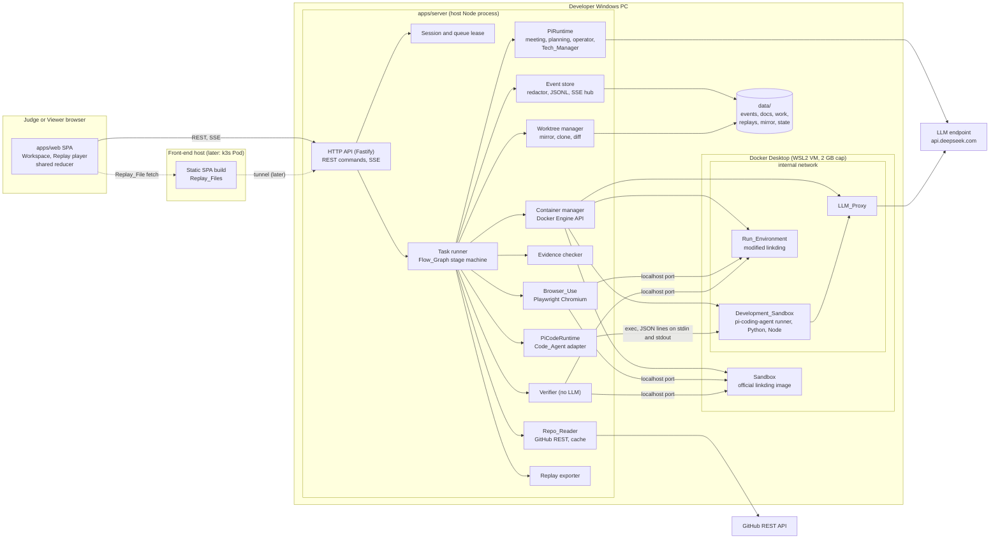
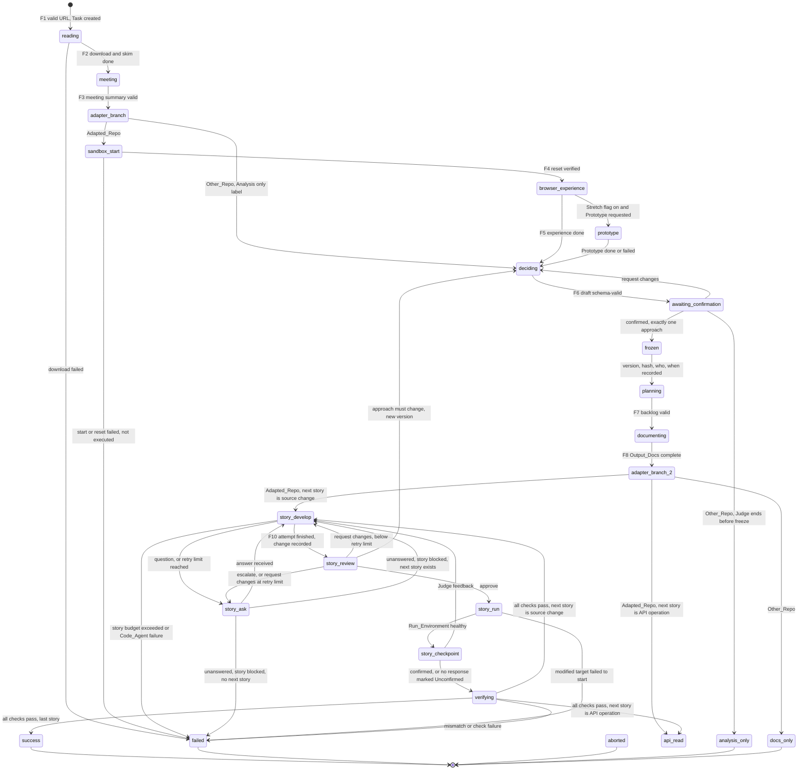
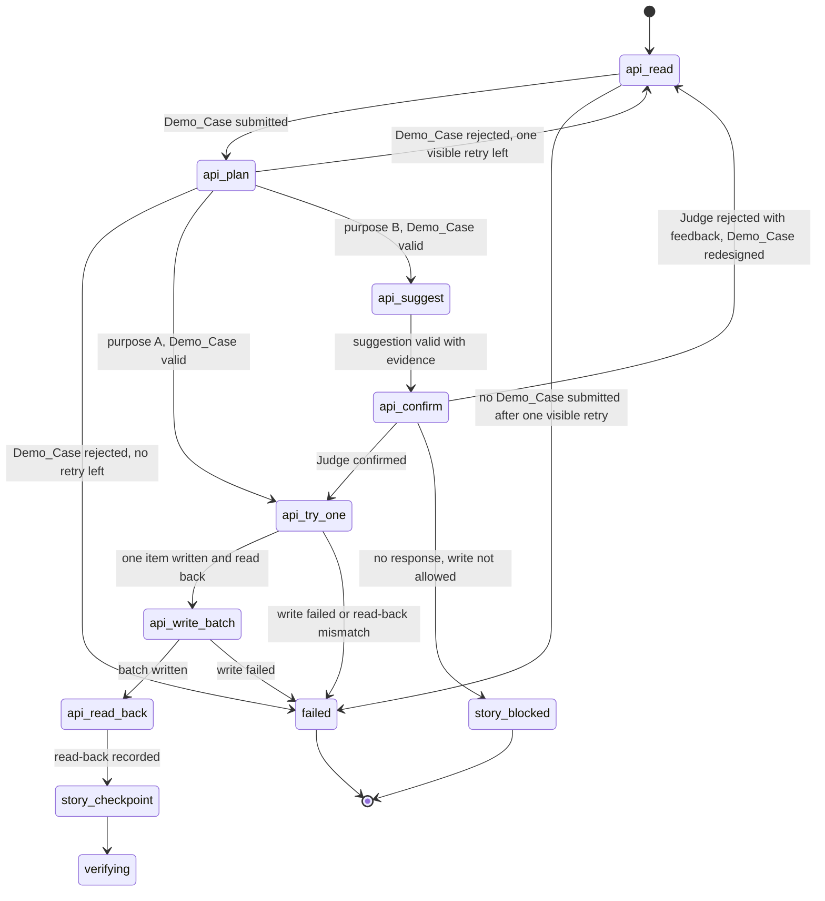

# Design Document: GraftLab AI

> Product name: GraftLab AI. In this document the product is called "the Studio", as in `requirements.md`.
> Every component and decision cites the requirement ids it serves (for example R36.3 is Requirement 36, criterion 3).
> "TO VERIFY" marks a fact that is not verified yet. All TO VERIFY items are collected in the final section together with the first task that verifies each one.
> Initial values are adjustable by environment variable; they are starting points to be measured, not promises.
> Target: buildable in 14 days by one developer. Where a simpler option works, the simpler option is chosen, and what is left out is listed in "Deliberately left out".

## Overview

The Studio is one TypeScript monorepo with three parts that matter at run time:

1. A Node backend (`apps/server`) that owns everything with authority: the Flow_Graph stage machine, the Event_Stream, the queue lease, the LLM key, the Docker containers, the Verifier and the secret redactor.
2. A React single-page app (`apps/web`) whose Workspace is a pure function of the ordered events, computed by a reducer shared with the server tests (`packages/shared`). Live view and Replay use the same reducer (R26.7, R27.14).
3. Containers on the developer's Windows PC, started by the backend through the Docker Engine API: the Sandbox (official, unmodified linkding image), the Development_Sandbox (Code_Agent plus toolchains, one per Task), the Run_Environment (the modified linkding, one per story attempt) and the LLM_Proxy (R13, R38, R39, R30.16).

A Task moves through an explicit Flow_Graph stored as data (R36). Agent loops run inside nodes: the meeting roles, planning roles, the Browser_Use operator and the Tech_Manager are pi-agent-core agents inside the backend process; the Code_Agent is `@earendil-works/pi-coding-agent` embedded by a small runner script (our code) that runs inside the Development_Sandbox. All agent roles therefore use one agent family (the pi packages). Leaving a node is decided only by guards over validated, schema-checked outputs, never by free model text (R36.2, R35.6).

Every Studio event passes the secret redactor, is appended to `events.jsonl`, and is then broadcast over Server-Sent Events (SSE). Streamed text is shown live from ephemeral SSE frames and is never persisted; the complete message, including the model-provided reasoning text, is persisted when the stream ends (R3.8, R3.11, R27.7).

Success is decided only by the Verifier, plain TypeScript with no LLM, that runs executable Acceptance_Checks: API read-back, the target's own test suite, and scripted browser checks (R22).

### Design decisions at a glance

| Decision | Choice | Requirements |
|---|---|---|
| Language and layout | One npm-workspaces monorepo, TypeScript in all our code, Node >=22.19 | R32, R35.1 |
| Backend | Fastify, REST for commands, SSE for live events, zod for every schema | R2, R27, R35.6 |
| Front end | React + Vite SPA, UI state = reducer over ordered events | R1-R8, R26.7, R27.14 |
| Meeting, planning, Browser_Use operator, Tech_Manager | `@earendil-works/pi-agent-core` with `@earendil-works/pi-ai` DeepSeek provider, in the backend process | R11, R14, R19, R40, R30 |
| Code_Agent | `@earendil-works/pi-coding-agent` 1.5.2 (MIT), embedded by our runner script (`docker/dev-sandbox/runner/`, about 100 lines) inside the Development_Sandbox: allow-listed tools, in-memory session manager, thinking level low, custom `ask_question` tool, JSON-line commands on stdin and normalized JSON-line events on stdout, one long-lived runner process per story attempt | R38, R40 |
| Runtime swap | Thin `AgentRuntime` interface; fallbacks for the Code_Agent only: DeepSeek Harness runtime, OpenCode, OpenHands SDK (not built in the first version) | Open item 44 |
| Browser automation | Playwright (Apache-2.0) with headless Chromium in the backend process | R14, R22.2 |
| Persistence | Files under one `data/` directory: JSONL event logs, JSON state file, Output_Docs, caches | R27.1, R32.3 |
| Containers | Docker Engine API from the host backend; no Docker-in-Docker | R38.2, R39 |
| Property tests | fast-check (MIT) with vitest | Testing Strategy |
| Runtime_Rules (layer B) | `runtime-rules/` with a `VERSION` file | R35, Open item 13 |
| Output_Docs (layer C) | `data/tasks/<taskId>/docs/` | R20, Open item 13 |
| Reasoning text | Persisted with `message_completed` | R3.12, Open item 42 |
| API-operation stories | Tech_Manager designs a Demo_Case with read-only tools; Studio code executes its writes against the Sandbox; the Verifier checks the Demo_Case expected outcome | R18.7-R18.13, R40.18, Open item 50 |

### Initial values (adjustable by environment variable)

| Value | Initial | Environment variable | Requirements and open items |
|---|---|---|---|
| Recency_Window | 15 s | `GL_RECENCY_WINDOW_S` | R2.5, Open item 14 |
| Message progress event interval while streaming | 5 s | `GL_PROGRESS_INTERVAL_S` | R2.4, R2.8 (see Gaps found) |
| Acknowledgement shown after a Judge input | within 1 s | `GL_ACK_BOUND_MS` | R6.2, Open item 15 |
| Confirmation wait at a confirmation point | 120 s (demo setting 30 s) | `GL_CONFIRM_WAIT_S` | R21.7, Open item 10 |
| Unanswered Code_Agent question wait | 300 s, then the story is marked Unconfirmed-blocked and the flow continues to the next story or a terminal | `GL_QUESTION_WAIT_S` | R40.11, R40.17, Open item 39 |
| Code_Agent time budget per story | 10 minutes of Code_Agent run time, summed over attempts | `GL_STORY_BUDGET_MIN` | R38.3, R40.1, Open items 25, 33 |
| Retry limit per story | 3 attempts | `GL_STORY_ATTEMPTS` | R40.11, R40.12, Open item 35 |
| Item_Count_Cap per Demo_Case | 10 items | `GL_DEMO_CASE_MAX_ITEMS` | R18.11, Open item 50 |
| Task timeout | 90 minutes | `GL_TASK_TIMEOUT_MIN` | R36.6, Open item 28 |
| Read-volume limit | 300 files or 2 MB of text, whichever comes first | `GL_READ_MAX_FILES`, `GL_READ_MAX_BYTES` | R34.3, Open item 16 |
| max_tokens for role turns | 16384, finish reason checked | `GL_MAX_TOKENS` | R30.12, R30.13 |
| Queue heartbeat and idle release | 30 s heartbeat, 120 s idle release | `GL_LEASE_HEARTBEAT_S`, `GL_LEASE_IDLE_S` | R28 |
| Container memory limits | Sandbox 512 MB, Development_Sandbox 768 MB, Run_Environment 512 MB, LLM_Proxy 64 MB | `GL_MEM_*_MB` | R38.3, Open item 25 |
| Run_Environment start and health wait | 240 s | `GL_RUN_START_TIMEOUT_S` | R39.11 |
| Per-node timeouts | see the node table in Flow_Graph | `GL_NODE_TIMEOUT_<NODE>_S` | R36.6, Open item 28 |

## Architecture

### Where things run (first version)

- The developer's Windows PC runs the Studio backend as a host Node process, not in a container. It talks to Docker Desktop through the Docker Engine API (`DOCKER_HOST`, default named pipe on Windows). No container gets the Docker socket, so no internet-facing component can start containers (R38.2, R39.1).
- The web app is served by the backend locally. Later the same static build is served by a front-end Pod in the k3s cluster under the Cloudflare domain, which reaches the PC backend through a Cloudflare tunnel started on the PC (decided direction; exact setup in the deployment task, R32.6, R32.7).
- Replay_Files are uploaded to the front-end host as static files, so Replays work while the PC is off (R27.13).
- No Docker-in-Docker anywhere.

### Component diagram



### Four environments (R39.1)

| Environment | What it is here | Requirements |
|---|---|---|
| Dev_Environment | The developer's machines, Kiro, this repository | R39.1 |
| Studio_Runtime | `apps/server` host Node process plus the `apps/web` build | R39.1, R32 |
| Development_Sandbox | One container per Task from the `dev-sandbox` image, Worktree mounted read-write at `/work` | R38.2, R39.2 |
| Run_Environment | One container per story attempt from the `dev-sandbox` image, running the modified linkding from a read-only snapshot of the Worktree | R39.3, R39.5 |

The Sandbox (official linkding image) is the baseline environment for F4 and F5 and is separate from all four (R13.6).

### Containers

| Container | Image | Lifetime | Network | Mounts | Memory |
|---|---|---|---|---|---|
| Sandbox | Official `sissbruecker/linkding` basic variant, pinned by digest (from `adapters/linkding/adapter.json`) | Created at `sandbox_start`, recreated on restore, stopped while source-change stories develop, removed at Task end | Own bridge network, port 9090 published to `127.0.0.1` only | Fresh named volume at `/etc/linkding/data` per start | 512 MB |
| Development_Sandbox | `graftlab/dev-sandbox` (built locally) | Created when the flow first needs it (first development story or Prototype), stopped while the Run_Environment and the Verifier run, removed at Task end | Internal network only | `data/tasks/<id>/work` read-write at `/work`; `data/tasks/<id>/context/<storyId>` read-only at `/context`; read-only root filesystem with tmpfs for `/tmp` and the session and home directory | 768 MB |
| Run_Environment | `graftlab/dev-sandbox` | One per story attempt; discarded and recreated for every attempt (R39.5) | Internal network only; app port published to `127.0.0.1` (TO VERIFY, see below) | Read-only snapshot of the Worktree at `/src`; the start commands copy it to an in-container directory before building | 512 MB |
| Verifier test container | `graftlab/dev-sandbox` | Fresh per `test_suite` check, removed after | Internal network only | Read-only snapshot at `/src` | 768 MB |
| LLM_Proxy | `graftlab/dev-sandbox` running the bundled proxy script | Per Task, started with the Development_Sandbox | Internal network and the default bridge (to reach the LLM) | none | 64 MB |

Only one Task runs at a time (R28.1), and containers that are not needed are stopped, so peak usage is Run_Environment or the test container plus the LLM_Proxy and, for API-operation stories, the Sandbox. Memory fit under the 2 GB cap of the WSL VM is TO VERIFY.

Network policy of the Development_Sandbox and Run_Environment (R38.4, Open item 26): both sit on a Docker network created with `internal: true`, whose only other member is the LLM_Proxy. They have no general internet access. Python and Node dependencies of linkding are preinstalled in the image at build time. Consequence: a story that needs a new third-party dependency cannot install it; the Code_Agent must stop and ask (R40.11), and the Judge sees that limit honestly.

The backend reaches the Sandbox and the Run_Environment through ports published on `127.0.0.1`. TO VERIFY on Docker Desktop for Windows: whether a container attached only to an internal network can publish a port. Fallback if it cannot: the LLM_Proxy container, which is on both networks, also relays one fixed TCP port to the Run_Environment's app port, and only the LLM_Proxy publishes ports.

### Images (Open item 48)

- Docker Hub is not reachable from the PC. `ubuntu:latest` (Ubuntu 24.04, glibc 2.39) is already present locally and is the base of `dev-sandbox`.
- The linkding image is pulled on another machine with `--platform linux/amd64`, pinned by digest in `adapter.json`, transferred with `docker save` and `docker load`, and verified by digest on the PC before use. The developer considers these layers controlled.
- `docker/dev-sandbox/Dockerfile` installs Python 3, git, Node (a Node 24 LTS Linux x64 tarball from nodejs.org, checksum verified at build time; the PC reaches nodejs.org), the pi packages (`@earendil-works/pi-coding-agent`, `@earendil-works/pi-agent-core`, `@earendil-works/pi-ai`, pinned versions, installed from the npm registry at image build time, about 153 MB with their siblings) and the Code_Agent runner (`docker/dev-sandbox/runner/`). The image does not contain the DeepSeek Harness executable. The Dockerfile also clones linkding at the pinned commit to `/opt/linkding-src`, and preinstalls linkding's Python dependencies into `/opt/venv` and its Node dependencies into a cache directory. Reachability of the Ubuntu package mirror, PyPI, nodejs.org, the npm registry and GitHub from the PC at image build time is TO VERIFY.

### Repository layout

```text
apps/server/            Node + TypeScript backend (Fastify, SSE, task runner, Verifier)
apps/server/src/proxy/  LLM_Proxy entry point (bundled to one file, run in its own container)
apps/web/               React + Vite SPA (Workspace, Replay player)
packages/shared/        Event types, zod schemas, UI reducer, Flow_Graph data, guards
runtime-rules/          Layer B: VERSION, roles/, rules/, schemas/ (JSON exported from zod), adapters/linkding-checklist.md, cases/rules.md
adapters/linkding/      adapter.json, test-data.json, checks/ (assessment helpers usable by the Verifier)
docker/dev-sandbox/     Dockerfile for Development_Sandbox, Run_Environment, Verifier test container and LLM_Proxy
docker/dev-sandbox/runner/  Code_Agent runner script (pi-coding-agent embedded; protocol and event normalization)
docker/llm-proxy/       Entry script and README for the LLM_Proxy container (runs on the dev-sandbox image)
data/                   gitignored state (see Data Models)
.kiro/specs/graftlab-ai requirements.md, design.md, tasks.md (layer A)
.kiro/steering/         product.md, tech.md, structure.md (layer A, created in the first tasks)
.kiro/hooks/            for example run tests and the secret scan on save (layer A, created in the first tasks)
```

Layer locations decide Open item 13 and R35.1: layer A in `.kiro/` and `AGENTS.md`, layer B in `runtime-rules/`, layer C in `data/tasks/<taskId>/docs/`. The repository holds linkding only as references (image digest, upstream URL and commit), never modified target code (R25.6, R38.6).
Third-party components named in the README (R33.6): the pi packages `@earendil-works/pi-agent-core`, `@earendil-works/pi-ai` and `@earendil-works/pi-coding-agent` (MIT), Playwright (Apache-2.0), linkding as an unmodified external dependency (MIT). The DeepSeek Harness runtime is not part of the first version; if it is activated as the fallback, its license note is TO VERIFY and it is added to the README then.

### Flow_Graph

The Flow_Graph is data in `packages/shared/src/flow/graph.ts` (R36.1). Each node has a `kind` (`auto`, `agent_loop`, `wait_user`, `terminal`), an allowed tool list, and a timeout. Each edge has an id, a source, a target and a guard: a pure function `(task: TaskState) => boolean`. The function `transition(task, edgeId)` is the only way to change `task.node` (R36.3). It checks that the edge exists from the current node and that its guard holds; otherwise it appends `transition_rejected` with the reason (R36.4). Every accepted transition appends `node_entered` (R36.9). The Workspace shows the current node from the reducer (R36.8).

Global edges apply to every non-terminal node: `timeout` and `unrecoverable_error` lead to `failed`; `judge_abort` leads to `aborted` (R36.6, chart "Any node").

Main graph, consistent with the requirements flow chart (F-step ids in the labels):



API-operation sub-path, used for stories whose confirmed approach executes the workflow by operating linkding through its API (R18.2-R18.4, R18.7-R18.13, R15.7, R22.1, R40.18; decided by the user, Open item 50). It is part of the same Flow_Graph data. The read and plan stages of R18.2 are the Tech_Manager designing the Demo_Case: in `api_read` the Tech_Manager reads the relevant linkding code and the Sandbox test data with read-only tools and submits a Demo_Case with `submit_demo_case`; in `api_plan` Studio code validates it (schema, Item_Count_Cap, Adapter endpoint allow-list, Sandbox target) and derives the Verifier's `api_readback` Acceptance_Check from its expected outcome. Writes in `api_try_one` and `api_write_batch` are executed by Studio code from the validated Demo_Case; no LLM-facing write tool exists, so write capability exists only in the two write stages. Purpose B still needs a schema-valid suggestion with evidence (`api_suggest`) and Judge confirmation (`api_confirm`) before any write. The Verification role does not design a second case; the non-LLM Verifier runs the derived checks:



`story_blocked` in this sub-diagram is not a node; it stands for the same outcome as the unanswered-question edges of `story_ask` (the story is marked Unconfirmed-blocked and the flow continues to the next story, or to `failed` if none is left).

Node table:

| Node | Kind | Allowed tools (enforced by `beforeToolCall` or by not exposing a tool) | Timeout | Requirements |
|---|---|---|---|---|
| reading | agent_loop | Studio download (code); Architecture role skim: `read_file`, `search_repo`, `record_finding` | 10 min | R10, R34 |
| meeting | agent_loop | `read_file`, `search_repo`, `record_finding`, `submit_statement`; Moderator also `ask_judge`, `submit_meeting_summary` | 25 min | R11, R12, R24 |
| adapter_branch | auto | none | 5 s | R25 |
| sandbox_start | auto | none (Studio code) | 3 min | R13, R29 |
| browser_experience | agent_loop | `browser_open`, `browser_click`, `browser_fill`, `browser_press`, `browser_snapshot`, `browser_screenshot`, `record_note` | 10 min, 40 actions | R14 |
| prototype | agent_loop (Stretch) | Code_Agent in a separate prototype clone | 15 min | R41 |
| deciding | agent_loop | `read_file`, `search_repo`, `ask_judge`, `submit_decision_draft` | 20 min | R15, R37 |
| awaiting_confirmation | wait_user | none (Judge card only) | Task timeout only; no automatic confirmation | R15.3, R15.4 |
| frozen | auto | none | 5 s | R15.3, R16 |
| planning | agent_loop | `submit_backlog`, `submit_sprint_plan`, `submit_definition_of_done` | 15 min | R19, R20, R40.1 |
| documenting | agent_loop | `submit_requirements_doc`, `submit_design_doc`, `submit_tasks_doc`, `submit_task_board` | 15 min | R19.2, R20 |
| adapter_branch_2 | auto | none | 5 s | R25 |
| story_develop | agent_loop | Code_Agent's own tools inside the Development_Sandbox only | story budget | R38, R40 |
| story_review | agent_loop | Tech_Manager: `read_changed_file`, `read_diff`, `submit_review_verdict` | 5 min | R40.6-R40.10 |
| story_ask | wait_user | Tech_Manager `answer_question` for technical questions; Judge question card for feature questions | 300 s for the Judge | R40.11-R40.14 |
| story_run | auto | none (Studio starts the Run_Environment) | 240 s | R39.9-R39.11 |
| story_checkpoint | wait_user | none | 120 s (demo 30 s) | R21 |
| verifying | auto | none (Verifier) | 10 min | R22 |
| api_read | agent_loop | Tech_Manager designs the Demo_Case: `linkding_read`, `read_file`, `search_repo` (read-only), `submit_demo_case` | 8 min | R18.2, R18.7, R40.18 |
| api_plan | auto | none (Studio validates the Demo_Case and derives its `api_readback` check) | 5 s | R18.2, R18.8, R18.10-R18.12 |
| api_suggest | agent_loop | Tech_Manager: `linkding_read`, `read_file`, `submit_suggestion` (values only for Demo_Case items marked as suggested) | 5 min | R18.3 |
| api_confirm | wait_user | none (Judge card shows the Demo_Case and the suggestion in feature words) | 120 s | R18.4, R15.7 |
| api_try_one | auto | none (Studio code writes Demo_Case item 1 and reads it back) | 2 min | R18.2, R18.9, R18.10 |
| api_write_batch | auto | none (Studio code writes the remaining Demo_Case items) | 5 min | R18.2, R18.9, R18.10 |
| api_read_back | auto | none (Studio code reads back all Demo_Case items) | 3 min | R18.2 |
| success, failed, aborted, analysis_only, docs_only | terminal | none | none | R36.5 |

Rules that keep the graph honest:

- Agent loops run inside a node. A node's loop ends by producing a validated output (for example a `submit_decision_draft` call whose arguments pass zod), and the task runner then picks the edge whose guard holds. Free model text never selects an edge (R36.2).
- Back edges: request changes (`awaiting_confirmation` to `deciding`, `story_review` to `story_develop`, `story_checkpoint` to `story_develop`), a new Decision_Doc version (`story_review` to `deciding`, R37.9, R40.15), stop-and-ask (`story_develop` to `story_ask`), and the retry limit (counted in `TaskState.stories[i].attempts`, R40.12).
- A build-time test computes reachability over the graph data and fails the build if any node cannot reach a terminal through non-global edges (R36.7).
- Guards on `frozen` and later nodes require `task.frozenVersion != null` (R15.4, R15.5); `adapter_branch_2` to a story node also requires all Output_Docs present and valid (R19.4).

## Components and Interfaces

### packages/shared

- `events.ts`: the event envelope and every payload as a zod discriminated union; `parseEvent`, `serializeEvent` (R27.4, R27.9).
- `flow/graph.ts`, `flow/guards.ts`, `flow/transition.ts`: the Flow_Graph data, guards and `transition` (R36).
- `reducer.ts`: `reduce(state, event)`, `foldEvents(events)`, and `roleStatus(state, roleId, now)` (R2, R26.7, R27.14).
- `schemas/`: stage output schemas (statements, findings, evidence references, Decision_Doc, Product_Backlog with Feature_Contracts, Sprint_Plan, Task_Board, Definition_of_Done, Review_Verdict, Demo_Case, suggestion, Acceptance_Check specs). A script exports them as JSON into `runtime-rules/schemas/` (R35.6).
- `url.ts`: GitHub URL parsing and normalization (R9.2, R9.3).
- `redact.ts`: the secret redactor (R30.15).

### apps/server modules

| Module | Responsibility | Requirements |
|---|---|---|
| `http/` | Fastify routes, cookie session, Origin check on every command, lease check on every command endpoint | R28.6 |
| `sse/` | SSE hub: event frames with `id: seq`, ephemeral `delta` frames, `queue` frames, 15 s comment heartbeats, resume with `Last-Event-ID` | R2, R3.6, R28.3 |
| `queue/` | Single operator lease, queue positions, admin switch | R28 |
| `tasks/runner.ts` | Hosts one Task: holds `TaskState`, runs node handlers, applies `transition`, enforces node and Task timeouts | R36 |
| `events/store.ts` | Single writer per Task: assigns `seq`, redacts, appends to `events.jsonl`, fsyncs on decisions and terminals, then broadcasts | R27.1, R27.6, R30.15 |
| `llm/` | LLM_Config resolution, SSRF validation for Judge-supplied base addresses, pi-ai model setup | R30 |
| `runtime/` | `AgentRuntime` interface, `PiRuntime`, `PiCodeRuntime` (the shared pi event mapping lives in one module used by both and by the runner) | R11, R40, Open item 44 |
| `roles/` | Loads role prompts and rules from `runtime-rules/`, records the Runtime_Rules version at Task start | R35.3, R35.4 |
| `reader/` | Repo_Reader over the GitHub REST API with cache by commit SHA | R10, R34 |
| `evidence/` | Evidence checker against the downloaded files | R24 |
| `meeting/` | Moderator-driven meeting rounds | R11, R12 |
| `docs/` | Planning and document-first generation, Output_Docs rendering | R19, R20, R40.1 |
| `browser/` | Playwright operator tools and scripted browser checks | R14, R22.2 |
| `containers/` | Docker Engine API wrapper for Sandbox, Development_Sandbox, Run_Environment, test container, LLM_Proxy, networks | R13, R38, R39 |
| `worktree/` | Mirror, per-Task clone, snapshots, diff, Patch_Artifact | R38 |
| `dev/` | Development stage per story: context building, Code_Agent run, review, ask, run, checkpoint | R21, R38, R39, R40 |
| `apiops/` | API-operation stories: Demo_Case validation, check derivation, and the Demo_Case writer (the only code path that writes to linkding) | R18.7-R18.13, R40.18 |
| `verifier/` | Acceptance_Check execution, no LLM | R22, R29.4 |
| `replay/` | Replay_File export with secret scan, static upload hook | R26, R27.11-R27.13 |
| `proxy/` | LLM_Proxy entry point (separate container) | R30.16 |

### HTTP API

All command endpoints require the operator lease and a same-origin request (R28.6). Responses are JSON validated by zod.

| Method and path | Purpose | Requirements |
|---|---|---|
| `POST /api/session` | Create or refresh the anonymous session cookie (`HttpOnly`, `SameSite=Lax`, `Secure` behind https) | R28 |
| `POST /api/queue/join`, `POST /api/queue/heartbeat`, `POST /api/queue/leave` | Queue and lease | R28.1-R28.5 |
| `POST /api/tasks` `{ url }` | Validate the URL, check GitHub, create the Task | R9 |
| `GET /api/tasks/current/stream` | SSE: event frames, delta frames, queue frames, in-progress buffers on connect | R2, R3, R28.3 |
| `GET /api/tasks/:id/events` | All persisted events as JSON | R26, R27 |
| `POST /api/tasks/:id/messages` `{ to, text }` | Interjection; returns `{ accepted: true, clientMsgId }` at once | R5.1, R5.2, R6.1, R12 |
| `POST /api/tasks/:id/cards/:cardId/answer` `{ optionId?, text? }` | Answer a question or confirm/reject card | R5.6, R6.5, R15.3, R21.3 |
| `POST /api/tasks/:id/abort` | Judge abort, leads to `aborted` | R36.6 |
| `POST /api/sandbox/restore` | Restore linkding to the fixed test data set (operator only) | R29.2 |
| `GET /api/tasks/:id/artifacts/:ref` | Diff, screenshot, file content portion | R4, R38.5 |
| `POST /api/admin/queue` `{ open }` | Admin switch to close or open the queue (admin token from environment) | R28 |
| `GET /replays/:taskId.json` | Static Replay_File | R27.13 |

Acknowledgement (R6.1, R6.2): the POST returns within the 1 s bound with `accepted`; the Workspace shows "received" at once. "Delivered" is shown when the `judge_message` event with `deliveredTo` arrives over SSE. If delivery fails, a `failure` event referencing the `clientMsgId` is shown next to the input (R6.4).

### AgentRuntime interface

```ts
// packages/shared/src/runtime.ts (types only; implementations in apps/server/src/runtime)
export interface AgentRuntime {
  start(opts: RuntimeStartOptions): Promise<RuntimeSession>;
}

export interface RuntimeStartOptions {
  taskId: string;
  roleId: RoleId;                 // "moderator" | "product" | ... | "tech_manager" | "operator" | "code_agent"
  systemPrompt: string;           // from runtime-rules
  tools: ToolDefinition[];        // already filtered to the node's whitelist
  context: ContextBundle;         // story plus referenced documents only (R19.7)
  budget: { maxTokens: number; deadlineMs: number };
}

export interface RuntimeSession {
  prompt(input: PromptInput): Promise<void>;
  events(): AsyncIterable<RuntimeEvent>;   // normalized events, see the mapping tables
  answerQuestion(questionId: string, answer: string): Promise<void>;
  abort(reason: string): Promise<void>;
}

export type RuntimeEvent =
  | { t: "message_start"; messageId: string }
  | { t: "text_delta" | "reasoning_delta" | "toolcall_delta"; messageId: string; text: string }
  | { t: "message_end"; messageId: string; text: string; reasoning: string; finishReason: string; usage?: Usage }
  | { t: "message_broken"; messageId: string; partialText: string; reason: string }
  | { t: "tool_start"; callId: string; tool: string; input: unknown }
  | { t: "tool_end"; callId: string; ok: boolean; output: unknown }
  | { t: "question"; questionId: string; text: string; kind: "technical" | "feature"; options?: string[] }
  | { t: "final"; reason: "completed" | "error" | "aborted"; text: string };
```

### PiRuntime (meeting roles, planning roles, operator, Tech_Manager)

- Uses `@earendil-works/pi-agent-core` 1.5.2 with the `@earendil-works/pi-ai` DeepSeek provider (`deepseek-flash`, OpenAI-compatible, text and image input). Runs inside the backend process, so the real LLM key never leaves the backend (R30.5).
- Event mapping from pi to `RuntimeEvent`:

| pi event | RuntimeEvent | Studio event |
|---|---|---|
| `agent_start`, `turn_start` | none | none |
| `message_start` | `message_start` | `message_started` |
| `message_update` with `text_delta` / `thinking_delta` / `toolcall_delta` | deltas | SSE `delta` frame only; `message_progress` every 5 s and at the first delta |
| `message_end` | `message_end` | `message_completed` (full text, reasoning text, finish reason, usage) |
| `tool_execution_start` / `tool_execution_end` | `tool_start` / `tool_end` | `tool_started` / `tool_finished` |
| `turn_end`, `agent_end` | none | none |
| stream error or abort mid-message | `message_broken` | `message_incomplete` plus `failure` (R3.9) |

- `abort()` maps to pi `abort()`. Interjections use `steer()` on the current speaker; if no role is speaking, the message is appended to the shared transcript before the next turn (R12.2). `followUp()` is used for the Moderator's follow-up turn after a Judge answer. `steer()` and `followUp()` behavior was not part of the 2026-11-20 smoke test: TO VERIFY.
- `beforeToolCall` enforces the node's tool whitelist; a blocked call is recorded as `failure` with class "rejected by a safety rule" and the agent receives an error result (R18, R19.8, R23.7). The 2026-11-20 smoke test verified a blocked tool through `beforeToolCall`.
- Structured outputs are produced through a `submit_<stage>` tool whose arguments are validated by zod. Invalid arguments, a missing submit call at the end of the turn, or a finish reason that shows truncation count as "LLM output format invalid" and the output is discarded (R23.6, R30.4, R30.13). One visible retry is allowed per turn and is shown as a separate attempt (R23.5); after that the turn fails (R11.2).
- `max_tokens` 16384 per role turn leaves room for thinking, which is on by default (R30.12, R30.14).

### PiCodeRuntime (Code_Agent)
- Artifact: `@earendil-works/pi-coding-agent` 1.5.2 (MIT, engines node >=22.19.0; built-in tools `read`, `bash`, `edit`, `write`), installed in the dev-sandbox image at build time together with `@earendil-works/pi-agent-core` and `@earendil-works/pi-ai`. Its shipped docs say it does not ask for approval before tool calls and recommend a container; the per-Task Development_Sandbox is that container. These facts come from reading the installed package on 2026-11-21; behavior in our container is TO VERIFY.
- The runner: a script of about 100 lines in `docker/dev-sandbox/runner/` (our code) that embeds the SDK with `createAgentSession()`. It sets an allow-listed tool set (`tools` option; `noTools` and `excludeTools` are the alternatives), `SessionManager.inMemory()` so no session files are written, thinking level low, no context files, and our custom `ask_question` tool through `customTools`. Whether the SDK-embedded runner or pi's RPC mode (`--mode rpc`, commands `prompt`, `steer`, `follow_up`, `abort`, `get_state`) is used is TO VERIFY in the first spike; the default is the embedded runner.
- Process model: the backend starts one long-lived runner process per story attempt with a Docker exec into the running Development_Sandbox (`cwd=/work`). The process stays alive while a question is open, so an answer continues the same session (R40.13). It ends after the final event, on abort, or when the budget timer kills the exec.
- Command protocol (stdin, one JSON object per line, validated by zod in the runner): `{"cmd":"prompt","text":"..."}`, `{"cmd":"answer","questionId":"...","text":"..."}`, `{"cmd":"steer","text":"..."}`, `{"cmd":"abort"}`. A prompt sent while the session streams must choose steer or follow-up; the runner uses `steer()` for `steer` and `followUp()` for `answer` when the turn has not yet ended.
- Event protocol (stdout, one JSON object per line): the normalized `RuntimeEvent` values (see above) plus `ready` and `runner_error`. The runner calls the same shared mapping module as `PiRuntime`, so a pi event is mapped in one place. The backend parses each line with zod; a line that does not match the protocol is counted and shown in Engineering_Details, never dropped silently.
- The story prompt is short: it tells the Code_Agent to read `/context/story.md` (Feature_Contract plus referenced documents, mounted read-only) and states the stop-and-ask rule (R19.7, R40.2, R40.11).
- Mapping from pi-coding-agent events to Studio events: the same table as `PiRuntime` (`message_start`, `message_update` deltas, `message_end`, `tool_execution_start` and `tool_execution_end`, stream error or abort mid-message), with these differences:
| pi-coding-agent event or result | RuntimeEvent | Studio event |
|---|---|---|
| `message_end` of an assistant message | `message_end` | `message_completed` (actor `code_agent`; text, reasoning text, usage) |
| `tool_execution_start` / `tool_execution_end` | `tool_start` / `tool_end` | `tool_started` / `tool_finished` (Engineering_Details only) |
| queue and retry events | none | counted, shown in Engineering_Details |
| `ask_question` tool call with valid arguments | `question` | `question_opened` (R40.11, R40.13) |
| `agent_end` followed by `agent_settled` (the session will not continue automatically) | `final` completed | attempt finished; the backend computes `code_change` from the Worktree diff |
| error result, abort, non-zero exit, or killed by budget | `final` error or aborted | `failure` (interface call failure, or budget exceeded) |
- The ask-question flow replaces the earlier `graftlab_question` JSON fallback. The custom tool `ask_question` takes `{ kind: "technical" | "feature", text: string, options?: string[] }`, validated by zod. A valid call emits the `question` event and ends the turn (the same terminate pattern as the earlier design: the tool result tells the session to stop). The runner then waits for an `answer` command and resumes the same session. Invalid arguments return an error result to the model. Spike evidence shows that none of the tested runtimes stopped to ask on an ambiguous request in unattended mode, so the Studio also opens a question by code when the retry limit is reached (R40.12).
- Write confinement: the container has a read-only root filesystem, tmpfs for `/tmp` and the session and home directory, and only `/work` writable from the host (R38.2). A tool result that reports a read-only file system error outside `/work` and `/tmp` is recorded as `failure` with class "rejected by a safety rule", shown only in Engineering_Details (R38.8). The embedded runner running with a read-only root filesystem and a tmpfs home is TO VERIFY.
- LLM access: the runner holds only the per-Task credential for the LLM_Proxy (R30.16). A custom provider and model entry in the runner's model registry sets the base address to the LLM_Proxy (pi-ai supports custom OpenAI-compatible providers). Whether this works through the proxy is TO VERIFY. The earlier 404 was seen with the harness runtime and stays as history.
- Code_Agent rules (in the Runtime_Rules, R35.9, R40): never special-case code to satisfy tests; report a contradiction between tests, story or documents by asking through `ask_question`; do not edit tests unless the story says so. This is best effort, not a guarantee: in the 2026-11-20 spike pi-coding-agent special-cased the code on the contradictory-tests fixture and did not point out the contradiction. The backstops are the Tech_Manager review and the Verifier.
- Steer and abort: `steer` and `abort` arrive over stdin; the runner calls `session.steer()` and `session.abort()` and waits for idle (`waitForIdle()`), and the backend expects the exec to finish within a few seconds of `abort`, otherwise it kills the exec. `dispose()` runs on exit.
### Runtime selection (Open item 44)
Decided with the user on 2026-11-21: one agent family for everything, the pi packages. Meeting roles, planning roles, the Browser_Use operator and the Tech_Manager use `@earendil-works/pi-agent-core` with `@earendil-works/pi-ai` in the backend process; the Code_Agent uses `@earendil-works/pi-coding-agent` embedded by the runner inside the Development_Sandbox. Rationale: one event model, one provider configuration, one steer and abort interface, one learning cost, and TypeScript only. The DeepSeek Harness headless mode emits step-level (not token-level) thinking and text events and has no mid-turn steer or abort, so it cannot serve the streaming meeting UI and is only a Code_Agent alternative.
Fallbacks for the Code_Agent, behind the `AgentRuntime` interface and not built in the first version: the DeepSeek Harness runtime (official bundled executable, headless JSON events), OpenCode (`opencode run --format json`, MIT) and the OpenHands Software Agent SDK (agent server with REST and WebSocket, MIT TypeScript client `@openhands/typescript-client`, about 587 MB Python 3.12 environment). Fallback trigger: pi-coding-agent fails the real-document comparison at the first development story, or fails its TO VERIFY items (read-only root with tmpfs home, custom base address through the LLM_Proxy, custom `ask_question` tool, steer and abort over stdin). The first fallback is pi RPC mode, the second is the harness runtime. If the harness is ever activated, its license note (MIT per its wheel metadata, third-party notices) is TO VERIFY and must be listed in the README.
Spike evidence (2026-11-20, macOS, a single run per scenario on a toy Python repository; this is evidence, not a guarantee):
| Scenario | pi-coding-agent | Harness runtime | OpenCode | OpenHands |
|---|---|---|---|---|
| Fix failing tests | passed, 20 s | passed, 15 s | passed, 34 s | passed, 18.5 s |
| Ambiguous request, unattended | did not ask | did not ask | did not ask | did not ask |
| Contradictory tests with "do not modify tests" | special-cased code to pass all tests | reported the contradiction, left two failing tests (`test_slug`, `test_slug_trim`) | reported the contradiction, left one failing test | special-cased code to pass all tests, disclosed it |
| Event output size | larger (`--mode json`, 171-882 KB) | 9-76 KB | larger | larger |
None of them edited tests in the first scenario. The comparison is repeated at the first development story with real documents, using the same criteria: works out of the box, cheaper and faster, follows instructions better (tool whitelists and stopping to ask). The fixtures of the spike live in `spike/bench`.
### LLM_Proxy (R30.16)

- A small Node HTTP server bundled from `apps/server/src/proxy/` into one file, run in its own container on the `dev-sandbox` image, started per Task with the real key and a freshly generated per-Task credential in its environment.
- Accepts requests only with `Authorization: Bearer <per-Task credential>`, forwards only allow-listed OpenAI-compatible paths (initially chat completions and models) to the configured LLM base address, replaces the credential with the real key, and streams the response back unchanged.
- Logs method, path and status (never headers or bodies) so the 404 seen on 2026-11-20 can be diagnosed.
- Stopped and removed at Task end; the credential is then useless.
- The real key is visible to the container environment on the developer's PC; it never enters the Development_Sandbox or the Run_Environment.

### LLM configuration and SSRF validation (R30)

- Server default from environment: base `https://api.deepseek.com`, model `deepseek-flash`, key from the server environment (R30.3, R30.5).
- A Judge-supplied configuration (base, model, key) is behind the feature flag `GL_ALLOW_JUDGE_LLM`, off by default (see Gaps found). Judge keys live in memory for that Task only and are registered with the redactor (R30.8). Whether Judges bring their own key or use a hosted capped key remains Open item 20.
- SSRF validation (R30.17): the base address must parse as `https:`; the host is resolved with DNS and every resolved address must be public. Rejected: loopback, unspecified, RFC 1918 private ranges, RFC 6598 shared address space, link-local (IPv4 and IPv6), IPv6 unique local, multicast, IPv4-mapped forms of these, and the k3s default pod and service ranges. The connection then uses the resolved address (pinned lookup) so a DNS change between check and use cannot redirect it.

### Secret redactor (R30.15, R28.4, R27.12)

- A registry of known secret values: LLM key, GitHub token, linkding token and password, per-Task proxy credential, Judge-supplied key, admin token. Values shorter than 8 characters are refused at registration (configuration error).
- `redact(event)` walks every string in the payload and replaces each occurrence of a registered value with `[REDACTED:<name>]`. It runs inside the event store before persisting and before broadcasting; SSE `delta` frames pass the same function.
- The Replay exporter runs a second scan (registered values plus common key patterns) and refuses to export if anything is found, recording a `failure`.

### Repo_Reader (R10, R34)

- GitHub REST API with the read-only token held server-side (R34.1): repository metadata (existence, visibility, default branch; R9.4), the commit SHA of the default branch, the recursive git tree, then raw file contents.
- Prioritized reading order: README, docs, OpenAPI or schema files, route and URL definitions, models, then the rest by path depth. Reading stops at the read-volume limit (300 files or 2 MB of text); skipped parts are listed in a `finding_recorded` event of kind `skipped` and shown in the Artifact_Area (R10.6).
- Binary files and files above 200 KB are skipped and listed.
- Cache: `data/cache/github/<owner>/<repo>/<sha>/` holds the tree and file contents; a repeated request for the same SHA reads only from the cache (R34.2).
- Rate limit responses (`403` or `429` with rate limit headers) produce a `failure` with the limit state and stop the Task honestly (R34.4). The anonymous rate limit value is not assumed (R34.5).
- Files are treated as text only and never executed (R10.3). Each file read appends `file_read` with path, size and an artifact reference to the cached content (R10.4, R4.4).
- After the download, the Architecture role skims the prioritized files with `read_file` and `search_repo` and records findings with `record_finding` (best effort, R10.2).

### Evidence checker (R24)

- Input: an evidence reference `{ path, line?, snippet }` and the downloaded file set.
- `passed` when the path exists among downloaded files and the whitespace-normalized snippet (runs of whitespace collapsed to one space, trimmed) is a substring of the whitespace-normalized file content, with at least 8 non-whitespace characters. Otherwise `Unverified` with a reason: `file_missing`, `not_downloaded` (skipped by the limit), `snippet_absent`, or `snippet_too_short` (R24.2, R24.3).
- A conclusion is Unverified unless at least one of its references passed (R24.5). The line number is shown when present and is not part of the check.
- The UI states that a passed check proves only that the file and snippet exist (R24.6).

### Meeting (R11, R12, R5, R24, R37)

- Turn order per round is fixed: Moderator opens, then Product, Architecture, Risk_and_Security, Verification; the Moderator closes the round (R11.1). Initial value: 2 rounds.
- Each role is a separate pi agent with its own system prompt from `runtime-rules/roles/<role>.md` plus the shared behavior rules. The shared meeting transcript (previous statements and Judge messages, with role names) is in each role's context.
- A statement is the streamed narration text plus a `submit_statement` call: `{ summary, findings: [{ claim, evidence: EvidenceRef[] }], workflows?: [{ name, purpose: "A" | "B" | "unclear", description, evidence }] }` (R11.5, R11.7, R18.6). The streamed text is narration for the Judge; the validated tool arguments are the machine-readable result.
- The Moderator asks question cards through `ask_judge` (`{ question, options[], allowFreeText }`), which opens `card_opened` and waits up to the confirmation wait (120 s); without an answer the meeting continues and the question is recorded as unanswered (R5.3, R11.4). Interjections addressed to a role are delivered with `steer()` to the current speaker if it is that role, otherwise they are prepended to that role's next turn (R5.2, R12.2).
- The Moderator ends the meeting with `submit_meeting_summary` (findings, workflows with A/B tags, open questions); its guard leads to `adapter_branch`.
- If a Judge message conflicts with the Frozen Decision_Doc, the Moderator can call `propose_new_version`, which opens a card stating that a new Decision_Doc version is required (R12.4). Detecting the conflict is an LLM judgment (see Gaps found).

### Sandbox and test data (R13, R29)

- `adapters/linkding/adapter.json` identifies the target: upstream repository `github.com/sissbruecker/linkding`, the pinned commit for the source copy, the official image reference pinned by digest (basic variant; the plus variant with Chromium is not used), and the documented configuration: port 9090, data at `/etc/linkding/data`, SQLite by default, `LD_SUPERUSER_NAME` and `LD_SUPERUSER_PASSWORD` for the initial user, `LD_DISABLE_BACKGROUND_TASKS=True` to save resources. That the pinned image version and the pinned commit are the same release is TO VERIFY.
- `sandbox_start`: create a fresh data volume, start the container with a per-Task generated superuser password (registered with the redactor), wait for HTTP readiness, create an API token, load `test-data.json` through the REST API with `disable_scraping` set on every bookmark creation, then the Verifier compares the full bookmark and tag list with `test-data.json` (R13.2, R29.1, R29.4). Any failure records `failure` and leads to `failed` with the "not executed" mark (R13.4, R29.5).
- API token creation: linkding documents only the settings page. Plan: create the token with a Django management shell command inside the container. TO VERIFY.
- Restore (R29.2) recreates the container and volume and repeats the load and the Verifier comparison.
- linkding refuses internal hosts for scraping by default; the Studio keeps that default. The token and password stay in the backend and are never shown (R13.5).

### Browser_Use (R14, R4.2)

- Playwright drives headless Chromium in the backend process against `http://127.0.0.1:<published port>` of the Sandbox or the Run_Environment (R14.5). A route filter aborts every request to another origin (R14.5, R14.10).
- Login is performed by Studio code with the test credentials; the operator role never sees the password.
- Operator tools: `browser_open(path)` (relative paths only), `browser_click(target)`, `browser_fill(target, text)`, `browser_press(key)`, `browser_snapshot()`, `browser_screenshot()`, `record_note(text)`. Targets are ARIA role and name pairs or text from the last snapshot.
- Observation: the primary observation is Playwright's ARIA snapshot (`locator.ariaSnapshot()`, present in the Playwright 1.65 type definitions), truncated to 8 KB for the model (R14.7). Its quality on linkding is TO VERIFY. Screenshots are a supplement sent to the model only when the operator calls `browser_screenshot` and the model is configured as image-capable (R14.8, R14.9). Screenshot reading quality on real pages is TO VERIFY (Open item 45).
- After each action the backend saves a JPEG screenshot to `data/tasks/<id>/artifacts/shots/` and appends `browser_action` and `browser_observation` (snapshot summary, screenshot reference). The live view in the Artifact_Area is this stream of screenshots (R4.2, R14.2, R14.4). A failed action appends `failure` before the next action may run (R14.6).
- Scripted browser checks for the Verifier reuse the same Playwright setup without any LLM (R14.11, R22.9).

### Decision step (R15, R16, R37)

- In `deciding`, the roles propose Approach_Options and the Risk_and_Security and Verification roles add Assessments (best effort, R37.1, R37.2). The Moderator submits the draft with `submit_decision_draft`; zod validates every section of R15.2.
- The Studio computes, by code, `assessment.complete = acceptanceChecks.length > 0` per option; an incomplete option cannot be selected in the confirm card (R37.5). Every Assessment is labeled "LLM assessment, not a guarantee" (R37.3).
- The confirm card shows the draft in feature terms with exactly one selectable approach or one combination (R15.11, R37.4). Confirm freezes: the server computes the content hash, records version, hash, Judge session id and time, and appends `decision_doc_frozen` (R15.3). Frozen versions are immutable; any later change creates version n+1 (R15.6, R16.1-R16.4).
- Cards and the Decision_Doc view are the first decision-step UI; the exact UI is explored during implementation (R5.7, Open item 9).

### Planning and document-first (R19, R20, R40)

- `planning`: Product and Moderator produce the Product_Backlog (stories with priority, acceptance criteria, exactly one demo point and a Feature_Contract), the Sprint_Plan (goal, story ids, Feature_Contract references) and the Definition_of_Done. Each is validated by zod; a backlog with an incomplete story is rejected and the incomplete story is named (R20.1, R20.5-R20.9).
- `documenting`: requirements, design and tasks documents and the Task_Board for the analyzed repository. The design document includes a `runEnvironment` section proposed by the Architecture role from linkding's own files: build and start commands, app port, health path (R39.9). The Studio does not supply a fallback recipe (R39.10).
- Every document records the Frozen Decision_Doc version (R19.2, R20.4, R20.11). Documents are stored as JSON plus rendered Markdown in `data/tasks/<id>/docs/` and shown in the Artifact_Area.
- When a new version is frozen, documents referencing an older version are marked "based on an older version" (R20.10).

### Development stage (R21, R38, R39, R40)

Per source-change story:

1. Context: `dev/context.ts` writes `data/tasks/<id>/context/<storyId>/story.md` containing only the story, its Feature_Contract and the documents the story references (R19.7, R40.2). A unit test checks that nothing else is included (R35.8).
2. Develop: start or resume the Development_Sandbox (stopping the Sandbox if no API-operation story remains, to save memory), run the Code_Agent, map its events. Attempt time counts against the story budget.
3. Record change: the backend computes changed files and the diff with git on the host using a temporary index (`GIT_INDEX_FILE`), so untracked files are included and the Code_Agent's own index is untouched. It appends `code_change` (changed files list, diff reference) (R38.5, R40.5).
4. Review: the Tech_Manager (pi agent) gets the Feature_Contract, the Decision_Doc summary and the diff, and must call `submit_review_verdict` with `{ verdict: "approve" | "request_changes" | "escalate", reasons[], questionForJudge? }`. The verdict is labeled "reviewed by Tech_Manager (LLM judgment)" and shown only in Engineering_Details unless an escalation needs the Judge (R40.6-R40.10).
5. Request changes go back to the Code_Agent with the reasons as the resumed prompt and count as an attempt (R40.7, R40.12).
6. Questions and escalations: technical questions go to the Tech_Manager's `answer_question`; feature or requirement questions go through the Moderator, which rephrases them in feature words as a question card (R40.8, R40.13, R5.5). The Workspace shows "waiting for answer" with the asked party and elapsed seconds (R2.10, R40.14).
7. Run: the Development_Sandbox is stopped, a read-only snapshot of the Worktree is copied to `data/tasks/<id>/snapshots/<storyId>-<attempt>/`, `worktree_handoff` is recorded as an `artifact_updated` event with the snapshot commit (R39.6, R39.7), and a fresh Run_Environment executes the proposed start commands only inside that container. The backend waits for the health path. Failure leads to `failed` (R39.11).
8. Checkpoint: a confirm card in feature words with the demo (screenshots of the Run_Environment produced by the story's browser check steps, or the API read-back table) (R21.1-R21.3). No response within the wait marks the story Unconfirmed (R21.4); the next Judge input triggers a `reminder` card listing pending Unconfirmed items in feature terms (R21.8, R21.9, R5.8).
9. Verify: the Verifier runs the story's Acceptance_Checks (R22.2).

The Patch_Artifact is `git diff <pinned commit>` saved to `data/tasks/<id>/docs/patches/<storyId>.patch` after each approved attempt and at Task end (R38.6).

Per API-operation story (Feature_Contract `executionKind: "api_operation"`; decided by the user, Open item 50):

1. Context: the same context builder writes the story bundle (R19.7). The story goes to the Tech_Manager, not to the Code_Agent; no Development_Sandbox is started (R40.18).
2. Design (`api_read`): the Tech_Manager (pi agent) reads the relevant linkding code from the downloaded repository with `read_file` and `search_repo` and the current Sandbox data with `linkding_read` (GET only, through the Studio, the token stays in the backend). It submits a Demo_Case with `submit_demo_case`: endpoints, test-data items, expected outcome, harmlessness reason, reversal statement and evidence. Choosing a meaningful, understandable case and the harmlessness reasoning are best effort (R18.7); the Demo_Case is labeled "designed by Tech_Manager (LLM judgment)" wherever it is shown.
3. Validate (`api_plan`, Studio code): zod validates the Demo_Case (required fields non-empty, R18.8); `apiops/validate.ts` then checks by code that the item count is at most the Item_Count_Cap (R18.11), that every endpoint is in the Adapter's `api.writeEndpoints` or `api.readEndpoints` allow-list, and that the target is the Sandbox (R18.10). A rejected Demo_Case records `failure` (schema problems as `llm_output_format_invalid`, cap, endpoint or target problems as `rejected_by_safety_rule`), executes no write, and allows one visible retry (R23.5). An accepted Demo_Case is stored as an artifact with its hash, and `deriveChecks(demoCase)` turns its expected outcome into one `api_readback` Acceptance_Check with target `sandbox` (R18.12). The Verification role is not asked to design a second case.
4. Purpose B (`api_suggest`, `api_confirm`): the Tech_Manager fills the fields that the Demo_Case marks as suggested (for example tags) with `submit_suggestion`, each value with evidence (R18.3). The Studio accepts a suggestion only for items of the validated Demo_Case and only for the marked fields, then shows the Demo_Case and the suggestion in feature words on a confirm card. Without a Judge confirmation no write happens (R18.4, R15.7). The derived check is recomputed with the confirmed suggested values.
5. Write (`api_try_one`, `api_write_batch`): `apiops/writer.ts` is the only module that sends writes to linkding. It accepts only a validated Demo_Case id, builds requests only from its items, uses the Sandbox origin from the container manager (never a URL from model output), checks each method and path against the Adapter allow-list again, and stops after the Item_Count_Cap. Each write appends `api_write` with the Demo_Case id and item id (R18.9, R18.10). The Verifier takes its pre-state snapshot before item 1.
6. Read back and checkpoint: `api_read_back` reads every item back; the checkpoint card shows the read-back table in feature words (R21.2).
7. Verify: the Verifier runs the derived `api_readback` check (R22.2, R22.4, R22.5).
8. Reversal: the Sandbox reset to the fixed test data set at Task start and the restore operation reverse every executed Demo_Case (R18.13, R29.1, R29.2). The reversal statement is shown to the Judge as an explanation only.

### Worktree manager (R38.1, R38.9, R25.6)

- A linked `git worktree` stores host-absolute metadata paths that do not resolve inside a container, so the Worktree is a local clone instead.
- `data/mirror/linkding.git` is a bare mirror of the upstream repository, created once and fetched when the pinned commit is missing.
- At Task start for Adapted_Repo: `git clone --no-hardlinks` from the mirror into `data/tasks/<id>/work`, check out the pinned commit on a new branch `graftlab/<taskId>`, with `core.autocrlf=false` so line endings are not rewritten on Windows. No `--shared` alternates (they would also store host paths).
- Nothing is pushed anywhere; the Studio repository never receives modified target code (R25.6, R38.6).
- Bind mounting a Windows host path into a Linux container (performance, permissions, line endings) is TO VERIFY.

### Verifier (R22, R29.4)

Plain TypeScript, no LLM (R22.9). Each Acceptance_Check produces a per-item result `{ checkId, item, pass, expected, actual, detail }` (R22.7).

| Check kind | How it runs | Requirements |
|---|---|---|
| `api_readback` | linkding REST API through the published port with the test token; reads all pages; matches bookmarks by normalized URL; tags compared by inclusion (planned tags are a subset of read-back tags); a planned create whose URL existed in the pre-state snapshot is compared as an update of that bookmark | R22.2, R22.4, R22.5 |
| `test_suite` | Runs the check's command (from the Frozen Decision_Doc or the Feature_Contract) inside a fresh test container from the dev-sandbox image with the Worktree snapshot read-only; the exit code decides; a parsed summary (passed, failed, errors) is shown when the output format is recognized | R22.2 |
| `browser_check` | Scripted Playwright steps from a schema: `goto(path)`, `expectRole(role, name)`, `expectText(text)`, `click(role, name)`, `fill(role, name, value)`; each step is an item | R22.2, R14.11 |

- The pre-state snapshot for `api_readback` is taken by the Verifier before the first write of the story.
- For API-operation stories the `api_readback` expectations are derived by code from the expected outcome of the validated Demo_Case (`deriveChecks`), one expectation per expected-outcome entry; no LLM and no second designed case is involved (R18.12).
- Success of the Task is computed only from Verifier results (R22.3). If a role statement claims success and the Verifier disagrees, both are shown with the Verifier result as the outcome (R22.6).
- Source and UI changes are verified against the Run_Environment (R22.8); API-operation stories against the Sandbox (R22.1).
- The test command and browser check steps come from LLM-produced, schema-validated documents, but they are executed only inside containers without internet access and their pass or fail is decided by code.

### Queue (R28)

- One operator lease `{ sessionId, acquiredAt, lastHeartbeatAt }` held server-side; queued sessions in order; positions sent as `queue` SSE frames (R28.2).
- During an active Task the lease stays with that Task's Judge until the Task reaches a terminal; idle release after 120 s without a heartbeat applies only while no Task is active. On Task end the next queued session is promoted (R28.5).
- Viewers receive the same SSE stream read-only; command endpoints reject any session that is not the lease holder with HTTP 403, regardless of the UI (R28.3, R28.6).
- An admin switch closes the queue to new operators.

### Web app (R1-R8, R26)

- Screens: Home (one URL input, R9.1), Workspace (Presence_Cards, Activity_Feed, Artifact_Area with tabs and the collapsed Engineering_Details view, Interaction_Card area, Interjection_Input with addressee selector, current Flow_Graph node, progress line), Replay (the same Workspace with a Replay bar: play, pause, speed, seek, and the permanent "Replay" label, R7.4, R26.2-R26.4).
- State: `foldEvents(events)` from `packages/shared` plus presentation-only state (selected tab, typing animation, in-progress delta buffers). The reducer ignores events with `seq` at or below the last applied `seq`, so reconnects and duplicates are harmless.
- Live streaming text comes from `delta` frames and is shown with a "live" marker; the persisted `message_completed` replaces it (R3.6-R3.8). In Replay, typing is animated from the stored Complete_Message with the note "typing speed in Replay is simulated" (R26.9).
- Reasoning text is shown in a collapsible section labeled "model-provided reasoning" (R3.12); when none was returned, only "thinking, N s" is shown (R3.13).
- Progress: a numeric value only when computed from data (for example files read out of the planned count, stories done out of total); otherwise an indeterminate bar with the waiting reason (R7.1-R7.3).
- Accessibility: `prefers-reduced-motion` disables non-essential animation; all cards are operable by keyboard with visible focus; status always has text, never color alone (R8).
- Halloween styling is optional and every avatar effect is bound to the derived Role_Status (R1.7, R2.9).

## Data Models

All models are zod schemas in `packages/shared`. Field lists below are the first version; schema versions start at 1.

### Event envelope (R27.9, R2.1)

```ts
type Actor =
  | { kind: "role"; roleId: RoleId }      // moderator, product, architecture, risk_and_security,
                                          // verification, tech_manager, operator
  | { kind: "judge" } | { kind: "system" } | { kind: "verifier" } | { kind: "code_agent" };

interface StudioEvent<T extends EventType = EventType> {
  v: 1;              // schema version
  seq: number;       // monotonic per Task, starts at 1, no gaps
  ts: string;        // ISO 8601 UTC, server clock
  taskId: string;
  node: NodeId;      // node current when the event was written
  actor: Actor;
  type: T;
  payload: PayloadOf<T>;
}
```

Event types and payloads:

| Type | Payload (main fields) | Requirements |
|---|---|---|
| `task_created` | url, owner, repo, repoKind (Adapted_Repo or Other_Repo), runtimeRulesVersion, commitSha | R9.5, R35.3 |
| `node_entered` | from, to, edgeId | R36.9 |
| `transition_rejected` | from, requestedEdgeId, reason | R36.4 |
| `file_read` | path, bytes, artifactRef | R10.4 |
| `finding_recorded` | kind (finding, endpoint, skipped, note), text, evidence[], evidenceStatus | R3.2, R10.2, R24 |
| `message_started` | messageId, roleId, purpose (statement, review, operator, code_agent_step) | R27.10 |
| `message_progress` | messageId, phase (waiting, thinking, speaking, tool_call), textChars, reasoningChars | R2.4, R2.8 (see Gaps found) |
| `message_completed` | messageId, text, reasoning, finishReason, usage | R3.8, R27.7 |
| `message_incomplete` | messageId, partialText, reason | R3.9 |
| `tool_started` / `tool_finished` | callId, tool, input summary, ok, output summary | R4.7 |
| `judge_message` | clientMsgId, to (all or roleId), text, deliveredTo | R5.2, R12.3 |
| `card_opened` / `card_answered` | cardId, kind (question, confirm, checkpoint, reminder, new_version), feature-level content, options; answer | R5, R21 |
| `artifact_updated` | artifactKind (file, diagram, decision_doc, doc, task_board, worktree_handoff, patch, screenshot, demo_case), ref, title | R4.3, R39.7 |
| `decision_doc_version` | version, content, hash | R15.2, R16.1 |
| `decision_doc_frozen` | version, hash, confirmedBy (session id), confirmedAt | R15.3 |
| `browser_action` | action, target, ok | R14.2 |
| `browser_observation` | snapshotSummary, screenshotRef | R14.2, R14.7 |
| `code_change` | storyId, attempt, changedFiles[], diffRef | R38.5, R40.5 |
| `review_verdict` | storyId, attempt, verdict, reasons[], label | R40.6, R40.9 |
| `question_opened` / `question_answered` | questionId, from (code_agent or role), askedParty (tech_manager or judge), kind, text in feature words; answer | R2.10, R40.13 |
| `demo_case_validated` | storyId, demoCaseId, hash, itemCount, derivedCheckId, label | R18.8, R18.12 |
| `api_write` | storyId, demoCaseId, itemId, method, endpoint (path template), status | R18.9, R18.10 |
| `verifier_result` | storyId, checkId, items[{ item, pass, expected, actual }], pass | R22.7 |
| `failure` | failureClass, detail, relatedRef | R23.1, R23.2 |
| `reminder` | pending items (feature name, plain status) | R21.8, R21.9 |
| `terminal_reached` | terminal, summary (Verifier totals, Failure_Class counts, Unconfirmed marks, label) | R26.5, R36.5 |

`message_progress` is the one type added to the list decided with the user; it carries no text (see Gaps found). `demo_case_validated` and `api_write` were added with the Demo_Case decision (Open item 50). No stream chunk is persisted (R3.11, R27.7).

Failure_Class values: `interface_call_failure`, `readback_mismatch`, `llm_output_format_invalid`, `rejected_by_safety_rule`, plus `budget_exceeded` and `blocked_unanswered_question` (allowed by "at least four" in R23.2; see Gaps found). A failed Verifier check of any kind uses `readback_mismatch`, because the Verifier compares the read-back result with the plan. Each failure also carries a `source` (llm, docker, github, verifier, browser, code_agent, persistence, tunnel) for the Error Handling table.

### Persistence and live delivery (R27)

- Append: the store serializes the redacted event to one JSON line and appends it to `data/tasks/<taskId>/events.jsonl` through one open file handle; `fsync` runs after `decision_doc_frozen`, `card_answered`, `terminal_reached` and every `failure`. Broadcast to SSE happens only after the append succeeded.
- If an append fails, the Workspace receives a non-event SSE `error` frame, the Task meta file is marked `incomplete: true`, and the Task goes to `failed` through the `unrecoverable_error` global edge (R27.6).
- In-progress buffers: for each open message the server keeps the streamed text and reasoning in memory, sends it on SSE connect so a reload mid-stream shows it, and drops it when `message_completed` or `message_incomplete` is written.
- SSE frame kinds: `event` (a StudioEvent, `id` = seq), `delta` ({ messageId, channel: text, reasoning or toolcall, text }), `buffer` (on connect), `queue`, `error`, and comment heartbeats.

### Role_Status derivation (R2)

`roleStatus(state, roleId, now)` is pure. Rules are evaluated top to bottom; the first match wins. "Recent" means the event's `ts` is within the Recency_Window before `now`.

| Condition | Role_Status shown | Working indicator |
|---|---|---|
| Latest `failure` for the role is newer than its latest other event | blocked, with the reason | no |
| An open `question_opened` from the role | waiting for answer, asked party, elapsed seconds | no |
| An open card opened by the role | waiting for user | no |
| Open message, no `message_progress` yet | waiting for LLM, seconds since `message_started` | no |
| Open message, recent `message_progress` with phase thinking | thinking (reasoning only has arrived) | yes |
| Open message, recent `message_progress` with phase speaking or tool_call | speaking | yes |
| Open message, no recent event for it | waiting for LLM, no output for N s | no |
| Open `tool_started` without `tool_finished` | waiting for tool `<name>`, elapsed seconds | no |
| Recent `file_read` by the role | reading | yes |
| Otherwise | idle | no |

"Open message" means a `message_started` without a later `message_completed` or `message_incomplete` for the same `messageId`. In Replay, `now` is the timestamp at the playhead, so the same function gives the same result (R26.7).

### TaskState (server, derived by the same reducer plus runner-only fields)

```ts
interface TaskState {
  taskId: string;
  url: string; owner: string; repo: string;
  repoKind: "adapted" | "other";
  node: NodeId;
  terminal?: TerminalId;
  runtimeRulesVersion: string;
  decisionDocs: DecisionDocVersion[];      // all versions, immutable once frozen
  frozenVersion: number | null;
  backlog?: ProductBacklog;
  docsComplete: boolean;
  stories: StoryProgress[];                // { storyId, kind, attempts, codeAgentMs, status, unconfirmed, blocked }
  currentStoryId?: string;
  openCards: CardRef[];
  pendingUnconfirmed: string[];            // storyIds
  failuresByClass: Record<FailureClass, number>;
  flags: { prototypeEnabled: boolean; judgeLlm: boolean };
  startedAt: string; deadlineAt: string;
}
```

### Decision_Doc (R15.2, R16, R37)

```ts
interface DecisionDocContent {
  purpose: "A" | "B";
  workflows: { id: string; name: string; purpose: "A" | "B"; description: string; evidence: EvidenceRef[] }[];
  inScope: string[]; outOfScope: string[];
  acceptanceCriteria: string[];
  approachOptions: {
    id: string;
    kind: "independent_agent" | "source_change" | "ui_change" | "mix";
    summary: string;
    assessment: {
      feasibility: string; effort: string; risk: string;
      neededEnvironments: ("sandbox" | "development_sandbox" | "run_environment")[];
      acceptanceChecks: AcceptanceCheckSpec[];
      label: "LLM assessment, not a guarantee";
      claims: { text: string; evidence: EvidenceRef[] }[];
    };
  }[];
  chosenApproachIds: string[];            // exactly one option, or the options of one combination
  uiImpact: string;
  executableAcceptanceChecks: AcceptanceCheckSpec[];
  risks: string[];
  evidenceSources: EvidenceRef[];
  openQuestions: string[];
}

interface DecisionDocVersion {
  version: number;                         // 1, 2, ...
  content: DecisionDocContent;
  hash: string;                            // sha256 hex of canonical JSON of content
  confirmation?: { confirmedBy: string; confirmedAt: string };
  frozen: boolean;
}
```

Canonical JSON: keys sorted, no insignificant whitespace, UTF-8. The hash covers only `content`; confirmation data is outside the hash (R16.5).

### Evidence reference (R24)

`EvidenceRef = { path: string; line?: number; snippet: string; status?: "passed" | "unverified"; reason?: string }`. `status` and `reason` are set by the evidence checker, never by the model.

### Product_Backlog and Feature_Contract (R20, R40)

```ts
interface Story {
  id: string;                              // "S1", "S2", ...
  title: string;
  priority: number;                        // 1 = highest
  acceptanceCriteria: string[];            // at least one
  demoPoint: { description: string };      // exactly one
  references: string[];                    // ids of Output_Docs sections this story uses
  featureContract: FeatureContract;
}

interface FeatureContract {                // zod .strict(): no other fields allowed, no path lists
  feature: string;                         // plain language
  shouldDo: string[];
  shouldNotDo: string[];                   // in feature terms
  executionKind: "source_change" | "api_operation";
  acceptanceChecks: AcceptanceCheckSpec[]; // where possible
  budgets: { maxAttempts: number; maxCodeAgentMinutes: number };  // initial 3 and 10
  derivedFromDecisionVersion: number;
}
```

`ProductBacklog = { decisionVersion, stories: Story[] }`, `SprintPlan = { decisionVersion, goal, storyIds[], featureContractRefs[] }`, `TaskBoard = { decisionVersion, items: { id, storyId, title, status: "to_do" | "in_progress" | "done" | "blocked" }[] }`, `DefinitionOfDone = { decisionVersion, checklist[] }`, `DemoReviewNote = { storyId, demo, judgeFeedback?, unconfirmed }`, `Retrospective = { worked[], failed[], change[] }` (R20).

### Acceptance_Check specs (R15.10, R22.2)

```ts
type AcceptanceCheckSpec =
  | { id: string; kind: "api_readback"; target: "sandbox" | "run_environment";
      expect: { url: string; titleContains?: string; tagsInclude?: string[]; archived?: boolean; mustExist: boolean }[] }
  | { id: string; kind: "test_suite"; command: string[]; workdir?: string; timeoutS: number }
  | { id: string; kind: "browser_check"; target: "run_environment" | "sandbox";
      steps: ({ op: "goto"; path: string } | { op: "expectRole"; role: string; name: string }
             | { op: "expectText"; text: string } | { op: "click"; role: string; name: string }
             | { op: "fill"; role: string; name: string; value: string })[] };
```

### Review_Verdict (R40.6)

`{ storyId, attempt, verdict: "approve" | "request_changes" | "escalate", reasons: string[] (at least one), questionForJudge?: string, label: "reviewed by Tech_Manager (LLM judgment)" }`.

### Demo_Case and suggestion (R18.7-R18.13, Open item 50)

The Demo_Case replaces the earlier "API plan". It is the only input from which Studio code writes to linkding, and its expected outcome is the source of the story's `api_readback` check.

```ts
interface DemoCase {                       // zod .strict()
  id: string;                              // assigned by the Studio on acceptance
  storyId: string;
  label: "designed by Tech_Manager (LLM judgment)";
  summary: string;                         // feature words, shown on the cards
  endpoints: { method: "GET" | "POST" | "PATCH"; path: string }[];   // at least one; each in the Adapter allow-list
  items: {                                 // 1..Item_Count_Cap (initial 10); item 1 is the "try one item"
    id: string;
    testDataRef: string | null;            // id in test-data.json, or null for a new test bookmark
    op: "create" | "update_tags" | "archive";
    url: string; title?: string; tags?: string[];
    suggestedFields?: ("tags" | "title")[]; // purpose B only: filled by the confirmed suggestion
  }[];
  expectedOutcome: {                       // at least one entry; becomes the api_readback expectations
    itemId: string; url: string; mustExist: boolean;
    titleContains?: string; tagsInclude?: string[]; archived?: boolean;
  }[];
  harmlessReason: string;                  // non-empty, best effort reasoning
  reversal: string;                        // non-empty; the mechanism is the Sandbox reset and restore (R18.13)
  evidence: EvidenceRef[];                 // code read by the Tech_Manager, checked as in R24
}
```

- Schema rules (zod): `endpoints`, `items`, `expectedOutcome` non-empty; `harmlessReason` and `reversal` non-empty after trimming; every `expectedOutcome.itemId` names an item; item ids unique (R18.8).
- Code rules (`apiops/validate.ts`, outside the schema because they depend on configuration): `items.length <= GL_DEMO_CASE_MAX_ITEMS`; every write endpoint matches `adapter.api.writeEndpoints`; every read endpoint matches `adapter.api.readEndpoints`; every item `op` maps to an allowed write endpoint (R18.10, R18.11).
- `ApiSuggestion = { storyId, demoCaseId, values: { itemId: string; field: "tags" | "title"; value: string | string[]; evidence: EvidenceRef[] | { bookmarkId: number; field: string; value: string }[] }[] }`. Accepted only for items and fields that the Demo_Case marks as suggested (R18.3).
- `deriveChecks(demoCase, confirmedSuggestion?) -> AcceptanceCheckSpec` returns one `api_readback` check with target `sandbox` and one expectation per expected-outcome entry, with suggested fields filled from the confirmed suggestion (R18.12).

### Adapter (R13.3, R39.10, Open item 41)

```json
{
  "id": "linkding",
  "match": { "owner": "sissbruecker", "repo": "linkding" },
  "upstream": { "url": "https://github.com/sissbruecker/linkding", "commit": "<pinned sha>", "tag": "<release tag>" },
  "baseline": {
    "image": "sissbruecker/linkding@sha256:<digest>",
    "port": 9090,
    "dataDir": "/etc/linkding/data",
    "env": { "LD_DISABLE_BACKGROUND_TASKS": "True" },
    "superuserEnv": ["LD_SUPERUSER_NAME", "LD_SUPERUSER_PASSWORD"]
  },
  "api": {
    "readEndpoints": [{ "method": "GET", "path": "/api/bookmarks/" }, { "method": "GET", "path": "/api/bookmarks/{id}/" }, { "method": "GET", "path": "/api/tags/" }],
    "writeEndpoints": [{ "method": "POST", "path": "/api/bookmarks/" }, { "method": "PATCH", "path": "/api/bookmarks/{id}/" }, { "method": "POST", "path": "/api/bookmarks/{id}/archive/" }]
  },
  "testData": "test-data.json",
  "checks": "checks/"
}
```

No start procedure for the modified target is part of the Adapter (R39.10). The `api` allow-list is the only set of endpoints a Demo_Case may use (R18.10); its paths follow the linkding REST API documentation and are confirmed on the pinned image by spike C (TO VERIFY item 6).

### Replay_File (R27.11-R27.13)

`{ header: { schemaVersion: 1, taskId, repo, runtimeRulesVersion, createdAt, label: "Replay" }, events: StudioEvent[] }`, optionally gzip-compressed. Exported at `terminal_reached` after the secret scan.

### Data directory (R32.3)

```text
data/
  state.json                     queue, lease, current task id (atomic write: temp file then rename)
  tasks/<taskId>/meta.json       url, repoKind, timestamps, incomplete flag
  tasks/<taskId>/events.jsonl    the Event_Stream
  tasks/<taskId>/docs/           layer C Output_Docs (JSON + Markdown), patches/
  tasks/<taskId>/work/           the Worktree (local clone)
  tasks/<taskId>/context/        per-story context bundles (mounted read-only)
  tasks/<taskId>/snapshots/      read-only Worktree snapshots for Run_Environment and test runs
  tasks/<taskId>/artifacts/      screenshots, diffs, file excerpts
  replays/<taskId>.json          Replay_Files
  mirror/linkding.git            local bare mirror
  cache/github/                  Repo_Reader cache by commit SHA
```

A JSON state file replaces SQLite: one Task at a time keeps it small, and it needs no native module.

## Correctness Properties

*A property is a characteristic or behavior that should hold true across all valid executions of a system-essentially, a formal statement about what the system should do. Properties serve as the bridge between human-readable specifications and machine-verifiable correctness guarantees.*

Each property below is implemented by exactly one fast-check property test. Properties cover the code the Studio guarantees (Process Principle 5); Agent quality is a Best_Effort_Goal and is not a property.

### Property 1: A terminal is reachable from every node, and terminals are absorbing

*For any* node of the Flow_Graph data, at least one Terminal_State is reachable from it using non-global edges only; and *for any* terminal node, no edge leaves it. Because the graph is finite, the test enumerates every node exhaustively; fast-check additionally generates random walks with guard-satisfying Task states and checks that every walk that stops ends in exactly one terminal.

**Validates: Requirements 36.5, 36.7**

### Property 2: Transitions happen only along edges whose guard holds

*For any* generated TaskState and *any* requested edge id, `transition(task, edgeId)` changes the node if and only if the edge leaves the current node and its guard holds; an accepted transition appends exactly one `node_entered`, and a rejected one appends exactly one `transition_rejected` and leaves the node unchanged. As consequences checked in the same test: no node from `planning` onward is entered while `frozenVersion` is null; no story node is entered while Output_Docs are incomplete or the Task is Other_Repo; `api_try_one` is entered for purpose B only after a confirmed `api_confirm`; and a story's attempts never exceed the retry limit, reaching it leads to `story_ask`.

**Validates: Requirements 36.2, 36.3, 36.4, 36.9, 15.4, 15.5, 15.7, 18.2, 18.3, 18.4, 19.4, 21.1, 25.3, 40.12**

### Property 3: Success comes only from the Verifier

*For any* generated sequence of story outcomes (Review_Verdicts, checkpoint answers, Prototype results and Verifier results), the Task reaches `success` if and only if every story has a Verifier result in which every item passed; an approving Review_Verdict or a Prototype never changes this outcome.

**Validates: Requirements 22.3, 40.10, 41.3**

### Property 4: Live and Replay produce the same UI state

*For any* valid ordered event sequence, folding it in one batch, folding it as delivered live (split into random chunks, with random duplicates and a reconnect that resends from a random earlier seq), and folding the events parsed from its Replay_File all produce deep-equal UI state.

**Validates: Requirements 26.7, 27.14, 7.5**

### Property 5: Every Activity_Feed entry maps to an event

*For any* valid event sequence, every Activity_Feed entry in the folded state references the seq of an existing event, every narrated event type yields exactly one entry, and every entry derived from a `file_read` or an evidence-carrying event includes the source file path.

**Validates: Requirements 3.1, 3.3, 3.5**

### Property 6: Role_Status never shows work without a recent event

*For any* event sequence, *any* role and *any* time `now`, if `roleStatus(state, role, now)` is reading, speaking or thinking, then an event for that role exists with a timestamp inside the Recency_Window before `now`; and speaking or thinking additionally requires an open message (a `message_started` without a matching end).

**Validates: Requirements 2.1, 2.2, 2.4, 2.8**

### Property 7: Event serialization round trip

*For any* valid Event_Stream, serializing it to JSONL (and to a Replay_File) and parsing it back produces an equal Event_Stream; and *for any* sequence of appends through the event store, seq values start at 1, increase by exactly 1 and every event has a timestamp.

**Validates: Requirements 27.4, 27.9**

### Property 8: Decision_Doc hash recomputation

*For any* Decision_Doc content, recomputing the hash over the canonical JSON of the stored content equals the recorded hash, and the hash is independent of key order in the input object; *for any* single-field change of the content, the hash differs.

**Validates: Requirements 16.5**

### Property 9: Evidence check marks

*For any* generated file set and *any* conclusion with evidence references, the conclusion is marked passed if and only if at least one reference names a downloaded file whose whitespace-normalized content contains the whitespace-normalized snippet (of at least 8 non-whitespace characters); otherwise it is marked Unverified. After checking, every conclusion in a Decision_Doc has either a passed reference or the Unverified mark.

**Validates: Requirements 24.2, 24.3, 24.4, 24.5, 11.5, 11.6, 37.6**

### Property 10: Only complete approach options can be confirmed

*For any* generated Decision_Doc draft, the set of options offered as confirmable equals the set of options with at least one executable Acceptance_Check, and a confirmation is accepted only if it selects exactly one option or one combination from that set.

**Validates: Requirements 15.11, 37.4, 37.5**

### Property 11: Verifier tag inclusion and same-URL update

*For any* pre-state of bookmarks and *any* validated Demo_Case (the plan), applying its items to an in-memory linkding model (upsert by URL, tags merged by generated auto-tag rules) and running the `api_readback` check passes; the check fails if and only if some planned tag is missing from the read-back tags or a planned bookmark is missing; and a planned create whose URL existed in the pre-state is compared as an update (bookmark count for that URL stays 1).

**Validates: Requirements 22.4, 22.5**

### Property 12: Secret redaction

*For any* set of registered secret values and *any* event whose payload strings contain those values at any position and nesting depth, the persisted JSONL line, the broadcast SSE frame and the exported Replay_File contain none of the secret values.

**Validates: Requirements 30.15, 27.12, 28.4, 30.5, 13.5**

### Property 13: Judge base-address validation

*For any* address in the rejected ranges (loopback, unspecified, private, shared, link-local, unique local, multicast, mapped forms, cluster ranges), the validator rejects a base address resolving to it; *for any* public address it accepts an https base address resolving to it; and *for any* non-https scheme it rejects.

**Validates: Requirements 30.17**

### Property 14: Home URL validation round trip

*For any* valid GitHub owner and repository name, every accepted input form (with or without scheme, `www.`, trailing slash or `.git`) parses to the same normalized owner and repository, and formatting then parsing returns the same value; *for any* string outside the grammar, parsing fails and no Task is created; and the Adapted_Repo label is assigned if and only if the normalized pair matches the Adapter case-insensitively.

**Validates: Requirements 9.2, 9.3, 9.5**

### Property 15: Backlog validity

*For any* generated Product_Backlog, validation accepts it if and only if every story has a priority, at least one acceptance criterion, exactly one demo point and a Feature_Contract with all required parts and no extra fields; when it rejects, the error names an incomplete story.

**Validates: Requirements 20.5, 20.6, 20.9, 40.1, 40.3**

### Property 16: Small scope per Agent

*For any* generated backlog, document set and assigned story, the context bundle built for an Agent_Role or the Code_Agent contains exactly that story, its Feature_Contract and the documents the story references, and nothing else.

**Validates: Requirements 19.5, 19.7, 35.8, 40.2**

### Property 17: Structured output validation

*For any* stage output schema and *any* value generated from it, local validation accepts it; *for any* mutation that breaks the schema (missing required field, wrong type, extra field in a strict schema) and *for any* response whose finish reason shows truncation, the output is rejected, discarded, and counted once as "LLM output format invalid".

**Validates: Requirements 30.4, 30.13, 23.6, 35.6, 15.2, 40.6, 11.2**

### Property 18: Every Code_Agent change is recorded and reviewed

*For any* sequence of story attempts with generated sets of added, modified and deleted files in a temporary git repository, each finished attempt yields exactly one `code_change` event whose changed-file list equals the files git reports as changed against the pinned commit, and the next node is `story_review`.

**Validates: Requirements 40.5, 38.5**

### Property 19: Demo_Case write constraints

*For any* generated Demo_Case (valid or mutated: missing harmlessness reason, reversal or expected outcome, too many items, a disallowed endpoint, a URL pointing at another origin), *any* Adapter allow-list and *any* Item_Count_Cap, running `api_plan`, `api_try_one` and `api_write_batch` against a recording fake HTTP client gives: the Demo_Case is accepted if and only if it is schema-valid, has at most Item_Count_Cap items and uses only allowed endpoints; for a rejected Demo_Case zero writes are sent; for an accepted Demo_Case every sent write goes to the Sandbox origin with an allowed method and path, belongs to exactly one item of that validated Demo_Case (by item id), no item is written twice, and the number of writes is at most Item_Count_Cap; and the derived `api_readback` check has exactly one expectation per expected-outcome entry.

**Validates: Requirements 18.8, 18.9, 18.10, 18.11, 18.12**

## Error Handling

Every failure appends a `failure` event with a Failure_Class and a source before anything else happens, stays visible in later retries, and is counted per class (R23.1-R23.3). No failure is hidden by an automatic retry; the one allowed visible retry for invalid LLM output is shown as its own attempt (R23.5).

| Failure source | Detection | Failure_Class | Where the Task goes | Requirements |
|---|---|---|---|---|
| LLM HTTP error, network error, 5xx | pi error, HTTP status | interface_call_failure | Role turn recorded as failed; the node continues if it can still produce its required output, otherwise `failed` | R30.7, R11.2 |
| LLM authentication error (bad key) | HTTP 401 or 403 | interface_call_failure | `failed` at once | R30.7 |
| LLM truncation | finish reason shows length | llm_output_format_invalid | Output discarded; one visible retry; then the turn fails | R30.13 |
| Schema-invalid structured output or missing submit call | zod | llm_output_format_invalid | As truncation | R23.6, R30.4 |
| Stream break mid-message | stream error | interface_call_failure | `message_incomplete` with partial text, then as an LLM error | R3.9 |
| Streaming unavailable | provider response | none (not a failure) | Non-streaming fallback with a visible note | R30.10 |
| Tool outside the node whitelist | `beforeToolCall` | rejected_by_safety_rule | Tool skipped, error returned to the agent, rule shown | R23.7, R18 |
| Demo_Case schema-invalid (missing endpoints, items, expected outcome, harmlessness reason or reversal) | zod | llm_output_format_invalid | No write; one visible retry in `api_read`; then `failed` | R18.8, R23.6 |
| Demo_Case over the Item_Count_Cap, with a disallowed endpoint or a non-Sandbox target | `apiops/validate.ts` | rejected_by_safety_rule | No write; rule shown; one visible retry in `api_read`; then `failed` | R18.10, R18.11, R23.7 |
| Write request not built from the validated Demo_Case (defensive check in the writer) | `apiops/writer.ts` | rejected_by_safety_rule | Write not sent; `failed` | R18.9 |
| linkding write or read-back error in `api_try_one` or `api_write_batch` | HTTP status, read-back comparison | interface_call_failure or readback_mismatch | `failed`; reversal by restore | R18.2, R18.13 |
| Repository missing or private | GitHub 404 at creation | none (no Task) | Error on the home page, no Task | R9.4 |
| GitHub rate limit | 403 or 429 with rate limit headers | interface_call_failure | Limit state shown, `failed` | R34.4, R10.5 |
| Docker engine unavailable | engine ping at `sandbox_start` and at server start | interface_call_failure | `failed`, marked not executed; the home page shows that live execution is unavailable | R13.4 |
| Sandbox start, reset or reset verification failure | Docker error, readiness timeout, Verifier comparison | interface_call_failure or readback_mismatch | `failed`, marked not executed | R13.4, R29.5 |
| Development_Sandbox start failure | Docker error | interface_call_failure | `failed` | R38.7 |
| Code_Agent error | `final` error, runner exit non-zero, or `runner_error` | interface_call_failure | `failed` (chart edge from F10) | R38.7 |
| Runner protocol line invalid (not matching the zod event schema) | zod parse of a stdout line | none (counted) | Counted and shown in Engineering_Details, never dropped; a runner that ends without a `final` event is a Code_Agent error | R38.7, R40.2 |
| Story budget exceeded | backend timer; exec killed | budget_exceeded | `failed` | R38.3, R38.7 |
| Retry limit reached | attempt counter | none | `story_ask` | R40.12 |
| Unanswered Code_Agent question | 300 s timer | blocked_unanswered_question | Story marked Unconfirmed-blocked; next story or `failed` | R40.11, Open item 39 |
| Write outside the Worktree | read-only file system error in a tool result | rejected_by_safety_rule | Recorded in Engineering_Details; the attempt continues | R38.8 |
| Run_Environment start or health failure | Docker error or health wait timeout | interface_call_failure | `failed` | R39.11 |
| Verifier check failure | per-item comparison | readback_mismatch | `failed`, per-item results shown | R22.7, R23 |
| Verifier cannot reach its target | HTTP or Docker error | interface_call_failure | `failed` | R22 |
| Browser action failure | Playwright error | interface_call_failure | Recorded before the next action; after 5 consecutive failures the experience ends with what was observed | R14.6 |
| Event append failure | file system error | interface_call_failure | SSE error frame, Task marked incomplete, `failed` | R27.6 |
| Tunnel down (front end on k3s) | SSE disconnect, fetch error | none on the server | Banner "backend unreachable"; SSE reconnects with `Last-Event-ID`; commands fail visibly next to the input; server-side timers continue | R6.4, R32 |
| Backend restart during a Task | Task without `terminal_reached` at start-up | interface_call_failure | `failure` "backend restarted" and `terminal_reached` failed; the Task's containers are removed | R36.5 |
| Task timeout | 90 min timer | interface_call_failure | `failed` | R36.6 |
| Judge abort | abort command | none | `aborted` | R36.6 |
| Secret found during Replay export | export scan | rejected_by_safety_rule | Export refused and recorded; terminal unchanged | R27.12 |

The final view shows the Verifier results, the counts per Failure_Class, the Unconfirmed marks, and the Analysis only or Docs only label where applicable (R26.5).

## Testing Strategy

### Tools

- vitest for unit, property and integration tests in all workspaces.
- fast-check (MIT) for property-based tests. No hand-written property framework.
- React Testing Library with jsdom for Workspace components.
- Playwright Test for one end-to-end smoke test of the web app against a recorded Replay_File, and for the Verifier's scripted browser checks against linkding.

### Property tests

- One fast-check test per Correctness Property, at least 100 runs each (`numRuns: 100` minimum; Property 1 is exhaustive over the graph plus 100 random walks).
- Each test carries a tag comment in the format `// Feature: graftlab-ai, Property <n>: <property text>`.
- The properties live next to the code they test, mostly in `packages/shared` (graph, reducer, schemas, URL, redactor, hash, evidence) and `apps/server` (Verifier model test, change recording, SSRF validator, Demo_Case validator and writer).

### Unit tests (examples, edge cases, errors)

- The UI examples listed in the traceability table: areas present, Replay label, Engineering_Details collapsed, cards without paths, reminders, reduced motion, keyboard operation, status text (R1-R8).
- Runner examples with a scripted fake `AgentRuntime`: role turn failure, stream break, truncation, interjection delivery, stop-and-ask after the retry limit, technical versus feature routing, approach change returning to `deciding`, checkpoint timeout giving Unconfirmed, reminder at the next input (R11, R21, R35.9, R40).
- Timers use a fake clock so timeouts are tested without waiting.

### Recorded-event fixture suite (Process Principle 6)

- Real event files from the spikes and from real runs are the fixtures: pi and pi-coding-agent event traces and runner protocol output, real `events.jsonl` files from development runs.
- Fixtures are sanitized before they are committed: absolute local paths, machine names and account names are replaced, and the secret scan runs over them.
- Parsers (the runner protocol with its zod command and event schemas, pi events), the reducer and the Role_Status derivation are tested against these fixtures; each new stage is debugged with the real output of the previous stage.

### Integration tests (one per container kind, run on the PC with Docker)

| Container | Test | Requirements |
|---|---|---|
| Sandbox | Start from the pinned digest, create token, load test data, Verifier equality, restore; one fixed Demo_Case executed end to end and reversed by restore | R13, R29, R18.13 |
| Development_Sandbox | Write to `/work` reaches the host Worktree; write to `/etc` fails with a read-only error; no host path outside the Worktree changes; internet request fails; LLM_Proxy reachable | R38.2, R38.4, R38.8 |
| Run_Environment | Start modified linkding from a snapshot with given start commands; health wait; failure path ends `failed` | R39.3-R39.5, R39.11 |
| Verifier test container | Run a test command on a snapshot, exit code and summary parsed | R22.2 |
| Code_Agent runner | In the Development_Sandbox with a fake upstream behind the LLM_Proxy: prompt, `ask_question` then `answer` in the same process, `steer`, `abort`; every stdout line matches the zod event schema | R40.2, R40.11, R40.13 |
| LLM_Proxy | Rejects a wrong credential, forwards an allowed path to a fake upstream with the real key replaced, refuses other paths | R30.16 |

A live LLM smoke test against `deepseek-flash` (streaming, a submit tool, abort) runs only when explicitly enabled by environment variable, so the normal test run makes no paid calls.

### Repository checks

LICENSE is Apache-2.0, `.kiro/` is not ignored, no `.env` is tracked, `.env.example` exists, the secret scan finds nothing, the Adapter has no start procedure field, the Verifier module imports no LLM module, and the traceability mapping is complete (R33, R35.5, R39.10, R22.9).

### Benchmarks of Best_Effort_Goals

Not on the first-version critical path. Each Task's Retrospective records attempts per story, review corrections, escalations, Verifier pass or fail and evidence pass rate, so later benchmarks have data (R37.10, R40.16, Open items 38 and 40).

### Demo and verify (layer A process note)

Every feature in our own tasks ends with a "demo and verify" item: show the feature running with real data and run its tests before the next feature starts.

## Stretch features (outside the first-version critical path)

### Narration (R31)

Would build: after the meeting, the backend splits narration into segments of at most 240 characters, calls the TTS_Service `POST /v1/speech` serially with rate limiting, converts the 24 kHz mono WAV to a compressed format, caches it per Task, and the Replay player plays cached audio only. Without the TTS_Service the Replay plays silently with a note. The network path stays open (Open item 8).

### Remotion presentation (R27.2, R27.5)

Would build: a Remotion composition that renders a Replay_File into a video-like presentation using the same reducer. The license conditions stay TO BE CONFIRMED (Open item 17) and the README would state them.

### Case_Cards (R17)

Would build: a small case library of team-written Markdown cards with source link and evidence boundary in `runtime-rules/cases/`, shown in the meeting and decision step by workflow tag.

### Prototype (R41)

Would build: the `prototype` node, enabled by a flag, running the Code_Agent in a separate clone `data/tasks/<id>/prototype/` inside the Development_Sandbox (started early, Open item 34), labeled "Prototype" everywhere, stored per Task, never counted as success, and never bypassing the freeze.

## Deployment and hosting

### First: the developer's Windows PC

- Prerequisites: Node >=22.19 (the PC has 22.14 today and must be upgraded, Open item 47), git, Docker Desktop with the WSL2 VM capped at 2 GB, `ubuntu:latest` present, the linkding image loaded by digest (Open item 48), the `dev-sandbox` image built locally.
- `npm run build` then `npm start`: the backend listens on `127.0.0.1` and serves the web build and the API. Configuration comes only from environment variables; `.env.example` lists them without values (R32.1, R33.4).
- All state lives under `data/` (R32.3).

### Later: front end on k3s with Cloudflare

- A front-end Pod in the k3s cluster serves the static web build and the Replay_Files under the Cloudflare domain.
- A Cloudflare tunnel started on the PC exposes the backend. The same public hostname routes `/api` to the tunnel, so the web app stays same-origin and the Judge-facing link does not change when the backend moves (R32.7). Exact setup is done in the deployment task.
- SSE through the tunnel is TO VERIFY (buffering and idle timeouts); the server sends comment heartbeats every 15 s.
- Replay_Files are uploaded to the front-end Pod as static files by a deployment script, so they work while the PC is off (R27.13).

### Consequence of PC uptime (Open item 46)

Live execution (F4-F10) needs Docker on the PC. When the PC or its tunnel is down, Judges can use analysis only if a backend is hosted elsewhere, plus the labeled Replays. A backend container without Docker access is possible (R32.2) and runs with `GL_EXECUTION_ENABLED=false`; the home page then states that live execution is unavailable. Whether this is acceptable for the "free until 2027-01-30" rule stays Open items 20 and 21.

## Kiro usage plan

- Spec: `.kiro/specs/graftlab-ai/` holds requirements, this design and the tasks; the spec is the single source of truth and code follows it (AGENTS.md).
- Steering: `product.md` (product purpose, honesty rules, UI priority), `tech.md` (stack, versions, commands, testing rules), `structure.md` (repository layout and layers). Created in the first tasks.
- Hooks: run the related vitest tests on save of TypeScript files; run the secret scan on save and before commits; run the Flow_Graph reachability test when `packages/shared/src/flow/` changes. Created in the first tasks.
- Write-up: the Devpost write-up describes how the spec drove the build, how steering kept rules stable across sessions, how hooks enforced tests and the secret scan, and how spike results fed the design decisions.

## Deliberately left out

- Running more than one Task at a time; queue scaling beyond one operator (R28).
- Docker-in-Docker, and giving any container the Docker socket.
- The DeepSeek Harness runtime, its process sandbox on Windows (R38.10, R38.11, R39.8), its npm CLI and TypeScript SDK client (fallback only, not built).
- Multiple worktrees with merging for large projects; one Worktree per Task only.
- A database server and SQLite; one JSON state file plus JSONL files.
- Accounts and login for Judges beyond an anonymous session cookie.
- General internet access from the Development_Sandbox and Run_Environment, and installing new dependencies during development.
- An LLM-facing write tool for linkding; writes are executed by Studio code from validated Demo_Cases (Open item 50).
- A second, Verification-designed case for API-operation stories; the Verifier checks the Demo_Case expected outcome (to save model calls).
- Delete operations on linkding in a Demo_Case; the Adapter allow-list has no delete endpoint in the first version.
- Automatic repair loops for LLM output beyond one visible retry.
- Building the fallback Code_Agent runtimes (DeepSeek Harness, OpenCode, OpenHands) unless pi-coding-agent fails the real-document comparison or its TO VERIFY items.
- Narration, Remotion presentation, Case_Cards and Prototype (Stretch, sections above).
- Benchmark tooling beyond the metrics recorded in each Retrospective.
- Data retention and clean-up of old Tasks.
- Automatic deployment (out of scope in the requirements).

## Gaps found

These are capabilities or clarifications the design needed that the requirements did not state. Status after the follow-up review: gaps 1-4 and 6-14 are applied to requirements.md; gap 5 is decided by the user and applied (requirements Open item 50, R18.7-R18.13, R40.18).

1. Long streams versus the Recency_Window (R2.4, R2.8): R2.8 requires a `message_started` event inside the Recency_Window for speaking or thinking, but a response can stream for longer than 15 s without new events, because chunks are not persisted. The design adds a text-free `message_progress` lifecycle event every 5 s. Suggested change: R2.8 should accept "a message-started or message-progress event" inside the window. Status: applied to requirements.md.
2. Sandbox start failure terminal (R13.4, R29.5): "mark the Task as not executed" and "SHALL NOT start the Task" do not name a Terminal_State, and the Task already exists. The design ends the Task in `failed` with the "not executed" mark. Status: applied to requirements.md.
3. Unanswered Code_Agent question (Open item 39): the requirements chart has no edge for an unanswered question and no terminal for a story blocked this way. The design adds `story_ask` edges to the next story, or to `failed` when no story is left. Status: applied to requirements.md.
4. Failure_Class for budget and unanswered question (R23.2, R38.7): none of the four named classes fits "budget exceeded" or "blocked by an unanswered question". The design adds `budget_exceeded` and `blocked_unanswered_question`, which "at least four" allows. Status: applied to requirements.md.
5. Flow_Graph nodes for the A/B stages (R18.2, R18.3): the decided node list has no nodes for the read, plan, try one, write in batch and read back stages, which R18.2 says are entered only through the Flow_Graph. The design adds the `api_*` nodes. Status: DECIDED by the user (requirements Open item 50): the Tech_Manager designs a Demo_Case with read-only tools in `api_read`, Studio code validates it in `api_plan` and executes its writes in `api_try_one` and `api_write_batch` against the Sandbox only, and the Verifier checks the Demo_Case expected outcome; applied to requirements.md as R18.7-R18.13 and R40.18.
6. Worktree creation timing (R38.9 versus R39.4): R38.9 creates a Worktree at every Task start, but an Other_Repo Task needs none. The design creates it only for Adapted_Repo. Suggested change: scope R38.9 with "WHERE the Task is Adapted_Repo". Status: applied to requirements.md.
7. Who proposes the Run_Environment start commands and when (R39.9): the requirements say the Agent_Roles analyze them but not in which stage. The design puts a `runEnvironment` section into the design Output_Doc in `documenting`. Status: applied to requirements.md.
8. Browser checks "through Browser_Use" (R14.11) versus a Verifier without LLM (R22.9): the design uses scripted Playwright with no LLM. Suggested wording: "through the Browser_Use automation, scripted, without an LLM". Status: applied to requirements.md.
9. Test suite "in the Development_Sandbox" (R22.2): the design runs the Verifier's test command in a fresh container from the same image with a read-only snapshot, not in the Code_Agent's container. Suggested wording to allow a fresh Development_Sandbox container. Status: applied to requirements.md.
10. Network policy of the Run_Environment: R38.4 covers only the Development_Sandbox. The design applies the same internal network to the Run_Environment and the test container. Status: applied to requirements.md.
11. Judge-supplied LLM configuration (R30.2, Must-have) ships behind a feature flag that is off by default until Open items 6 and 20 are settled. Status: applied to requirements.md.
12. Conflict detection for R12.4 is an LLM judgment by the Moderator; the requirement reads as a Studio guarantee. Suggested marking as best effort. Status: applied to requirements.md.
13. Restore operation (R29.2) has no stated actor. The design allows only the operator and the admin. Status: applied to requirements.md.
14. Adapted_Repo while live execution is unavailable (hosted backend without Docker): the requirements define no analysis-only path for linkding. The design ends such a Task in `failed` "not executed" and warns on the home page. Status: applied to requirements.md.

## TO VERIFY list

Each item is verified by an early spike task in `tasks.md` (task group 1; item 14 in task 17.1). Until verified, the design keeps the stated fallback.

| # | Item | First task that verifies it | Fallback |
|---|---|---|---|
| 1 | The pi-coding-agent embedded runner works in the dev-sandbox container with a read-only root filesystem and a tmpfs home and session directory, writing only under `/work` and `/tmp` | Spike A part 1 | pi RPC mode; then writable root filesystem with confinement by mounts only (outside writes are not detected, only kept off the host); then the harness runtime fallback |
| 2 | A custom provider and model entry in pi-coding-agent points at the LLM_Proxy as base address and the story completes with only the per-Task credential in the container (the 404 of 2026-11-20 was seen with the harness runtime) | Spike A part 1: read the proxy's path log, adjust the allow-listed paths or the base address form | pi RPC mode; then the harness runtime fallback; then OpenCode or OpenHands SDK |
| 3 | The custom `ask_question` tool ends the turn and the same runner process resumes with an answer | Spike A part 2: ambiguous story prompt with the stop-and-ask rule, inspect the events | Question opened by code at the retry limit (R40.12) plus a new prompt in the same session; or pi RPC mode `follow_up` |
| 4 | Docker Desktop for Windows: a container on an internal network can publish a port to `127.0.0.1` | Spike B: create the internal network, start a test container, curl from the host | LLM_Proxy container relays the app port |
| 5 | Bind mounting the Windows host Worktree into Linux containers: performance, permissions, line endings with `core.autocrlf=false` | Spike B | Keep the Worktree in a named volume and compute diffs with a helper container |
| 6 | linkding API token creation by a Django management shell command inside the container, and the Adapter `api` allow-list paths (create, PATCH, archive, list) on the pinned image | Spike C: start the pinned image, create the token, call each allow-listed endpoint | Create the token through the settings page with Playwright; correct the allow-list paths to the observed ones |
| 7 | Running linkding from source in the dev-sandbox image: Python 3.12 compatibility, management commands, frontend build step, test command, health path | Spike C | Pin the image to a Python version linkding supports |
| 8 | The pinned image version and the pinned upstream commit are the same release | Spike C | Choose a tag that exists for both |
| 9 | ARIA snapshot quality on linkding pages, and screenshot reading quality on real pages (Open item 45) | Spike D: snapshot the linkding pages and run one operator turn | Screenshots as the main input where snapshots are poor |
| 10 | pi-agent-core `steer()` and `followUp()` behave as described for interjections | Spike D | Deliver interjections only before the next turn |
| 11 | Memory fit under the 2 GB WSL cap with the stated limits | Spike B: run Sandbox, Run_Environment or test container, and LLM_Proxy together and measure | Lower limits or stop the Sandbox earlier |
| 12 | Node upgrade on the PC to >=22.19 (Open item 47) | First setup task | none (required) |
| 13 | Reachability of the Ubuntu package mirror, PyPI, nodejs.org, the npm registry, GitHub and the Playwright browser download from the PC | First setup task | Download on another machine and transfer, as for images |
| 14 | SSE through the Cloudflare tunnel (buffering, idle timeout) | Deployment task | Long polling of `/api/tasks/:id/events?after=<seq>` |
| 15 | Steer and abort through stdin commands reach the running pi-coding-agent session, and abort ends the exec within a few seconds | Spike A part 2 | Kill the exec on abort; interjections only between turns |
| 16 | The Code_Agent follows the rule "report contradictions by asking, never special-case code to satisfy tests" on the toy-trap fixture in `spike/bench` (the result is recorded, not treated as a guarantee) | Spike A part 2 | Rely on the Tech_Manager review and the Verifier; harness runtime fallback if the real-document comparison shows it is clearly better |
