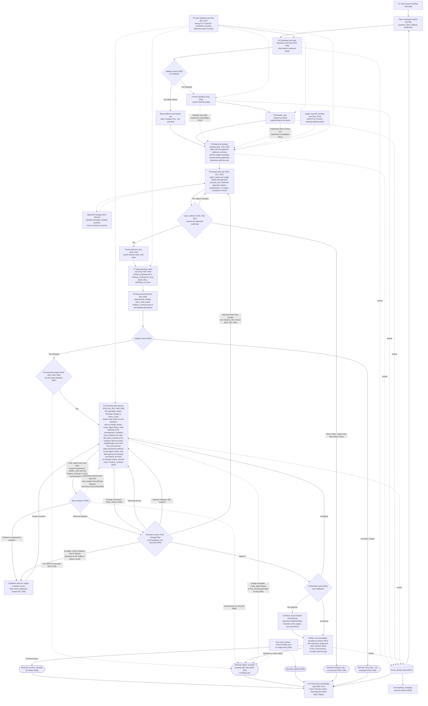

# Requirements Document

> Language: English (hackathon submission). Project name: GraftLab AI. Feature directory: `graftlab-ai`. In this document the product is called "the Studio".
> Anything marked "TO BE CONFIRMED" is an unverified external fact or a decision not yet made and MUST NOT be treated as verified. Anything marked "UNDECIDED" is a value or choice deferred to the design stage or later.
> Priority labels: "Must-have" (first version) or "Stretch" (only if time remains). The UI group (Requirements 1-8) is "Must-have, highest priority".
> Fallback statement (user): If the project cannot be finished, the user wants the UI (Requirements 1-8) and the requirement-analysis stage (flow steps F1-F6, ending with the frozen Decision_Doc) protected first. The final scope decision is made in the last week before the deadline; until then work proceeds at the normal pace. No priority tiers are defined now.

## Introduction

### Product in one sentence

A Judge types a GitHub repository URL on a search-like home page. Several AI roles analyze the repository like a meeting and interact with the Judge, and together they decide "how to make this software powered by AI". The Studio then plans in a document-first agile way and generates agile documents. For linkding (the only adapted software) the Studio runs it in a sandbox, uses it through a browser, develops against it (a code Agent changes a copy of the linkding source inside an isolated per-Task worktree), demonstrates each feature, and an independent Verifier decides success from executable acceptance checks.

### Top priority: the UI

The most important quality of this product is the UI. It MUST be interactive, the viewer MUST see that people (Agent_Roles) are working all the time, and every user action MUST get feedback. When trading off, UI interactivity and visible, honest agent activity take priority over breadth of features. Everything shown as "working" MUST be backed by real events.

### Process Principles

The user uses an agile process for three reasons:

1. The requirements are clear.
2. The work is split clearly.
3. Each Agent_Role can be given a very small task context (one story plus its referenced documents).

These reasons are made testable by the "small scope per Agent" rule in Requirement 19 (a Runtime_Rules rule, see Requirement 35 and the traceability table). What an Agent does inside that context is best effort (principle 5).

A fourth principle fixes who decides what:

4. **Decisions are made in the requirement meeting; development executes a feature-level contract and has no decision power.** How to make the target software AI-powered is decided in the requirement discussion (flow steps F3-F6) by the Agent_Roles together with the Judge, and a Prototype may be produced there to help the decision (Requirement 41). The requirement split (Product_Backlog) then gives every story a Feature_Contract (Requirement 40): what the feature should do, what it should not do, and how it is checked. The Studio cannot predict which files an Agent must change in an unfamiliar codebase, so it does not fix file paths in advance. It records every change, has the Reviewer Agent_Role assess afterwards whether the changed files fit the Feature_Contract (an LLM judgment, not a guarantee), and lets only the non-LLM Verifier decide success. When the development Code_Agent cannot resolve a problem, it stops and asks instead of retrying forever or improvising. Any need that goes beyond the Feature_Contract goes back to the requirement meeting and a new Decision_Doc version (Requirement 16).

A fifth principle fixes what the Studio can promise:

5. **Studio guarantees versus Agent best effort.** The Studio guarantees only what code can enforce or check:
   - the Flow_Graph and the Terminal_States (Requirement 36);
   - persistence and replay of events (Requirement 27);
   - validation of structured output against a schema (Requirements 23 and 35);
   - existence of cited evidence: a cited file exists and a quoted snippet is present, otherwise the claim is marked Unverified (Requirement 24);
   - write confinement of the Code_Agent to its Worktree by the container boundary of the Development_Sandbox (Requirement 38);
   - budgets and timeouts (Requirements 36 and 38);
   - the checks of the non-LLM Verifier (Requirement 22);
   - the write constraints of API-operation stories: writes come only from a schema-validated Demo_Case, are executed by Studio code, go only to the Sandbox linkding and only to endpoints allowed by the Adapter, and stay within the item-count cap per Demo_Case (Requirement 18);
   - honest display of failures (Requirement 23);
   - secret redaction: every known secret value is removed from every event before it is persisted, broadcast or written to a Replay_File (Requirement 30).

   What the Agent_Roles do well is a goal, not a guarantee: quality of analysis, adherence to an A/B path, quality of Assessments and reviews, and quality of generated code. These goals are measured by benchmarks and mitigated by checks. Requirements worded "THE Agent_Roles SHOULD ... (best effort, measured, not guaranteed)" are goals of this kind. Every Agent output shown to the Judge as an assessment or review is labeled as an LLM judgment.

A sixth principle fixes how the project itself is built:

6. **Build stage by stage with real data.** The project is built one stage at a time. The real output of one stage is used directly as the input to debug the next stage, and real documents are used for testing.

### Two product purposes

- **Purpose A (replace a human decision or work step with AI)**: a decision or a work step that a human makes or does today is made or done by AI, fully or partly.
- **Purpose B (AI-powered)**: with AI, a function of the software becomes stronger or becomes new.

How the user interface changes after a feature becomes AI-powered is a design question, not a direction question. It is proposed by the Agent_Roles and decided with the Judge, and it is recorded in the "UI impact" section of the Decision_Doc (Requirement 15). No UI change is pre-decided by these requirements.

Every analyzed workflow is labeled A or B. The default path suggested to the Agents depends on the label (the Studio enforces what the stage machine and the per-stage tools can enforce; the rest is best effort, see Requirement 18):

- A: read, plan, try one item first, write in batch, read back after writing.
- B: the A path plus one extra step, "retrieve or infer, then give a suggestion with evidence", with Judge confirmation required before any write.

### Who chooses the approach

How to make linkding AI-powered (an independent agent next to it, a source change to the application, a UI change, or a mix) is NOT pre-selected by the Studio team. It is decided at run time by the DeepSeek-driven Agent_Roles together with the Judge in flow step F6 and is recorded in the Decision_Doc. The Studio only ASSESSES each proposed approach (feasibility, effort, risk, needed environments, executable acceptance checks); the assessment is an LLM judgment, not a guarantee (see Requirement 37). The development stage never chooses, changes or extends the approach (Requirements 37 and 40).

### Kiroween category and Frankenstein statement

Target: Devpost Kiroween 2026, preferred category Frankenstein (stitching together seemingly incompatible technologies into a useful application). **The rules below are relayed by the user. The official page could not be read (HTTP 403), so every rule detail is TO BE CONFIRMED.** Whether the category name has changed is TO BE CONFIRMED.

Evaluation notes (TO BE CONFIRMED for 2026): the 2025 edition's page stated that entries are judged on potential value, implementation of Kiro, and creativity. The 2026 judging criteria could not be read and are TO BE CONFIRMED. Whether 2026 has extra prize categories is TO BE CONFIRMED.

| Part | Responsibility |
|---|---|
| Existing software (linkding) | Provides real business functions and a REST API; it is what gets transformed and verified |
| Agents (multiple roles) | Try to read the repository, hold the meeting, decide with the user, write documents, plan, operate linkding, and develop changes to a copy of linkding in a per-Task worktree; the Reviewer reviews the changed files (best effort, an LLM judgment) |
| Independent Verifier | Runs the executable acceptance checks (API read-back, the target's own test suite, browser check), compares with the plan item by item, and is the only judge of success |
| Event stream and replay layer | Stores all process events for live viewing and replay |
| Team workspace UI | Shows the roles working, takes user input, and gives feedback on every action |

What the combination adds: an Agent that looks like "just chat" is checked against the real API of existing software, corrected by an independent Verifier, and fully watchable and replayable. The chat box is only an entry point, not the product.

### Submission rules summary (relayed by the user, TO BE CONFIRMED)

- A runnable new work, substantially developed with Kiro during the submission period (2026-10-30 to 2026-12-04). A compliant open-source base is allowed, but old code MUST be disclosed with an explanation of what is new.
- Judges can actually try it (review account provided if login is needed), free to use until 2027-01-30 05:00 Beijing time.
- Public GitHub repository: full source, assets, run instructions, an identifiable open-source license; the root `.kiro/` directory MUST be committed and not ignored.
- Public YouTube demo video of at most 3 minutes; the video does not replace a usable product.
- Devpost text materials MUST be in English, including a write-up on how Kiro was used.
- Submission deadline: 2026-12-05 06:00 Beijing time.

### Verified linkding facts

Moved to `reference-target-linkding.md`, section "Verified linkding facts" (including the verified correction that a POST with an existing URL replaces title and tags).

## Glossary

- **Studio**: The whole product (frontend, backend, Agent runtime, Verifier, Event_Stream).
- **Judge**: The evaluator or trial user, the human who operates the Studio.
- **Viewer**: A person who only watches the current Task and cannot operate.
- **Task**: One complete analysis and (if adapted) execution flow started by submitting a GitHub URL.
- **Agent_Role**: An AI agent inside the Studio, defined by the function it performs in one flow step, not by a human job title (decided by the user, 2026-11-22). Function agents: Reader, Explorer, Facilitator, Planner, Reviewer; the Code_Agent is the development agent. Meeting_Perspectives take part only in the meeting. See "Roles and Queue Rules".
- **Repo_Memo**: The summaries of a downloaded repository: the Repo_Brief (one generic description of the whole repository, written before the meeting from the README, the docs and a planned set of files) and the Repo_Index (file memos and directory memos, built in the background). Tests, vendored and generated files get only a code-built map entry. Agents start from the brief, then open only the files they need. An LLM description, not evidence.
- **Repo_Brief**: The part of the Repo_Memo that the meeting waits for; see Requirement 10.7 and 10.11.
- **Proposal_Board**: The shared state of the meeting: the proposed AI changes, each with what changes for the user, a purpose tag, evidence, and one stance per Meeting_Perspective; see Requirement 11.11.
- **Evidence_Pool**: The quotes checked by Studio code during the meeting, each with an internal id that agents use to cite it; the ids are never shown to the Judge (Requirement 11.13).
- **Repo_Index**: The background part of the Repo_Memo; see Requirement 10.12.
- **Meeting_Perspective**: An Agent_Role that only speaks in the meeting and argues from one fixed viewpoint, so that the Judge sees real disagreement: User_Value (what the user gains, purpose A or B), Feasibility (interfaces, data, effort, how it can be built) and Risk (what can go wrong; safety rules are still enforced by Studio code).
- **Reviewer**: The Agent_Role that, in the development stage, reviews the files changed by the Code_Agent against the Feature_Contract and the Decision_Doc and answers technical questions of the Code_Agent; for stories whose confirmed approach executes the workflow by operating linkding through its API, it designs the Demo_Case. Its verdicts and Demo_Cases are LLM judgments (assessments, not guarantees) and are never success.
- **Review_Verdict**: The Reviewer's result for one story attempt: approve, request changes, or escalate. Labeled "reviewed by Reviewer (LLM judgment)".
- **Engineering_Details**: The collapsed, on-demand view of diffs, review verdicts, rejected changes and tool calls. Never the main Judge view.
- **Best_Effort_Goal**: A requirement worded "THE Agent_Roles SHOULD ... (best effort, measured, not guaranteed)"; its quality is measured by benchmarks and mitigated by checks.
- **Adapter**: An adaptation package for one specific software. The first version has only the linkding Adapter. It carries only what the Studio itself needs: the target identity and reference (the upstream repository and pinned commit for the source copy, and the unmodified baseline, identified as the official linkding container image pinned by digest plus its documented configuration), the fixed test data set, and the assessment checks. The Sandbox runs that unmodified baseline. The Adapter does not define how to build or start the modified target (Requirement 39). Its exact contents are set in design.md, section "Adapter contract"; the linkding values are in `reference-target-linkding.md`.
- **Adapted_Repo**: A repository that has an Adapter; in the first version only linkding.
- **Other_Repo**: Any other public GitHub repository; analysis and documents only.
- **Repo_Reader**: The Studio component that downloads and reads a repository read-only.
- **Sandbox**: The isolated environment that runs the unmodified target baseline (linkding in the first version) for flow steps F4 and F5: the target's container image pinned by digest, with its documented configuration, as identified by the Adapter.
- **Evidence_Gathering**: The part of the flow before the meeting: reading the repository (F2) and, for an Adapted_Repo, the Sandbox start (F4) and the Browser_Use experience (F5). During Evidence_Gathering the Studio narrates the work and asks the Judge no questions; Judge messages are accepted and delivered when the meeting starts.
- **Browser_Use**: An Agent operating the sandboxed linkding web page through a browser like a human. Does not include controlling the whole desktop (computer use).
- **Decision_Doc**: The decision document produced in flow step F6; once confirmed by the user it is frozen and is the stable baseline for everything after.
- **Approach_Option**: One proposed way to make linkding AI-powered (independent agent, source change, UI change or a mix), proposed by the Agent_Roles and carried in the Decision_Doc together with its assessment.
- **Assessment**: The Agent_Roles' evaluation of one Approach_Option: feasibility, effort, risk, needed environments, and executable Acceptance_Checks. It is an LLM judgment, labeled as such, not a guarantee.
- **Acceptance_Check**: An executable check that proves a feature works: an API read-back compared item by item, a run of the target's own test suite in a fresh container from the Development_Sandbox image, or a scripted Playwright browser check (no LLM) in the Run_Environment (Requirement 22.2).
- **Flow_Graph**: The explicit graph of Task stages (nodes and guarded edges stored as data) that governs every state transition of a Task.
- **Terminal_State**: One of success, failed, aborted, Analysis only, Docs only.
- **Test_Agent**: The in-product Agent that writes the tests of one Feature before the Code_Agent builds it (test first). It runs in the Development_Sandbox like the Code_Agent, changes only test files, and has no decision power.
- **Code_Agent**: The in-product Agent that edits a copy of the target source and runs tests inside the Development_Sandbox. It has no decision power and stops and asks when it cannot resolve a problem.
- **Worktree**: An isolated per-Task working copy of the target source under git (implemented as a local clone from a mirror, not a linked worktree; see design), one per Task, holding the only modified copy of the target source.
- **Feature_Contract**: The per-story, feature-level contract derived from the Frozen Decision_Doc and carried by every Product_Backlog story. It states the feature in plain language, what it should do, what it should NOT do (in feature terms), executable Acceptance_Checks where possible, and budgets. It contains no file or path lists (Requirement 40).
- **Demo_Case**: The case that the Reviewer designs for one story whose confirmed approach executes the workflow by operating linkding through its API: which endpoints are called, which test-data items are used, the expected outcome, why the case is harmless, and how it is reversed. It is validated against its schema, labeled "designed by Reviewer (LLM judgment)", executed only by Studio code against the Sandbox linkding, and its expected outcome becomes the Verifier's API read-back Acceptance_Checks for that story (Requirement 18).
- **Item_Count_Cap**: The maximum number of test-data items one Demo_Case may write (initial value 10, set in design.md, adjustable).
- **Prototype**: A throwaway artifact the Agent_Roles may build in flow steps F3-F6 to help the approach decision. It is labeled "Prototype", is never an execution result and never counts as success (Requirement 41).
- **Patch_Artifact**: The stored diff of the changes produced in a Worktree, kept as an Output_Docs artifact per Task.
- **Dev_Environment**: Environment 1: the team's own development environment, used to build the Studio itself.
- **Studio_Runtime**: Environment 2: the Studio product runtime (Node backend and web UI).
- **Development_Sandbox**: Environment 3: the one container per Task in which the whole code-Agent runtime, its tools and the needed toolchains (Node and Python) run. Confinement of the Code_Agent's file writes to its Worktree comes from the container boundary. Only one Task runs at a time (Requirement 28), so one container is enough. The exact image and the network policy are UNDECIDED (design).
- **Run_Environment**: Environment 4: the environment that runs the modified target software starting from the Task's Worktree result. How to build and start the target is analyzed by the Agent_Roles from the target's own files and documentation; the Studio only assesses the result (Requirement 39).
- **Frozen**: The immutable state of a Decision_Doc version after user confirmation.
- **Verifier**: The independent, non-LLM verifier. Runs the Acceptance_Checks, compares results with the plan, and does not call an LLM to judge results.
- **Event_Stream**: The ordered list of process events saved by the Studio; live view and Replay read the same list. It holds complete messages and message lifecycle events; streamed text chunks are not stored.
- **Complete_Message**: A model message persisted in full in the Event_Stream. An interrupted stream is persisted as the partial text marked "incomplete" with the reason.
- **Replay**: Event-stream playback from a saved JSON file; always labeled "Replay". Typing of messages in a Replay is animated in the UI from the stored Complete_Message and is simulated.
- **Replay_File**: The JSON file holding a saved Event_Stream with a schema version.
- **Checkpoint_Demo**: The demo and confirmation point of one feature during development.
- **Unconfirmed**: The mark on a result when the user did not respond at a confirmation point; it MUST NOT be treated as confirmed.
- **Unverified**: The mark on a conclusion that has no supporting evidence, or whose cited evidence fails the Studio's existence check (cited file missing or quoted snippet absent); displayed as "Unverified".
- **Failure_Class**: Failure classification, at least four classes: interface call failure, read-back mismatch, LLM output format invalid, rejected by a safety rule (for example a blocked worktree-escape attempt); additionally budget exceeded and blocked by an unanswered question (Requirement 23.2).
- **Analysis_Only**: The on-screen label "Analysis only - not executed".
- **Docs_Only**: The on-screen label "Docs only - not developed".
- **Case_Card**: A "similar approaches" card collected by the team itself, with a source link and an evidence boundary.
- **Workspace**: The live team workspace screen shown after a URL is submitted (Requirement 1).
- **Presence_Card**: The card in the Workspace showing one Agent_Role's avatar, name, role and status.
- **Role_Status**: The status shown on a Presence_Card. Allowed values include reading, speaking, thinking, waiting for user, waiting for LLM, waiting for answer, blocked, idle.
- **Activity_Feed**: The live narrated list of what is happening in the Workspace.
- **Artifact_Area**: The Workspace area showing the current work product, in feature terms (Engineering_Details only on demand).
- **Interjection_Input**: The always-available input through which the Judge talks to the roles.
- **Interaction_Card**: An inline card in the Workspace: a question card (options plus free text) or a confirm/reject card.
- **Recency_Window**: The maximum age of the last Event_Stream event that may back a "working" indicator. Value UNDECIDED (design).
- **Dev_Docs (layer A)**: Our own development documents: AGENTS.md, .kiro/steering, .kiro/specs, hooks.
- **Runtime_Rules (layer B)**: Rules given to the in-product Agent_Roles (the Studio enforces what code can enforce; adherence otherwise is best effort): role duties, behavior rules, stage output schemas, linkding Adapter checklist, case library rules. Versioned and loaded at run time.
- **Output_Docs (layer C)**: Documents generated by the Studio for each analyzed repository (see Agile_Docs).
- **Agile_Docs**: The Output_Docs set: Decision_Doc, Product_Backlog, Sprint_Plan, Task_Board, Definition_of_Done, Demo_Review_Notes, Retrospective, plus requirements, design and tasks documents for the analyzed repository.
- **Product_Backlog**: The list of user stories, each with acceptance criteria and a priority.
- **Sprint_Plan**: The sprint goal and the selected stories.
- **Task_Board**: The work items and their status (for example to do, in progress, done, blocked). In the development stage it is shown live as a whiteboard: one card per Feature with its phase and the agent working on it.
- **Regression_Check**: The Verifier's run of the target's whole test suite on the merged `main`, compared test by test with the same run on the pinned commit.
- **AI_Usage**: Token counts of model calls, per Agent_Role and for the changed app's own calls through the LLM_Proxy, with a cost estimate from configured prices.
- **Definition_of_Done**: The shared checklist a story must satisfy to count as done.
- **Demo_Review_Notes**: One note per feature confirmation point, recording the demo and the Judge feedback.
- **Retrospective**: The end-of-Task review of what worked, what failed and what to change.
- **TTS_Service**: The in-cluster text-to-speech service (details in Requirement 31).
- **LLM_Config**: The LLM base address, model name and key supplied by the Judge or the server.
- **LLM_Proxy**: The Studio's own LLM proxy that holds the real LLM key and forwards requests from the Development_Sandbox, authenticating callers by a per-Task proxy credential (Requirement 30).

## UI Principles

1. Alive but honest: show activity only when real events back it; otherwise show idle or the honest waiting reason.
2. Always interactive: the Judge can speak to the roles at any moment, and every action gets visible feedback.
3. Narrated waiting: long waits are filled with meaningful narration of real work, not spinners.
4. Show the work: the current work product is always visible next to the people producing it.
5. One view for live and replay: Replay reuses the Workspace and is always labeled "Replay".
6. Accessible by default: reduced-motion respected, keyboard operation for decisions.
7. Feature-first: the Judge-facing view speaks in features and demos (feature name, plain-language status, a demo, confirm cards in feature words). Engineering details (diffs, review verdicts, rejected changes, tool calls) are recorded in the Event_Stream and live in a collapsed, on-demand "Engineering details" view; they are never pushed to the Judge as the main view.

### Illustrative wireframe (ILLUSTRATIVE ONLY, not a final design)

The exact layout and the decision-step UI are UNDECIDED and will be explored by experimenting during implementation.

```text
+----------------------------------------------------------------------------------+
| Studio | repo: github.com/sissbruecker/linkding | Task: running | [Replay: off]  |
+------------------------+---------------------------------------+-----------------+
| TEAM (Presence_Cards)  | ARTIFACT AREA                         | ACTIVITY FEED   |
| +--------------------+ | +-----------------------------------+ | 12:01 Reading   |
| | Facilitator        | | | [Files] [Diagram] [Decision Doc]  | |  bookmarks/api  |
| | status: speaking   | | | [Browser view]                    | | 12:02 Reader:   |
| +--------------------+ | |                                   | |  found tag rules|
| | Reader             | | |  (current work product shown      | | 12:02 Reader:   |
| | status: thinking   | | |   here, e.g. file being read,     | |  endpoint /api/ |
| +--------------------+ | |   diagram being built, or live    | |  bookmarks/     |
| | Explorer           | | |   sandboxed linkding page)        | | 12:03 Waiting   |
| | status: waiting    | | |                                   | |  for LLM, 12 s  |
| |   for LLM (12 s)   | | +-----------------------------------+ |                 |
| +--------------------+ |                                       |                 |
| | User_Value         | | INTERACTION CARDS                     |                 |
| | status: idle       | | +-----------------------------------+ |                 |
| +--------------------+ | | Facilitator asks: Which workflow? | |                 |
| | Feasibility        | | | (o) Import  (o) Dedupe  [free text]| |                 |
| | status: idle       | | | [Send]                            | |                 |
| +--------------------+ | +-----------------------------------+ |                 |
+------------------------+---------------------------------------+-----------------+
| Talk to the team: [ to: All v ] [ type a message...                    ] [Send]  |
| Progress: indeterminate - reading repository (file count unknown yet)            |
+----------------------------------------------------------------------------------+
```

## Flow Chart and Document Layers

### Flow chart (for user review)

Every step is labeled with a name and the requirement ids that cover it. Step ids F1-F11 are flow step ids, not requirement numbers; the mapping table below links them.



Flow chart notes:

- F4 and F5 run before F3: evidence is gathered first so the meeting is not interrupted by waits. Evidence_Gathering is F2 and, for linkding, F4 and F5. During it the Workspace narrates the reading and the experience with live screenshots; Judge messages are accepted, acknowledged and recorded and are delivered to the roles when F3 starts; the Judge is not asked questions (R11, R12).
- A Sandbox start failure (F4) or an experience failure or timeout (F5) is recorded honestly, labeled "experience unavailable", and the flow continues to F3 on the reading evidence (dotted edges); it does not end the Task. The Judge may end F4 or F5 early with "start the meeting now"; F3 then uses what was gathered so far, labeled partial (R13.4, R14.13, R14.14).
- The pre-execution target check before F10 is the only point where an unavailable target baseline ends the Task: in `failed` with the label "not executed" (R13.4, R25.8, R29.5).
- F9 "user interjects any time" runs through the whole flow and is drawn with dotted lines.
- Demonstration runs through the whole flow: F5 is itself a demo, and F10 builds and demos one feature at a time.
- Any step may fail; the chart shows the failure path at the verification stage as the representative case, and the same honest recording applies to all other steps (R23).
- Freeze point: F7 and later steps MUST NOT start before the Decision_Doc is confirmed.
- The chart is the draft of the Flow_Graph (R36): nodes and edges are data with guards; a deterministic stage machine moves the Task between nodes, and Agent loops run inside a node, never across nodes. The rounded nodes are Terminal_States.
- The approach to make linkding AI-powered is decided at F6 by the Agent_Roles with the Judge; the Studio only assesses it (R37).
- F7 and F8 produce the Feature_Contract of every story. In F10 every change is recorded, the Reviewer reviews the changed files against the Feature_Contract (an LLM judgment, not a guarantee), the Code_Agent stops and asks when it cannot resolve a problem, and a need to change the approach returns to F6 with a new Decision_Doc version. Development has no decision power (R40). Success is decided only by the Verifier's checks, which run after review and confirmation.
- Diffs, review verdicts and rejected changes go to the Event_Stream and the collapsed Engineering details view; the Judge sees feature-level status, demos and confirm cards (UI principle "Feature-first").
- The dashed Prototype activity off F6 is optional (Stretch, R41); it is requested during the requirement discussion (F3-F6), returns to F6, and never replaces the Decision_Doc confirmation.
- F11 is a view of the saved Event_Stream after a Terminal_State; it is not a stage that changes the Task outcome.
- The Event_Stream feeds the Workspace, so every presence and activity display comes from real events (R2).
- The Event_Stream stores complete messages only; live streamed text is shown in the Workspace while it arrives and is not stored, and Replay animates typing from the stored complete message (R3, R26, R27).

### Flow step to requirement mapping

| Flow step | Name | Requirement ids |
|---|---|---|
| Workspace | Team workspace screen | R1-R8 |
| F1 | Home input | R9 |
| F2 | Download and read (Evidence_Gathering) | R10, R34 |
| Adapter branch | Adapted_Repo or Other_Repo, right after F2 | R25, R9 (labeling) |
| F4 | Sandbox, before the meeting (Evidence_Gathering); a failure continues to F3 labeled "experience unavailable" | R13, R29, R39 |
| F5 | Browser_Use, before the meeting (Evidence_Gathering); a failure or timeout continues to F3 labeled "experience unavailable"; the Judge may end it early | R14 |
| Evidence_Gathering (F2, F4, F5) | Judge messages accepted, recorded and delivered when F3 starts; no questions to the Judge | R12 |
| F3 | Meeting analysis after Evidence_Gathering, starting with the gathered-evidence summary (partial or "experience unavailable" where applicable) | R11, R18, R24 |
| F6 (optional Prototype) | Prototype during the requirement discussion, drawn off F6 | R41 (Stretch) |
| F6 | Decide, approach options and assessment, freeze, versions; decision made here, not in development | R15, R16, R17 (Case_Cards, Stretch), R37 |
| F7 | Agile planning, Feature_Contract per story | R19, R20, R40 |
| F8 | Document-first, Feature_Contract in backlog documents | R19, R20, R40 |
| F9 | Interjection | R5, R12 |
| Pre-execution target check | Before F10: can the target baseline start; failure ends in failed "not executed" | R13, R25, R29 |
| F10 | Develop in a worktree inside the per-Task container against the Feature_Contract, Reviewer review, stop and ask, run (start procedure analyzed by the Agent_Roles), confirmation points and reminders; for API-operation stories, a Reviewer Demo_Case executed by Studio code against the Sandbox | R18, R21, R22, R38, R39, R40 |
| Verification and failure | Verifier, honesty, Engineering details | R22, R23, R24, R38, R40 |
| Terminal states and Flow_Graph | Stage machine, all stages | R36 (all flow steps), R25 (Analysis only, Docs only labels) |
| F11 | Final demo and Replay | R26, R27 |
| Cross-cutting | Queue, LLM config, TTS, portability, compliance, layers | R28, R30, R31, R32, R33, R35 |

### Three document layers

| Layer | Name | Content | Reader | Delivery | Location |
|---|---|---|---|---|---|
| A | Dev docs | AGENTS.md, .kiro/steering, .kiro/specs, hooks | Developers and Kiro | Committed with the repository | Repository root and `.kiro/` |
| B | Runtime rules | Role duties, behavior rules, stage output schemas, linkding Adapter checklist, case library rules | In-product Agent_Roles | Shipped with the product, versioned, loaded at run time | `runtime-rules/` (decided in design.md) |
| C | Output docs | Decision_Doc, Product_Backlog, Sprint_Plan, Task_Board, Definition_of_Done, Demo_Review_Notes, Retrospective, plus requirements, design, tasks for the analyzed repository | Judge | Generated at run time, one set per Task | `data/tasks/<taskId>/docs/` (decided in design.md; generated, gitignored) |

Traceability: key requirements in A map to rules in B and to test checks. Example: A says "failures MUST be shown honestly", B has a matching Agent rule, and a test has a matching check. See the traceability table at the end.

Process note for our own work (layer A stays in Kiro format): each feature in our own tasks will include a "demo and verify" item. The design and tasks phases will honor this.

## Roles and Queue Rules

| Role | Type | Description |
|---|---|---|
| Judge | Human | Submits the URL, joins the meeting, confirms the Decision_Doc, gives feedback at confirmation points. Only one Judge can operate at a time |
| Viewer | Human | Queued or watching; can watch the current Task but cannot operate; never sees any key |
| Reader | Agent_Role (function) | Reads the downloaded repository in flow step F2 and records findings with evidence |
| Explorer | Agent_Role (function) | Uses the Sandbox target in a browser in flow step F5 (the Browser_Use operator) and records what it observed |
| Facilitator | Agent_Role (function) | Runs the meeting, summarizes disagreements, asks the Judge, and drafts the Decision_Doc including its executable acceptance checks (flow steps F3 and F6) |
| User_Value | Meeting_Perspective | Argues for what the user gains; proposes workflows and labels them A or B |
| Feasibility | Meeting_Perspective | Argues from interfaces, data and effort; assesses how each approach can be built |
| Risk | Meeting_Perspective | Argues from what can go wrong; assesses the risk of each approach; safety rules are enforced by Studio code, not by this role |
| Planner | Agent_Role (function) | Splits the frozen decision into stories with Feature_Contracts and writes the Output_Docs (flow steps F7 and F8) |
| Reviewer | Agent_Role (function) | Active in the development stage: reviews the files changed by the Code_Agent against the Feature_Contract and the Decision_Doc (approve, request changes, escalate) and answers technical questions; also active for API-operation stories, where it reads the relevant code with read-only tools and designs the Demo_Case (endpoints, test-data items, expected outcome, harmlessness reason, reversal statement); its verdicts and Demo_Cases are LLM judgments, not guarantees, and not success |
| Test_Agent | Agent_Role (function) | Writes the tests of one Feature before the code exists, from the Feature_Contract and the technical design, inside the per-Task container; changes only test files; has no decision power (decided by the user 2026-11-24) |
| Code_Agent | Agent_Role (function) | Develops one story inside the per-Task container; has no decision power and stops to ask; may add tests but may not change the Test_Agent's tests |
| Verifier | Non-LLM component | The only judge of success |

Agents are split by function, one per flow step, not by human job titles (decided by the user, 2026-11-22). Each function agent has one step, one input and one schema-validated output. The three Meeting_Perspectives exist only to bring different viewpoints into the meeting; they are shown only while the meeting runs. The former draft roles map as follows: Moderator became the Facilitator; Product became User_Value (meeting) and the Explorer (browser experience); Architecture became Feasibility (meeting) and the Reader (reading); Risk_and_Security became Risk; Verification was removed (the Facilitator drafts the acceptance checks; only the Verifier decides success); Tech_Manager became the Reviewer.

Every agent has its own Presence_Card. The Verifier has a Presence_Card that is visibly different from Agent_Role cards (no reasoning section, a list of checks only) and labeled "code, no LLM".

Queue and watching rules: only one Judge operates at a time; others queue and may watch the current Task; no view may display a key.

## Requirements

### Group 1: Team Workspace UI (Must-have, highest priority)

### Requirement 1: Live team workspace screen

**User Story:** As a Judge, I want a live team workspace right after I submit a URL, so that I can see the roles working as a team.

**Priority:** Must-have, highest priority

#### Acceptance Criteria

1. WHEN a Task is created, THE Studio SHALL open the Workspace for that Task.
2. WHEN an Agent_Role (or the Verifier) has its first event in the Task, THE Workspace SHALL display its Presence_Card from then on, showing the avatar, the name, a short description and the current Role_Status; THE Workspace SHALL NOT display a Presence_Card for an agent that has not yet started in the Task.
3. THE Workspace SHALL provide an Activity_Feed area, an Artifact_Area, an Interjection_Input and an Interaction_Card area on one screen; THE Interjection_Input SHALL be shown at all times (Requirement 5.1), while the Artifact_Area, each of its tabs and each Interaction_Card SHALL appear only when they first have content.
9. THE Workspace SHALL show an element only when it first becomes useful (progressive disclosure, decided by the user 2026-11-22): no empty placeholders for agents, tabs, panels or controls that have nothing yet; the progress indicator of Requirement 7 and the Interjection_Input are the only elements shown in advance.
4. WHEN a Role_Status changes, THE Workspace SHALL update the corresponding Presence_Card.
5. WHERE the Task is a Replay, THE Workspace SHALL use the same layout as a live Task.
6. THE Studio SHALL give each Agent_Role an avatar.
7. WHERE a dark Halloween theme is used, THE Studio SHALL treat it as a styling choice only; the main Kiroween category remains Frankenstein.
8. THE project documents SHALL treat the question whether one entry may be in more than one Kiroween category as TO BE CONFIRMED and SHALL NOT assume the answer.
10. WHILE the development stage runs, THE Workspace SHALL show the Task_Board as a whiteboard (decided by the user 2026-11-24): one card per Feature, grouped by story, showing the Feature's phase (to do, writing tests, building, in review, running the app, demo, verifying, merged, failed, blocked), the agent working on it with that agent's current Role_Status, the attempt number, the size of the change (files, added and removed lines) and the Verifier result; every phase SHALL come from a recorded event, and counts such as "2 of 4 Features merged" SHALL be computed from those events.

### Requirement 2: Event-backed presence, no fake animation

**User Story:** As a Judge, I want every "working" indicator to reflect something real, so that I can trust what I see.

**Priority:** Must-have, highest priority

#### Acceptance Criteria

1. THE Studio SHALL derive every Role_Status from events in the Event_Stream.
2. WHILE an Agent_Role has no event inside the Recency_Window, THE Workspace SHALL show that role as "idle" or with an honest waiting reason.
3. WHILE the Studio waits for an LLM response, THE Workspace SHALL show the role as "waiting for LLM" with the elapsed seconds, for example "waiting for LLM response, 12 s elapsed".
4. THE Studio SHALL show a "working" indicator (reading, speaking, thinking) on a Presence_Card only when an Event_Stream event for that role exists inside the Recency_Window.
5. THE Recency_Window value SHALL be UNDECIDED and decided in the design stage.
6. WHEN an Agent_Role is blocked by a failure or a safety rule, THE Workspace SHALL show the status "blocked" with the reason.
7. WHILE nothing is happening in a Task, THE Workspace SHALL NOT display any animation that implies activity.
8. THE Studio SHALL show a role as "speaking" or "thinking" because of streaming only when a message-started event or a message-progress event for that role's message exists inside the Recency_Window and no event that ends that message (complete or incomplete) follows it. A message-progress event is a text-free lifecycle event that the Studio emits at a fixed interval while the message streams; it stores no text (Requirement 27.10).
9. WHERE Halloween-style avatar effects are used, THE Studio SHALL bind each effect to the Role_Status derived from events, and SHALL show no activity effect on an avatar while no event backs it.
10. WHILE the Code_Agent waits for an answer to a question (Requirement 40), THE Workspace SHALL show an honest "waiting for answer" status with the asked party (Reviewer or Judge) and the elapsed seconds.

### Requirement 3: Live activity feed with narration and streaming LLM output

**User Story:** As a Judge, I want a live feed that narrates what is happening, so that long waits feel immersive and informative.

**Priority:** Must-have, highest priority

#### Acceptance Criteria

1. WHEN an event is appended to the Event_Stream, THE Activity_Feed SHALL display a narration entry for it, including the acting role and a timestamp.
2. THE Activity_Feed SHALL narrate each of these event kinds when it occurs in the Event_Stream: file being read, finding recorded, endpoint recorded, statement made, Judge message received, and action taken in the browser. Whether the Agent_Roles produce findings or endpoints is best effort (Process Principle 5); the Studio narrates only what was recorded.
3. WHERE a narration entry refers to a repository file, THE Activity_Feed SHALL attach the source file path to that entry.
4. WHEN the Judge selects a narration entry that has an artifact, THE Workspace SHALL show that artifact in the Artifact_Area.
5. THE Activity_Feed SHALL narrate only events that exist in the Event_Stream.
6. WHEN an Agent_Role is generating a response, THE Activity_Feed and the Presence_Card of that role SHALL display the model output incrementally as it arrives.
7. THE Studio SHALL display as live streamed text only the actual model output, and SHALL NOT display simulated text or text replayed from a cache while it is labeled as live.
8. WHEN a stream ends, THE Activity_Feed SHALL mark the entry as complete and THE Studio SHALL persist the Complete_Message in the Event_Stream.
9. IF a stream breaks, THEN THE Activity_Feed SHALL mark the entry "incomplete" with the reason, SHALL keep the partial text, THE Studio SHALL persist the partial text as a message marked "incomplete" with the reason, and THE Studio SHALL record the break as a failure with its Failure_Class.
10. WHILE a stream has not started, THE Presence_Card SHALL show "waiting for LLM" with the elapsed seconds (Requirement 2).
11. THE Studio SHALL persist only Complete_Messages and incomplete messages (criteria 8 and 9) and SHALL NOT store streamed text chunks; the live incremental display of criterion 6 is shown while the text arrives and is not itself stored.
12. WHERE the provider returns reasoning text with a response, THE Activity_Feed SHALL display the real reasoning text in a collapsible section labeled as model-provided.
13. WHERE the provider returns no reasoning text, THE Activity_Feed SHALL show only a "thinking" state with the elapsed seconds and SHALL NOT display invented reasoning text.

### Requirement 4: Artifact area

**User Story:** As a Judge, I want to see the work product being built, so that I know what the roles are producing.

**Priority:** Must-have, highest priority

#### Acceptance Criteria

1. THE Artifact_Area SHALL display the current work product in feature terms, selectable from: files being read, the diagram or whiteboard-style view the roles are building, the Decision_Doc draft, and, in the development stage, the feature name, its plain-language status and its demo.
2. WHERE the Task is Adapted_Repo and a Browser_Use session is running, THE Artifact_Area SHALL display a live view of the sandboxed browser session.
3. WHEN a new work product appears, THE Artifact_Area SHALL show a notification that identifies it without taking focus away from the Judge's current selection.
4. WHILE a file is being read, THE Artifact_Area SHALL display the file path and the content portion read so far.
5. THE Artifact_Area SHALL display the Decision_Doc draft with its version number and its Unverified marks.
6. IF a work product that the flow was going to produce is unavailable (for example the browser experience after a failed Sandbox start), THEN THE Artifact_Area SHALL display the reason; a work product that is simply not due yet is not shown at all (Requirement 1.9).
7. WHEN the first tool call, diff, Review_Verdict or rejected change exists, THE Artifact_Area SHALL provide a collapsed "Engineering details" view, closed by default, that shows on demand the diffs, Review_Verdicts, rejected changes and tool calls of the development stage.
8. THE Studio SHALL NOT push diffs, Review_Verdicts or rejected changes into the Judge's main view and SHALL NOT open the Engineering details view without a Judge action.
9. THE Engineering details view SHALL show the code changes (decided by the user 2026-11-24): per Feature attempt the changed files with added and removed lines, each marked planned or unplanned, and the diff text; and for the Task the whole change of `main` against the pinned commit as a file list with line counts. The diff text SHALL travel in the Event_Stream, so Replay shows the same changes.

### Requirement 5: Interjection, questions and confirmation cards

**User Story:** As a Judge, I want to talk to the team at any moment and answer their questions inline, so that I can steer the work.

**Priority:** Must-have, highest priority

#### Acceptance Criteria

1. WHILE a Task is running, THE Interjection_Input SHALL be available at all times.
2. WHERE the Judge selects a specific Agent_Role as addressee, THE Studio SHALL deliver the message to that role as the primary recipient.
3. WHEN an Agent_Role asks the Judge a question, THE Workspace SHALL display an inline question card with predefined options and a free-text field. A meeting question does not block the meeting (Requirement 11.4); a card still open when the meeting ends is closed as unanswered and listed as an open question.
4. WHEN a decision, a confirmation or a Checkpoint_Demo needs the Judge, THE Workspace SHALL display an inline confirm/reject card worded in feature terms (feature name, what it does, the demo), without file names, paths or diffs.
5. WHEN a Code_Agent question or a Reviewer escalation about a feature or requirement needs the Judge, THE Workspace SHALL display it as a question card phrased in feature terms.
6. WHEN the Judge answers a card, THE Studio SHALL record the answer in the Event_Stream and deliver it to the asking role.
7. WHEN a schema-valid Decision_Doc draft is ready for confirmation, THE Workspace SHALL present it as a list of review items (one per Decision_Doc section, the approach options as one item with exactly one selectable approach or combination), SHALL let the Judge accept or reject each item, SHALL require a reason for each rejection, SHALL send the draft back for revision with the rejected items and reasons only when every item has a verdict and at least one is rejected, SHALL keep the verdict of an item whose content is unchanged in the next draft and reset changed items to pending, and SHALL enable the final freeze only when every item is accepted (decided by the user, 2026-11-22: draft, item-by-item accept or reject, final freeze).
8. WHEN the Studio reminds the Judge of pending Unconfirmed items (Requirement 21.8), THE Workspace SHALL display the reminder as an inline card that lists each pending item in feature terms, without file names, paths or diffs.

### Requirement 6: Feedback for every user action

**User Story:** As a Judge, I want immediate feedback on everything I do, so that I know the system heard me.

**Priority:** Must-have, highest priority

#### Acceptance Criteria

1. WHEN the Judge submits an input, THE Workspace SHALL display an acknowledgement that the input was received and delivered.
2. THE acknowledgement time bound SHALL be UNDECIDED and decided in the design stage.
3. WHEN the Studio delivers a Judge input to an Agent_Role, THE Workspace SHALL show a Role_Status change or an Activity_Feed entry for that delivery; the content and quality of the role's reply are best effort (Process Principle 5).
4. IF delivery of a Judge input fails, THEN THE Workspace SHALL display the failure next to that input.
5. WHEN the Judge confirms or rejects a card, THE Workspace SHALL display the resulting state change.

### Requirement 7: Honest progress and Replay in the same view

**User Story:** As a Judge, I want honest progress and a replay in the same screen, so that nothing is faked and review is easy.

**Priority:** Must-have, highest priority

#### Acceptance Criteria

1. WHERE a progress value is known, THE Workspace SHALL display the real value.
2. WHERE a progress value is unknown, THE Workspace SHALL display an indeterminate state together with an explanation of what is being waited for.
3. THE Workspace SHALL NOT display a progress value that is not computed from real data.
4. WHILE the Workspace plays a Replay, THE Workspace SHALL display the label "Replay" visibly at all times.
5. WHEN a Replay plays, THE Workspace SHALL render presence, feed and artifacts from the saved Event_Stream.

### Requirement 8: Basic accessibility

**User Story:** As a Judge with accessibility needs, I want motion and keyboard handling to respect my settings, so that I can use the Workspace comfortably.

**Priority:** Must-have, highest priority

#### Acceptance Criteria

1. WHILE the operating system reduced-motion setting is on, THE Workspace SHALL disable non-essential animation.
2. THE Workspace SHALL allow every confirm/reject card and question card to be operated using the keyboard alone.
3. THE Workspace SHALL show a visible focus indicator on every interactive element.
4. THE Workspace SHALL NOT convey a Role_Status by color alone and SHALL include the status text.

### Group 2: Core Flow

### Requirement 9: Home page input

**User Story:** As a Judge, I want a search-like home page with one input, so that I can start an analysis by pasting a GitHub repository URL.

**Priority:** Must-have

#### Acceptance Criteria

1. THE Studio SHALL display on the home page a single input for a GitHub repository URL and no other required input.
2. WHEN the Judge submits a URL that matches the form of a public GitHub repository address, THE Studio SHALL create a Task and start the reading step.
3. IF the submitted text is not a GitHub repository URL, THEN THE Studio SHALL display an error that names the expected form and SHALL NOT create a Task.
4. IF the repository does not exist or is not public, THEN THE Studio SHALL display the reason returned by GitHub and SHALL NOT create a Task.
5. WHEN a Task is created, THE Studio SHALL label the Task as Adapted_Repo or Other_Repo according to whether an Adapter exists for it.

### Requirement 10: Download and read-only reading, immersion

**User Story:** As a Judge, I want to watch the repository being read in real time, so that I understand what the Agent reads and discovers during a long wait.

**Priority:** Must-have

#### Acceptance Criteria

1. WHEN a Task starts, THE Repo_Reader SHALL download the repository content using a read-only credential. WHERE the Task is Adapted_Repo, THE Repo_Reader SHALL download the commit the Adapter pins, so that the code the roles analyze is the code that is developed, built and verified (decided by the user 2026-11-23); for Other_Repo it downloads the head of the default branch.
2. WHILE the Repo_Reader is reading, THE Studio SHALL display in real time the file currently being read and each finding the Agent_Roles record, with the source file path; which findings the Agent_Roles discover is best effort.
3. THE Repo_Reader SHALL treat the downloaded repository as read-only text and SHALL NOT execute any file from it.
4. THE Studio SHALL record each reading event into the Event_Stream with a timestamp.
5. IF the download fails, THEN THE Studio SHALL display the failure reason, record it in the Event_Stream, and stop the Task without retrying silently.
6. WHERE the repository exceeds the read-volume limit defined in Requirement 34, THE Repo_Reader SHALL display which parts were skipped.
7. WHEN the download finishes, THE Studio SHALL build a Repo_Brief before the meeting: the README is read in full, the docs are outlined by code and the pages that explain features and setup are read, and the Reader reads a bounded, planned set of source files, so that the meeting knows what the software is, who uses it and where its features live without reading every file (decided by the user 2026-11-23, revised the same day after a 388 s full-memo run).
8. WHILE the Repo_Brief and the Repo_Index are built, THE Studio SHALL show each summary as it is written, with its path; a summary is an LLM description (best effort) and SHALL NOT count as evidence (Requirement 24 still needs a quoted snippet from the file).
9. THE Studio SHALL cache the Repo_Brief and the Repo_Index per repository commit, so that a repeated Task on the same commit does not build them again.
10. THE Studio SHALL show the Reader's reading plan with the reason for each planned file; the plan stays within the caps enforced by code, and IF the plan call fails, THEN THE Studio SHALL show the failure and use the code ranking instead, labeled as such.
11. THE Repo_Brief SHALL use one format for every repository (what it is, users and their jobs, how it runs, core concepts, features with paths, extension points labeled as an LLM assessment, unknowns, and coverage computed by code), with source paths for every claim and unknowns listed instead of guessed.
12. AFTER the Repo_Brief, THE Studio SHALL build the Repo_Index of the remaining files in the background without delaying the meeting, and SHALL show its progress from real events.

### Requirement 11: Multi-role meeting analysis

**User Story:** As a Judge, I want multiple AI roles to discuss the repository like a meeting and ask me questions, so that I do not just receive a one-shot conclusion.

**Priority:** Must-have

#### Acceptance Criteria

1. WHEN evidence gathering finishes (reading, and for an Adapted_Repo the Sandbox start and the Browser_Use experience or their recorded failure, or the Judge ends gathering early), THE Studio SHALL start the meeting, led by the Facilitator: first the three Meeting_Perspectives User_Value, Feasibility and Risk prepare their positions at the same time, then they discuss, where after each statement or Judge message every perspective signals whether it wants to speak and to whom it responds, and Studio code picks the next speaker by fixed rules (revised with the user 2026-11-23: a fixed turn order is not a discussion).
2. IF an Agent_Role does not produce a schema-valid statement in its turn, THEN THE Studio SHALL record that role's turn as failed (Requirement 23) and SHALL NOT present the role as having contributed.
3. THE Studio SHALL display each statement with the speaking Agent_Role name.
4. THE Meeting_Perspectives SHOULD discuss the repository from their own viewpoint, SHOULD respond to each other and SHOULD state disagreements openly, and the Facilitator SHOULD ask the Judge at least one question before presenting a conclusion (best effort, measured, not guaranteed; Process Principle 5). A question does not stop the meeting: the discussion continues and the answer is delivered when it arrives.
5. THE Studio SHALL require each conclusion to carry an evidence reference (source file path, and the line number where available) in the stage output schema and SHALL validate the reference as in Requirement 24.
6. IF a conclusion lacks an evidence reference or its evidence fails validation, THEN THE Studio SHALL mark it Unverified.
7. THE Studio SHALL require each analyzed workflow to carry a purpose A or purpose B tag in the stage output schema; which tag the Agent_Roles choose is best effort and is confirmed by the Judge in the Decision_Doc.
8. THE Studio SHALL record each statement and each Judge answer into the Event_Stream.
9. WHEN the meeting starts, THE Studio SHALL first present a summary of the gathered evidence, labeled partial when the Judge ended gathering early and labeled "experience unavailable" when the Sandbox start or the Browser_Use experience failed.
10. WHEN the meeting starts, THE Studio SHALL deliver to the Agent_Roles the Judge messages received during evidence gathering.
11. THE meeting SHALL work on a shared Proposal_Board: each proposal has a name, what changes for the user, a purpose tag, its evidence, and one stance per Meeting_Perspective (supports, against, or only under conditions, with a reason). Statements change the board; Studio code validates every change and keeps the board.
12. THE Studio SHALL end the discussion when every proposal has a stance from every Meeting_Perspective and no perspective wants to speak, or at the statement or time limit, or when the Judge ends it; the meeting summary SHALL be built by Studio code from the board, the open questions and the unanswered cards.
13. THE Workspace SHALL show the meeting in plain language: statements are written for the Judge without evidence numbers, file paths or tool syntax; evidence is shown as the quoted lines with their file and check mark behind a "why we think so" fold; evidence numbers, tool arguments and speaking signals in raw form appear only in Engineering_Details.
14. THE Facilitator SHALL conclude the meeting with a verdict on every proposal: recommended (with a rank and the conditions that bind it), dropped, or parked for the Judge, each with a reason; it decides what the meeting can decide (duplicates, which conditions bind, the order) and asks the Judge only what only the Judge can know. The Facilitator is the highest authority below the Judge: its verdicts are a recommendation labeled as an LLM judgment, and the Judge still accepts or rejects every item in the decision step (Requirement 15). Studio code refuses a recommendation for a proposal without any quote found in the code (decided by the user 2026-11-23).
15. THE meeting SHALL consider two kinds of proposals and the Workspace SHALL show them apart: improvements of what the software already does, and new capabilities that the software cannot offer today and that AI makes possible. Each Meeting_Perspective SHALL prepare at least one new capability (enforced by Studio code). A new capability is backed by quotes that show the gap (a stated limit or a missing step) and where it would attach (the data or the hook that exists); the evidence check is the same as for every claim. The Facilitator SHALL give a verdict on proposals of both kinds and SHALL say why when it drops every new capability (decided by the user 2026-11-23, after four meetings produced only improvements).

### Requirement 12: User interjects at any time

**User Story:** As a Judge, I want to interject at any time, so that I can steer the analysis without waiting for a step to end.

**Priority:** Must-have

#### Acceptance Criteria

1. WHILE a Task is running, THE Studio SHALL accept a Judge message at any step.
2. WHEN a Judge message arrives, THE Studio SHALL display it in the Workspace and deliver it to the Agent_Roles before their next statement or action.
3. THE Studio SHALL record each Judge message into the Event_Stream.
4. WHEN a Judge message conflicts with a Frozen Decision_Doc, THE Studio SHALL tell the Judge that the change requires a new Decision_Doc version (Requirement 16). Detecting the conflict is an LLM judgment and is best effort (measured, not guaranteed); the Studio enforces only that a changed baseline needs a new Decision_Doc version (Requirement 16).
5. WHILE evidence is being gathered, THE Studio SHALL accept, acknowledge and record Judge messages and SHALL deliver them when the meeting starts (Requirement 11.10).
6. WHILE evidence is being gathered, THE Studio SHALL NOT ask the Judge questions.

### Requirement 13: Sandbox run (linkding only)

**User Story:** As a Judge, I want unmodified linkding to run in an isolated sandbox, so that the Agent can really operate it for the baseline experience without risk to any other system.

**Priority:** Must-have

#### Acceptance Criteria

1. WHERE the Task is Adapted_Repo, THE Studio SHALL start linkding in the Sandbox before the Browser_Use step.
2. WHEN a Task starts a Sandbox, THE Studio SHALL reset linkding to the fixed test data set.
3. THE Studio SHALL run only the linkding version identified by the Adapter's target reference and SHALL NOT run any other code taken from a submitted repository.
4. IF the Sandbox fails to start, THEN THE Studio SHALL display and record the failure, label the experience "experience unavailable", and continue to the meeting; the Task SHALL end in the Terminal_State `failed` with the label "not executed" only if the target baseline still cannot start when an execution story needs it (pre-execution check), after the failure review step of Requirement 36.6 in which the Judge may retry the check.
5. THE Studio SHALL keep Sandbox access limited to the Studio backend and SHALL NOT expose the linkding token to any Viewer or Judge view.
6. THE Studio SHALL run the unmodified linkding version identified by the Adapter in the Sandbox for flow steps F4 and F5; the modified target software runs only in the Run_Environment (Requirement 39).

### Requirement 14: Browser use experience (linkding only)

**User Story:** As a Judge, I want to watch the Agent use linkding in a browser and analyze while using it, so that the experience itself is the demonstration.

**Priority:** Must-have (confirmed by the user for the first version). Image input by the default model was verified by a live test on 2026-11-20 (Requirement 30).

#### Acceptance Criteria

1. WHERE the Task is Adapted_Repo, THE Studio SHALL run a Browser_Use session against the Sandbox linkding after it starts.
2. WHILE the Browser_Use session runs, THE Studio SHALL display each Agent action and observation in real time.
3. WHILE the Browser_Use session runs, THE Studio SHALL display analysis notes produced by the Agent_Roles.
4. THE Studio SHALL record each Browser_Use event into the Event_Stream.
5. THE Studio SHALL limit the Browser_Use scope to the browser page of the Sandbox linkding and SHALL NOT control the whole desktop.
6. IF a Browser_Use action fails, THEN THE Studio SHALL record the failure with its Failure_Class in the Event_Stream before the next Browser_Use action is executed.
7. THE Studio SHALL use page-structure snapshots as the primary Browser_Use observation method and MAY use screenshots as a supplement.
8. WHERE Browser_Use uses screenshots, THE Studio SHALL use a model that accepts image input; screenshots are allowed because image input by the default model deepseek-flash was verified by a live test on 2026-11-20 (a solid red image was identified as red). How well the model reads real page screenshots is not yet verified.
9. WHERE the configured model does not accept image input, THE Studio SHALL use page-structure operation only.
10. THE Studio SHALL keep desktop control (computer use) out of scope.
11. WHERE an Acceptance_Check is a browser check, THE Verifier SHALL run it as a scripted Playwright check without an LLM (Requirement 22.9) against the Run_Environment and SHALL record its events in the Event_Stream; the LLM-driven Browser_Use operator is used only for the experience in flow step F5.
12. WHERE the Task is Adapted_Repo, THE Studio SHALL run the Browser_Use experience before the meeting.
13. IF the Browser_Use experience fails or times out, THEN THE Studio SHALL record the failure and continue to the meeting.
14. WHEN the Judge ends the experience early ("start the meeting now"), THE Studio SHALL stop the experience and start the meeting with what was gathered.

### Requirement 15: Decision_Doc production, confirmation and freeze

**User Story:** As a Judge, I want to decide with the Agent how to make the software powered by AI and confirm a decision document, so that all later steps rest on a stable baseline.

**Priority:** Must-have

#### Acceptance Criteria

1. WHEN the meeting ends, THE Studio SHALL start the interactive decision step.
2. THE Studio SHALL validate the Decision_Doc against its stage output schema and SHALL reject a draft that lacks a required section; the Agent_Roles draft the content (best effort), and the Judge confirms it. The Decision_Doc contains: purpose (A or B), selected workflows, in-scope items, out-of-scope items, acceptance criteria, approach options with their assessments (Requirement 37), the chosen approach, UI impact, executable acceptance checks, risks, evidence sources with file references, open questions, version number, content hash, and confirmation record (who, when).
3. WHEN the Judge confirms a Decision_Doc version, THE Studio SHALL freeze it and SHALL record the version number, content hash, confirming person and confirmation time.
4. WHILE no Decision_Doc version is confirmed, THE Studio SHALL block the planning, document-first and execution steps from starting.
5. WHILE no Decision_Doc version is confirmed, THE Studio SHALL prevent every Agent_Role from planning or executing based on that version.
6. WHEN a Decision_Doc is Frozen, THE Studio SHALL reject any in-place modification of its content.
7. WHERE the purpose of a workflow is B and the confirmed approach executes the workflow by operating linkding through its API, THE Studio SHALL require explicit Judge confirmation before any write operation derived from an AI suggestion. Where the confirmed approach is a source or UI change, this confirmation step applies to how the built feature behaves and is checked by the Acceptance_Checks (Requirement 22).
8. THE Studio SHALL display statements in the Decision_Doc whose evidence is missing or fails validation (Requirement 24) as Unverified.
9. THE "UI impact" section of the Decision_Doc SHALL describe how the user interface would change after the feature becomes AI-powered, SHALL be proposed by the Agent_Roles (best effort) and decided with the Judge, and SHALL NOT be pre-decided by these requirements.
10. THE "executable acceptance checks" section of the Decision_Doc SHALL list each check in a form the Verifier can execute (Requirement 22).
11. THE Decision_Doc SHALL record exactly one confirmed approach (or one confirmed combination of approaches) before it can be frozen (Requirement 37).
12. THE Decision_Doc SHALL contain an AI runtime section: where the model of every AI change runs when the changed software is used (an outside model service the Studio provides, an endpoint the Judge gives, or a local model only when the Adapter's environment facts show the deployment can host it), which data is sent to it, and the Judge's consent; WHEN this is not known, THE Facilitator SHALL ask the Judge with a question card, and a draft without the section SHALL be rejected by code (decided by the user 2026-11-24, after a meeting chose a local model that the run environment cannot host).

### Requirement 16: Decision_Doc version changes

**User Story:** As a Judge, I want later feedback to create a new version rather than silently altering the confirmed one, so that the baseline stays trustworthy.

**Priority:** Must-have

#### Acceptance Criteria

1. WHEN the Judge requests a change after a Decision_Doc is Frozen, THE Studio SHALL create a new version with an incremented version number and a new content hash.
2. WHEN a new version is created, THE Studio SHALL require a new Judge confirmation before it replaces the previous baseline.
3. WHILE a new version awaits confirmation, THE Studio SHALL keep the previous Frozen version as the only baseline and mark any work started afterwards as based on that version.
4. THE Studio SHALL keep all versions with their hashes and confirmation records viewable.
5. FOR ALL Decision_Doc versions, recomputing the content hash over the stored content SHALL equal the recorded hash.

### Requirement 17: Case inspiration (similar approaches cards)

**User Story:** As a Judge, I want to see similar approaches during the decision step and the meeting, so that I get inspiration for making software powered by AI.

**Priority:** Stretch

#### Acceptance Criteria

1. WHEN the meeting or the decision step discusses a workflow, THE Studio SHALL display Case_Cards related to that workflow from the project's own case library.
2. THE Studio SHALL display on each Case_Card a source link and an evidence boundary statement.
3. WHERE a Case_Card originates from a company or vendor disclosure, THE Studio SHALL state that it is not independent verification.
4. THE Studio SHALL limit the case library topic to making software powered by AI and SHALL exclude enterprise AI adoption cases.
5. THE Studio SHALL contain only case documents written by the team and SHALL exclude case documents copied from another project.

### Requirement 18: Purpose A/B and default thinking path

**User Story:** As a Judge, I want each workflow labeled A or B with a matching working method, so that replacement work and capability enhancement are handled with the right level of care.

**Priority:** Must-have

#### Acceptance Criteria

1. THE Studio SHALL label every analyzed workflow as A (replace a human decision or work step with AI) or B (AI-powered: a function becomes stronger or new) in the Decision_Doc.
2. WHERE a workflow is labeled A and the confirmed approach executes the workflow by operating linkding through its API, THE Studio SHALL run its execution as the stages read, plan, try one item, write in batch, read back, with write operations executed by Studio code only in the "try one item" and "write in batch" stages and read operations in the read and read-back stages, and with each stage entered only through the Flow_Graph. For these approaches the read and plan stages are the Reviewer designing the Demo_Case (criteria 7-13). Where the confirmed approach is a source or UI change, these stages apply to how the built feature behaves and are checked by the Acceptance_Checks (Requirement 22).
3. WHERE a workflow is labeled B and the confirmed approach executes the workflow by operating linkding through its API, THE Studio SHALL add to the A stages a stage "retrieve or infer, then suggest with evidence" before any write stage, and SHALL require a schema-valid suggestion with an evidence reference to enter the write stage.
4. WHERE a workflow is labeled B and the confirmed approach executes the workflow by operating linkding through its API, THE Studio SHALL require Judge confirmation before writing any result (consistent with Requirement 15.7).
5. THE Agent_Roles SHOULD make good use of each stage, for example plan from what was read and choose a representative item to try first (best effort, measured, not guaranteed); the Verifier and the read-back stage check the outcome (Requirement 22).
6. IF a workflow cannot be labeled A or B, THEN THE Studio SHALL list it as an open question in the Decision_Doc.
7. WHERE the confirmed approach of a story executes the workflow by operating linkding through its API, THE Reviewer SHOULD read the relevant code and design a meaningful, understandable Demo_Case with a sound harmlessness reasoning (best effort, measured, not guaranteed), and THE Studio SHALL label the Demo_Case "designed by Reviewer (LLM judgment)" wherever it is shown.
8. WHERE the confirmed approach of a story executes the workflow by operating linkding through its API, THE Studio SHALL validate the Demo_Case against its schema and SHALL reject a Demo_Case that lacks the endpoints, the test-data items, the expected outcome, the harmlessness reason or the reversal statement.
9. WHERE the confirmed approach of a story executes the workflow by operating linkding through its API, THE Studio SHALL execute every write of the story by Studio code from the schema-validated Demo_Case only (for purpose B after the suggestion and Judge confirmation of criteria 3 and 4), and SHALL provide no LLM-facing write tool for linkding.
10. WHEN the Studio executes a write of a Demo_Case, THE Studio SHALL send the write only to the Sandbox linkding and only to an endpoint allowed by the Adapter.
11. IF a Demo_Case contains more items than the Item_Count_Cap, THEN THE Studio SHALL reject the Demo_Case and SHALL execute none of its writes.
12. WHERE the confirmed approach of a story executes the workflow by operating linkding through its API, THE Studio SHALL derive the Verifier's API read-back Acceptance_Checks of the story from the expected outcome of the validated Demo_Case, and the Studio SHALL NOT ask the Verification Agent_Role to design a second case for the story.
13. WHEN a Demo_Case has been executed, THE Studio SHALL provide its reversal through the Sandbox reset to the fixed test data set and the restore operation (Requirement 29); the reversal statement in the Demo_Case explains the reversal to the Judge and is not the reversal mechanism.

### Requirement 19: Agile planning and document-first

**User Story:** As a Judge, I want a multi-role agile plan and documents prepared before development, so that Agents work from documents rather than improvisation.

**Priority:** Must-have

#### Acceptance Criteria

1. WHEN a Decision_Doc is Frozen, THE Studio SHALL start the multi-role agile planning step: the Planner drafts the Product_Backlog, the Sprint_Plan and the Definition_of_Done; Feasibility and Risk assess every story; the Facilitator decides the final plan (decided by the user 2026-11-23).
2. THE Studio SHALL have the Agent_Roles draft requirements, design and tasks documents from the Frozen Decision_Doc version, SHALL validate each against its schema, and SHALL record that version number in each; the quality of the drafted content is best effort (Process Principle 5).
3. WHEN splitting user stories and features, THE Studio SHALL attach to each feature a demonstration and confirmation point.
4. WHILE the Output_Docs are incomplete, THE Studio SHALL block development from starting.
5. THE Studio SHALL place the Output_Docs referenced by the assigned story into the context of the Agent_Role for development, and THE Agent_Roles SHOULD base their actions on them (best effort, measured, not guaranteed).
6. WHERE the Task is Other_Repo, THE Studio SHALL stop after producing documents and label the result Docs_Only.
7. WHEN the Studio assigns a task to an Agent_Role, THE Studio SHALL give that Agent_Role exactly one Product_Backlog story plus the documents that story references as its working context, and SHALL NOT give it the whole repository or all documents.
8. IF an Agent_Role needs context outside its assigned story and referenced documents, THEN THE Agent_Role SHALL ask through the Facilitator or the Judge (Requirement 40); the Studio SHALL provide no tool that reads context outside the assigned story and its referenced documents.
9. WHEN the Studio performs planning and document-first, THE Studio SHALL generate the Feature_Contract of each story from the Frozen Decision_Doc version and SHALL include it in the backlog documents (Requirement 40).
10. THE Studio SHALL reference the Feature_Contract of each story in the Sprint_Plan entry of that story.
11. WHEN the plan is valid, THE Studio SHALL show it to the Judge in feature terms (sprint goal, each story with what it does, its demo point and its effort) and SHALL write the documents and start development only after the Judge confirms the plan (decided by the user 2026-11-23).
12. IF the Judge sends the plan back, THEN THE Studio SHALL require a reason and SHALL return to the meeting, where the roles discuss the reason with the current Frozen Decision_Doc; the meeting leads to a new decision draft, and a new Frozen version is required before planning runs again (decided by the user 2026-11-23).
13. WHEN the Judge has confirmed the plan, THE Studio SHALL run a technical design step before development (Sprint Planning part two, decided by the user 2026-11-23): the Planner drafts a Technical Architecture document (affected parts of the existing architecture with quotes checked by code, new components and modules, data and configuration changes, technical decisions as decision records, and the run environment) and a Feature breakdown that splits every story into 1 to 3 Features, at most 4 in the sprint; Feasibility reviews it; the Reviewer decides the final version. The Judge is not asked to confirm it; the documents are shown, and the Judge can interject at any time.
14. THE Studio SHALL give every Feature: its story, a scope (modules and files expected to change, and parts not to touch), the interfaces it adds or changes, the tests to add or change with the command that runs them, its size (XS, S or M; a larger Feature is split), its dependencies on other Features, and the acceptance checks of its story it serves. Code SHALL reject a breakdown in which a Feature lacks a test command or a scope, is larger than M, depends on a later or unknown Feature, or in which a story or an acceptance check of the confirmed plan is not covered, and SHALL name the Feature.
15. THE Studio SHALL measure the quality of each Feature breakdown: the code checks of criterion 14 are guaranteed; a rubric assessment by the Reviewer (vertical slice, independent, testable, small, in scope) is shown with the label "LLM assessment, not a guarantee"; the splitting rules are validated on recorded real plans before they are used, and the results are kept with the Runtime_Rules version.
16. THE technical design SHALL make every acceptance check of the confirmed stories executable against the code: it may replace a story's checks with refined ones that keep their intent (for example the real test module, the real labels and paths of a page), each with a reason, shown in the Feature Breakdown with the label "refined in the technical design"; code SHALL reject a test check whose test module or file neither exists in the repository nor is added by a Feature (found 2026-11-24, when a check written in the decision step named a test module that does not exist).
17. THE technical design SHALL give every Feature a detail design (decided by the user 2026-11-25, after a Test_Agent could not test an answer format nobody had designed): the model calls it makes, each with its input, the shape of the model's answer as a JSON example, and what the app does when the call fails; its data changes; the visible texts and labels that checks and people use; and its behavior on errors. THE Studio SHALL refuse by code a Feature that uses the model without at least one model call with an answer shape. The Test_Agent and the Code_Agent work from the same detail design.

### Requirement 20: Agile documents (layer C set)

**User Story:** As a Judge, I want the documents an agile process needs generated for the analyzed repository, so that planning, delivery and review are all documented and traceable to the baseline.

**Priority:** Must-have

#### Acceptance Criteria

1. WHEN a Decision_Doc is Frozen, THE Studio SHALL generate the Product_Backlog, Sprint_Plan, Task_Board and Definition_of_Done for the Task and SHALL validate each against its schema.
2. WHEN a Checkpoint_Demo ends, THE Studio SHALL generate one Demo_Review_Notes entry for that feature confirmation point.
3. WHEN a Task ends, THE Studio SHALL generate the Retrospective.
4. THE Studio SHALL record in every Agile_Docs document the version number of the Frozen Decision_Doc it references.
5. THE Studio SHALL give every Product_Backlog story at least one acceptance criterion and exactly one demo and confirmation point.
6. THE Studio SHALL give every Product_Backlog story a priority.
7. THE Sprint_Plan SHALL state a sprint goal and list the selected stories by identifier.
8. THE Task_Board SHALL show for every work item a status from the set to do, in progress, done and blocked.
9. IF a Product_Backlog story lacks an acceptance criterion, a demo and confirmation point, or a Feature_Contract, THEN THE Studio SHALL reject the Product_Backlog as invalid and SHALL display which story is incomplete.
10. WHEN a new Decision_Doc version is Frozen, THE Studio SHALL mark Agile_Docs that reference an older version as based on an older version.
11. THE Studio SHALL include the Feature_Contract of every story in the Product_Backlog documents and SHALL record in it the Decision_Doc version it was derived from (Requirement 40).

### Requirement 21: Demo and confirmation points during development

**User Story:** As a Judge, I want each feature demonstrated and confirmed as it is built, so that I can give feedback before the next piece starts.

**Priority:** Must-have

#### Acceptance Criteria

1. WHILE development runs, THE Studio SHALL develop one feature at a time, demonstrate it, and request Judge feedback at its confirmation point before starting the next feature.
2. WHEN a confirmation point is reached, THE Studio SHALL display a confirm card in feature words (feature name, plain-language status, the demonstration of the feature) and an input for Judge feedback, and SHALL NOT include file names, paths or diffs in the card.
3. WHEN the Judge gives feedback at a confirmation point, THE Studio SHALL record it and apply it before continuing.
4. IF the Judge does not respond at a confirmation point within the confirmation wait time, THEN THE Studio SHALL allow the Agent to continue and SHALL mark the result Unconfirmed.
5. THE Studio SHALL display an Unconfirmed result as Unconfirmed in every summary and in the final result.
6. THE Studio SHALL record each confirmation point and its outcome into the Event_Stream.
7. THE confirmation wait time SHALL be UNDECIDED and decided in the design stage.
8. WHEN the Judge next gives any input while results marked Unconfirmed are pending, THE Studio SHALL remind the Judge of the pending Unconfirmed items, listed in feature terms (feature name and plain-language status), without file names, paths or diffs.
9. THE Studio SHALL record each reminder of criterion 8 in the Event_Stream.
10. A demo is optional (decided by the user 2026-11-24): WHERE a story has nothing to show in the running app (for example a change to log output), so that all its Acceptance_Checks are test runs, THE Studio SHALL skip the Run_Environment and the confirmation point for that story, SHALL show the story as "no demo, the tests prove it", and SHALL still decide its success by the Verifier's checks.

### Requirement 22: Execution and independent verification

**User Story:** As a Judge, I want success decided by an independent verifier running executable checks against the real result, so that I can trust the result.

**Priority:** Must-have

#### Acceptance Criteria

1. WHERE the Task is Adapted_Repo, THE Studio SHALL execute the approved plan against linkding: through the linkding API in the Sandbox for approaches that do not change the source, and in the Run_Environment for approaches that change the source or the UI (Requirements 38 and 39).
2. WHEN execution finishes, THE Verifier SHALL run the executable Acceptance_Checks of the Frozen Decision_Doc and compare the results item by item with the plan; an Acceptance_Check is one of: an API read-back through the linkding REST API, a run of the target's own test suite in a fresh container from the Development_Sandbox image (not necessarily the same container instance), or a scripted Playwright browser check, executed by the Verifier without an LLM (criterion 9), that a new or changed UI element works; the LLM-driven Browser_Use operator is used only for the experience in flow step F5.
3. THE Studio SHALL determine success from the Verifier result of the Acceptance_Checks only.
4. WHEN the Verifier compares tags, THE Verifier SHALL use an inclusion comparison (planned tags are a subset of read-back tags), because linkding auto-tagging rules merge tags.
5. WHEN the plan creates a bookmark whose URL already exists, THE Verifier SHALL treat the result as an update of the existing bookmark and SHALL compare accordingly.
6. IF the Verifier result differs from the LLM statement, THEN THE Studio SHALL display the Verifier result as the outcome and SHALL display the disagreement.
7. THE Studio SHALL display per-item pass or fail results from the Verifier.
8. WHERE a source change or a UI change is verified, THE Verifier SHALL verify it in the Run_Environment.
9. THE Verifier SHALL decide each Acceptance_Check without calling an LLM.
10. WHEN the last Feature of the Task is merged, THE Verifier SHALL run the Regression_Check (decided by the user 2026-11-24): the target's whole test suite, as named by the Adapter, on the merged `main` and on the pinned commit (the pinned-commit result may be cached per Adapter, commit and image), and SHALL compare them test by test; a test that does not fail at the pinned commit and fails on `main` is a regression, named with its test id; the check passes only without regressions and is shown with the test counts of both runs, the number of new tests and the regressions. Tests that already fail at the pinned commit are shown but are not counted against the change.
11. WHERE the Frozen Decision_Doc's AI runtime uses the Studio's model service, THE Verifier SHALL count by code, through the LLM_Proxy, the changed app's model calls during each browser check (the app has its own proxy credential, separate from the agents'), and SHALL show the number of calls, their status codes and their tokens as an item of the check; WHERE the check is marked as needing the model, THE item SHALL pass only with at least one successful call.
12. BEFORE the Code_Agent builds a Feature, THE Verifier SHALL run the Test_Agent's tests on the Feature's starting point and SHALL require them to fail (the "red" check, decided by the user 2026-11-24); tests that already pass before the code exists test nothing new and are sent back to the Test_Agent once with that reason, visibly.

### Requirement 23: Failure and honesty principle

**User Story:** As a Judge, I want failures shown as they are, so that nothing simulated is presented as success.

**Priority:** Must-have

#### Acceptance Criteria

1. IF any step fails, THEN THE Studio SHALL display the failure, record it in the Event_Stream, and keep the original failure visible in any later retry.
2. THE Studio SHALL classify each failure into at least four Failure_Classes: interface call failure, read-back mismatch, LLM output format invalid, and rejected by a safety rule; the Studio additionally uses the Failure_Classes budget exceeded and blocked by an unanswered question.
3. THE Studio SHALL display a separate count for each Failure_Class.
4. THE Studio SHALL label every simulated result as simulated.
5. WHERE a retry occurs, THE Studio SHALL display each attempt and its outcome as separate events.
6. IF the LLM output does not pass local schema validation, THEN THE Studio SHALL count it as LLM output format invalid and discard the output.
7. IF a safety rule rejects an action, THEN THE Studio SHALL skip the action and SHALL display the rejecting rule.

### Requirement 24: Evidence and Unverified

**User Story:** As a Judge, I want conclusions tied to source files and unsupported ones marked, so that I can tell facts from guesses.

**Priority:** Must-have

#### Acceptance Criteria

1. THE Studio SHALL require each conclusion to carry at least one evidence reference consisting of a source file path, the line number where available, and a quoted snippet.
2. WHEN a conclusion cites evidence, THE Studio SHALL check that the cited file exists in the downloaded repository and that the quoted snippet is present in it, and SHALL mark the conclusion Unverified if either check fails.
3. IF an interface or capability has no evidence reference that passes the check in criterion 2, THEN THE Studio SHALL mark it Unverified and SHALL present it as not confirmed to exist.
4. THE Studio SHALL require an evidence reference for every endpoint named in a Decision_Doc and SHALL mark the endpoint Unverified when the reference is missing or fails the check.
5. FOR ALL conclusions in a Decision_Doc, either an evidence reference that passed the check exists or the Unverified mark exists.
6. THE Studio SHALL NOT claim that a passed evidence check proves the conclusion is correct; the check proves only that the cited file and snippet exist. The Agent_Roles SHOULD avoid naming endpoints or capabilities the repository does not contain (best effort, measured, not guaranteed).

### Requirement 25: Scope tiers and labels

**User Story:** As a Judge, I want to know exactly what was executed and what was only analyzed, so that I am not misled.

**Priority:** Must-have

#### Acceptance Criteria

1. WHERE the Task is Other_Repo and only analysis was done, THE Studio SHALL label the result "Analysis only - not executed" on every result view.
2. WHERE the Task is Other_Repo and documents were produced without development, THE Studio SHALL label the result "Docs only - not developed" on every result view.
3. THE Studio SHALL execute (run, operate with browser, develop, including source changes inside a per-Task Worktree, and verify) only on Adapted_Repo, which in the first version is linkding.
4. THE Studio SHALL keep code taken from any submitted Other_Repo from running on the server or on the user's machine.
5. IF the Judge asks for execution on an Other_Repo, THEN THE Studio SHALL decline and explain that execution is not supported in the first version.
6. THE Studio repository SHALL contain linkding only as an unmodified external dependency and SHALL NOT contain modified target code; modified copies SHALL exist only in per-Task Worktrees (Requirement 38).
7. THE Studio SHALL confine the file writes of the Code_Agent to the Task Worktree (Requirement 38); the guarantee comes from the container boundary of the Development_Sandbox, and network access is limited only as far as the container's network policy sets it (Requirement 38).
8. IF the backend that serves a Task has no Docker engine, THEN THE Studio SHALL end a linkding Task in the Terminal_State `failed` with the label "not executed" after analysis, and THE home page SHALL state that live execution is unavailable.

### Requirement 26: Final demo and Replay

**User Story:** As a Judge, I want a final demonstration and a replay of the whole process, so that I can review what happened.

**Priority:** Must-have

#### Acceptance Criteria

1. WHEN a Task ends, THE Studio SHALL provide a final demonstration view built from the Event_Stream.
2. THE Studio SHALL display the label "Replay" visibly on every Replay view.
3. THE Studio SHALL present a Replay as a recording and not as real-time.
4. WHEN the Judge opens a Replay, THE Studio SHALL support playback, speed change and seeking to a point in time.
5. THE Studio SHALL show in the final view the Verifier results, Failure_Class counts, Unconfirmed marks, and the "Analysis only - not executed" or "Docs only - not developed" label where applicable.
6. THE Replay SHALL be event-stream playback from a Replay_File.
7. THE Workspace UI state SHALL be a pure function of the ordered events, and live view and Replay SHALL share the same rendering logic.
8. THE Studio MAY keep a Replay of a real recorded successful run, labeled "Replay", as a complement to live runs, and SHALL NOT use it to replace the honesty rules.
9. WHEN a Replay shows a message, THE Studio SHALL animate the typing in the UI from the stored Complete_Message, and SHALL state in the Replay view that typing speed in Replay is simulated and does not reflect real latency. The typing animation is presentation only and is not part of the UI state of criterion 7.

### Requirement 27: Event stream and experience layer

**User Story:** As a Judge, I want one saved event list that drives both live viewing and replay, so that what I saw live matches what I replay.

**Priority:** Must-have

#### Acceptance Criteria

1. THE Studio SHALL save process events as an Event_Stream, one ordered list per Task.
2. THE Studio SHALL play the Event_Stream in the browser, supporting live view, replay, speed change and seeking; basic event replay is Must-have, and the video-like Remotion presentation of a Replay is a Stretch enhancement.
3. THE Studio web page SHALL read the same Event_Stream for live view and replay.
4. FOR ALL Event_Streams, serializing then deserializing SHALL produce an equivalent Event_Stream (round trip).
5. WHERE Remotion is used for the Stretch presentation, THE README SHALL state that Remotion is used under its free license conditions for an individual developer (license terms TO BE CONFIRMED).
6. IF an event cannot be saved, THEN THE Studio SHALL display the failure and mark the Task record incomplete.
7. THE Studio SHALL persist model text in the Event_Stream only as Complete_Messages, and an interrupted stream only as the partial text marked "incomplete" with the reason (Requirement 3.8, 3.9, 3.11).
8. WHEN a Replay shows message text, THE Studio SHALL label it "Replay".
9. THE Studio SHALL give every event a sequence number and a timestamp.
10. THE Studio SHALL record for each model message a message-started event, `message_progress` lifecycle events without text at a fixed interval while the message streams, and an event that ends it (complete or incomplete), without text chunks, so that presence can be derived from events (Requirement 2.8).
11. THE Replay_File SHALL carry a schema version.
12. THE Replay_File SHALL contain no key and no token.
13. THE Replay_File SHALL be servable as a static file by the front-end host, so that a Replay can be viewed while the backend is offline, and THE Studio SHALL label it "Replay".
14. FOR ALL ordered event sequences, rendering the UI state live and rendering it from the Replay_File SHALL produce the same UI state.

### Requirement 28: Queue and watching

**User Story:** As a Viewer, I want to wait in a queue and watch the current task, so that I can follow along without interfering.

**Priority:** Must-have

#### Acceptance Criteria

1. THE Studio SHALL allow only one Judge to operate at the same time.
2. WHEN a second person requests to operate while a Task is active, THE Studio SHALL place the person in a queue and display the queue position.
3. WHILE a person is queued or only watching, THE Studio SHALL display the current Task process in real time and disable all operations.
4. THE Studio SHALL keep every key and token out of every view, including the Viewer view and the Event_Stream.
5. WHEN the active Task ends, THE Studio SHALL promote the next queued person.
6. THE Studio backend SHALL enforce the queue and the single-operator rule server-side, and SHALL reject operation requests from a queued or watching person even when the UI hides the controls.

### Requirement 29: Data isolation and recovery

**User Story:** As a Judge, I want linkding reset to fixed test data before each Task and a way to restore it, so that each run starts from the same state.

**Priority:** Must-have

#### Acceptance Criteria

1. WHEN a Task starts on Adapted_Repo, THE Studio SHALL reset linkding to the fixed test data set before any Agent action.
2. THE Studio SHALL provide an operation that restores linkding to the fixed test data set, and SHALL accept the restore operation only from the current operator (the queue lease holder, Requirement 28) or the admin.
3. THE Studio SHALL keep only test data in linkding and SHALL keep real personal data out of it.
4. WHEN a reset or restore finishes, THE Verifier SHALL confirm that the linkding data equals the fixed test data set.
5. IF a reset or restore fails, THEN THE Studio SHALL display the failure and SHALL NOT run any Agent action against the target baseline; at Task start the flow continues per Requirement 13.4.

### Requirement 30: LLM configuration and data egress

**User Story:** As a Judge, I want to use my own LLM address, model name and key, so that I can try the product with the model I trust.

**Priority:** Must-have

#### Acceptance Criteria

1. THE Studio SHALL use an OpenAI-compatible request format to call the LLM.
2. WHERE Judge-supplied LLM configuration is enabled (a feature flag, off until Open items 6 and 20 are settled), THE Studio SHALL let the Judge fill in the base address, model name and key.
3. THE Studio SHALL use the default model name deepseek-flash and the default base address https://api.deepseek.com; both were verified by a live test on 2026-11-20, in which the models endpoint listed deepseek-flash and deepseek-v4-pro.
4. THE Studio SHALL obtain structured output by requiring the LLM to output JSON or by using function calling, and SHALL validate all structured output locally regardless of the method.
5. THE Studio SHALL keep the LLM key and the GitHub read-only token in server-side environment variables or server-side memory only, and SHALL keep them out of the repository, logs and the Event_Stream.
6. THE Studio SHALL send to the LLM only test data from linkding and, for repository analysis, only text fragments of public repositories.
7. IF the LLM call fails, THEN THE Studio SHALL display the failure and record the Failure_Class.
8. WHERE a Judge-supplied key is used, THE Studio SHALL use it only for that Task and SHALL NOT display it back.
9. THE Studio SHALL request streamed responses using the OpenAI-compatible streaming format; streaming by the default model and endpoint was verified by a live test on 2026-11-20.
10. IF streaming is unavailable, THEN THE Studio SHALL fall back to non-streaming and SHALL display a visible note that the response arrived at once, and SHALL NOT simulate streaming.
11. THE Studio SHALL treat the following default-model capabilities as verified by a live test on 2026-11-20: streaming, function calling, and image input (a solid red image was identified as red). The Studio SHALL keep function calling plus local validation of structured output (criterion 4).
12. THE model streams its thinking text separately: reasoning content arrives before the answer text. Thinking is on by default and consumes the token budget. THE Studio SHALL therefore set max_tokens so that it leaves room for thinking, and SHALL check the finish reason of every response for truncation.
13. IF the finish reason shows that a response was truncated, THEN THE Studio SHALL treat the response as a failure with the Failure_Class "LLM output format invalid" and SHALL NOT use the truncated output as a valid structured result.
14. Whether thinking can be turned off is TO BE CONFIRMED (not verified); THE Studio SHALL NOT rely on turning thinking off.
15. THE Studio SHALL keep secrets out of events, logs and outgoing data by design (first guard, decided by the user 2026-11-22): no Studio code SHALL write a secret value (LLM key, GitHub token, linkding password or token, per-Task proxy credential, admin token) into an event, a log line, an LLM prompt, an SSE frame or a Replay_File; credentials SHALL be used only by Studio code at the point of the request and SHALL never be shown to an Agent_Role. As a second guard, THE Studio SHALL redact every registered secret value from every event and every server log line before it is persisted, broadcast, logged or written to a Replay_File, and SHALL treat every redaction hit as a defect: it SHALL record a failure with the Failure_Class "rejected by safety rule" that names the secret by its registered name only (never its value) and SHALL show it in the Workspace.
16. THE Studio SHALL NOT pass the real LLM key into the Development_Sandbox; THE Studio SHALL give the Code_Agent a per-Task credential for the LLM_Proxy, which holds the real key. Whether the pi-coding-agent custom provider and model entry, pointing at the LLM_Proxy as base address, works is TO BE CONFIRMED by the first spike task (history: in the 2026-11-20 test, a custom base address on the DeepSeek Harness runtime returned HTTP 404; the cause is not known).
17. WHERE a Judge-supplied base address is enabled, THE Studio SHALL accept only https addresses that resolve to public IP addresses and SHALL reject loopback, private, link-local and cluster addresses (server-side request forgery protection).
18. WHERE the server environment selects an LLM profile, THE Studio SHALL use that profile's base address, model and key instead of the defaults, and SHALL show the active profile and model (never the key) in the Studio status and in the Task record.
19. THE Studio SHALL show AI_Usage (decided by the user 2026-11-24): tokens (input, cached input, output) per Agent_Role from the recorded complete messages, and the changed app's tokens counted by the LLM_Proxy; WHERE prices are configured in the server's price file (`<data>/config/llm-prices.json`, per model name; not environment variables, decided by the user 2026-11-24), THE Studio SHALL show a cost estimate labeled "estimate from configured prices" and SHALL record the prices used in the Event_Stream so Replay shows the same numbers; without configured prices only tokens are shown. Counts come from the model's reported usage, never from an estimate of text length.

### Requirement 31: Narration (text to speech)

**User Story:** As a Judge, I want narration in the replay, so that the demo is easier to follow.

**Priority:** Stretch

#### Acceptance Criteria

1. WHEN a meeting ends, THE Studio SHALL pre-generate narration audio for the replay and cache it.
2. WHEN a Replay plays, THE Studio SHALL play the cached audio and SHALL NOT synthesize speech on the fly.
3. THE Studio SHALL call the TTS_Service only from the project's own backend.
4. THE Studio SHALL limit each TTS request to at most 240 characters and SHALL limit request frequency.
5. THE Studio SHALL send each TTS request as POST /v1/speech with text and language (zh or en) and treat the response as a 24 kHz mono WAV.
6. THE Studio SHALL convert the cached audio to a smaller format before serving it.
7. IF the TTS_Service is unavailable, THEN THE Studio SHALL play the Replay without audio and SHALL display that narration is unavailable.
8. THE Studio SHALL treat the following TTS_Service facts, supplied by the user, as TO BE CONFIRMED: no subtitles, a serial queue of at most 4 segments per Pod, no authentication, no public entry, temporary forwarding through the project's front-end Pod.
9. THE network path from the PC to the TTS_Service SHALL be UNDECIDED.

### Requirement 32: Portability and runtime environment

**User Story:** As a developer, I want the Studio configured by environment variables and easy to move, so that hosting can change last without breaking the Judge link.

**Priority:** Must-have

#### Acceptance Criteria

1. THE Studio SHALL read all configuration from environment variables.
2. THE Studio SHALL be runnable as containers.
3. THE Studio SHALL keep its state in one directory or one SQLite database.
4. THE Studio SHALL run without Windows-specific features.
5. THE Studio web page SHALL read the same Event_Stream regardless of where the backend runs.
6. THE Studio SHALL first run on the user's Windows PC; hosting (k3s, Cloudflare domain) is done last and is UNDECIDED.
7. WHEN the backend is migrated, THE Studio SHALL keep the Judge-facing link unchanged by changing only the backend.

Note (hosting consequence, Open item 46): live execution (flow steps F4-F10) needs the Docker engine on the developer's Windows PC. After the front end moves to the cluster, live execution is available only while the PC and its tunnel are up; otherwise Judges can use analysis (if the backend is hosted) and labeled Replays.

### Requirement 33: Open source and submission compliance

**User Story:** As a developer, I want the repository to meet submission rules, so that the entry is valid.

**Priority:** Must-have

#### Acceptance Criteria

1. THE repository SHALL contain the complete source code, assets and run instructions.
2. THE repository SHALL contain a LICENSE file with the Apache-2.0 license (DECIDED; the LICENSE file is committed).
3. THE repository SHALL commit the `.kiro/` directory and SHALL keep it out of `.gitignore`.
4. THE repository SHALL contain `.env.example` and SHALL keep every key, token and `.env` file out of the repository.
5. THE README SHALL state that the project is a new work with new history, written entirely by the team, and that no code or assets are copied from other projects.
6. THE README SHALL list third-party dependencies with their licenses, including the pi packages (MIT), Playwright (Apache-2.0) and linkding as an unmodified external dependency (MIT), and the DeepSeek Harness runtime executable as MIT with its third-party notices only if it is activated as the Code_Agent fallback (Open items 29 and 44).
7. THE README SHALL explain how Kiro was used, and all Devpost submission materials SHALL be in English.
8. THE README SHALL describe how a Judge tries the product; where login is needed, review account details SHALL be provided outside the repository.
9. THE Studio SHALL remain free for Judges to use until 2027-01-30 05:00 Beijing time (TO BE CONFIRMED).
10. THE demonstration video SHALL be at most 3 minutes and SHALL be a supplement to the usable product.

### Requirement 34: GitHub read limits

**User Story:** As a developer, I want GitHub reads cached and capped, so that rate limits do not break the Studio.

**Priority:** Must-have

#### Acceptance Criteria

1. THE Repo_Reader SHALL use a read-only GitHub token held server-side.
2. THE Repo_Reader SHALL cache downloaded repository content so that a repeated request for the same repository version does not download it again.
3. THE Repo_Reader SHALL enforce a per-Task read-volume limit whose value is UNDECIDED and defined in the design stage.
4. IF the GitHub rate limit is reached, THEN THE Studio SHALL display the limit state and SHALL NOT fabricate repository content.
5. THE Studio SHALL treat the anonymous rate limit value as TO BE CONFIRMED and SHALL NOT assume it.

### Requirement 35: Three document layers and traceability

**User Story:** As a developer, I want the three document layers kept distinct and traceable, so that key rules are enforced by tests.

**Priority:** Must-have

#### Acceptance Criteria

1. THE repository SHALL keep Dev_Docs, Runtime_Rules and Output_Docs in separate, named locations; the Runtime_Rules directory name is UNDECIDED.
2. THE Runtime_Rules SHALL be versioned.
3. WHEN a Task runs, THE Studio SHALL record in the Event_Stream the Runtime_Rules version used.
4. THE Studio SHALL load Runtime_Rules at run time and supply them to the Agent_Roles.
5. THE repository SHALL map each key Dev_Docs requirement to a Runtime_Rules rule and to a test check; the mapping is summarized in the traceability table.
6. THE Runtime_Rules SHALL define the output schema of each stage, and THE Studio SHALL validate stage outputs against it.
7. THE Studio SHALL contain only documents and code written by the team and SHALL exclude case documents or code copied from other projects.
8. THE Runtime_Rules SHALL contain the "small scope per Agent" rule of Requirement 19 (one Product_Backlog story plus its referenced documents per Agent_Role task), and THE repository SHALL include a test check that the Studio builds each Agent context this way.
9. THE Runtime_Rules SHALL contain the rule "development agents have no decision power, MUST stop and ask when a problem cannot be resolved within the Feature_Contract, and are reviewed by the Reviewer" (Requirement 40), and THE repository SHALL include a test check that the Studio routes a simulated unresolved problem to a question and not to a widened scope. THE Runtime_Rules for the Code_Agent SHALL also say: never special-case code to satisfy tests, and report a contradiction between tests, story or documents by asking; adherence to this rule is best effort (Process Principle 5), backed by the Reviewer review and the Verifier, and is not a Studio guarantee.
10. THE Studio SHALL treat Runtime_Rules as instructions to the Agent_Roles whose adherence is best effort (Process Principle 5) and SHALL enforce by code only the parts listed there as Studio guarantees.

### Requirement 36: Explicit flow graph with guaranteed terminal states

**User Story:** As a Judge, I want every Task to follow an explicit flow and always finish in a clear final state, so that no Task hangs or ends in an unknown state.

**Priority:** Must-have

#### Acceptance Criteria

1. THE Studio SHALL represent the Task flow as a Flow_Graph whose nodes and edges are data, with a guard on each edge.
2. THE Studio SHALL run the Flow_Graph as a deterministic stage machine, and Agent loops SHALL run inside nodes, not across nodes.
3. WHEN a state transition is requested, THE Studio SHALL perform it only if it is an edge of the Flow_Graph and its guard holds.
4. IF a requested transition is not an edge of the Flow_Graph, THEN THE Studio SHALL reject it and record the rejection in the Event_Stream.
5. THE Studio SHALL end every Task in exactly one Terminal_State: success, failed, aborted, Analysis only, or Docs only.
6. IF an unexpected failure occurs in a node (a node timeout, an unrecoverable error, or a failure of the node's own work such as a download, start, Code_Agent, Demo_Case or write failure), THEN THE Studio SHALL record the failure, SHALL stop in a failure review step that waits for the Judge, and SHALL let the Judge decide: retry the failed step (recorded as a visible retry), skip the current story when another story is left (the skipped story is marked blocked), or end the Task in the Terminal_State `failed` (decided by the user 2026-11-22: a user loop instead of an automatic end, also to make testing observable). Results are not unexpected failures and keep their own edges: a Verifier mismatch, an unanswered question or confirmation, and a Judge rejection. IF the Task timeout is reached, or an unrecoverable error occurs inside the failure review step, THEN THE Studio SHALL move the Task to the Terminal_State `failed`; a Judge abort moves it to `aborted`.
7. FOR ALL nodes of the Flow_Graph, at least one Terminal_State SHALL be reachable from that node.
8. THE Workspace SHALL display the current node of the Flow_Graph for the Task.
9. THE Studio SHALL record every node transition in the Event_Stream.

### Requirement 37: Approach selection by Agents and Judge, assessment by the Studio

**User Story:** As a Judge, I want the Agent_Roles to propose how to make linkding AI-powered and the Studio to assess each proposal, so that I confirm an approach with known cost and risk.

**Priority:** Must-have

#### Acceptance Criteria

1. WHEN the flow reaches step F6, THE Studio SHALL ask the Agent_Roles to propose Approach_Options (an independent agent next to linkding, a source change, a UI change, or a mix) and SHALL NOT pre-select the approach; the number and quality of the proposals are best effort (Process Principle 5).
2. THE Feasibility and Risk Meeting_Perspectives SHOULD produce an Assessment for each Approach_Option covering feasibility, effort, risk and needed environments (Requirement 39), and THE Facilitator SHOULD add the executable Acceptance_Checks when drafting the Decision_Doc (best effort, measured, not guaranteed).
3. THE Studio SHALL label every Assessment shown to the Judge as an LLM assessment, not a guarantee, and SHALL display it together with its Approach_Option in the Decision_Doc.
4. WHEN the Judge decides, THE Judge SHALL confirm exactly one Approach_Option or one combination of Approach_Options before the Decision_Doc is frozen.
5. IF an Approach_Option has no executable Acceptance_Check, THEN THE Studio SHALL mark its Assessment as incomplete and SHALL NOT allow it to be confirmed; this is a Studio check on the presence of an executable Acceptance_Check, not a judgment of the Assessment's quality.
6. IF a claim in an Assessment lacks evidence or its evidence fails the check of Requirement 24, THEN THE Studio SHALL mark it Unverified.
7. THE Agent_Roles and the Judge SHALL decide the approach at flow step F6, and THE Studio SHALL record the decision in the Decision_Doc.
8. THE Studio SHALL give the Code_Agent and the development stage no tool and no transition that changes the confirmed approach.
9. THE Feasibility Meeting_Perspective SHALL state the effort of every proposal in the meeting and of every Approach_Option in the decision step as small, medium or large, with a small first version for a large one; THE Studio SHALL mark every large proposal and option as an engineering risk ("large change") in the Workspace and SHALL list it among the Decision_Doc risks (decided by the user 2026-11-23: a demo needs the effort judged, and too much work is a risk to raise).
9. IF a need to change or extend the confirmed approach arises after the Decision_Doc is Frozen, THEN THE Studio SHALL return the Task to flow step F6 and SHALL require a new Decision_Doc version (Requirement 16) before any development continues.
10. THE Studio SHALL measure the accuracy of Assessments against later Verifier results in the benchmark (design-stage item) and SHALL NOT present an Assessment as a prediction that is guaranteed.

### Requirement 38: Development in an isolated worktree (linkding only)

**User Story:** As a Judge, I want source changes made in an isolated copy with every change recorded, so that nothing outside the Task is touched and the diff is available on demand.

**Priority:** Must-have

#### Acceptance Criteria

1. WHERE the Task is Adapted_Repo and the confirmed approach changes source, THE Code_Agent SHALL modify a copy of the target source inside a dedicated git Worktree, inside the Development_Sandbox.
2. THE Studio SHALL run the whole code-Agent runtime together with its tools and the needed toolchains (Node and Python) inside one container per Task (the Development_Sandbox), and SHALL confine the Code_Agent's file writes to the Worktree through the container boundary, with the Worktree as the only host path shared with the container for writing. The guarantee is confinement by the container boundary, not per-file permission. Which files inside the Worktree the Code_Agent changes is not restricted in advance, because it cannot be predicted in an unfamiliar codebase.
3. THE Studio SHALL apply resource and time budgets per Task to the Code_Agent; the budget values are UNDECIDED (design).
12. WHERE the target has a background worker of its own, THE Run_Environment SHALL run it next to the web server the way the target itself starts it, named in the run environment's start commands from the target's own files (decided by the user 2026-11-25; for linkding `run_huey`). It reaches the internet only under criterion 4.
4. THE Studio SHALL keep the Development_Sandbox without internet access. THE Run_Environment and the Verifier test container SHALL have internet access only WHERE the Frozen Decision_Doc's AI runtime sends data to an outside model service with the Judge's consent, so that the changed software can reach its model; otherwise they stay on the internal network like the Development_Sandbox (decided by the user 2026-11-24; the narrower egress through the LLM_Proxy only is recorded for later in design.md, "Deferred for later").
5. WHEN the Code_Agent changes a file, THE Studio SHALL record the change and its diff in the Event_Stream and SHALL make the diff available in the Engineering details view on demand; the Studio SHALL NOT push the diff to the Judge as the main view.
6. THE Studio SHALL store the produced changes as a Patch_Artifact among the Output_Docs of the Task and SHALL NOT commit them into the Studio's own repository.
7. IF the Code_Agent fails or exceeds a budget, THEN THE Studio SHALL display the failure honestly with its Failure_Class and record it in the Event_Stream.
8. IF the Code_Agent attempts to write outside the Worktree, THEN THE container boundary SHALL keep the write from reaching any host path outside the Worktree, and where the Studio detects the attempt, THE Studio SHALL record it with the Failure_Class "rejected by a safety rule" in the Event_Stream and show it only in the Engineering details view.
9. WHERE the Task is Adapted_Repo, THE Studio SHALL create the Worktree when the flow first needs it (consistent with Requirement 39.4) and keep one Worktree per Task.
10. THE Studio SHALL develop each Feature on its own branch created from the Worktree's `main`, and SHALL merge it into `main` with a merge commit only after the Reviewer approved it and the Verifier passed its checks; a failed or abandoned Feature branch is left unmerged, so `main` always holds the last verified state; a merge conflict or a failure after the merge is shown and stops the flow for the Judge (decided by the user 2026-11-23). Nothing is pushed anywhere.
10. WHERE the DeepSeek Harness is activated as the Code_Agent fallback and a process sandbox is used on Windows, THE Studio SHALL treat that process sandbox's write confinement as possibly only partial and SHALL record in the Event_Stream the enforcement level it reports. This criterion is not part of the first-version path.
11. WHERE a process sandbox is used, THE Studio SHALL NOT claim that confinement is complete when that sandbox reports partial or no enforcement. This criterion is not part of the first-version path.

### Requirement 39: Four separate environments

**User Story:** As a developer, I want four environments kept separate with clean starts, so that code-writing, running and building the Studio never contaminate each other.

**Priority:** Must-have

#### Acceptance Criteria

1. THE Studio project SHALL keep four environments separate: the Dev_Environment, the Studio_Runtime, the Development_Sandbox and the Run_Environment.
2. THE Development_Sandbox SHALL be one container per Task that holds the whole code-Agent runtime, its tools, and both the Node and Python toolchains, because the target linkding is a Python/Django application; because only one Task runs at a time (Requirement 28), one container is enough. The exact image is UNDECIDED (design).
3. THE Run_Environment SHALL start from the Task's Worktree result and SHALL be separate from the Development_Sandbox.
4. WHERE the Task is Adapted_Repo, THE Studio SHALL start each of the Development_Sandbox and the Run_Environment from a clean state when the flow first needs it: the Development_Sandbox before the first development story or Prototype, and the Run_Environment after a story attempt, to run the modified target.
5. THE Studio SHALL reset the Run_Environment by discarding and recreating it.
6. THE Development_Sandbox and the Run_Environment SHALL share no writable state except the explicit Worktree handoff.
7. WHEN the Worktree handoff happens, THE Studio SHALL record it in the Event_Stream.
8. WHERE the DeepSeek Harness is activated as the Code_Agent fallback and a process sandbox is used, THE Studio SHALL NOT assume that the process sandbox supplies the Python or Node environments or runs the target app; that process sandbox confines file writes of a spawned process only (modes read-only, workspace-write, danger-full-access), so the toolchains and the Run_Environment must be provided separately. This criterion is not part of the first-version path.
9. THE Studio SHALL have the Agent_Roles (DeepSeek) analyze, from the target's own files and documentation, how to build and start the modified target software in the Run_Environment; the Agent_Roles propose the start commands during document-first (flow step F8), THE Studio SHALL record them in a `runEnvironment` section of the Output_Docs and SHALL execute them only inside the Run_Environment container, and the Studio SHALL only assess the result of that start. The quality of the analysis is best effort (Process Principle 5).
10. THE Studio SHALL provide no fallback start recipe and no start optimization for the modified target software in the Run_Environment in the first version, and the Adapter SHALL NOT define the start procedure of the modified target; the Adapter only identifies the unmodified baseline (the official linkding container image pinned by digest plus its documented configuration), which the Sandbox runs (Requirement 13).
11. IF the modified target software fails to start in the Run_Environment, THEN THE Studio SHALL display the failure honestly (Requirement 23), record it in the Event_Stream, and stop in the failure review step, which ends the Task in the Terminal_State failed unless the Judge retries or skips the story (Requirement 36.6).

### Requirement 40: Feature_Contract per story, Reviewer review, stop and ask

**User Story:** As a Judge, I want every development story fixed at the feature level by the confirmed documents, reviewed by a Reviewer, and handled by a Code_Agent that asks when stuck, so that development executes decisions made in the requirement meeting, makes none of its own, and I only have to think about features.

**Priority:** Must-have

#### Acceptance Criteria

1. THE Studio SHALL attach to every Product_Backlog story a Feature_Contract derived from the Frozen Decision_Doc and containing: the feature in plain language, what it should do, what it should NOT do (in feature terms), executable Acceptance_Checks where possible, and budgets (values UNDECIDED, design). The Feature_Contract SHALL contain no file or path lists.
2. WHEN the Studio assigns a story to the Code_Agent, THE Studio SHALL give the Code_Agent only the Feature_Contract of that story plus the documents that story references (Requirements 19.7 and 19.8).
3. IF a Product_Backlog story has no Feature_Contract, THEN THE Studio SHALL treat the story as invalid (Requirement 20.9).
4. WHEN the Judge wants to widen what a feature does, THE Studio SHALL require a new Decision_Doc version (Requirement 16) and a regenerated Product_Backlog, and SHALL NOT accept a scope decision made by an Agent_Role during development.
5. FOR ALL changes made by the Code_Agent, THE Studio SHALL record the change and the list of changed files in the Event_Stream and SHALL send the changed files to the Reviewer review.
6. WHEN the Code_Agent finishes a story attempt, THE Studio SHALL ask the Reviewer to review the changed files against the Feature_Contract and the Decision_Doc and SHALL accept only a schema-valid Review_Verdict: approve, request changes, or escalate; the quality of the review is best effort (criterion 16).
7. WHEN the Review_Verdict is request changes, THE Studio SHALL send the reasons back to the Code_Agent.
8. WHEN the Review_Verdict is escalate, THE Studio SHALL send it to the Facilitator and, for feature or requirement questions, through the Facilitator to the Judge in feature words.
9. THE Studio SHALL record each Review_Verdict and its reasons in the Event_Stream, SHALL label it "reviewed by Reviewer (LLM judgment)", and SHALL show it only in the Engineering details view unless an escalation needs the Judge.
10. THE Studio SHALL treat a Review_Verdict as an assessment and not as success; only the Verifier's executable checks decide success (Requirement 22), and THE Studio SHALL NOT present approval by the Reviewer as proof that the feature works or that the changed files are right.
11. IF the Code_Agent cannot resolve a problem (an unclear requirement, a conflict, work that would need more than the Feature_Contract, or repeated failure beyond a retry limit whose value is UNDECIDED), THEN THE Code_Agent SHALL stop and ask a question and SHALL NOT retry indefinitely or improvise.
12. THE Studio SHALL enforce the retry limit by counting attempts in the stage machine and SHALL stop the Code_Agent and open a question when the limit is reached.
13. WHEN the Code_Agent's question is technical, THE Studio SHALL route it to the Reviewer; WHEN it is a feature or requirement question, THE Studio SHALL route it through the Facilitator to the Judge, phrased in feature terms.
14. WHILE a question awaits an answer, THE Workspace SHALL show an honest "waiting for answer" status (Requirement 2).
15. IF a need to change the approach itself arises, THEN THE Studio SHALL return the Task to flow step F6 and require a new Decision_Doc version (Requirement 37.9).
16. THE Code_Agent and the Reviewer SHOULD follow the Feature_Contract and ask when unsure (best effort, measured, not guaranteed); the Studio measures in the benchmark how often changes needed review corrections or escalation, and records the result of each Verifier check for the story.
17. IF a Code_Agent question stays unanswered beyond its wait time (initial value 300 s, set in design.md, Open item 39), THEN THE Studio SHALL mark the story Unconfirmed-blocked and continue the flow with the next story, or end the Task in the Terminal_State `failed` if no story is left.
18. WHERE the confirmed approach of a story executes the workflow by operating linkding through its API, THE Studio SHALL assign the story to the Reviewer for Demo_Case design (Requirement 18) instead of to the Code_Agent, and SHALL give the Reviewer only read-only tools plus the Demo_Case submission for that story.
19. WHEN a Feature starts, THE Studio SHALL build by code a focus pack for the Code_Agent from the Repo_Memo and the current `main`: the planned files with their summaries and code outlines, their direct neighbors by import or by the Repo_Memo, an existing test next to the planned tests as an example, and the quotes of the technical design; summaries of files changed by earlier Features are marked as possibly outdated. The pack is a map, not the code: the Code_Agent reads the code itself. Which files the Code_Agent reads and changes is recorded and measured against the pack (decided by the user 2026-11-24).
20. WHEN a Feature starts, THE Studio SHALL first give it to the Test_Agent (test first, decided by the user 2026-11-24): the Test_Agent gets the same story bundle and focus pack, writes the Feature's tests from the Feature_Contract, the acceptance criteria and the interfaces of the technical design, and commits them on the Feature branch; THE Studio SHALL reject by code a Test_Agent change to a file that is not a test file, with the Failure_Class "rejected by a safety rule".
21. WHEN a Code_Agent attempt changes or deletes a test the Test_Agent wrote (because the Code_Agent thinks it is wrong), THE Studio SHALL follow the Code_Agent so the flow continues, SHALL record the changed tests visibly in the Event_Stream, and SHALL require the Reviewer to justify each changed test to approve (decided by the user 2026-11-24; a small meeting of Test_Agent, Code_Agent and Reviewer to settle such a disagreement is recorded for later in design.md, "Deferred for later"). The Code_Agent may add its own tests.
22. THE Reviewer SHALL review the Test_Agent's tests together with the Code_Agent's change (criterion 6).
24. THE documents of a Feature are only its story bundle in `/context/<Feature>/` and the working copy; WHEN a detail the Test_Agent or the Code_Agent needs is in neither, THE agent SHALL ask (criterion 11) and SHALL NOT search elsewhere (decided by the user 2026-11-25). THE Studio SHALL keep every question and answer of a Feature with the Feature, so the later agents and the Reviewer of that Feature see them, and SHALL show a question from the Test_Agent on the whiteboard as "found a design gap", not as a failure.
23. WHERE the changed software calls a model, THE Studio SHALL provide a prewritten AI client library in the target's language (decided by the user 2026-11-24; first Python), written and tested by us in the Studio repository and added by code to the Worktree's `main` as one commit marked "Studio-provided" before the first Feature, so the Patch_Artifact stays self-contained. The library reads the address, key and model only from `GL_AI_BASE_URL`, `GL_AI_API_KEY` and `GL_AI_MODEL`, calls the OpenAI-compatible chat endpoint synchronously with a time limit, never raises into the app, reports token usage, offers a test stub, and can check the shape of a JSON answer against the Feature's detail design (Requirement 19.17) and return a failed result when it does not match. The Code_Agent and the Test_Agent SHALL use it for every model call and SHALL NOT write their own client; THE Studio SHALL flag by code an added line outside the library that calls the chat endpoint or reads the GL_AI_* variables, and the Reviewer can approve such a change only with a reason. Which service the variables point to stays the decision of the AI runtime (Requirement 15.12): the Studio's service for the demo, the Judge's own endpoint otherwise.

### Requirement 41: Prototype during the requirement meeting

**User Story:** As a Judge, I want the Agent_Roles to be able to build a quick prototype while we decide the approach, so that the decision rests on something I can see.

**Priority:** Stretch (priority to be confirmed by the user: TO BE CONFIRMED)

#### Acceptance Criteria

1. WHERE the Agent_Roles build a Prototype in flow steps F3-F6 to help the approach decision, THE Studio SHALL label it "Prototype" everywhere it is shown.
2. WHERE a Prototype is built, THE Studio SHALL build it in an isolated worktree inside the Development_Sandbox with the same confinement as Requirement 38.
3. THE Studio SHALL NOT count a Prototype as an execution result or as success.
4. THE Studio SHALL store the artifacts of a Prototype per Task.
5. THE Studio SHALL NOT let a Prototype bypass the Decision_Doc confirmation and freeze (Requirements 15 and 16).
6. THE Judge SHALL remain the decision maker on the approach, with or without a Prototype.
7. IF a Prototype fails, THEN THE Studio SHALL show the failure honestly with its Failure_Class (Requirement 23).
8. THE Studio documents SHALL note that a Prototype for an Adapted_Repo may need the Development_Sandbox before the Decision_Doc is frozen; this dependency is a design-stage discussion item.

## Out of Scope (first version)

- A general multi-Agent framework.
- Automatic deployment.
- A platform that automatically transforms any GitHub repository.
- A complex account system.
- Running arbitrary repository code (equivalent to remote code execution).
- Computer use (controlling the whole desktop); only Browser_Use is in scope.
- Sandbox run, experience, development and execution on Other_Repo.
- Modified target code stored in the Studio repository (the Studio repository holds linkding only as an unmodified external dependency).
- File writes by the Code_Agent outside the per-Task Worktree (kept from reaching the host by the container boundary).
- Running arbitrary submitted repositories (only linkding is executed, including its source changes inside a Task Worktree).
- Executing non-adapted repositories, and the vetting and stronger isolation that would require (future).

## Open Items

Nothing here may be assumed:

1. TO BE CONFIRMED: Official Kiroween rule details (category name changes, format for disclosing new code, whether hosting may change after submission). The official page returned HTTP 403.
2. DECIDED: The license is Apache-2.0; the LICENSE file is committed (Requirement 33.2).
3. CLOSED (verified by a live test on 2026-11-20): DeepSeek function calling works.
4. CLOSED (verified by a live test on 2026-11-20): deepseek-flash accepts image input (a solid red image was identified as red). Screenshot reading quality on real pages is tracked in item 45; page-structure operation stays the primary Browser_Use method (Requirement 14).
5. CLOSED (verified by a live test on 2026-11-20): the DeepSeek base address https://api.deepseek.com and the model name deepseek-flash are valid; the models endpoint lists deepseek-flash and deepseek-v4-pro.
6. UNDECIDED: Source of the Judge's LLM key: Judge-supplied, hosted key with a cap, or both.
7. UNDECIDED: Hosting domain and public entry.
8. UNDECIDED: Network path from the PC to the TTS_Service; TO BE CONFIRMED: the TTS_Service facts in Requirement 31.
9. DECIDED (user, 2026-11-22): Decision-step UI form is draft, item-by-item accept or reject with a reason, then final freeze (Requirement 5.7; screenshots in design.md, "UI design").
10. Initial value set in design.md (adjustable): Confirmation wait time at confirmation points (Requirement 21).
11. DECIDED (user, 2026-11-22): agents are split by function (Reader, Explorer, Facilitator, Planner, Reviewer, Code_Agent) plus three Meeting_Perspectives (User_Value, Feasibility, Risk); see "Roles and Queue Rules".
12. TO BE CONFIRMED: GitHub anonymous rate limit value.
13. Initial value set in design.md (adjustable): Directory names and locations of Runtime_Rules (B) and Output_Docs (C).
14. Initial value set in design.md (adjustable): Recency_Window value for "working" indicators (Requirement 2).
15. Initial value set in design.md (adjustable): Acknowledgement time bound for user actions (Requirement 6).
16. Initial value set in design.md (adjustable): Per-Task read-volume limit value (Requirement 34).
17. TO BE CONFIRMED: Remotion free-license conditions for an individual developer.
18. UNDECIDED: Final-week scope decision. If the project cannot be finished, the user wants the UI (Requirements 1-8) and the requirement-analysis stage (flow steps F1-F6, ending with the frozen Decision_Doc) protected first. The decision is made in the last week before the deadline; until then work proceeds at the normal pace. No priority tiers are defined now.
19. TO BE CONFIRMED: Whether the Kiroween 2026 judging criteria match the 2025 edition (potential value, implementation of Kiro, creativity), and whether 2026 has extra prize categories.
20. UNDECIDED: Judge trial path without the Judge needing their own LLM key (hosted capped key, a labeled Replay of a real recorded run, or both), to be settled before the last week.
21. TO BE CONFIRMED: Hosting the first version on the developer's PC during judging is not allowed by the "free until 2027-01-30" requirement; hosting migration is required before submission. Confirm against the official rules.
22. CLOSED (verified by a live test on 2026-11-20): the default model and endpoint support streamed responses (Requirement 30). The model streams thinking text separately before the answer text.
23. CLOSED (verified by a live test on 2026-11-20): function calling and image input of the default model (Requirements 14 and 30). Items 3 and 4 above record the same result.
24. TO BE CONFIRMED: Whether one entry may be in more than one Kiroween category (Requirement 1).
25. Initial value set in design.md (adjustable): Resource and time budgets per Task for the Code_Agent (Requirement 38).
26. Initial value set in design.md (adjustable): Network access policy of the Development_Sandbox (Requirement 38).
27. Initial value set in design.md (adjustable): Exact image and contents of the Development_Sandbox (Node plus Python) (Requirement 39).
28. Initial value set in design.md (adjustable): Wait and timeout values that move a Task to a Terminal_State (Requirement 36).
29. NOT APPLICABLE for the first version (the DeepSeek Harness runtime is not used; see item 44). Recorded for the fallback only: if the harness is activated as the Code_Agent fallback, the license question must be reconciled and the runtime listed in the README. Licensing of the DeepSeek Harness. The artifact the Studio uses is the official bundled runtime executable from the PyPI wheel `deepseek-harness-runtime-bin` 0.2.2rc2; its wheel metadata states Author DeepSeek, License-Expression MIT, source github.com/deepseek-ai/deepseek-harness, and the wheel ships THIRD_PARTY_NOTICES. The npm TypeScript SDK client `@deepseek-ai/dsh-sdk-client` shows BSD-3-Clause and is not used in the first version. If activated, the README MUST list the runtime as MIT together with its third-party notices (Requirement 33.6).
30. VERIFIED on 2026-11-20 from npm: @earendil-works/pi-ai and @earendil-works/pi-agent-core version 1.5.2, MIT, engines node >=22.19.0. A smoke test against deepseek-flash ran streaming (text, thinking and tool-call deltas), tool use, abort, and a tool blocked through beforeToolCall successfully. The statement that the harness SDK has no mid-turn cancel comes from the harness README and was not tested. Also recorded on 2026-11-21 from the installed package and its shipped docs (behavior in our container is TO BE CONFIRMED): @earendil-works/pi-coding-agent version 1.5.2, MIT, engines node >=22.19.0, built-in tools read, bash, edit and write, about 153 MB with its sibling packages; the SDK `createAgentSession()` emits events with the same shapes as pi-agent-core and offers prompt, steer, followUp, abort and waitForIdle; tools are controlled with the options tools, noTools, excludeTools and customTools; sessions persist by default and an in-memory session manager avoids session files; it does not ask for approval before tool calls, and its docs recommend running it inside a container.
31. UNDECIDED: Success rate of model-driven source changes to an unfamiliar Django app; it is unknown and must be measured, and failures are shown honestly.
32. TO BE CONFIRMED: Priority of Requirement 41 (Prototype during the requirement meeting). It is marked Stretch for now; the user confirms.
33. Initial value set in design.md (adjustable): Feature_Contract budget values per story and the concrete Feature_Contract schema (Requirement 40).
34. UNDECIDED: Whether and how the Development_Sandbox is available before the Decision_Doc freeze for a Prototype on an Adapted_Repo (Requirement 41, design).
35. Initial value set in design.md (adjustable): Retry limit of the Code_Agent and the "stop and ask" threshold (Requirement 40).
36. DECIDED: The Development_Sandbox is one container per Task that holds the whole code-Agent runtime, its tools and the Node and Python toolchains (Requirements 38 and 39). The question "host process versus Docker" is closed in favor of a container. Remaining design details: image contents (item 27) and network policy (item 26).
37. TO BE CONFIRMED, relevant only if the DeepSeek Harness is activated as the Code_Agent fallback and a process sandbox is used (not part of the first-version path): facts about the DeepSeek Harness process sandbox, read from the local harness documentation and not tested here: it confines file-write effects of a spawned process (modes read-only, workspace-write, danger-full-access); network and process visibility are not covered; backends are Linux bwrap/Landlock, macOS Seatbelt and a Windows ACL restricted-token runner that reports enforcement as "partial" (documented gaps: objects granting Everyone write access, NTFS hard links); containers and microVMs are separate sibling implementations; it provides no Python or Node environment and does not run the target app; the harness's own minimal composition uses danger-full-access, so confinement must be switched on explicitly. Must be confirmed by experiment on the target platform.
38. UNDECIDED: How the Reviewer review is evaluated in the benchmark (for example agreement with the Verifier results and with human labels of correct and incorrect changes) (Requirement 40, design).
39. Initial value set in design.md (adjustable): Wait time and escalation path when a Code_Agent question stays unanswered by the Judge (Requirement 40).
40. UNDECIDED: How Assessment accuracy and the other Best_Effort_Goals are measured and reported (Process Principle 5, Requirement 37.10, design).
41. UNDECIDED: Exact contents of the Adapter beyond the target identity and reference (including the pinned baseline image and its documented configuration), the fixed test data set, and the assessment checks (design).
42. Initial value set in design.md (adjustable): Whether the complete reasoning text is persisted together with a Complete_Message so that Replay can show it (Requirement 3.12).
43. TO BE CONFIRMED: Whether thinking can be turned off on the default model; not verified, and the Studio does not rely on it (Requirement 30.14).
44. DECIDED (user, 2026-11-21; see design.md): one agent family, the pi packages, for all roles and the Code_Agent. Meeting roles, planning roles, the Reviewer and the Browser_Use operator: pi-agent-core with pi-ai in the backend process. Code_Agent: @earendil-works/pi-coding-agent embedded by a runner script in the Development_Sandbox. The DeepSeek Harness runtime, OpenCode and the OpenHands SDK are only fallbacks for the Code_Agent behind the runtime interface and are not built in the first version. The comparison is repeated at the first development story with real documents.
45. TO BE CONFIRMED: How well deepseek-flash reads real page screenshots; only a solid-color image was tested (Requirement 14.8).
46. RECORDED (hosting consequence), linked to items 20 and 21: live execution (flow steps F4-F10) needs the Docker engine on the developer's Windows PC. After the front end moves to the cluster, live execution is available only while the PC and its tunnel are up; otherwise Judges can use analysis (if the backend is hosted) and labeled Replays (Requirement 32).
47. DONE (2026-11-21): A portable Node 24.22.3 was installed beside the system Node 22.14 on the developer PC (checksum verified; PATH unchanged). The Studio start script must call it explicitly. pi packages (engines node >=22.19.0) ran streaming, tool use and abort on it.
48. DONE (2026-11-21, task 1.3; not a requirement change): Docker Hub is not reachable from the PC; images are fetched by digest on another machine with a per-blob checksum check, transferred and loaded with docker load (see `reference-deployment.md`, section "Image transfer").
49. TO BE CONFIRMED: whether the pi-coding-agent custom provider accepts a base address pointing at the LLM_Proxy; history: in the 2026-11-20 test a custom base address on the harness runtime returned HTTP 404 with an unknown cause (Requirement 30.16).
50. DECIDED by the user (design Gap 5): for stories whose confirmed approach executes the workflow by operating linkding through its API, the Reviewer reads the relevant code and designs a Demo_Case: which endpoints, which test-data items, the expected outcome, why it is harmless, and how it is reversed. The Demo_Case doubles as a test case: its expected outcome becomes the Verifier's Acceptance_Checks (API read-back). Studio code executes the writes from the schema-validated Demo_Case; no LLM-facing write tool exists. The Verification Agent_Role does not design a second case (to save model calls); the non-LLM Verifier runs the checks. Studio guarantees (code): writes go only to the Sandbox linkding; only endpoints allowed by the Adapter; an item-count cap per Demo_Case (Item_Count_Cap, initial value 10, adjustable); reversibility comes from the Sandbox reset to the fixed test data set (Requirement 29) and the restore operation; a Demo_Case missing the harmlessness reason, the reversal statement or the expected outcome is rejected by schema validation. Best effort (LLM judgment, labeled "designed by Reviewer (LLM judgment)"): choosing a meaningful, understandable case and the harmlessness reasoning (Requirements 18.7-18.13, 40.18).
51. RECORDED: Security of analyzed and executed repositories (future, not built): see design.md "Security of analyzed repositories".
52. RECORDED (user, 2026-11-22; later): The failure review choices of Requirement 36.6 (retry, skip story, end Task) are a first version. Collect real failure cases from test and demo runs (which step failed, the Failure_Class, what the Judge chose, whether it helped), and add or change choices when new cases show a need. See design.md "Deferred for later".
54. RECORDED (user, 2026-11-23; later): After reading the code, the Studio should introduce the software to the Judge (what it is, who uses it, main parts and workflows, with evidence) and let the Judge confirm or correct this understanding before the meeting discusses ideas. See design.md "Deferred for later".
55. RECORDED (user, 2026-11-23; later): Execution needs a hand-written, verified Adapter per target, so without new Adapters no other repository can be executed. Later an LLM may draft an Adapter from the target's documents for a person to review, verify and enable; the draft is never executed automatically. Not needed for the competition. See design.md "Deferred for later".
53. RECORDED (user, 2026-11-22; later): A Verifier mismatch is treated as a result for the demo and ends the Task in `failed` directly. Whether a Verifier mismatch should also stop in the failure review step (for example to let the Judge send the story back to development) is to be decided later. Success stays decided only by the Verifier either way. See design.md "Deferred for later".

## Design-Stage Discussion Items

- Agent framework choice: decided in design.md.
- The in-progress message buffer: the server keeps the text of a message that is still streaming in memory only, so that a page reload mid-stream can show it (best effort); no chunk is stored, and the buffer is dropped when the message is persisted as complete or incomplete (Requirements 3 and 27).
- The Adapter contents: target identity and reference (including the pinned baseline image and its documented configuration, which the Sandbox runs), the fixed test data set, and the assessment checks; no start procedure for the modified target (Requirement 39).
- Browser automation library choice: decided in design.md.
- Single Agent for small projects versus multiple roles with multiple worktrees and merging for large projects.
- Event schema and Remotion playback structure, including how presence status is derived from events.
- TTS network path and audio compression format.
- Honoring the "demo and verify" item for every feature in our own tasks.
- Separating the human-readable narration text (streamed) from the machine-readable structured result (validated locally after the stream completes).
- Handling of reasoning text: it is shown in a collapsible section labeled model-provided when the provider returns it (Requirement 3.12); design decides whether it is persisted (open item 42) and how max_tokens leaves room for thinking (Requirement 30.12).
- Agent runtime selection: DECIDED in design.md (open item 44). Meeting roles: pi-agent-core in the backend process; Code_Agent: @earendil-works/pi-coding-agent embedded by a runner script (one agent family, the pi packages); fallbacks for the Code_Agent only: the DeepSeek Harness runtime, OpenCode and the OpenHands SDK, not built in the first version; all behind a thin runtime interface so that the runtime can be swapped cheaply. The comparison is repeated at the first development story using the project's own real documents. Criteria: works out of the box; cheaper and faster; follows instructions better (including tool whitelists and stopping to ask). The harness licensing (open item 29) matters only if the fallback is activated; the pi packages (MIT) are listed in the README.
- Building or running the modified target without docker-in-docker.
- Image contents, size and network policy of the per-Task Development_Sandbox container (Python plus Node).
- The unknown success rate of model-driven source changes to an unfamiliar Django app: it must be measured, and failures are shown honestly.
- Keeping the demo stable: a labeled Replay of a real recorded successful run may complement live runs, and never replaces the honesty rules.
- The Flow_Graph data format, guard language and the reachability check (Requirement 36).
- The UI changes that AI-powered features need, proposed by the Agent_Roles and decided with the Judge (Requirement 15, UI impact).
- How the Feature_Contract is represented and how the Reviewer review is prompted and routed (Requirement 40); file paths are deliberately not part of the contract.
- Relevant only if the DeepSeek Harness is activated as the Code_Agent fallback and a process sandbox is used (not part of the first-version path): the harness process sandbox confines file writes only, gives no network control, enforcement on Windows is partial, and it provides no Python or Node environment; confinement must be switched on explicitly because the harness's minimal composition uses danger-full-access (Requirement 38).
- The retry limit and the "stop and ask" threshold of the Code_Agent (Requirement 40).
- How the Reviewer review is evaluated in the benchmark (Requirement 40).
- How each Best_Effort_Goal is measured in the benchmark (Process Principle 5).
- Prototype timing and the early need for the Development_Sandbox before the freeze (Requirement 41).

## Traceability Table

| Requirement | Layer | Verification summary |
|---|---|---|
| 1 Live team workspace | A, B | UI example tests: the Interjection_Input is always present; an agent card, a tab or the Artifact_Area appears only after its first content and not before; layout equal for live and Replay; every role has an avatar |
| 2 Event-backed presence | A, B | Property test: every working status and every avatar activity effect has an event inside the Recency_Window; example test for idle and waiting-for-LLM display |
| 3 Activity feed and streaming | A, B | Property test: every feed entry maps to an Event_Stream event; example tests for stream complete (Complete_Message persisted), stream broken (partial text kept and persisted as incomplete, failure recorded) and non-streaming fallback note; check that no streamed text chunk is stored; example tests for reasoning display (collapsible, labeled model-provided) and for the "thinking" state with elapsed time when no reasoning text is returned |
| 4 Artifact area | A, B | Example tests for each artifact kind and the unavailable reason; example test that the Engineering details view is collapsed by default and that diffs, Review_Verdicts and rejected changes are not in the main view |
| 5 Interjection and cards | A, B | Example tests for addressing a role, question cards, confirm/reject cards; check that cards in the development stage contain no file names, paths or diffs; example test that the reminder card lists pending Unconfirmed items in feature terms |
| 6 Action feedback | A | Example tests: acknowledgement shown, delivery failure shown |
| 7 Honest progress and Replay | A, B | Check that no progress value lacks a data source; "Replay" label check |
| 8 Accessibility | A | Reduced-motion check; keyboard-only operation test; status text present |
| 9 Home page input | A, B | Example test for form input; property test for URL validation |
| 10 Download and read | A, B | Read-only and no-execution check; example test for events; Repo_Memo tests: the reading plan stays within its caps and only names mapped files, every planned file is covered by a file memo or a visible no-memo mark, the brief validates and its source paths exist, coverage is computed by code, every directory memo covers its children, a second Task on the same commit reads the memo from the cache, a memo is never accepted as evidence |
| 11 Meeting analysis | A, B, C | Schema validation of role statements and evidence marks; example test that a role turn without a valid statement is recorded as failed; state machine check that the meeting starts only after evidence gathering (including after a recorded gathering failure or an early end by the Judge); example test that the meeting starts with the gathered-evidence summary, labeled partial after an early end and "experience unavailable" after a failed experience; example test that Judge messages received during gathering are delivered to the roles at the meeting start; participation and question quality are Best_Effort_Goals measured in the benchmark, not tested as guarantees |
| 12 Interjection | A, B | Example test that interjections enter the Event_Stream; example test that a Judge message sent during gathering is acknowledged, recorded and delivered at the meeting start; check that no question card is opened during gathering |
| 13 Sandbox | A, B | Integration test for start and reset; example test that a Sandbox start failure during gathering is recorded, labels the experience "experience unavailable" and continues to the meeting; example test that the pre-execution target check ends the Task in `failed` with the label "not executed" when the target baseline cannot start |
| 14 Browser use | A, B | End-to-end example; failure classification check; example test that an experience failure or timeout is recorded and continues to the meeting; example test that "start the meeting now" ends the experience and the meeting starts with what was gathered; scripted Playwright browser check (no LLM) by the Verifier against the Run_Environment |
| 15 Decision_Doc freeze | A, B, C | State machine check: the decision step starts when the meeting ends; blocks later steps while unconfirmed; rejects edits when Frozen; schema validation that approach options, assessments, chosen approach, UI impact and executable acceptance checks are present |
| 16 Version changes | A, B, C | Property test for hash recomputation; example test for version chain |
| 17 Case inspiration | A, B | Schema validation: card has source link and evidence boundary |
| 18 Purpose A/B | A, B, C | Schema validation: every workflow has an A or B mark; stage machine check, for workflows executed by operating linkding through its API, that write operations run only in the write stages and that a B write stage needs a valid suggestion and Judge confirmation (for source or UI changes the stages are checked by the Acceptance_Checks); schema validation of the Demo_Case (endpoints, test-data items, expected outcome, harmlessness reason and reversal statement required; more items than the Item_Count_Cap rejected); property test: every executed write goes to the Sandbox origin and an Adapter-allowed endpoint, belongs to the validated Demo_Case, and the write count stays within the Item_Count_Cap; check that no LLM-facing write tool exists and that the "designed by Reviewer (LLM judgment)" label is shown; example test that reversal uses the Sandbox reset and restore; quality of path adherence and of the Demo_Case choice and harmlessness reasoning are Best_Effort_Goals measured in the benchmark |
| 19 Agile planning, document-first | A, B, C | Check that development is blocked while documents are incomplete; check that each Agent_Role task context holds exactly one story plus its referenced documents (small scope per Agent, a Runtime_Rules rule); schema validation that the Feature_Contract is generated from the Frozen Decision_Doc, is part of the backlog documents and is referenced in the Sprint_Plan stories |
| 20 Agile documents | A, B, C | Schema validation: each story has an acceptance criterion, a demo point and a Feature_Contract (a backlog without a Feature_Contract is rejected as invalid); each document references the Decision_Doc version |
| 21 Demo and confirmation points | A, B, C | Example tests: no response gives Unconfirmed; the next Judge input triggers a reminder of the pending Unconfirmed items in feature terms and the reminder is recorded in the Event_Stream |
| 22 Execution and verification | A, B | Property tests for Verifier comparison (tag inclusion, same-URL update); example tests for the three Acceptance_Check kinds (API read-back, target test suite, browser check); check that success depends on Verifier results only; for API-operation stories, check that the API read-back Acceptance_Checks are derived from the expected outcome of the schema-validated Demo_Case |
| 23 Failure and honesty | A, B | Count check for the four named classes plus budget exceeded and blocked by an unanswered question; display of LLM and Verifier disagreement |
| 24 Evidence and Unverified | A, B, C | Property test: for all conclusions, the cited file exists and the quoted snippet is present, otherwise the Unverified mark is set; example tests with a missing file and an absent snippet; frequency of invented claims is a Best_Effort_Goal measured in the benchmark |
| 25 Scope tiers | A, B | Label and execution refusal checks for non-linkding repositories; check that the Studio repository holds no modified target code and no change outside the Worktree; example test that a linkding Task on a backend without a Docker engine ends in `failed` "not executed" after analysis and the home page states that live execution is unavailable |
| 26 Final demo and Replay | A, B | UI check of the "Replay" label; property test that live and Replay rendering give the same UI state; example test that Replay types messages from the stored Complete_Message and states that typing speed is simulated and does not reflect real latency |
| 27 Event stream | A | Property test: Event_Stream serialization round trip; Replay_File checks (schema version, sequence numbers, timestamps, no key or token, static serving); check that the Event_Stream holds only Complete_Messages, incomplete messages and message lifecycle events, and no chunk events |
| 28 Queue and watching | A | Integration test for queue and read-only watching; server-side rejection of operations from queued persons; key-absence check |
| 29 Data isolation and recovery | A, B | Verifier comparison test after reset; example test that restore is rejected unless requested by the lease holder or the admin; example test that a reset failure is shown, no Agent action runs against the target baseline, and at Task start the flow continues to the meeting (the pre-execution target check ends the Task in `failed` "not executed" if the baseline still cannot start) |
| 30 LLM configuration | A, B | Example test that Judge-supplied LLM configuration is unavailable while its feature flag is off; property test for local validation of JSON and function-call output; secret scan; property test: for all events containing a secret value, the persisted and broadcast forms contain none; example test that the Development_Sandbox receives only the per-Task proxy credential and not the real LLM key; property test that the Judge base-address validation rejects loopback, private, link-local and cluster addresses; example test that a truncated finish reason is recorded as a failure and the output is not used; example test that max_tokens leaves room for thinking; capability facts verified by a live test on 2026-11-20 |
| 31 Narration | A | Example tests for length and rate limits; degradation when unavailable |
| 32 Portability | A | Smoke tests for environment configuration and container start |
| 33 Open source and compliance | A | Repository checks: LICENSE, .kiro not ignored, no secrets, .env.example present |
| 34 GitHub read limits | A, B | Example tests for cache and limits |
| 35 Three layers and traceability | A, B | Mapping completeness check; run record includes Runtime_Rules version; the "small scope per Agent" rule exists in Runtime_Rules (layer B) and has a test check; the Runtime_Rules rule "development agents have no decision power, stop and ask when a problem cannot be resolved within the Feature_Contract, and are reviewed by the Reviewer" exists in layer B and has a test check (for example a simulated unresolved problem ends in a question and not in a widened scope); the Studio guarantees only what code enforces and treats the rest as best effort |
| 36 Flow graph and terminal states | A, B | Property test: every transition performed is an edge of the Flow_Graph; property test: a Terminal_State is reachable from every node; example tests for rejected transitions and timeouts |
| 37 Approach selection and assessment | A, B, C | Schema validation: each Approach_Option has an Assessment labeled as LLM assessment and an executable Acceptance_Check (an option without one cannot be confirmed); check that exactly one approach is confirmed before freeze; Assessment accuracy is a Best_Effort_Goal measured against Verifier results in the benchmark; state machine check that the approach is decided only at F6 and that a development-stage need to change it returns the Task to F6 and requires a new Decision_Doc version |
| 38 Worktree development | A, B | Example tests: the code-Agent runtime, tools and toolchains run inside one container per Task, a write outside the Worktree does not reach the host and a detected attempt is recorded as rejected by a safety rule, diff recorded and shown only in the Engineering details view, Patch_Artifact stored, nothing committed to the Studio repository, budget-exceeded failure shown, Worktree created only for Adapted_Repo; check that the Development_Sandbox, the Run_Environment and the Verifier test container share the same network policy |
| 39 Environment separation | A, B | Integration test: clean start of the Development_Sandbox container and Run_Environment, no shared writable state except the Worktree handoff; example test that a failure to start the modified target is shown honestly and the Task ends in the Terminal_State failed; check that the Adapter holds no start procedure for the modified target (only the pinned baseline image and its documented configuration) and the Studio holds no fallback start recipe; check that each environment starts clean when the flow first needs it; check that the start commands come from the `runEnvironment` section of the Output_Docs and run only inside the Run_Environment container |
| 40 Feature_Contract, Reviewer review, stop and ask | A, B, C | Property test: for all Code_Agent changes, the change and its changed-file list are recorded in the Event_Stream and routed to the Reviewer review; schema validation that a Feature_Contract has the required parts and no path list, and that a backlog without one is invalid; example tests for the three Review_Verdict routes (request changes back to the Code_Agent, escalate to the Facilitator and Judge in feature words, approve is not success), the "reviewed by Reviewer (LLM judgment)" label, stop-and-ask after the retry limit with a "waiting for answer" status, an unanswered question past its wait time marks the story Unconfirmed-blocked and continues with the next story or ends in `failed`, routing of technical versus feature questions, widening only through a new Decision_Doc version; example test that an API-operation story is assigned to the Reviewer with read-only tools and the Demo_Case submission only, and that its Demo_Case passes schema validation before any write; Runtime_Rules rule with a test check (layer B); review quality is a Best_Effort_Goal measured in the benchmark |
| 41 Prototype in the requirement meeting | A, B, C | Example tests: "Prototype" label on every view, Prototype never counted as execution result or success, artifacts stored per Task, Decision_Doc freeze not bypassed, failure shown honestly; confinement check shared with Requirement 38 |

Process note: each feature in our own tasks will include a "demo and verify" item (to be honored by the design and tasks phases).

Requirement renumbering reference (old draft number to new number): old 1-11 became 9-19; the new Agile documents requirement is 20; old 12-26 became 21-35; the new UI group is 1-8.
